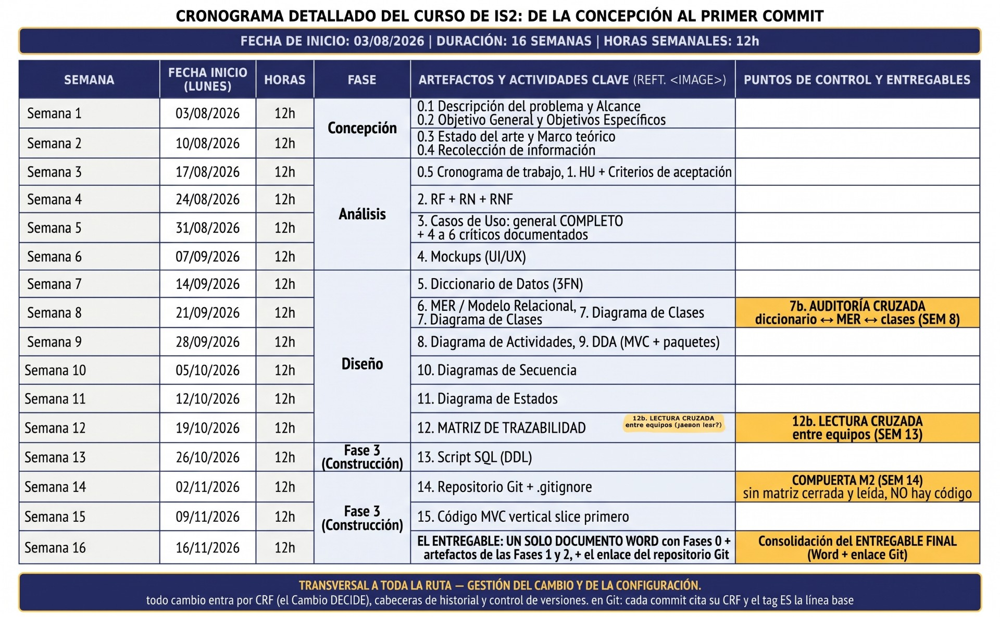

# 00.5 Cronograma de Trabajo

**Proyecto:** Sistema de Gestión de Solicitudes de Talento Humano  
**Organización:** Nexa Servicios  
**Fase:** Concepción (Semanas 1–2)  
**Artefactos del Cronograma:** 0.5 Cronograma de trabajo y compuertas de control  

---

## 7.2 Cronograma de Trabajo del Proyecto

Plan académico de **16 semanas** iniciado el lunes 3 de agosto de 2026. Cada semana contempla 4 horas presenciales y 8 horas de trabajo autónomo (12 horas semanales); el total previsto para el desarrollo del proyecto es de **192 horas**. Los responsables que aparecen en la tabla constituyen la distribución operativa del equipo entre Javier Bernal Garavito y Jhulius Karol Escobar Gómez.

### Tabla 3. Cronograma de trabajo del proyecto (16 Semanas)

| Semana | Inicio (lunes) | Horas | Fase | Artefactos y actividades clave | Punto de control y entregable | Responsable propuesto |
| --- | --- | --- | --- | --- | --- | --- |
| 1 | 03/08/2026 | 12 h 4 + 8 | Concepción | 0.1 Problema y alcance; 0.2 objetivo general y objetivos específicos. | Problema, alcance y objetivos coherentes con las entidades del modelo. Documento: secciones 1, 4 y 5. | Javier Bernal; Jhulius Escobar revisa |
| 2 | 10/08/2026 | 12 h 4 + 8 | Concepción | 0.3 Estado del arte y marco teórico; 0.4 recolección de información. | Fuentes documentadas; encuesta analizada. Entrevista solo si existe evidencia real. Documento: secciones 2, 3 y 6. | Jhulius Escobar; Javier Bernal revisa |
| 3 | 17/08/2026 | 12 h 4 + 8 | Análisis | 0.5 Cronograma; 1 HU inicial con criterios de aceptación. | Cronograma de 16 semanas; HU con criterios verificables y rechazo. Documento: secciones 7.2 y 8.1. | Javier Bernal; Jhulius Escobar revisa |
| 4 | 24/08/2026 | 12 h 4 + 8 | Análisis | 2. RF, RN y RNF. | Fichas completas, priorizadas y enlazadas con las HU. Documento: secciones 9, 10 y 11. | Jhulius Escobar; Javier Bernal revisa |
| 5 | 31/08/2026 | 12 h 4 + 8 | Análisis | 3. Diagrama general de casos de uso; 4 a 6 casos críticos documentados. | Selección crítica justificada; flujos alternos trazados a criterios de rechazo. Documento: secciones 13.1 a 13.15. | Javier Bernal; Jhulius Escobar revisa |
| 6 | 07/09/2026 | 12 h 4 + 8 | Análisis | 4. Mockups UI/UX. | Pantallas vinculadas a HU, casos de uso y datos del modelo. Documento: secciones 14.1 a 14.12. | Jhulius Escobar; Javier Bernal revisa |
| 7 | 14/09/2026 | 12 h 4 + 8 | Diseño | 5. Diccionario de datos y revisión lógica de 1FN, 2FN y 3FN. | Entidades, campos, claves y dependencias documentados; revisión del DDL queda con el responsable SQL. Documento: secciones 15 y 15.31. | Javier Bernal; Jhulius Escobar revisa |
| 8 | 21/09/2026 | 12 h 4 + 8 | Diseño | 6. MER/modelo relacional; 7. diagrama de clases. | Auditoría cruzada: diccionario ↔ MER ↔ clases. Documento: secciones 16 y 17; contraste cruzado en 18. | Jhulius Escobar; Javier Bernal revisa |
| 9 | 28/09/2026 | 12 h 4 + 8 | Diseño | 8. Diagramas de actividades; 9. DDA (MVC y paquetes). | Flujos y arquitectura alineados con requisitos y clases. Documento: diagramas de actividad y DDA en 16.6. | Javier Bernal; Jhulius Escobar revisa |
| 10 | 05/10/2026 | 12 h 4 + 8 | Diseño | 10. Diagramas de secuencia. | Participantes, mensajes y respuestas coherentes con casos y métodos documentados. Documento: secuencias de registro y decisión en 16.6. | Jhulius Escobar; Javier Bernal revisa |
| 11 | 12/10/2026 | 12 h 4 + 8 | Diseño | 11. Diagrama de estados. | Transiciones justificadas por HU, RF y reglas de negocio. Documento: estados de Solicitud en 16.6. | Javier Bernal; Jhulius Escobar revisa |
| 12 | 19/10/2026 | 12 h 4 + 8 | Diseño | 12. Matriz integral de trazabilidad. | Matriz única; control de HU, RF, criterios, casos, clases y datos. Documento: matriz integral de trazabilidad en la sección 14.13. | Jhulius Escobar; Javier Bernal revisa |
| 13 | 26/10/2026 | 12 h 4 + 8 | Construcción | 13. Script SQL (DDL), a cargo del compañero responsable del SQL. | Lectura cruzada entre equipos (12b); revisar el DDL con el diccionario. Documento: diccionario 15 y cruce MySQL 19; SQL a cargo del compañero. | Compañero responsable del SQL; revisión del equipo |
| 14 | 02/11/2026 | 12 h 4 + 8 | Construcción | 14. Repositorio Git y archivo .gitignore. | Compuerta M2: no integrar código sin matriz cerrada y revisada. Añadir enlace del repositorio. Documento: compuerta M2 y enlace al repositorio. Repositorio: Talento-humano- | Javier Bernal; Jhulius Escobar revisa |
| 15 | 09/11/2026 | 12 h 4 + 8 | Construcción | 15. Primer vertical slice de código MVC. | Primer flujo funcional vertical y trazable, según la matriz aprobada. Documento: hito en 7.2; trazabilidad en 14.13; evidencia en el repositorio Git. | Jhulius Escobar; Javier Bernal revisa |
| 16 | 16/11/2026 | 12 h 4 + 8 | Construcción | Consolidar un solo Word con Fase 0 y artefactos de Fases 1 y 2, más enlace Git. | Entrega final consolidada (Word + enlace del repositorio). Documento: consolidación Word y enlace Git en 18.1 y 19. Repositorio: Talento-humano- | Javier Bernal y Jhulius Escobar |

---

## Gestión Transversal del Cambio y la Configuración

* **Solicitudes Formales de Cambio (CRF):** Cada solicitud formal de cambio se registra y se decide antes de incorporarla al código o a la documentación.
* **Trazabilidad en Control de Versiones:** El commit asociado debe citar el código CRF correspondiente. La etiqueta ES identifica la línea base.
* **Compuerta de Calidad M2 (Semana 14):** No se integrará código fuente ni slices verticales en el repositorio sin que la Matriz Integral de Trazabilidad esté debidamente cerrada, auditada y revisada por el equipo.

---

## Diagrama Gráfico del Cronograma

A continuación se referencia la representación visual del cronograma de trabajo:

