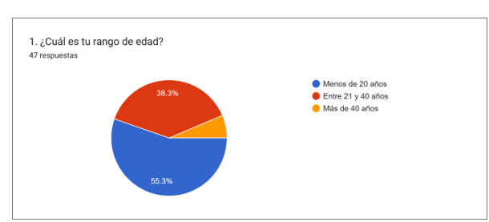
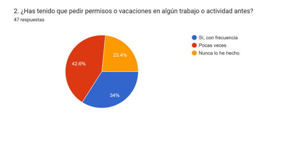
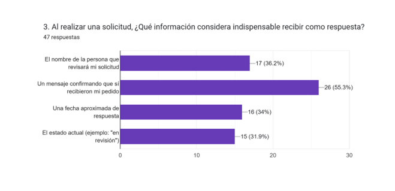
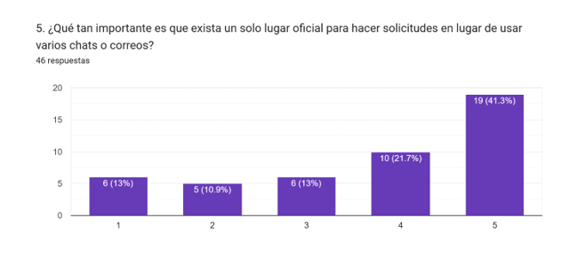
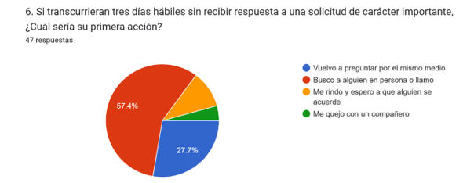
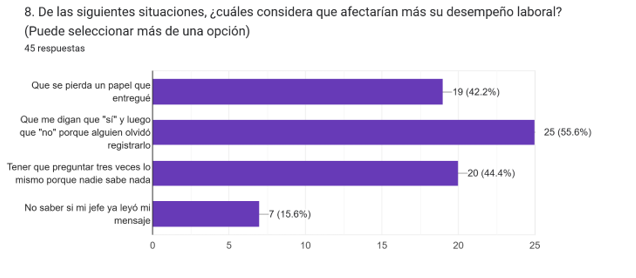
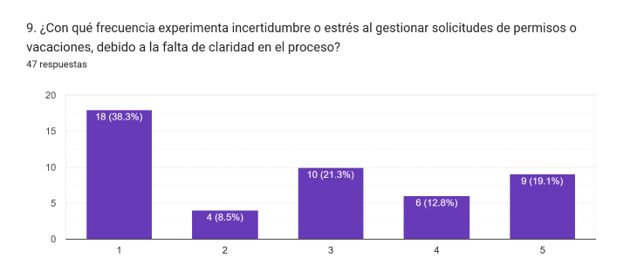
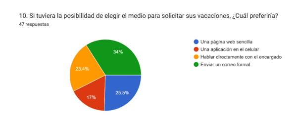

# 0. Fase 0: Concepción

**Proyecto:** Sistema de Gestión de Solicitudes de Talento Humano  
**Organización:** Nexa Servicios  
**Documento Fuente:** *Nexa servicios talento humano definitivo actual.docx*  
**Autores:** Javier Bernal Garavito | Jhulius Karol Escobar Gómez  
**Docente:** Prof. Gloria Amparo Lora Patiño — Universidad Remington  

---

## 1.1 Planteamiento del problema y alcance

En las organizaciones actuales, la gestión eficiente de la información y la correcta coordinación de actividades internas dependen en gran medida del uso de sistemas digitales que permitan registrar, controlar y dar seguimiento a los procesos administrativos, especialmente en áreas críticas como Talento Humano. No obstante, aún existen organizaciones que gestionan sus procesos mediante canales informales de comunicación, como aplicaciones de mensajería instantánea, correos electrónicos o documentos dispersos, lo que genera limitaciones en el control de la información y en la trazabilidad de los procesos.

En la empresa Nexa Servicios, esta problemática se evidencia de manera particular en el área de Talento Humano, específicamente en la gestión de solicitudes relacionadas con permisos laborales, vacaciones, certificaciones laborales e incapacidades médicas. Actualmente, estas solicitudes son tramitadas a través de medios no estructurados como WhatsApp, correos electrónicos y archivos de hojas de cálculo compartidos, sin la existencia de un sistema centralizado que permita registrar de forma organizada cada solicitud, asignar responsables, definir estados del proceso y conservar un historial detallado de las acciones realizadas.

Como consecuencia de esta situación, se presentan múltiples dificultades operativas, entre las cuales destacan la pérdida de información, la duplicidad de solicitudes, la falta de claridad en la asignación de responsabilidades y la imposibilidad de realizar un seguimiento adecuado del estado de cada solicitud. Esta ausencia de control estructurado impacta negativamente la eficiencia de los procesos del área de Talento Humano, generando retrasos en la atención de solicitudes y afectando la calidad del servicio interno ofrecido a los colaboradores.

Adicionalmente, la inexistencia de un sistema formal de gestión limita la capacidad de la gerencia para supervisar los procesos y tomar decisiones fundamentadas en información confiable. La falta de registros históricos impide analizar el comportamiento de las solicitudes, identificar cuellos de botella, evaluar tiempos de respuesta y establecer estrategias de mejora continua en la gestión del talento humano.

En el ámbito académico y organizacional, diversos estudios sobre Business Process Management (BPM) y Workflow Management han demostrado que la implementación de sistemas orientados a la gestión de procesos permite mejorar significativamente la eficiencia operativa, al facilitar el registro, control y seguimiento de las actividades. De igual manera, los Human Resource Information Systems (HRIS) han evidenciado su impacto positivo en la digitalización de los procesos de Talento Humano, optimizando el acceso a la información, fortaleciendo la trazabilidad y mejorando la toma de decisiones.

En este contexto, surge la necesidad de diseñar una solución tecnológica orientada al área de Talento Humano de la empresa Nexa Servicios, que permita registrar, gestionar y dar seguimiento a las solicitudes de permisos, vacaciones, certificaciones e incapacidades médicas, mediante la centralización de la información, la asignación de responsables y la implementación de mecanismos de trazabilidad. Esta solución busca mejorar la organización de los procesos internos, reducir las ineficiencias operativas y fortalecer la gestión de la información dentro de la organización.

### Alcance del Proyecto

El proyecto consiste en el **diseño y construcción de un sistema de gestión de solicitudes de Talento Humano** para la empresa Nexa Servicios. Este sistema centralizará la administración de permisos laborales, vacaciones, certificaciones laborales e incapacidades médicas.

#### Módulos del Sistema:
1. **Gestión de Permisos Laborales:** Registro con fechas, motivo y tipo; aprobación o rechazo por el responsable asignado; cálculo derivado de días de ausencia.
2. **Gestión de Vacaciones:** Solicitud con validación previa de saldo disponible por período en SaldoVacaciones; control de fechas válidas y registro de motivo.
3. **Gestión de Certificaciones Laborales:** Radicación de solicitudes por el empleado; generación del certificado digital únicamente cuando la solicitud se encuentre en estado **Aprobada**; descarga para el colaborador.
4. **Gestión de Incapacidades Médicas:** Registro de fechas, tipo de incapacidad y carga obligatoria de soporte médico/clínico para completar el trámite.
5. **Servicios de Trazabilidad y Control:** Autenticación por roles (ACT-01 a ACT-04), recuperación de clave por mecanismo temporal, asignación de responsables con motivo obligatorio, notificaciones y auditoría inmutable (AuditoriaSistema y DetalleAuditoria).

#### Límites y Exclusiones:
El sistema se enfoca en el control operativo, seguimiento y trazabilidad de las solicitudes de Talento Humano. No incluye la liquidación financiera ni el pago de nómina, ni la administración directa de prestaciones sociales o pagos bancarios.

---

## 1.2 Objetivos del proyecto

### Objetivo General

Diseñar un sistema de gestión de solicitudes para el área de Talento Humano de la empresa Nexa Servicios, que permita registrar, gestionar y realizar seguimiento a las solicitudes de permisos laborales, vacaciones, certificaciones laborales e incapacidades médicas, mediante la centralización de la información, la asignación de responsables y el registro del historial de cada proceso, con el fin de mejorar la trazabilidad, la organización y la eficiencia en la gestión de las solicitudes.

### Objetivos específicos

1. Analizar el proceso actual de gestión de solicitudes del área de Talento Humano de Nexa Servicios, identificando las principales dificultades relacionadas con la creación (registro), consulta, actualización, inactivación o cancelación lógica, seguimiento y trazabilidad de los permisos laborales, vacaciones, certificaciones laborales e incapacidades médicas.
2. Establecer los requerimientos funcionales, no funcionales y reglas de negocio del sistema a partir de las necesidades identificadas, definiendo las operaciones aplicables de crear (radicación de solicitudes, carga de documentos soporte, emisión de certificados, notificaciones, reportes y trazas), consultar (búsqueda por radicado, filtros operativos, saldos, historial y auditoría), actualizar (aprobación, rechazo, puesta en revisión, edición en estado permitido y reasignación) e inactivar o cancelar lógicamente registros (sin eliminación física en base de datos).
3. Diseñar la estructura de información y el funcionamiento del sistema mediante el modelo relacional, el diccionario de datos, el modelo orientado a objetos y las interfaces necesarias para registrar, consultar, actualizar e inactivar lógicamente las solicitudes del área de Talento Humano.
4. Evaluar la correspondencia de la solución propuesta mediante la trazabilidad de requerimientos y casos de uso en relación con la organización de la información, el seguimiento de las solicitudes, el control de las actividades y la integridad histórica de los procesos de Talento Humano.

---

## 1.3 Estado del arte

2. Estado del arte

### Tabla 1. Referentes de talento humano y gestión de procesos

| Autor / Organización | Año | Tipo de fuente | Problema que aborda | Enfoque / solución propuesta | Tecnología o metodología | Resultados principales | Limitaciones | Aporte al proyecto |
| --- | --- | --- | --- | --- | --- | --- | --- | --- |
| McKinsey & Company | 2025 | Reporte de industria | Ineficiencia en procesos administrativos | Digitalización de procesos empresariales | Transformación digital | Incremento en eficiencia operativa | Alto costo de implementación | Justifica la necesidad de digitalizar procesos en Talento Humano |
| Deloitte | 2024 | Reporte de industria | Desorganización en la gestión del talento humano | Implementación de plataformas digitales HR | HR Tech | Mejora en la coordinación organizacional | Requiere cambio cultural | Sustenta la digitalización de procesos de Talento Humano |
| Gartner | 2024 | Análisis de mercado | Falta de integración en sistemas de RRHH | Plataformas tecnológicas integradas | HRIS | Mejor control y visibilidad de procesos | Acceso limitado a reportes especializados | Fundamenta la adopción de sistemas HRIS |
| ServiceNow | 2024 | Solución tecnológica | Gestión manual de solicitudes en RRHH | HR Service Delivery | Automatización de workflows | Seguimiento centralizado de solicitudes | Costos elevados | Referente de sistemas de gestión de solicitudes en Talento Humano |
| SAP | 2023 | Plataforma empresarial | Desorganización en procesos de RRHH | SAP SuccessFactors | HRIS | Centralización de información del talento humano | Implementación compleja | Ejemplo de gestión estructurada de información en HR |
| Atlassian | 2023 | Software | Falta de seguimiento a solicitudes internas | Jira Service Management | Sistema de tickets | Mejora en la trazabilidad de solicitudes | No especializado en Talento Humano | Modelo de control y seguimiento de solicitudes |
| Camunda | 2023 | Tecnología BPM | Procesos manuales poco eficientes | Automatización de procesos empresariales | BPMN | Mejora en el control de procesos | Curva de aprendizaje | Apoya el modelado de flujos de trabajo |
| ProcessMaker | 2024 | Plataforma BPM | Procesos administrativos manuales | BPM Low-Code | Automatización de workflows | Reducción de tiempos de proceso | Dependencia tecnológica | Referente en automatización de procesos organizacionales |
| Celonis | 2023 | Process Mining | Falta de visibilidad de procesos | Análisis de procesos empresariales | Process Mining | Identificación de cuellos de botella | Requiere datos estructurados | Apoya el análisis de trazabilidad de procesos |
| Bizneo HR | 2024 | Software HR | Procesos de Talento Humano dispersos | Sistema de gestión de RRHH | HR Software | Centralización de solicitudes y datos | Dependencia del proveedor | Ejemplo directo de sistema HR para gestión de solicitudes |
| Van der Aalst | 2023 | Investigación académica | Falta de análisis en procesos organizacionales | Process Mining | BPM | Optimización de flujos de trabajo | Requiere registros estructurados | Fundamenta el análisis de procesos |
| Dumas et al. | 2023 | Libro académico | Complejidad en procesos organizacionales | Business Process Management | BPM | Mejora en la gestión organizacional | Implementación progresiva | Base teórica para el diseño de procesos |
| Stone et al. | 2022 | Investigación HR | Ineficiencia en la gestión del talento humano | Sistemas de información HR | HRIS | Mejora en la toma de decisiones | Requiere digitalización previa | Fundamenta el uso de sistemas HR |
| Marler & Boudreau | 2021 | Investigación académica | Bajo uso de datos en RRHH | HR Analytics | Analítica de datos | Mejora en decisiones estratégicas | Dependencia de calidad de datos | Refuerza la importancia de datos estructurados |
| Bondarouk & Brewster | 2021 | Investigación HR | Procesos manuales en Talento Humano | e-HRM | Sistemas digitales HR | Automatización de procesos administrativos | Resistencia al cambio organizacional | Apoya la transformación digital en HR |
| Microsoft | 2023 | Tecnología | Procesos repetitivos administrativos | Power Automate | Automatización de procesos | Optimización de tareas | Dependencia del ecosistema | Apoya la automatización de flujos |
| IBM | 2024 | Tecnología | Procesos manuales organizacionales | Business Automation | Automatización inteligente | Mejora en eficiencia operativa | Complejidad técnica | Referente en automatización empresarial |
| Oracle | 2023 | Software empresarial | Gestión fragmentada de RRHH | Oracle HCM Cloud | HRIS | Centralización de procesos de Talento Humano | Costos elevados | Ejemplo de gestión integral HR |
| UiPath | 2023 | Tecnología RPA | Tareas administrativas repetitivas | Automatización robótica de procesos | RPA | Reducción del trabajo manual | No cubre procesos completos | Complementa automatización de tareas |
| Appian | 2024 | Plataforma BPM | Procesos empresariales lentos | BPM Low-Code | Workflow automation | Mejora en eficiencia operativa | Dependencia de plataforma | Apoya la gestión de procesos |

> **Nota.** Este cuadro se conserva como inventario exploratorio del documento previo. Las filas sin título, URL o referencia bibliográfica completa no se usan como evidencia cuantitativa ni como citas verificadas; sus datos de fuente deben completarse antes de atribuirles resultados específicos.

---

## 1.4 Marco Teórico

3.  Marco Teórico

El diseño de soluciones tecnológicas orientadas a la gestión organizacional requiere la comprensión de fundamentos teóricos relacionados con la gestión de procesos, los sistemas de información, la trazabilidad y la estructuración de flujos de trabajo, especialmente en áreas estratégicas como Talento Humano. Estos conceptos permiten formalizar las actividades internas de una organización, optimizar la gestión de la información y mejorar la eficiencia en la ejecución de procesos administrativos.

En el contexto de la gestión de solicitudes de Talento Humano —como permisos laborales, vacaciones, certificaciones e incapacidades médicas—, la aplicación de estos enfoques resulta fundamental para garantizar el control, seguimiento y organización de las actividades, así como para fortalecer la toma de decisiones basada en información estructurada y confiable.

### 1.4.1 Gestión de Procesos Organizacionales (Business Process Management – BPM)

La Gestión de Procesos Organizacionales, conocida como Business Process Management (BPM), es un enfoque metodológico orientado al análisis, modelado, diseño y mejora continua de los procesos dentro de una organización. Un proceso organizacional se define como un conjunto estructurado de actividades interrelacionadas que transforman una necesidad en un resultado que genera valor (Dumas et al., 2018).

En el área de Talento Humano, los procesos asociados a la gestión de solicitudes —como la aprobación de permisos, la validación de incapacidades o la emisión de certificaciones laborales— requieren una secuencia definida de actividades, reglas claras y roles específicos. Cuando estos procesos no se encuentran formalmente establecidos, las actividades tienden a ejecutarse de manera informal, lo que genera desorganización, duplicidad de tareas, retrasos y dificultades en la asignación de responsabilidades.

El enfoque BPM propone la estructuración de los procesos mediante la definición de flujos de trabajo, la asignación de responsables y la estandarización de procedimientos, lo que permite mejorar la coordinación entre los actores involucrados, optimizar los recursos y fortalecer el control organizacional. En este proyecto, BPM constituye la base conceptual para el diseño de los procesos de gestión de solicitudes dentro del área de Talento Humano.

### 1.4.2 Sistemas de Información para la Gestión del Talento Humano (HRIS)

Los Sistemas de Información para la Gestión del Talento Humano, conocidos como Human Resource Information Systems (HRIS), son plataformas tecnológicas diseñadas para gestionar, almacenar y procesar información relacionada con los empleados y los procesos del área de Talento Humano (Polivka & Dvorakova, 2021).

Estos sistemas permiten integrar diferentes funciones administrativas en un entorno digital centralizado, facilitando la gestión de información como datos laborales, solicitudes internas, historiales de empleados y procesos administrativos. Dentro de un HRIS, la gestión de solicitudes (permisos, vacaciones, incapacidades y certificaciones) se considera un componente clave para la organización y control de las actividades internas.

La implementación de sistemas HRIS contribuye a mejorar la disponibilidad de la información, reducir errores asociados a la gestión manual, optimizar los tiempos de respuesta y fortalecer la toma de decisiones. En el contexto del presente proyecto, este enfoque proporciona la base para el diseño de un sistema que centralice la gestión de solicitudes del área de Talento Humano en Nexa Servicios.

### 1.4.3 Gestión de Flujos de Trabajo (Workflow Management)

La gestión de flujos de trabajo, o Workflow Management, es un enfoque que se centra en la definición, ejecución y control de las secuencias de actividades que conforman un proceso organizacional. Este concepto permite modelar cómo una tarea o solicitud fluye a través de diferentes etapas y actores dentro de la organización.

En la gestión de solicitudes de Talento Humano, el workflow define el recorrido que sigue una solicitud desde su creación hasta su resolución, incluyendo etapas como registro, revisión, aprobación, rechazo o cierre. Cada una de estas etapas implica la participación de diferentes roles y la aplicación de reglas específicas que determinan el avance del proceso.

La implementación de flujos de trabajo estructurados permite garantizar que todas las solicitudes sigan un proceso definido, reduciendo la posibilidad de errores, evitando reprocesos y mejorando la eficiencia operativa. En este proyecto, el concepto de workflow es fundamental para diseñar los procesos internos del sistema, asegurando la correcta gestión y seguimiento de las solicitudes.

### 1.4.4 Trazabilidad de la Información en Procesos Organizacionales

La trazabilidad de la información se refiere a la capacidad de registrar y seguir el historial completo de un proceso desde su inicio hasta su finalización. En el contexto organizacional, este concepto permite conocer en detalle cada una de las acciones realizadas sobre una solicitud, así como los responsables y los momentos en los que dichas acciones ocurrieron.

En el área de Talento Humano, la trazabilidad es un elemento esencial para garantizar el control de las solicitudes, ya que permite identificar quién realizó la solicitud, quién la gestionó, qué decisiones fueron tomadas y cuál fue su resultado final. Este nivel de detalle resulta fundamental para asegurar la transparencia, la rendición de cuentas y el control interno.

Además, la trazabilidad facilita la identificación de fallas en los procesos, la detección de retrasos y el análisis del desempeño organizacional. Cuando no existen mecanismos de trazabilidad, las organizaciones enfrentan dificultades para reconstruir los procesos, lo que puede generar pérdida de información, inconsistencias y limitaciones en la toma de decisiones (Laudon & Laudon, 2020).

### 1.4.5 Gestión de la Información y Control de Versiones

La gestión de la información hace referencia al conjunto de prácticas orientadas a garantizar la organización, almacenamiento, acceso y uso adecuado de los datos dentro de una organización. En este contexto, el control de versiones es una técnica que permite registrar las modificaciones realizadas sobre documentos, solicitudes o registros a lo largo del tiempo.

En la gestión de solicitudes de Talento Humano, el control de versiones permite mantener un historial de cambios, como actualizaciones en los datos de una solicitud, modificaciones en su estado o decisiones tomadas durante el proceso. Esto garantiza la integridad de la información y permite identificar la evolución de cada solicitud.

Por otra parte, la documentación de procesos establece lineamientos claros sobre cómo deben ejecutarse las actividades, facilitando la comprensión de los procedimientos y asegurando la continuidad operativa. La combinación de gestión de la información, control de versiones y documentación contribuye a fortalecer la trazabilidad, mejorar la organización de los datos y respaldar las decisiones tomadas dentro del área de Talento Humano.

---

## 1.5 Recolección y análisis de información (Encuesta)

### 1.5.1 Fuentes, método y alcance de recolección

6.1 Fuentes, método y alcance de recolección

Se revisó el archivo de respuestas de la encuesta de procesos internos y experiencia laboral: 47 registros con marca temporal entre el 11 de abril y el 9 de mayo de 2026 y diez preguntas cerradas, de selección múltiple, escala y abiertas. Los conteos y porcentajes de las preguntas cerradas se recalcularon y coinciden con las filas de respuesta. Hubo 47 respuestas en las preguntas 1, 2, 3, 6, 9 y 10; 46 en las preguntas 4 y 5; 43 en la 7 y 45 en la 8. Los resultados describen a quienes respondieron; el archivo no documenta el método de selección de la muestra. Las fuentes documentales contrastadas incluyen RF, RN, RNF, casos de uso, diccionario de datos y modelos del proyecto.

### Detalle de Resultados por Pregunta

#### Pregunta 1: Rango de edad
*¿Cuál es tu rango de edad?*
¿Cuál es tu rango de edad?
Esta pregunta permitió caracterizar la distribución etaria de los 47 participantes de la encuesta (n = 47). El grupo mayoritario corresponde a menores de 20 años con 55,3 % (26 respuestas), seguido del rango de 21 a 40 años con 38,3 % (18 respuestas) y de mayores de 40 años con 6,4 % (3 respuestas). Este resultado describe únicamente la composición demográfica de la muestra consultada, sin inferir hábitos digitales solo a partir de la edad.

#### Figura 1. Distribución por rango de edad (Pregunta 1; n = 47)

#### Pregunta 2: Experiencia solicitando permisos
*¿Has tenido que pedir permisos o vacaciones en algún trabajo o actividad antes?*
¿Has tenido que pedir permisos o vacaciones en algún trabajo o actividad antes?
Sobre un total de 47 respuestas (n = 47), el 42,6 % (20 personas) indicó haber solicitado permisos o vacaciones pocas veces y el 34,0 % (16 personas) afirmó haberlo hecho con frecuencia, lo que suma un 76,6 % (36 participantes) con experiencia previa en este tipo de trámites, frente a un 23,4 % (11 personas) que nunca lo ha hecho. Esto muestra que más de tres cuartas partes de los encuestados conocen el trámite por experiencia directa.

#### Figura 2. Experiencia previa al solicitar permisos o vacaciones (Pregunta 2; n = 47)

#### Pregunta 3: Información importante al realizar una solicitud
*Al realizar una solicitud, ¿qué información considera indispensable recibir como respuesta?*
Al realizar una solicitud, ¿qué información considera indispensable recibir como respuesta?
En esta pregunta de selección múltiple (n = 47, por lo que los porcentajes suman más de 100 % al calcularse sobre 47 encuestados), la información más valorada al radicar una solicitud fue recibir confirmación de recibido con 55,3 % (26 menciones), seguida de conocer el nombre de quien revisará la solicitud con 36,2 % (17 menciones), la fecha aproximada de respuesta con 34,0 % (16 menciones) y el estado actual del trámite con 31,9 % (15 menciones). Estos datos sustentan los requisitos de radicado único, asignación visible de responsable y consulta de estado.

#### Figura 3. Información que se espera al radicar una solicitud (Pregunta 3; n = 47)

#### Pregunta 4: Permiso urgente sin un canal claro
*Si mañana necesitara gestionar un permiso urgente y desconociera el canal o responsable al que dirigirse, ¿cómo describiría esa experiencia y qué acciones tomaría?*
Si mañana necesitara gestionar un permiso urgente y desconociera el canal o responsable al que dirigirse, ¿cómo describiría esa experiencia y qué acciones tomaría?
De 47 participantes, 46 respondieron esta pregunta abierta y una respuesta quedó vacía. Varias respuestas expresan confusión sobre el canal y proponen consultar a un superior, compañeros o al área responsable; también hay contestaciones breves o ambiguas. Se interpreta como evidencia cualitativa de la necesidad de orientar el trámite, sin asignar porcentajes ni generalizar la frecuencia de esas experiencias.

#### Pregunta 5: Importancia de un único lugar oficial
*¿Qué tan importante es que exista un solo lugar oficial para hacer solicitudes en lugar de usar varios chats o correos?*
¿Qué tan importante es que exista un solo lugar oficial para hacer solicitudes en lugar de usar varios chats o correos?
En la escala de 1 a 5 (con n = 46 respuestas válidas y 1 no respuesta sobre los 47 participantes), el nivel 5 (muy importante) obtuvo 41,3 % (19 respuestas) y el nivel 4 alcanzó 21,7 % (10 respuestas), concentrando conjuntamente el 63,0 % (29 de 46) en valoración alta; el nivel intermedio 3 registró 13,0 % (6 respuestas), el nivel 2 obtuvo 10,9 % (5 respuestas) y el nivel 1 registró 13,0 % (6 respuestas). Ello respalda la centralización de las solicitudes en un canal oficial.

#### Figura 4. Importancia de contar con un canal oficial único (Pregunta 5; n = 46 respuestas válidas)

#### Pregunta 6: Falta de respuesta después de varios días
*Si transcurrieran tres días hábiles sin recibir respuesta a una solicitud importante, ¿cuál sería su primera acción?*
Si transcurrieran tres días hábiles sin recibir respuesta a una solicitud importante, ¿cuál sería su primera acción?
Ante el escenario hipotético de tres días hábiles sin respuesta (n = 47), el 57,4 % (27 participantes) dice que buscaría a alguien en persona o llamaría, el 27,7 % (13) volvería a preguntar por el mismo medio, el 10,6 % (5) esperaría sin insistir y el 4,3 % (2) lo comentaría con un compañero. En conjunto, el 85,1 % (40 de 47) plantea hacer seguimiento manual; el resultado respalda considerar notificaciones automáticas y alertas por inactividad mayor a tres días.

#### Figura 5. Acción ante tres días hábiles sin respuesta (Pregunta 6; n = 47)

#### Pregunta 7: Retrasos o pérdida de solicitudes
*¿Ha experimentado alguna vez el extravío de una solicitud o una respuesta considerablemente tardía?*
¿Ha experimentado alguna vez el extravío de una solicitud o una respuesta considerablemente tardía?
De 47 participantes, 43 respondieron esta pregunta abierta y 4 la dejaron en blanco. Algunas respuestas describen demoras y efectos en la organización de actividades; otras se limitan a sí o no, o son demasiado breves o ambiguas para codificarlas con fiabilidad. Por ello se presentan como evidencia cualitativa, sin porcentajes. Esta pregunta no permite sostener cuantitativamente el extravío de documentos; esa preocupación aparece como situación percibida en la pregunta 8.

#### Pregunta 8: Situaciones que afectan el desempeño
*¿Cuáles considera que afectarían más su desempeño laboral?*
¿Cuáles considera que afectarían más su desempeño laboral?
Las opciones disponibles eran (podían elegir más de una): que se pierda un papel que entregué, que me digan que "sí" y luego que "no" porque alguien olvidó registrarlo, tener que preguntar tres veces lo mismo porque nadie sabe nada, y no saber si mi jefe ya leyó mi mensaje.
Hallazgo: En esta pregunta de selección múltiple (n = 45 participantes y 2 sin respuesta), las opciones describen situaciones que afectarían el desempeño, no incidentes que cada persona afirme haber vivido. La más seleccionada fue recibir un sí y luego un no por falta de registro, con 55,6 % (25 menciones), seguida de tener que preguntar varias veces con 44,4 % (20), la pérdida de un papel entregado con 42,2 % (19) y no saber si el jefe leyó el mensaje con 15,6 % (7). Los resultados muestran riesgos percibidos y respaldan priorizar el registro formal y la trazabilidad, sin estimar la incidencia real de esos problemas.

#### Figura 6. Situaciones que afectan el desempeño laboral (Pregunta 8; n = 45 respuestas válidas)

#### Pregunta 9: Nivel de incertidumbre
*¿Con qué frecuencia experimenta incertidumbre o estrés al gestionar solicitudes de permisos o vacaciones, debido a la falta de claridad en el proceso?*
¿Con qué frecuencia experimenta incertidumbre o estrés al gestionar solicitudes de permisos o vacaciones, debido a la falta de claridad en el proceso?
Esta pregunta usó una escala del 1 (poca incertidumbre) al 5 (mucha incertidumbre).
Hallazgo: En la escala de 1 a 5 (n = 47), el nivel 1 (poca incertidumbre) registró el valor individual más alto con 38,3 % (18 respuestas) y el nivel 2 obtuvo 8,5 % (4 respuestas), sumando 46,8 % (22 personas) en niveles bajos; sin embargo, el nivel 3 concentró 21,3 % (10 respuestas), el nivel 4 registró 12,8 % (6 respuestas) y el nivel 5 (mucha incertidumbre) alcanzó 19,1 % (9 respuestas). Así, los niveles altos (4 y 5) representan el 31,9 % (15 personas) y el conjunto de incertidumbre moderada a alta (niveles 3 a 5) abarca el 53,2 % (25 de 47 participantes).

#### Figura 7. Nivel de incertidumbre al gestionar solicitudes (Pregunta 9; n = 47)

#### Pregunta 10: Medio preferido para hacer solicitudes
*Si tuviera la posibilidad de elegir el medio para solicitar sus vacaciones, ¿cuál preferiría?*
Si tuviera la posibilidad de elegir el medio para solicitar sus vacaciones, ¿cuál preferiría?
Las opciones disponibles eran: una página web sencilla, una aplicación en el celular, hablar directamente con el encargado, o enviar un correo formal.
Hallazgo: Entre los 47 participantes (n = 47), la opción con mayor frecuencia individual fue «enviar un correo formal» con 34,0 % (16 respuestas), seguida de «una página web sencilla» con 25,5 % (12 respuestas), «hablar directamente con el encargado» con 23,4 % (11 respuestas) y «una aplicación en el celular» con 17,0 % (8 respuestas). Aunque el correo formal lidera de manera individual, las alternativas de plataforma interactiva (página web sencilla más aplicación móvil) suman el 42,6 % (20 respuestas), y el total de canales digitales o escritos con registro (correo formal, web y aplicación móvil) alcanza el 76,6 % (36 de 47), frente al 23,4 % verbal.

#### Figura 8. Medio preferido para solicitar vacaciones (Pregunta 10; n = 47)

---

## 1.6 Problemas identificados y conclusiones

### Tabla 2. Problemas identificados en la gestión de solicitudes

| Código | Problema identificado |
| --- | --- |
| P-01 | Las solicitudes de los empleados no se pueden seguir fácilmente. A veces nadie sabe en qué van o quién las tiene. |
| P-02 | Las personas hacen solicitudes por muchos lugares diferentes: WhatsApp, correos, mensajes o hablando directamente. Eso causa desorden. |
| P-03 | Algunas solicitudes se pierden porque no existe un solo lugar donde queden guardadas. |
| P-04 | No está claro quién debe revisar o aprobar las solicitudes. |
| P-05 | Los permisos y vacaciones tardan mucho tiempo en ser aprobados. |
| P-06 | No existe un historial digital para revisar solicitudes antiguas cuando se necesitan. |
| P-07 | Los empleados se sienten preocupados o estresados porque no saben qué pasó con sus solicitudes. |
| P-08 | La información de permisos, vacaciones y solicitudes está regada en diferentes lugares y no organizada en uno solo. |
| P-09 | Es difícil saber en tiempo real si una solicitud ya fue aprobada, rechazada o sigue pendiente. |
| P-10 | El sistema no avisa automáticamente cuando una solicitud fue recibida o cuando tuvo algún avance. |
| P-11 | La comunicación entre los empleados y Talento Humano no es rápida ni eficiente. |
| P-12 | Como muchas cosas se hacen manualmente, pueden ocurrir errores o confusiones en las aprobaciones y registros. |

### Conclusiones del análisis y recolección de información

7.1 Conclusiones del análisis y recolección de información

En conjunto, la encuesta orienta a priorizar un canal oficial, confirmación de radicación, responsable y estado visibles, avisos oportunos e historial verificable. La pregunta 6 recoge una reacción ante un escenario hipotético y la pregunta 8 indaga situaciones que las personas consideran perjudiciales; ninguna mide directamente la tasa de fallas del proceso institucional. Los resultados son descriptivos de quienes respondieron y el archivo no documenta un método de selección aleatoria, por lo que no se generalizan a toda la población.

Trazabilidad de los artefactos: las 40 HU consolidadas se relacionan con los 62 RF, reglas, casos de uso, actores, mockups y fuentes de evidencia. El cronograma y sus entregables están en la sección 7.2; el cotejo del DDL y de los objetos MySQL descritos por el equipo se documenta en las secciones 14.13 y 19. No se atribuyen al DDL objetos que no estén en ese archivo.
