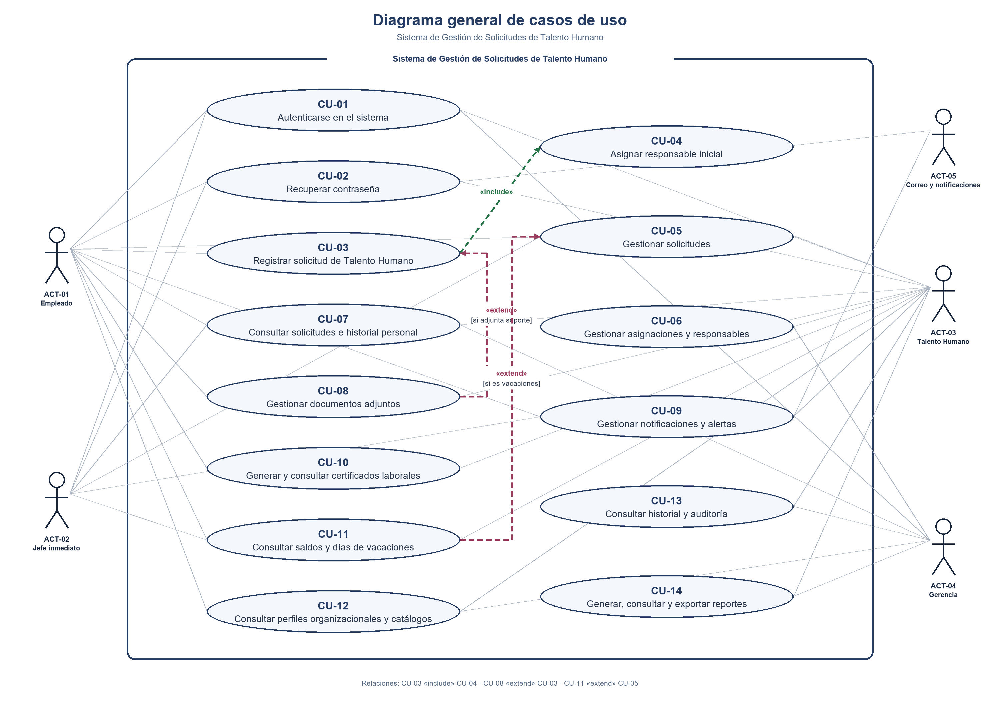

# 1.6 Casos de Uso (CU-01 a CU-14)

**Proyecto:** Sistema de Gestión de Solicitudes de Talento Humano — Nexa Servicios  
**Fase:** Fase 2 — Análisis  
**Fuente:** Documento Definitivo Aprobado (*Nexa servicios talento humano definitivo actual.docx*)  

---

Los 14 casos de uso agrupan los flujos funcionales y relacionan las 40 HU consolidadas con los cinco actores del sistema. El diagrama UML se conserva; las fichas detallan los pasos y escenarios alternos, y la matriz 14.13 concentra la trazabilidad.

Este capítulo documenta las interacciones del sistema con sus actores. Cada ficha conserva la plantilla de actor, precondición, flujo básico en Evento/Respuesta, alternativas y excepciones, poscondición y procedencia. La matriz final permite rastrear las HU y sus criterios de aceptación hasta el caso y el flujo que los cubre.

### 13.1 Diagrama general de casos de uso UML

#### Figura 9. Diagrama general de casos de uso del Sistema de Gestión de Solicitudes de Talento Humano.

El límite representa el sistema y las asociaciones conectan cada actor con los casos en los que participa. La relación «include» parte de CU-03 hacia CU-04 porque registrar una solicitud ejecuta la asignación inicial. La relación «extend» parte de CU-08 hacia CU-03 y se activa cuando se adjunta un soporte. Ambas relaciones se conectan a sus casos base según la notación UML y aparecen en la Figura 9.

#### Catálogo de casos de uso. La tabla resume su operación, las historias que los originan y los requisitos funcionales que implementan.

#### Tabla 5. Catálogo de casos de uso

| Caso de uso | Nombre | Operaciones | Nace de | Implementa |
| --- | --- | --- | --- | --- |
| CU-01 | Autenticarse en el sistema | 1. Crear (HU-01, registro de acceso) → 2. Consultar (HU-01, credenciales y rol) | HU-01 | RF-01 |
| CU-02 | Recuperar contraseña | 1. Crear (HU-02) → 3. Actualizar (HU-02) | HU-02 | RF-02, RF-43 |
| CU-03 | Registrar solicitud de Talento Humano | 1. Crear | HU-03 | RF-03, RF-04, RF-05, RF-06, RF-13 |
| CU-04 | Asignar responsable inicial | 1. Crear | HU-05 | RF-09 |
| CU-05 | Gestionar solicitudes | 1. Crear (HU-04, historial) → 2. Consultar → 3. Actualizar → 4. Eliminar (cancelación lógica) | HU-04, HU-07, HU-12, HU-15, HU-18 | RF-11, RF-17, RF-20, RF-07, RF-08, RF-23 |
| CU-06 | Gestionar asignaciones y responsables | 1. Crear → 2. Consultar → 3. Actualizar → 4. Eliminar (inactivación lógica) | HU-05, HU-19, HU-23, HU-24, HU-25, HU-26 | RF-29, RF-30, RF-32, RF-24, RF-31 |
| CU-07 | Consultar solicitudes e historial personal | 2. Consultar | HU-09, HU-16, HU-17, HU-22, HU-29 | RF-13, RF-14, RF-21, RF-22, RF-28, RF-36, RF-37, RF-38 |
| CU-08 | Gestionar documentos adjuntos | 1. Crear → 2. Consultar | HU-10, HU-27, HU-28 | RF-15, RF-33, RF-35, RF-34 |
| CU-09 | Gestionar notificaciones y alertas | 1. Crear → 2. Consultar → 3. Actualizar | HU-06, HU-13, HU-31 | RF-10, RF-18, RF-41, RF-42 |
| CU-10 | Generar y consultar certificados laborales | 1. Crear → 2. Consultar → 3. Actualizar | HU-03, HU-08, HU-30 | RF-05, RF-12, RF-39, RF-40 |
| CU-11 | Consultar saldos y días de vacaciones | 2. Consultar | HU-35, HU-36 | RF-50, RF-51 |
| CU-12 | Consultar perfiles organizacionales y catálogos | 2. Consultar | HU-21, HU-32 | RF-27, RF-44, RF-45 |
| CU-13 | Consultar historial y auditoría | 2. Consultar | HU-11, HU-33, HU-34 | RF-26, RF-16, RF-46, RF-47, RF-48, RF-49, RF-60, RF-61 |
| CU-14 | Generar, consultar y exportar reportes | 1. Crear → 2. Consultar / exportar | HU-14, HU-16, HU-20, HU-37, HU-38, HU-39, HU-40 | RF-19, RF-25, RF-53, RF-54, RF-56, RF-52, RF-57, RF-58, RF-59, RF-62, RF-55 |

### 13.1.1 Selección justificada de casos críticos

Los 14 casos se mantienen en el diagrama general y el catálogo. Se documentan como críticos seis que validan acceso, recuperación, radicación, decisión, asignación y soportes, y concentran reglas de negocio y escenarios de rechazo:

CU-01, Autenticarse: autorización y protección de acceso (RN-27; RNF-03).

CU-02, Recuperar contraseña: token temporal y uso restringido (RN-20; RNF-03 y RNF-05).

CU-03, Registrar solicitud: registro previo, soporte y radicado único (RN-01, RN-02 y RN-23).

CU-05, Gestionar solicitudes: estados, aprobación, rechazo con motivo y conservación del historial (RN-03 a RN-07 y RN-16).

CU-06, Gestionar asignaciones: responsable inicial, reasignación y motivo obligatorio (RN-08 a RN-10 y RN-26).

CU-08, Gestionar documentos: asociación, validación e identificación de soportes (RN-17 a RN-19).

### 13.2 CU-01 — Autenticarse en el sistema

| CU-01 | Autenticarse en el sistema | Procedencia |
| --- | --- | --- |
| Actor | Actor principal: ACT-01 Empleado, ACT-02 Jefe inmediato, ACT-03 Usuario de Talento Humano o ACT-04 Gerencia. | Actores ACT definidos en el contexto del proyecto. |
| Precondición | El usuario tiene una cuenta registrada y activa y se encuentra en la pantalla de acceso. | Antecedentes de las HU relacionadas y RN aplicables. |
| Flujo básico (Evento / Respuesta) | 1. El usuario abre la opción de acceso e ingresa su correo y contraseña. / El sistema recibe las credenciales para validarlas.   2. El usuario solicita iniciar sesión. / El sistema valida las credenciales y determina el rol asociado a la cuenta.   3. El usuario presenta credenciales válidas. / El sistema crea la sesión y muestra únicamente el menú y las funciones permitidas para el rol. / El sistema registra el resultado del intento de la cuenta en RegistroAcceso. | Paso 1: HU-01Paso 2: HU-01; RF-01Paso 3: HU-01; RNF-03 / Registro del intento: HU-01 o CA-2; RF-01. |
| Flujo alternativo FA-01 | FA-01 Credenciales incorrectas. El sistema rechaza el acceso, informa que las credenciales no son válidas y mantiene al usuario fuera de las funciones internas. | HU-01 (si la cuenta está registrada) |
| Flujo alternativo FA-02 | FA-02 Correo no registrado. El sistema rechaza el acceso y muestra un mensaje de credenciales no válidas sin revelar información interna. | HU-01 |
| Poscondición | El usuario queda autenticado con una sesión asociada a su rol, o permanece sin acceso si la validación falla. | Criterios de aceptación: HU-01 → FB-02–FB-03; CA-2 → FA-01; CA-3 → FA-02. |

### 13.3 CU-02 — Recuperar contraseña

| CU-02 | Recuperar contraseña | Procedencia |
| --- | --- | --- |
| Actor | Actor principal: ACT-01 Empleado, ACT-02 Jefe inmediato, ACT-03 Usuario de Talento Humano o ACT-04 Gerencia. Actor secundario: ACT-05 Sistema de Correo y Notificaciones. | Actores ACT definidos en el contexto del proyecto. |
| Precondición | El usuario tiene una cuenta activa y un correo registrado. Para solicitar un nuevo enlace, el mecanismo anterior expiró o dejó de ser utilizable. | Antecedentes de las HU relacionadas y RN aplicables. |
| Flujo básico (Evento / Respuesta) | 1. El usuario solicita recuperación e ingresa el correo registrado. / El sistema valida la cuenta y genera un mecanismo temporal. 2. El usuario abre el mecanismo vigente y registra una nueva contraseña. / El sistema valida vigencia, actualiza la contraseña e invalida el mecanismo utilizado. 3. Si el enlace anterior no sirve, el usuario solicita otro mecanismo. / El sistema genera uno nuevo con vigencia definida. | Paso 1: HU-02; RF-02 / Paso 2: HU-02; RF-02; RN-20 / Paso 3: HU-02; RF-43; RN-20 |
| Flujo alternativo FA-01 | FA-01 Correo no registrado. El sistema no inicia la recuperación y muestra una respuesta controlada. | HU-02 |
| Flujo alternativo FA-02 | FA-02 Enlace expirado o inválido. El sistema rechaza el mecanismo y permite solicitar uno nuevo. | HU-02 |
| Poscondición | La contraseña queda actualizada solo después de validar un mecanismo temporal vigente; el mecanismo utilizado deja de ser utilizable. | Criterios de aceptación: HU-02 → FB-01/FA-01; HU-02 → FB-02/FA-02; HU-02 → FB-03/FA-02. |

### 13.4 CU-03 — Registrar solicitud de Talento Humano

| CU-03 | Registrar solicitud de Talento Humano | Procedencia |
| --- | --- | --- |
| Actor | Actor principal: ACT-01 Empleado. | Actores ACT definidos en el contexto del proyecto. |
| Precondición | El empleado tiene una cuenta activa y está autenticado. Los tipos de solicitud habilitados están disponibles para consulta. | Antecedentes de las HU relacionadas y RN aplicables. |
| Flujo básico (Evento / Respuesta) | 1. El empleado consulta los tipos disponibles y selecciona permiso, vacaciones, certificado o incapacidad. / El sistema presenta los campos correspondientes al tipo seleccionado.   2. El empleado diligencia la información requerida y envía la solicitud. / El sistema valida campos obligatorios y, para vacaciones, fechas y duración; para incapacidad, exige el soporte clínico.   3. El empleado adjunta soporte cuando el tipo de solicitud lo exige o cuando complementa la información. / El sistema valida y asocia el archivo a la solicitud mediante CU-08.   4. El empleado confirma el envío. / El sistema registra la solicitud con estado inicial, genera su radicado único y determina el responsable inicial. | Paso 1: HU-03; consulta de HU-32 en CU-12Paso 2: HU-03; RN-01, RN-02, RN-13Paso 3: HU-03, HU-10; RN-17–RN-19Paso 4: HU-03, HU-05 CA-1–CA-3; RF-03–RF-06, RF-13; RN-01, RN-08, RN-23 |
| Flujo alternativo FA-01 | FA-01 Información obligatoria incompleta. El sistema no registra la solicitud e identifica la información que debe completarse. | HU-03; RN-01 |
| Flujo alternativo FA-02 | FA-02 Fechas de vacaciones inválidas. El sistema rechaza el período y solicita corregir las fechas. | HU-03; RN-13 |
| Flujo alternativo FA-03 | FA-03 Falta o invalidez del soporte médico. El sistema no registra la incapacidad hasta que se adjunte un soporte válido. | HU-03; RN-02, RN-18 |
| Flujo alternativo FA-04 | FA-04 No hay responsable inicial disponible. El sistema conserva la solicitud registrada sin asignarla a un responsable no autorizado y deja el evento identificable para su atención. | HU-05 CA-4; RN-08 |
| Poscondición | La solicitud queda asociada al empleado, con radicado único, estado inicial y responsable cuando existe uno autorizado; los datos inválidos no se guardan como una solicitud completa. | Criterios de aceptación: HU-03 → FB-02; CA-3 → FA-01; CA-4 → FB-04.; HU-03 → FB-02; CA-4 → FA-02.; HU-03 → FB-02 y FB-04; CA-3–CA-4 → CU-10.; HU-03 → FB-02–FB-04; CA-3–CA-4 → FA-03. |

### 13.5 CU-04 — Asignar responsable inicial

| CU-04 | Asignar responsable inicial | Procedencia |
| --- | --- | --- |
| Actor | Caso automático ejecutado por el sistema durante el registro de una solicitud. No requiere interacción directa de un actor externo. | Actores ACT definidos en el contexto del proyecto. |
| Precondición | Se ha completado el registro de una solicitud y existe una regla de asignación asociada al tipo de trámite. | Antecedentes de las HU relacionadas y RN aplicables. |
| Flujo básico (Evento / Respuesta) | 1. CU-03 solicita determinar el responsable inicial. / El sistema consulta el tipo de solicitud y la asignación configurada para ese tipo.   2. El sistema identifica un responsable autorizado. / El sistema crea la asignación y registra responsable, solicitud y fecha de asignación.   3. La asignación queda creada. / El sistema deja disponible la identidad del responsable vigente para la gestión del trámite. | Paso 1: HU-05 CA-1; RF-09; RN-08Paso 2: HU-05 CA-2–CA-3; RN-08Paso 3: HU-05 CA-1–CA-3; RF-09; RN-26 |
| Flujo alternativo FA-01 | FA-01 No se encuentra responsable disponible. El sistema no asigna la solicitud a una persona no autorizada y mantiene identificable que falta completar la asignación. | HU-05 CA-4; RN-08 |
| Poscondición | La solicitud tiene una asignación inicial vigente o queda identificada para que Talento Humano complete la asignación conforme a la autorización definida. | Criterios de aceptación: HU-05 CA-1–CA-3 → FB-01–FB-03; CA-4 → FA-01. |

### 13.6 CU-05 — Gestionar solicitudes

| CU-05 | Gestionar solicitudes | Procedencia |
| --- | --- | --- |
| Actor | Actor principal: ACT-02 Jefe inmediato o ACT-03 Usuario de Talento Humano. Para editar o cancelar una solicitud pendiente, actor principal: ACT-01 Empleado. | Actores ACT definidos en el contexto del proyecto. |
| Precondición | La solicitud existe. El usuario está autenticado, autorizado para la operación y la solicitud se encuentra en un estado que permite realizarla. | Antecedentes de las HU relacionadas y RN aplicables. |
| Flujo básico (Evento / Respuesta) | 1. El usuario consulta la solicitud y selecciona una acción permitida. / El sistema muestra el detalle y verifica el rol, el estado y las reglas aplicables.   2. Para aprobar una solicitud de vacaciones, el responsable solicita la aprobación. / El sistema consulta el saldo del período y permite continuar solo si es suficiente.   3. El responsable aprueba, rechaza con motivo o cambia el estado a En revisión con nota; el empleado puede editar o cancelar mientras siga permitido. / El sistema aplica la acción, actualiza el estado y registra usuario, fecha, motivo o nota cuando corresponda. | Paso 1: HU-04, HU-12 CA-1, HU-15 CA-1, HU-18 CA-1; RN-03–RN-05, RN-15Paso 2: HU-07 CA-1–CA-4; RF-11; RN-12, RN-13Paso 3: HU-04, HU-12 CA-1, CA-4; HU-15 CA-1, CA-3–CA-4; HU-18 CA-1, CA-4; RN-03–RN-07, RN-15–RN-16 |
| Flujo alternativo FA-01 | FA-01 Solicitud en estado no permitido o ya procesada. El sistema no realiza la acción y conserva el estado y el historial existentes. | HU-04, HU-12 CA-2–CA-3; HU-18 CA-2–CA-3; RN-03–RN-04, RN-15 |
| Flujo alternativo FA-02 | FA-02 Rechazo sin motivo o cambio a En revisión sin nota. El sistema solicita el dato obligatorio y no confirma la operación hasta recibirlo. | HU-04, HU-15 CA-2; RN-06, RN-16 |
| Flujo alternativo FA-03 | FA-03 Saldo de vacaciones insuficiente. El sistema impide aprobar la solicitud de vacaciones y presenta el saldo correspondiente al período. | HU-07 CA-3–CA-4; RN-12–RN-13 |
| Flujo alternativo FA-04 | FA-04 Usuario no autorizado. El sistema rechaza la operación y no modifica la solicitud. | HU-04; RN-05 |
| Poscondición | La solicitud conserva el estado resultante de la operación autorizada y el historial incluye la evidencia requerida; si una validación falla, no se aplica el cambio. | Criterios de aceptación: HU-04 → FB-01 y FB-03; CA-3 → FA-01.; HU-04 → FB-03; CA-2 → FA-02.; HU-07 CA-1–CA-2, CA-4 → FB-02; CA-3 → FA-03.; HU-12 CA-1, CA-4 → FB-01 y FB-03; CA-2–CA-3 → FA-01.; HU-15 CA-1, CA-3–CA-4 → FB-03; CA-2 → FA-02.; HU-18 CA-1, CA-4 → FB-03; CA-2–CA-3 → FA-01. |

### 13.7 CU-06 — Gestionar asignaciones y responsables

| CU-06 | Gestionar asignaciones y responsables | Procedencia |
| --- | --- | --- |
| Actor | Actor principal: ACT-03 Usuario de Talento Humano. | Actores ACT definidos en el contexto del proyecto. |
| Precondición | La solicitud existe y el usuario está autenticado y autorizado para consultar o modificar asignaciones. | Antecedentes de las HU relacionadas y RN aplicables. |
| Flujo básico (Evento / Respuesta) | 1. El usuario busca la solicitud y abre su sección de responsables. / El sistema muestra el responsable vigente y distingue las asignaciones finalizadas.   2. El usuario solicita consultar el historial o el motivo de una asignación. / El sistema presenta la secuencia, fechas y motivos registrados, sin modificar la solicitud.   3. El usuario reasigna a un responsable autorizado o finaliza una asignación vigente. / El sistema registra motivo y fechas, conserva la asignación anterior y actualiza quién queda vigente. | Paso 1: HU-23 CA-1–CA-3; RF-29; RN-26Paso 2: HU-24 CA-1–CA-3; HU-26 CA-1–CA-2, CA-4; RF-30, RF-32; RN-10, RN-26Paso 3: HU-19 CA-1, CA-3–CA-4; HU-25 CA-1–CA-3; RF-24, RF-31; RN-07, RN-09–RN-10, RN-26 |
| Flujo alternativo FA-01 | FA-01 Responsable no autorizado o motivo obligatorio ausente. El sistema rechaza la reasignación y conserva la asignación vigente. | HU-19 CA-2–CA-3; RN-09–RN-10 |
| Flujo alternativo FA-02 | FA-02 No existe responsable vigente o no hay asignaciones. El sistema informa que no hay asignación vigente o historial para mostrar. | HU-23 CA-4; HU-24 CA-4 |
| Flujo alternativo FA-03 | FA-03 La asignación ya fue finalizada. El sistema no la finaliza por segunda vez y mantiene su fecha de cierre. | HU-25 CA-4 |
| Flujo alternativo FA-04 | FA-04 Asignación sin motivo registrado. El sistema indica que no hay motivo disponible, sin inventar información. | HU-26 CA-3 |
| Poscondición | Las asignaciones mantienen su secuencia e historial; solo una reasignación válida cambia el responsable vigente. | Criterios de aceptación: HU-19 CA-1 y CA-4 → FB-03; CA-2–CA-3 → FA-01.; HU-23 CA-1–CA-3 → FB-01; CA-4 → FA-02.; HU-24 CA-1–CA-3 → FB-02; CA-4 → FA-02.; HU-25 CA-1–CA-3 → FB-03; CA-4 → FA-03.; HU-26 CA-1–CA-2, CA-4 → FB-02; CA-3 → FA-04. |

### 13.8 CU-07 — Consultar solicitudes e historial personal

| CU-07 | Consultar solicitudes e historial personal | Procedencia |
| --- | --- | --- |
| Actor | Actor principal: ACT-01 Empleado. Actores secundarios: ACT-02 Jefe inmediato y ACT-03 Usuario de Talento Humano, según permisos. | Actores ACT definidos en el contexto del proyecto. |
| Precondición | El usuario está autenticado. La solicitud existe para consultar el detalle; las consultas personales se limitan al empleado autenticado. | Antecedentes de las HU relacionadas y RN aplicables. |
| Flujo básico (Evento / Respuesta) | 1. El usuario ingresa un radicado o combina filtros permitidos por tipo, estado, fecha y empleado. / El sistema busca las solicitudes que cumplen los criterios y respeta los permisos del usuario.   2. El usuario selecciona una solicitud o consulta su historial personal. / El sistema muestra radicado, tipo, fecha, estado, responsable vigente cuando exista y las respuestas disponibles.   3. El usuario revisa los resultados. / El sistema conserva los datos y no modifica la solicitud por el hecho de consultarla. | Paso 1: HU-09 CA-1, CA-3; HU-16, HU-17 CA-1–CA-2; HU-22 CA-1–CA-3; RF-14, RF-21, RF-22, RF-28; RN-23–RN-24, RN-27Paso 2: HU-17 CA-2–CA-3; HU-22 CA-1–CA-3; HU-29; RF-28, RF-36–RF-38Paso 3: HU-09 CA-4; HU-17 CA-1–CA-3; HU-29 |
| Flujo alternativo FA-01 | FA-01 Radicado inexistente, filtros sin coincidencias o historial vacío. El sistema informa que no encontró resultados y mantiene disponible la consulta. | HU-09 CA-2; HU-16, HU-17 CA-4; HU-22 CA-4 |
| Flujo alternativo FA-02 | FA-02 El usuario intenta consultar información personal de otro empleado. El sistema aplica las restricciones de autorización y no muestra solicitudes ajenas. | HU-17 CA-1; RN-24, RN-27 |
| Flujo alternativo FA-03 | FA-03 No hay responsable asociado o el detalle solicitado no está disponible. El sistema presenta únicamente la información registrada y señala el dato ausente. | HU-22 CA-3–CA-4; RN-26 |
| Poscondición | La información se presenta conforme a los filtros y permisos; la consulta no modifica solicitudes ni historiales. | Criterios de aceptación: HU-09 CA-1, CA-3–CA-4 → FB-01 y FB-03; CA-2 → FA-01.; HU-16 → FB-01; CA-4 → FA-01.; HU-17 CA-1–CA-3 → FB-01–FB-03; CA-4 → FA-01.; HU-22 CA-1–CA-3 → FB-01–FB-02; CA-4 → FA-01.; HU-29 → FB-02.; HU-29 → FB-02.; HU-29 → FB-02. |

### 13.9 CU-08 — Gestionar documentos adjuntos

| CU-08 | Gestionar documentos adjuntos | Procedencia |
| --- | --- | --- |
| Actor | Actor principal: ACT-01 Empleado. Actor secundario: ACT-03 Usuario de Talento Humano. | Actores ACT definidos en el contexto del proyecto. |
| Precondición | La solicitud existe y el usuario tiene autorización para adjuntar o consultar documentos asociados a ella. | Antecedentes de las HU relacionadas y RN aplicables. |
| Flujo básico (Evento / Respuesta) | 1. El empleado selecciona el archivo y la solicitud a la que pertenece. / El sistema comprueba formato y tamaño antes de aceptar el archivo.   2. El archivo cumple las condiciones. / El sistema almacena el documento asociado a la solicitud y registra quién lo cargó y cuándo.   3. El usuario consulta los documentos asociados. / El sistema presenta los datos disponibles de cada documento, únicamente para la solicitud autorizada. | Paso 1: HU-10, HU-28 CA-1–CA-4; RF-15, RF-33, RF-35; RN-18Paso 2: HU-10; RF-15, RF-33; RN-17, RN-19Paso 3: HU-27 CA-1–CA-2, CA-4; RF-34; RN-17, RN-19, RN-27 |
| Flujo alternativo FA-01 | FA-01 Formato o tamaño no permitido. El sistema rechaza el archivo e indica la condición que debe corregirse antes de cargarlo. | HU-10, HU-28 CA-2–CA-3; RF-35; RN-18 |
| Flujo alternativo FA-02 | FA-02 El documento pertenece a otra solicitud o el usuario no tiene permiso. El sistema no asocia ni muestra el documento en la solicitud consultada. | HU-27 CA-3; RN-17, RN-27 |
| Flujo alternativo FA-03 | FA-03 La solicitud no tiene documentos asociados. El sistema informa que no hay documentos para mostrar. | HU-27 CA-1, CA-4 |
| Poscondición | Los documentos válidos quedan asociados a su solicitud con evidencia de carga; los archivos rechazados no quedan disponibles como soportes. | Criterios de aceptación: HU-10 → FB-01–FB-02; CA-2 → FA-01.; HU-10 → FB-01–FB-02; CA-2–CA-3 → FA-01.; HU-27 CA-1–CA-2, CA-4 → FB-03; CA-3 → FA-02.; HU-28 CA-1, CA-4 → FB-01; CA-2–CA-3 → FA-01. |

### 13.10 CU-09 — Gestionar notificaciones y alertas

| CU-09 | Gestionar notificaciones y alertas | Procedencia |
| --- | --- | --- |
| Actor | Actor principal: ACT-01 Empleado o ACT-03 Usuario de Talento Humano, según el aviso. Actor secundario: ACT-05 Sistema de Correo y Notificaciones. | Actores ACT definidos en el contexto del proyecto. |
| Precondición | El usuario tiene una cuenta y existen eventos o notificaciones dirigidos a él. Para una alerta de demora, la solicitud superó el plazo definido sin movimiento. | Antecedentes de las HU relacionadas y RN aplicables. |
| Flujo básico (Evento / Respuesta) | 1. Se produce un cambio de estado o se supera el plazo de tres días sin movimiento. / El sistema identifica la solicitud y el destinatario correspondiente; para la demora, dirige la alerta a Talento Humano.   2. El sistema genera el aviso. / El sistema crea la notificación interna y envía correo cuando el canal está configurado.   3. El empleado consulta sus notificaciones internas y marca una como leída. / El sistema muestra solo avisos del empleado y cambia únicamente su estado de lectura. | Paso 1: HU-06 CA-1, CA-3–CA-4; HU-13 CA-1–CA-2; RN-11, RN-21Paso 2: HU-13 CA-1, CA-3–CA-4; RF-10, RF-18, RF-41; RN-21Paso 3: HU-31; RF-41–RF-42; RN-21–RN-22 |
| Flujo alternativo FA-01 | FA-01 La solicitud aún no supera tres días sin movimiento. El sistema no genera la alerta de demora. | HU-06 CA-2; RN-11 |
| Flujo alternativo FA-02 | FA-02 Correo no configurado. El sistema conserva la notificación interna sin reportar un envío de correo no realizado. | HU-13 CA-4 |
| Flujo alternativo FA-03 | FA-03 No hay notificaciones o el aviso pertenece a otro usuario. El sistema informa que no hay avisos propios disponibles y rechaza modificar notificaciones ajenas. | HU-31; RN-21–RN-22 |
| Poscondición | El aviso queda asociado al destinatario correcto; el estado leído se actualiza solo para la notificación seleccionada. | Criterios de aceptación: HU-06 CA-1, CA-3–CA-4 → FB-01; CA-2 → FA-01.; HU-13 CA-1–CA-3 → FB-01–FB-02; CA-4 → FA-02.; HU-31 → FB-03; CA-4 → FA-03.; HU-31 → FB-03; CA-4 → FA-03. |

### 13.11 CU-10 — Generar y consultar certificados laborales

| CU-10 | Generar y consultar certificados laborales | Procedencia |
| --- | --- | --- |
| Actor | Actor principal: ACT-03 Usuario de Talento Humano para generar el certificado; ACT-01 Empleado para consultar y descargarlo. | Actores ACT definidos en el contexto del proyecto. |
| Precondición | Existe una solicitud de certificado asociada al empleado. Para generar el documento, la solicitud debe estar aprobada y la información laboral necesaria debe estar disponible. | Antecedentes de las HU relacionadas y RN aplicables. |
| Flujo básico (Evento / Respuesta) | 1. Talento Humano selecciona una solicitud de certificado aprobada. / El sistema verifica el estado de la solicitud antes de habilitar la generación.   2. Talento Humano confirma la generación. / El sistema genera y almacena el certificado asociado a la solicitud y actualiza el estado del trámite.   3. El empleado consulta el estado o solicita el certificado generado. / El sistema presenta el estado asociado a la solicitud y, si existe, permite consultar o descargar el archivo correcto. | Paso 1: HU-03, HU-08 CA-1–CA-2; RF-12; RN-14–RN-14Paso 2: HU-08 CA-1, CA-3–CA-4; RF-12, RF-39–RF-40; RN-14–RN-14Paso 3: HU-03, HU-30; RF-39–RF-40; RN-14 |
| Flujo alternativo FA-01 | FA-01 La solicitud no está aprobada. El sistema no genera el certificado y mantiene el trámite en el estado correspondiente. | HU-03, HU-08 CA-2; RN-14 |
| Flujo alternativo FA-02 | FA-02 El certificado aún no se ha generado o no está disponible. El sistema informa que no hay archivo para consultar o descargar. | HU-30 |
| Poscondición | El certificado, cuando se genera, queda asociado a su solicitud y su estado puede consultarse sin mezclar trámites de otros empleados. | Criterios de aceptación: HU-03 → FB-01 y FA-01; CA-1–CA-2 → CU-03.; HU-08 CA-1, CA-3–CA-4 → FB-01–FB-02; CA-2 → FA-01.; HU-30 → FB-03; CA-4 → FA-02.; HU-30 → FB-03 y FA-02. |

### 13.12 CU-11 — Consultar saldos y días de vacaciones

| CU-11 | Consultar saldos y días de vacaciones | Procedencia |
| --- | --- | --- |
| Actor | Actor principal: ACT-01 Empleado para consultar sus días disponibles; ACT-03 Usuario de Talento Humano para consultar el saldo de un empleado por período. | Actores ACT definidos en el contexto del proyecto. |
| Precondición | El usuario está autenticado y puede consultar el saldo propio o el de un empleado conforme a sus permisos. | Antecedentes de las HU relacionadas y RN aplicables. |
| Flujo básico (Evento / Respuesta) | 1. El usuario selecciona el empleado y el período, o solicita su propio saldo disponible. / El sistema consulta el saldo correspondiente sin modificarlo.   2. El sistema encuentra el saldo del período. / El sistema presenta días generados, utilizados y disponibles y mantiene la asociación al empleado y período correctos. | Paso 1: HU-35 CA-1; HU-36 CA-1–CA-3; RF-50–RF-51; RN-12, RN-30Paso 2: HU-35 CA-2–CA-3; HU-36 CA-1–CA-2; RF-50–RF-51; RN-12 |
| Flujo alternativo FA-01 | FA-01 No hay información de saldo para el período o empleado. El sistema informa que no existe saldo registrado y no calcula valores sin respaldo. | HU-35 CA-4; HU-36 CA-4 |
| Flujo alternativo FA-02 | FA-02 El empleado intenta consultar el saldo de otra persona. El sistema limita la consulta al saldo propio. | HU-36 CA-3; RN-27 |
| Poscondición | El saldo se presenta para el empleado y período solicitados; la consulta no modifica los valores almacenados. | Criterios de aceptación: HU-35 CA-1–CA-3 → FB-01–FB-02; CA-4 → FA-01.; HU-36 CA-1–CA-3 → FB-01–FB-02; CA-4 → FA-01. |

### 13.13 CU-12 — Consultar perfiles organizacionales y catálogos

| CU-12 | Consultar perfiles organizacionales y catálogos | Procedencia |
| --- | --- | --- |
| Actor | Actor principal: ACT-03 Usuario de Talento Humano para consultar perfil; ACT-01 Empleado para consultar tipos; ACT-03 Usuario de Talento Humano para consultar estados. | Actores ACT definidos en el contexto del proyecto. |
| Precondición | El usuario está autenticado y tiene permiso para consultar la información seleccionada. | Antecedentes de las HU relacionadas y RN aplicables. |
| Flujo básico (Evento / Respuesta) | 1. El usuario selecciona el empleado, tipo de solicitud o estados que desea consultar. / El sistema verifica el criterio y la autorización correspondiente.   2. El sistema encuentra la información solicitada. / El sistema muestra área, cargo y rol del empleado, o el catálogo de tipos y estados sin mezclar registros. | Paso 1: HU-21 CA-1; HU-32; RF-27, RF-44–RF-45; RN-25, RN-27Paso 2: HU-21 CA-2–CA-3; HU-32; RN-03, RN-25 |
| Flujo alternativo FA-01 | FA-01 El empleado no tiene datos organizacionales registrados. El sistema identifica los datos que no están disponibles sin sustituirlos por los de otra persona. | HU-21 CA-4 |
| Flujo alternativo FA-02 | FA-02 Tipo no habilitado o estado no definido. El sistema no presenta el valor como una opción válida y conserva la consulta en modo de solo lectura. | HU-32; RN-03 |
| Flujo alternativo FA-03 | FA-03 El usuario no tiene autorización para consultar el perfil. El sistema rechaza la consulta. | HU-21 CA-1; RN-27 |
| Poscondición | La información de referencia se muestra en modo de consulta y corresponde al empleado o catálogo solicitado. | Criterios de aceptación: HU-21 CA-1–CA-3 → FB-01–FB-02; CA-4 → FA-01.; HU-32 → FB-01–FB-02; CA-4 → FA-02.; HU-32 → FB-01–FB-02; CA-3–CA-4 → FA-02. |

### 13.14 CU-13 — Consultar historial y auditoría

| CU-13 | Consultar historial y auditoría | Procedencia |
| --- | --- | --- |
| Actor | Actor principal: ACT-03 Usuario de Talento Humano o ACT-04 Gerencia, según los permisos de consulta. | Actores ACT definidos en el contexto del proyecto. |
| Precondición | El usuario está autenticado y autorizado para consultar el historial, registros de acceso u operaciones auditadas. | Antecedentes de las HU relacionadas y RN aplicables. |
| Flujo básico (Evento / Respuesta) | 1. El usuario selecciona el tipo de consulta y define solicitud, usuario o período. / El sistema valida permisos y presenta los registros que coinciden con los criterios.   2. El usuario selecciona una operación auditada para ver su detalle. / El sistema muestra entidad, operación, usuario, fecha y los valores anterior y nuevo cuando estén registrados.   3. El usuario termina la consulta. / El sistema mantiene el historial y la auditoría sin modificaciones. | Paso 1: HU-11, HU-33, HU-34; RF-16, RF-26, RF-46–RF-48, RF-60–RF-61; RN-07, RN-27–RN-28Paso 2: HU-11, HU-34; RF-49; RN-28Paso 3: HU-11, HU-33, HU-34; RF-16, RF-46–RF-49 |
| Flujo alternativo FA-01 | FA-01 No hay registros que coincidan o la operación no quedó registrada. El sistema informa que no hay resultados para mostrar. | HU-34 |
| Flujo alternativo FA-02 | FA-02 El usuario no está autorizado para consultar los registros. El sistema rechaza la consulta y no revela datos auditados. | HU-34; RN-27 |
| Flujo alternativo FA-03 | FA-03 El valor anterior o nuevo no está disponible. El sistema presenta únicamente los valores registrados e indica cuál no está disponible. | HU-34; RN-28 |
| Poscondición | La consulta es de solo lectura y no altera las evidencias históricas o de acceso. | Criterios de aceptación: HU-11 → FB-01–FB-03.; HU-11 → FB-01; CA-4 → FB-03.; HU-33 → FB-01; CA-4 → FA-02.; HU-34 → FB-01–FB-03; CA-4 → FA-01.; HU-34 → FB-02; CA-4 → FA-03.; HU-33 → FB-01; CA-4 → FA-02.; HU-34 → FB-01; restricciones → FA-02. |

### 13.15 CU-14 — Generar, consultar y exportar reportes

| CU-14 | Generar, consultar y exportar reportes | Procedencia |
| --- | --- | --- |
| Actor | Actor principal: ACT-03 Usuario de Talento Humano para reportes operativos; ACT-04 Gerencia para resúmenes globales y reportes organizacionales. | Actores ACT definidos en el contexto del proyecto. |
| Precondición | Existe información registrada. El usuario está autenticado y autorizado para consultar el alcance de reporte solicitado. | Antecedentes de las HU relacionadas y RN aplicables. |
| Flujo básico (Evento / Respuesta) | 1. El usuario selecciona el reporte y combina tipo, responsable, área, cargo, rol, estado o período según corresponda. / El sistema valida los criterios y los permisos asociados al usuario.   2. El usuario solicita generar el reporte. / El sistema procesa los datos, diferencia los resultados por los criterios y presenta el reporte con su período.   3. El usuario abre reportes ya generados o elige exportar el resultado. / El sistema presenta el reporte autorizado o exporta el mismo resultado consultado en un formato habilitado. | Paso 1: HU-14 CA-1–CA-3; HU-20 CA-1–CA-3; HU-16 CA-1–CA-2; HU-38 CA-1–CA-2; HU-40 CA-1–CA-2; RF-19, RF-25, RF-53–RF-54, RF-56–RF-59, RF-62; RN-27, RN-29–RN-30. Paso 2: HU-14 CA-2–CA-3; HU-20 CA-2–CA-3; HU-16 CA-1–CA-2; HU-38 CA-1–CA-2. Paso 3: HU-37 CA-1–CA-3; HU-39 CA-1–CA-3; RF-52, RF-55; RN-27. |
| Flujo alternativo FA-01 | FA-01 No existen datos para los criterios seleccionados. El sistema informa que no hay resultados y conserva los filtros para que puedan ajustarse. | HU-14 CA-4; HU-16 CA-3; HU-20 CA-4; HU-38 CA-3; RN-29–RN-30. |
| Flujo alternativo FA-02 | FA-02 El usuario no tiene permiso para consultar o exportar la información. El sistema rechaza la consulta o exportación y no entrega datos fuera del alcance autorizado. | HU-37 CA-4; HU-40 CA-3; RN-27. |
| Flujo alternativo FA-03 | FA-03 Formato de exportación no habilitado. El sistema informa los formatos disponibles y conserva el reporte generado. | HU-39 CA-4. |
| Poscondición | El reporte queda presentado o exportado conforme al alcance y filtros seleccionados; los resultados no incluyen solicitudes ajenas a los criterios o permisos. | Criterios de aceptación: HU-14 CA-1–CA-3 → FB-01–FB-02; CA-4 → FA-01. HU-16 CA-1–CA-2 → FB-01–FB-02; CA-3 → FA-01. HU-20 CA-1–CA-3 → FB-01–FB-02; CA-4 → FA-01. HU-37 CA-1–CA-3 → FB-03; CA-4 → FA-02. HU-38 CA-1–CA-2 → FB-01–FB-02; CA-3 → FA-01. HU-39 CA-1–CA-3 → FB-03; CA-4 → FA-03. HU-40 CA-1–CA-2 → FB-01; CA-3 → FA-02. |
