# 1.7 Mockups e Interfaces de Usuario (MK-01 a MK-12)

**Proyecto:** Sistema de Gestión de Solicitudes de Talento Humano — Nexa Servicios  
**Fase:** Fase 2 — Análisis  
**Fuente:** Documento Definitivo Aprobado (*Nexa servicios talento humano definitivo actual.docx*)  

---

Los 12 mockups se vinculan con los casos de uso y las HU que representan. La matriz 14.13 consolida sus códigos junto con los actores y las referencias MySQL. Los métodos indicados corresponden a los que aparecen en el modelo de clases o en la entrega de programación del equipo.

Este capítulo representa las vistas de interacción del sistema a partir de las HU, CU, RF, RN y el diccionario de datos del proyecto. Cada figura incorpora llamadas de trazabilidad; su ficha declara cobertura, campos/tipos existentes, acciones y reglas visibles. Las brechas del modelo se señalan para revisión en vez de completar el esquema por suposición.

### 14.1 MK-01 — Acceso y recuperación

#### Figura 10. MK-01: Acceso y recuperación; vista de referencia con trazabilidad anotada.

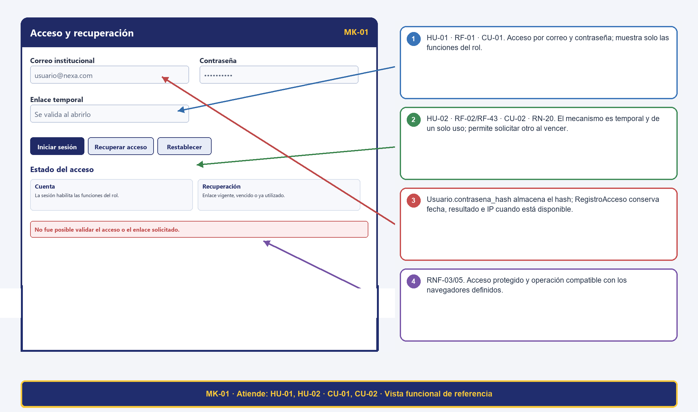

#### Tabla 6. Trazabilidad del mockup MK-01: Acceso y recuperación

| Código | MK-01 |
| --- | --- |
| Pantalla | Acceso y recuperación |
| Atiende (HU / CU) | HU-01, HU-02 / CU-01, CU-02 |
| Campos ↔ Diccionario | Usuario.correo VARCHAR(150) UQ NN; Usuario.contrasena_hash VARCHAR(255) NN; Usuario.activo BOOLEAN NN; Usuario.intentos_fallidos INT NN; Usuario.bloqueado_hasta DATETIME NULL; RecuperacionClave.token VARCHAR(255) UQ NN, fecha_expiracion DATETIME NN y utilizada BOOLEAN NN. |
| Botones ↔ Eventos | Iniciar sesión; Recuperar acceso; Restablecer — eventos relacionados con CU-01, CU-02. RF específicos y transiciones se detallan en la matriz final. |
| RN visibles | RN-20: mecanismo temporal; rechazar vencido o inválido. RNF-03/05: protección de acceso y compatibilidad. |
| Métodos de clase ↔ pantalla (HU respaldadas) | RegistroAcceso.registrarIntento; Usuario.iniciarSesion; RecuperacionClave.generarToken; Usuario.actualizarContrasena |

### 14.2 MK-02 — Bandeja y búsqueda de solicitudes

#### Figura 11. MK-02: Bandeja y búsqueda de solicitudes; vista de referencia con trazabilidad anotada.

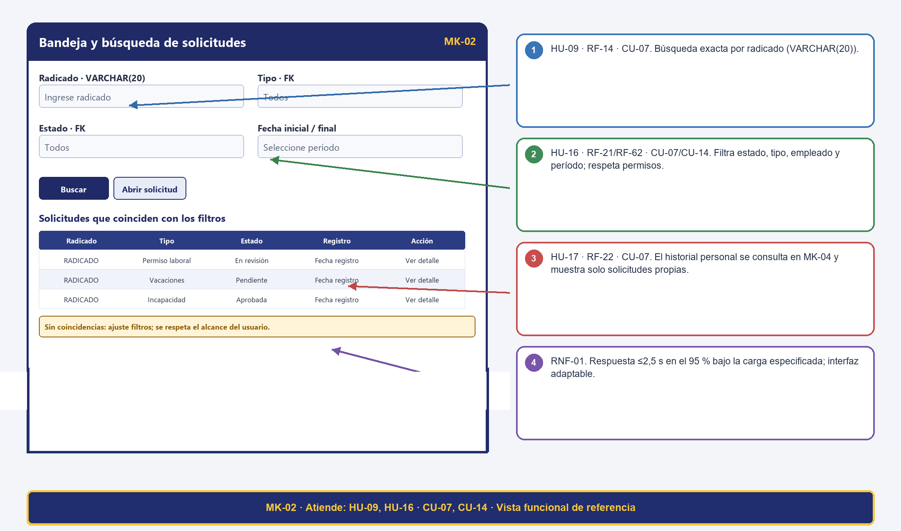

#### Tabla 7. Trazabilidad del mockup MK-02: Bandeja y búsqueda de solicitudes

| Código | MK-02 |
| --- | --- |
| Pantalla | Bandeja y búsqueda de solicitudes |
| Atiende (HU / CU) | HU-09, HU-16 / CU-07, CU-14 |
| Campos ↔ Diccionario | Solicitud.radicado VARCHAR(20), id_tipo_solicitud/id_estado INT FK, fecha_registro DATETIME y fechas DATE. TipoSolicitud.nombre VARCHAR(50); EstadoSolicitud.nombre VARCHAR(30). |
| Botones ↔ Eventos | Buscar; Abrir solicitud; filtrar reportes — eventos relacionados con CU-07 y CU-14. RF específicos y transiciones se detallan en la matriz final. |
| RN visibles | RN-03: toda consulta exige sesión activa.RN-27: el acceso a consultas operativas se restringe por rol autorizado (HU-17 / RF-22 se gestiona en la vista personal MK-04). |
| Métodos de clase ↔ pantalla (HU respaldadas) | Solicitud.consultarPorRadicado |

### 14.3 MK-03 — Registro y edición de solicitud

#### Figura 12. MK-03: Registro y edición de solicitud; vista de referencia con trazabilidad anotada.

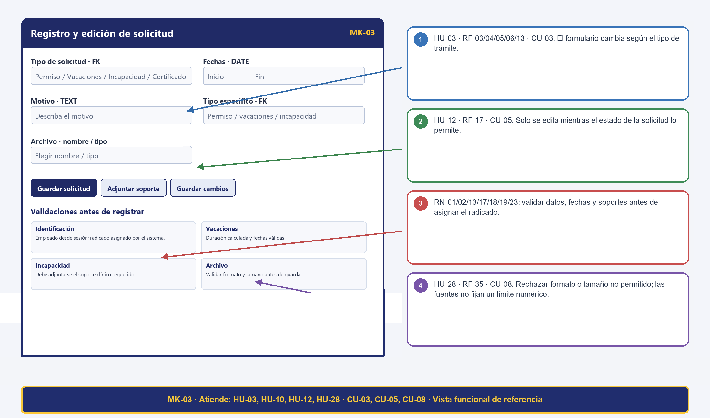

#### Tabla 8. Trazabilidad del mockup MK-03: Registro y edición de solicitud

| Código | MK-03 |
| --- | --- |
| Pantalla | Registro y edición de solicitud |
| Atiende (HU / CU) | HU-03, HU-10, HU-12, HU-28 / CU-03, CU-05, CU-08 |
| Campos ↔ Diccionario | Solicitud.id_usuario INT FK NN, id_tipo_solicitud INT FK NN, id_estado INT FK NN, radicado VARCHAR(20) UQ NN; PermisoLaboral/Vacacion (fecha_inicio DATE NN, fecha_fin DATE NN, motivo TEXT); Incapacidad (fecha_inicio DATE NN, fecha_fin DATE NN, observacion TEXT); Documento (nombre_archivo VARCHAR(150), tipo_archivo VARCHAR(50), tamano_archivo INT, ruta_archivo VARCHAR(300)). Días solicitados se calcula como valor derivado sin persistirse. |
| Botones ↔ Eventos | Guardar solicitud; Adjuntar soporte; Guardar cambios — eventos relacionados con CU-03, CU-05, CU-08. RF específicos y transiciones se detallan en la matriz final. |
| RN visibles | RN-01/02/13/15/17/18/19/23: obligatoriedad, soporte clínico, fechas, edición por estado, asociación/validación de archivo, carga y radicado. RNF-03/04/05/06. |
| Métodos de clase ↔ pantalla (HU respaldadas) | Solicitud.radicarSolicitud; Incapacidad.validarDocumentoMedico; Documento.validarFormato; Documento.validarTamanoMaximo |

### 14.4 MK-04 — Detalle, historial y documentos

#### Figura 13. MK-04: Detalle, historial y documentos; vista de referencia con trazabilidad anotada.

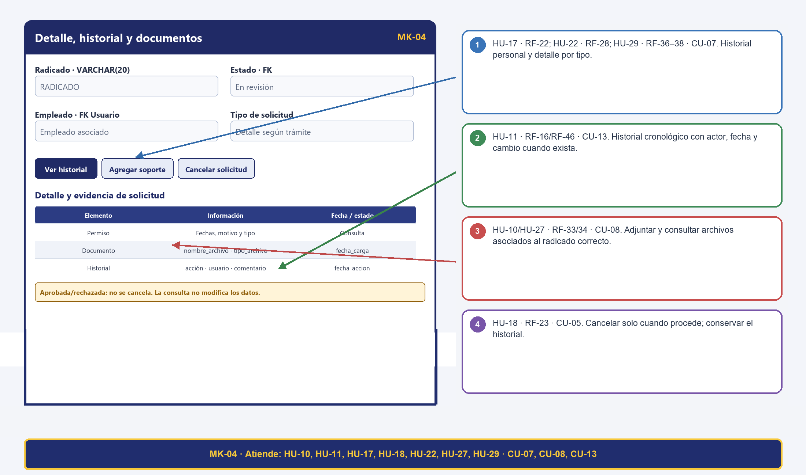

#### Tabla 9. Trazabilidad del mockup MK-04: Detalle, historial y documentos

| Código | MK-04 |
| --- | --- |
| Pantalla | Detalle, historial y documentos |
| Atiende (HU / CU) | HU-11, HU-17, HU-18, HU-22, HU-10, HU-27, HU-29 / CU-07, CU-08, CU-13 |
| Campos ↔ Diccionario | Solicitud.radicado VARCHAR(20), id_estado INT FK, fechas DATE, motivo TEXT; HistorialSolicitud.fecha_accion DATETIME, comentario TEXT y estados anterior/nuevo; Documento.nombre_archivo VARCHAR(150), tipo_archivo VARCHAR(50), fecha_carga DATETIME. |
| Botones ↔ Eventos | Ver historial; Agregar soporte; Cancelar solicitud — eventos relacionados con CU-07, CU-08, CU-13. RF específicos y transiciones se detallan en la matriz final. |
| RN visibles | RN-04/07/15/17/19/23/24/26/28: cancelación permitida, historial, documentos asociados, consulta personal y responsable vigente. RNF-01/03/04/05/06. |
| Métodos de clase ↔ pantalla (HU respaldadas) | HistorialSolicitud.consultarHistorial; Solicitud.actualizarEstado; PermisoLaboral.aprobarPermiso; HistorialSolicitud.registrarCambioEstado; Documento.validarFormato; PermisoLaboral.calcularDias; Vacacion.calcularDias; Incapacidad.calcularDias |

### 14.5 MK-05 — Bandeja de revisión y decisión

#### Figura 14. MK-05: Bandeja de revisión y decisión; vista de referencia con trazabilidad anotada.

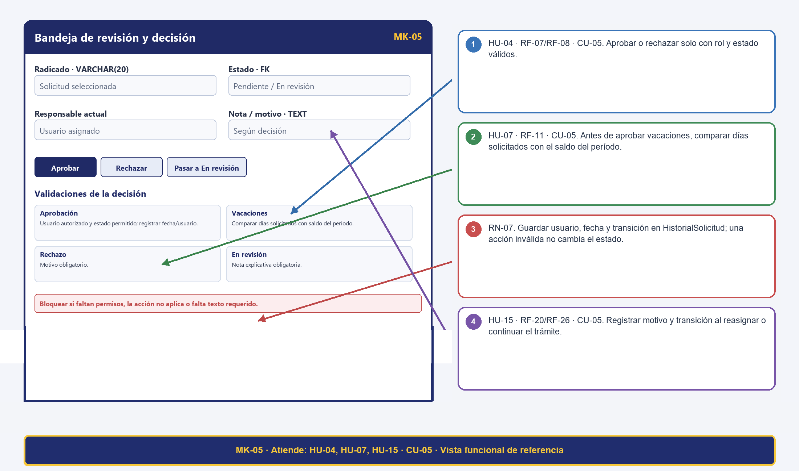

#### Tabla 10. Trazabilidad del mockup MK-05: Bandeja de revisión y decisión

| Código | MK-05 |
| --- | --- |
| Pantalla | Bandeja de revisión y decisión |
| Atiende (HU / CU) | HU-04, HU-07, HU-15 / CU-05 |
| Campos ↔ Diccionario | Solicitud.id_estado INT FK; decisión y nota en HistorialSolicitud.fecha_accion DATETIME/comentario TEXT; SaldoVacaciones.dias_generados y dias_utilizados. Días disponibles = dias_generados - dias_utilizados (valor derivado, no almacenado). |
| Botones ↔ Eventos | Aprobar; Rechazar; Pasar a En revisión — eventos relacionados con CU-05. RF específicos y transiciones se detallan en la matriz final. |
| RN visibles | RN-03/05/06/07/12/16: estado válido, autorización, motivo de rechazo, saldo y nota para En revisión. RNF-01/03/04/05. |
| Métodos de clase ↔ pantalla (HU respaldadas) | PermisoLaboral.aprobarPermiso; SaldoVacaciones.diasDisponibles; Solicitud.actualizarEstado; HistorialSolicitud.registrarCambioEstado |

### 14.6 MK-06 — Asignaciones y responsables

#### Figura 15. MK-06: Asignaciones y responsables; vista de referencia con trazabilidad anotada.

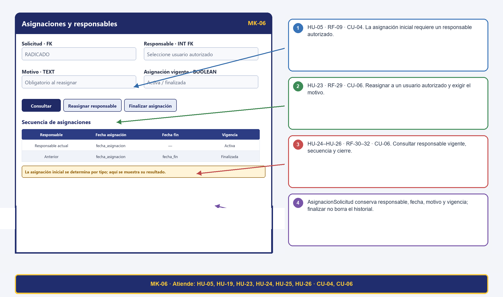

#### Tabla 11. Trazabilidad del mockup MK-06: Asignaciones y responsables

| Código | MK-06 |
| --- | --- |
| Pantalla | Asignaciones y responsables |
| Atiende (HU / CU) | HU-05, HU-19, HU-23, HU-24, HU-25, HU-26 / CU-04, CU-06 |
| Campos ↔ Diccionario | AsignacionSolicitud.id_solicitud/id_usuario_responsable INT FK; fecha_asignacion/fecha_fin DATETIME; motivo TEXT; activa BOOLEAN. |
| Botones ↔ Eventos | Consultar; Reasignar responsable; Finalizar asignación — eventos relacionados con CU-04, CU-06. RF específicos y transiciones se detallan en la matriz final. |
| RN visibles | RN-08/09/10/26: responsable autorizado, motivo de reasignación y asignación vigente diferenciada de finalizada. RNF-03/04/05/06. |
| Métodos de clase ↔ pantalla (HU respaldadas) | Solicitud.asignarResponsable; AsignacionSolicitud.asignar; AsignacionSolicitud.finalizarAsignacion |

### 14.7 MK-07 — Notificaciones y alertas

#### Figura 16. MK-07: Notificaciones y alertas; vista de referencia con trazabilidad anotada.

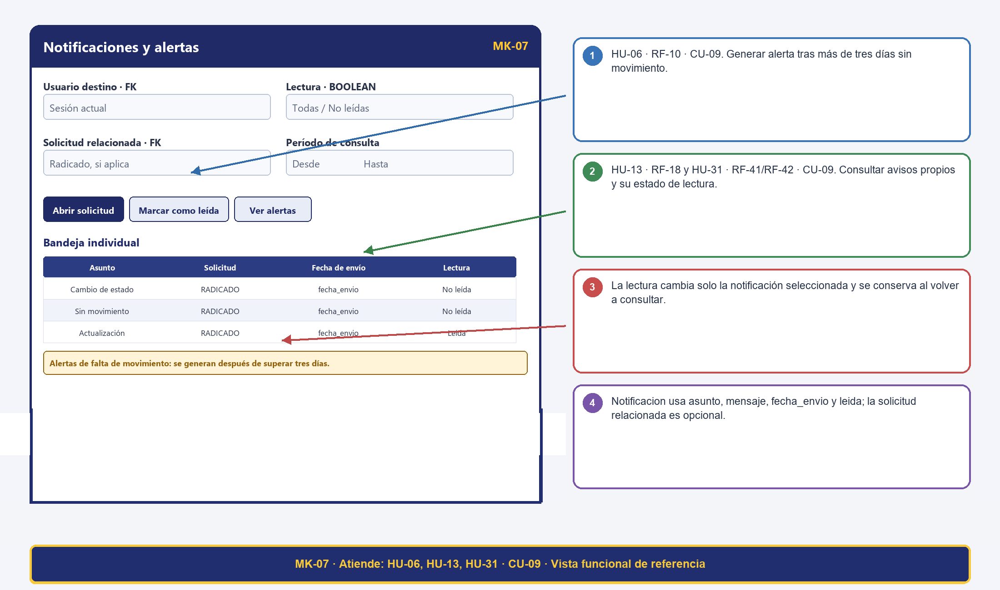

#### Tabla 12. Trazabilidad del mockup MK-07: Notificaciones y alertas

| Código | MK-07 |
| --- | --- |
| Pantalla | Notificaciones y alertas |
| Atiende (HU / CU) | HU-06, HU-13, HU-31 / CU-09 |
| Campos ↔ Diccionario | Notificacion.id_usuario INT FK, id_solicitud INT FK opcional, asunto VARCHAR(150), mensaje TEXT, fecha_envio DATETIME y leida BOOLEAN. |
| Botones ↔ Eventos | Abrir solicitud; Marcar como leída; Ver alertas — eventos relacionados con CU-09. RF específicos y transiciones se detallan en la matriz final. |
| RN visibles | RN-11/21/22: alerta después de tres días sin movimiento, destinatario correcto y lectura individual. RNF-03/04/05. |
| Métodos de clase ↔ pantalla (HU respaldadas) | Notificacion.enviarNotificacion; Notificacion.marcarComoLeida |

### 14.8 MK-08 — Certificado laboral

#### Figura 17. MK-08: Certificado laboral; vista de referencia con trazabilidad anotada.

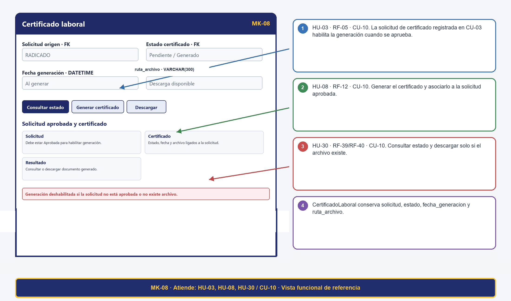

#### Tabla 13. Trazabilidad del mockup MK-08: Certificado laboral

| Código | MK-08 |
| --- | --- |
| Pantalla | Certificado laboral |
| Atiende (HU / CU) | HU-03, HU-08, HU-30 / CU-10 |
| Campos ↔ Diccionario | CertificadoLaboral.id_solicitud/id_estado_certificado INT FK; fecha_generacion DATETIME; ruta_archivo VARCHAR(300). EstadoCertificado.nombre VARCHAR(30). |
| Botones ↔ Eventos | Consultar estado; Generar certificado; Descargar — eventos relacionados con CU-10. RF específicos y transiciones se detallan en la matriz final. |
| RN visibles | RN-14: solo pueden generarse certificados laborales cuando la solicitud esté en estado Aprobada.   RN-03: la consulta y descarga del certificado exige sesión activa y autorización sobre la solicitud. |
| Métodos de clase ↔ pantalla (HU respaldadas) | Solicitud.radicarSolicitud; CertificadoLaboral.generarCertificado; CertificadoLaboral.consultarCertificado |

### 14.9 MK-09 — Saldo y días de vacaciones

#### Figura 18. MK-09: Saldo y días de vacaciones; vista de referencia con trazabilidad anotada.

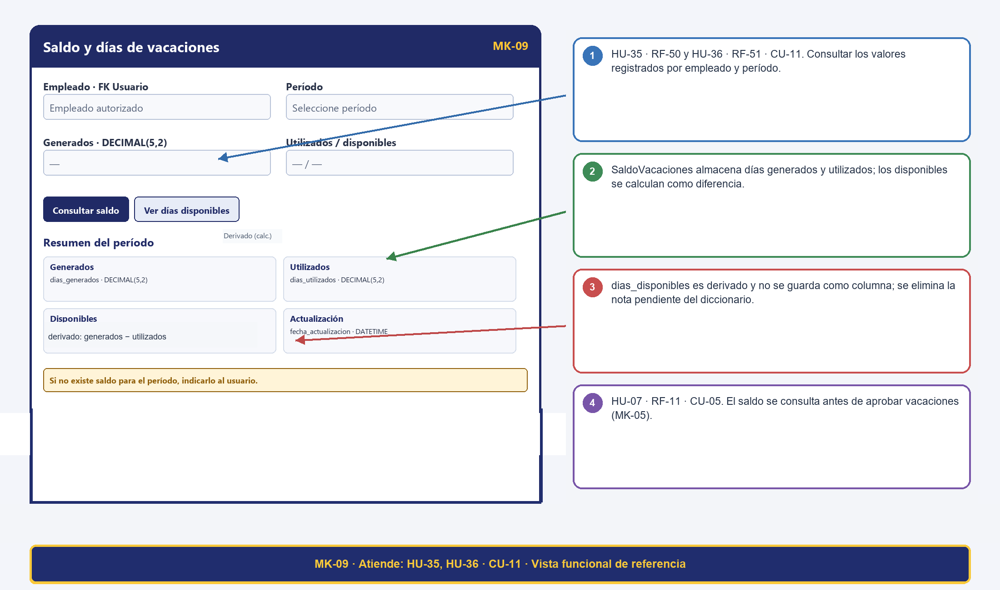

#### Tabla 14. Trazabilidad del mockup MK-09: Saldo y días de vacaciones

| Código | MK-09 |
| --- | --- |
| Pantalla | Saldo y días de vacaciones |
| Atiende (HU / CU) | HU-35, HU-36 / CU-11 |
| Campos ↔ Diccionario | SaldoVacaciones.id_usuario INT FK NN; SaldoVacaciones.periodo VARCHAR(10) NN; SaldoVacaciones.dias_generados DECIMAL(5,2) NN; SaldoVacaciones.dias_utilizados DECIMAL(5,2) NN; SaldoVacaciones.fecha_actualizacion DATETIME NN. El saldo disponible (dias_generados - dias_utilizados) se calcula como valor derivado en consulta. |
| Botones ↔ Eventos | Consultar saldo; Ver días disponibles — eventos relacionados con CU-11. RF específicos y transiciones se detallan en la matriz final. |
| RN visibles | RN-12/30: saldo del período y rango temporal coherente. Días disponibles se calculan con los valores de SaldoVacaciones. RNF-01/03/04/05. |
| Métodos de clase ↔ pantalla (HU respaldadas) | SaldoVacaciones.diasDisponibles |

### 14.10 MK-10 — Perfil organizacional y catálogos

#### Figura 19. MK-10: Perfil organizacional y catálogos; vista de referencia con trazabilidad anotada.

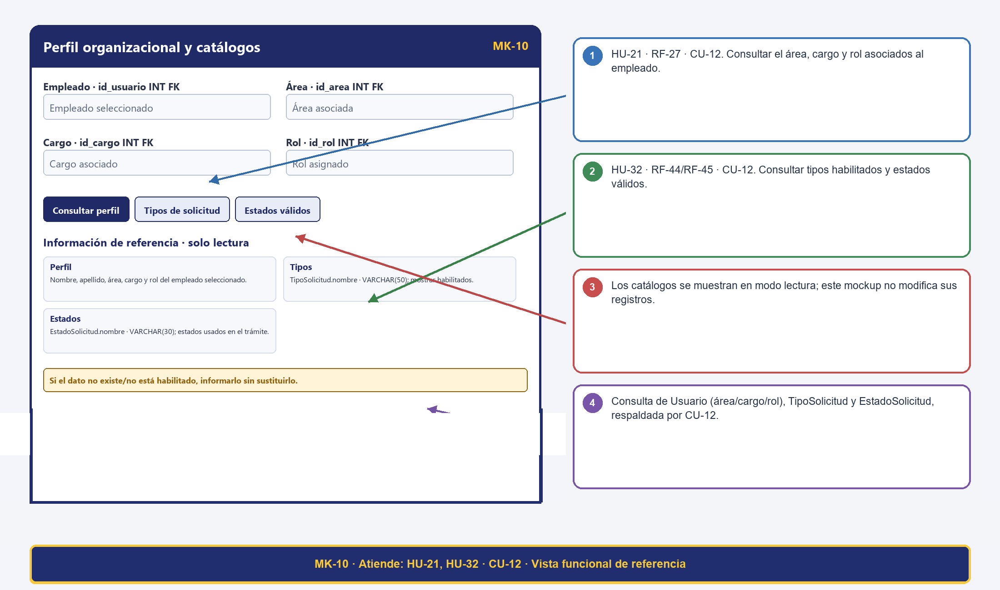

#### Tabla 15. Trazabilidad del mockup MK-10: Perfil organizacional y catálogos

| Código | MK-10 |
| --- | --- |
| Pantalla | Perfil organizacional y catálogos |
| Atiende (HU / CU) | HU-21, HU-32 / CU-12 |
| Campos ↔ Diccionario | Usuario.nombre/apellido VARCHAR(100), id_area/id_cargo/id_rol INT FK; Área/Cargo.nombre VARCHAR(100); Rol.nombre VARCHAR(50); TipoSolicitud.nombre VARCHAR(50); EstadoSolicitud.nombre VARCHAR(30). |
| Botones ↔ Eventos | Consultar perfil; Tipos de solicitud; Estados válidos — eventos relacionados con CU-12. RF específicos y transiciones se detallan en la matriz final. |
| RN visibles | RN-03/25/27: estado válido, perfil del empleado consultado y acceso autorizado. RNF-03/04/05. |
| Métodos de clase ↔ pantalla (HU respaldadas) | Consulta de solo lectura de Usuario (área, cargo y rol), TipoSolicitud y EstadoSolicitud, respaldada por CU-12. |

### 14.11 MK-11 — Historial y auditoría

#### Figura 20. MK-11: Historial y auditoría; vista de referencia con trazabilidad anotada.

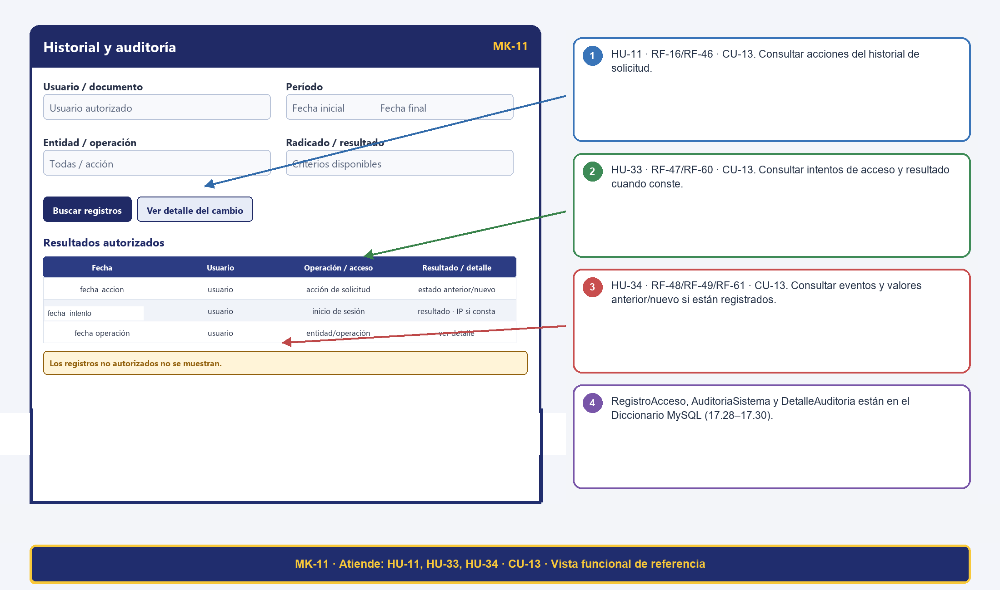

#### Tabla 16. Trazabilidad del mockup MK-11: Historial y auditoría

| Código | MK-11 |
| --- | --- |
| Pantalla | Historial y auditoría |
| Atiende (HU / CU) | HU-11, HU-33, HU-34 / CU-13 |
| Campos ↔ Diccionario | HistorialSolicitud (id_solicitud, id_usuario, id_tipo_accion, id_estado_anterior, id_estado_nuevo, comentario, fecha_accion); RegistroAcceso (id_usuario, fecha_intento, exitoso, direccion_ip); AuditoriaSistema (id_usuario, tabla_afectada, accion_realizada, fecha_accion); DetalleAuditoria (id_auditoria, campo_modificado, valor_anterior, valor_nuevo). |
| Botones ↔ Eventos | Buscar registros; Ver detalle del cambio — eventos relacionados con CU-13. RF específicos y transiciones se detallan en la matriz final. |
| RN visibles | RN-07/27/28: solo lectura, autorización y valores anterior/nuevo cuando existan. RNF-03/05. El Diccionario MySQL incluye RegistroAcceso, AuditoriaSistema y DetalleAuditoria. |
| Métodos de clase ↔ pantalla (HU respaldadas) | PermisoLaboral.aprobarPermiso; Solicitud.actualizarEstado; HistorialSolicitud.registrarCambioEstado; HistorialSolicitud.consultarHistorial; RegistroAcceso.consultarAccesosPorUsuario; AuditoriaSistema.consultarPorUsuario; DetalleAuditoria.consultarDetalle |

### 14.12 MK-12 — Reportes y exportación

#### Figura 21. MK-12: Reportes y exportación; vista de referencia con trazabilidad anotada.

#### Tabla 17. Trazabilidad del mockup MK-12: Reportes y exportación

| Código | MK-12 |
| --- | --- |
| Pantalla | Reportes y exportación |
| Atiende (HU / CU) | HU-14, HU-20, HU-37, HU-38, HU-39, HU-40, HU-16 / CU-14 |
| Campos ↔ Diccionario | Reporte.id_tipo_reporte/id_usuario INT FK, fecha_generacion DATETIME, nombre_archivo VARCHAR(150), ruta_archivo VARCHAR(300). Los filtros de consulta no están definidos como campos persistidos. |
| Botones ↔ Eventos | Generar reporte; Consultar generados; Exportar resultado — eventos relacionados con CU-14. RF específicos y transiciones se detallan en la matriz final. |
| RN visibles | RN-25: los reportes deben generarse únicamente con información registrada en el sistema.   RN-27 y RN-30: solo usuarios con rol autorizado pueden generar o exportar reportes según los parámetros seleccionados. |
| Métodos de clase ↔ pantalla (HU respaldadas) | Reporte.generar; Reporte.exportar |

### 14.13 Matriz integral de trazabilidad

La matriz integra las 40 HU consolidadas con sus criterios de aceptación, RF, RN/RNF, pasos básicos y alternos de CU, campos SQL contrastados, actores, mockups y referencias al documento MySQL. La numeración de HU de la entrega MySQL se usa como referencia funcional; no se presume una equivalencia uno a uno con las historias consolidadas de Nexa. P identifica pasos básicos y FA, flujos alternos. La tabla de correspondencia MySQL relaciona los métodos operativos con los procedimientos y HU; las operaciones de consulta y validación se justifican por sus criterios de aceptación.

#### Tabla 18. Matriz integral de trazabilidad del proyecto

| HU | Criterios de aceptación | RF asociados | RN / RNF | CU (pasos / flujos) | SQL DDL: tablas y campos | ACT / MK / referencia MySQL |
| --- | --- | --- | --- | --- | --- | --- |
| HU-01 | CA-1: Con credenciales válidas, el sistema permite el acceso y muestra únicamente las funciones del rol asignado.   CA-2: Con credenciales inválidas, deniega el acceso y presenta un mensaje claro.   CA-3: Registra los intentos asociados a una cuenta identificable con fecha, resultado y dirección IP cuando esté disponible. | RF-01 | RN: — / RNF: RNF-03 | CU-01 P1–3; FA-01/02; CU-01 P3 | Usuario (id_usuario, nombre, apellido, correo, contrasena_hash, id_cargo, id_area, id_rol, activo); Rol (id_rol, nombre); RegistroAcceso (id_acceso, id_usuario, fecha_intento, exitoso, direccion_ip) | ACT-01 / MK-01 / PRG-01 / ACT-01, ACT-02, ACT-03, ACT-04 / Sin PRG directo identificado en la matriz MySQL |
| HU-02 | CA-1: El sistema envía un mecanismo temporal al correo registrado y permite solicitar otro cuando el anterior haya expirado.   CA-2: Solo un mecanismo vigente y no utilizado permite establecer la nueva contraseña.   CA-3: Después del restablecimiento, el mecanismo queda marcado como utilizado y no puede reutilizarse. | RF-02, RF-43 | RN: RN-20 / RNF: RNF-03, RNF-05 | CU-02 P1; FA-01/02; CU-02 P3; FA-02; CU-02 P2 | RecuperacionClave (id_recuperacion, id_usuario, token, fecha_solicitud, fecha_expiracion, utilizada); Usuario (id_usuario, nombre, apellido, correo, contrasena_hash, id_cargo, id_area, id_rol, activo) | ACT-01, ACT-05 / MK-01 / PRG-02 / ACT-01, ACT-02, ACT-03, ACT-05 / Sin PRG directo identificado en la matriz MySQL |
| HU-03 | CA-1: El empleado selecciona uno de los tipos de solicitud disponibles y diligencia los datos obligatorios de ese trámite.   CA-2: Se aplican las validaciones correspondientes, incluidas las fechas y el saldo para vacaciones y el soporte requerido para incapacidad.   CA-3: Una solicitud válida recibe un radicado único, queda en el estado inicial definido y muestra confirmación.   CA-4: Si faltan datos o no se cumplen las reglas del tipo seleccionado, el sistema no radica la solicitud e indica qué debe corregirse. | RF-03, RF-13, RF-04, RF-05, RF-06 | RN: RN-01, RN-23, RN-13, RN-14, RN-02 / RNF: RNF-01, RNF-02, RNF-03, RNF-04, RNF-05, RNF-06 | CU-03 P1–4; FA-01–04; CU-10 P1–3; FA-01/02. | PermisoLaboral (id_permiso, id_solicitud, id_tipo_permiso, id_estado_permiso, fecha_inicio, fecha_fin, motivo); EstadoPermiso (id_estado_permiso, nombre); TipoPermiso (id_tipo_permiso, nombre); Solicitud (id_solicitud, radicado, id_usuario, id_tipo_solicitud, id_estado, fecha_registro); EstadoVacacion (id_estado_vacacion, nombre); TipoVacacion (id_tipo_vacacion, nombre); Vacacion (id_vacacion, id_solicitud, id_tipo_vacacion, id_estado_vacacion, fecha_inicio, fecha_fin, motivo); CertificadoLaboral (id_certificado, id_solicitud, id_estado_certificado, fecha_generacion, ruta_archivo); EstadoCertificado (id_estado_certificado, nombre); EstadoIncapacidad (id_estado_incapacidad, nombre); TipoIncapacidad (id_tipo_incapacidad, nombre); Incapacidad (id_incapacidad, id_solicitud, id_tipo_incapacidad, id_estado_incapacidad, fecha_inicio, fecha_fin, observacion); Documento (id_documento, id_solicitud, id_usuario_carga, nombre_archivo, tipo_archivo, tamano_archivo, ruta_archivo, fecha_carga) | ACT-01 / MK-03, MK-08 / PRG-04 / PRG-03, PRG-04 / PRG-04, PRG-08 / PRG-04, PRG-07 |
| HU-04 | CA-1: Solo un actor autorizado puede aprobar o rechazar una solicitud en un estado que admita la decisión.   CA-2: Al rechazar, se exige el motivo; al aprobar, se registra la decisión y su nuevo estado.   CA-3: Cada cambio guarda solicitud, actor, fecha, estado anterior, estado nuevo y acción asociada al historial. | RF-07, RF-26, RF-08 | RN: RN-03, RN-05, RN-07, RN-06 / RNF: RNF-01, RNF-02, RNF-03, RNF-04, RNF-05, RNF-06 | CU-05 P1–3; FA-01/02/04. | HistorialSolicitud (id_historial, id_solicitud, id_usuario, id_tipo_accion, id_estado_anterior, id_estado_nuevo, fecha_accion, comentario); EstadoSolicitud (id_estado, nombre); PermisoLaboral (id_permiso, id_solicitud, id_tipo_permiso, id_estado_permiso, fecha_inicio, fecha_fin, motivo); Solicitud (id_solicitud, radicado, id_usuario, id_tipo_solicitud, id_estado, fecha_registro) | ACT-02 / MK-05 / PRG-05 / ACT-01, ACT-02, ACT-03, ACT-04 / Sin PRG directo identificado en la matriz MySQL |
| HU-05 | Antecedentes:   Dado que existe una solicitud registrada   Y que el tipo de solicitud tiene un responsable definido para iniciar su flujo      Escenario: CA-1 Determinación del responsable   Dado que RAD-2026-005 corresponde a un tipo de solicitud con responsable configurado   Cuando se inicia el flujo de atención   Entonces el sistema determina el responsable correspondiente al tipo de solicitud      Escenario: CA-2 Asociación de la asignación   Dado que se determinó el responsable "Carlos Pérez"   Cuando se confirma la asignación inicial   Entonces la asignación queda asociada a RAD-2026-005   Y Carlos Pérez queda identificado como responsable      Escenario: CA-3 Registro de fecha   Dado que la solicitud fue asignada   Cuando se consulta la asignación   Entonces se muestra el responsable asignado   Y se conserva la fecha de asignación      Escenario: CA-4 Solicitud sin responsable disponible   Dado que no existe un responsable configurado para el tipo correspondiente   Cuando se intenta realizar la asignación inicial   Entonces el sistema no asigna un responsable inexistente   Y deja la situación identificada para gestión | RF-09 | RN: RN-08 / RNF: RNF-01, RNF-02, RNF-03, RNF-06 | CU-04 P1–3; FA-01; CU-06 P1–4 (consulta, reasignación y cierre de asignaciones). | AsignacionSolicitud (id_asignacion, id_solicitud, id_usuario_responsable, fecha_asignacion, fecha_fin, motivo, activa); Solicitud (id_solicitud, radicado, id_usuario, id_tipo_solicitud, id_estado, fecha_registro) | ACT-03 / MK-06 / PRG-04 |
| HU-06 | Antecedentes:   Dado que existe una solicitud pendiente de atención   Y que el límite definido para generar la alerta es superior a tres días sin movimiento      Escenario: CA-1 Alerta después del límite   Dado que RAD-2026-006 permanece sin movimiento durante más de tres días   Cuando se supera el límite definido   Entonces el sistema genera la alerta correspondiente   Y la alerta identifica la solicitud y el destinatario      Escenario: CA-2 Sin alerta antes del límite   Dado que RAD-2026-007 lleva menos de tres días sin movimiento   Cuando se verifica el proceso de alertas   Entonces el sistema no genera la alerta por vencimiento del límite      Escenario: CA-3 Identificación de la solicitud   Dado que RAD-2026-006 genera una alerta   Cuando el destinatario consulta la alerta   Entonces puede identificar el número de radicado   Y puede identificar que corresponde a una solicitud sin movimiento      Escenario: CA-4 Destinatario correcto   Dado que una solicitud tiene un responsable vigente   Cuando se genera la alerta   Entonces la alerta se dirige al destinatario definido para la atención de la solicitud | RF-10 | RN: RN-11 / RNF: RNF-02, RNF-03, RNF-04 | CU-09 P1–2; FA-01 | Notificacion (id_notificacion, id_usuario, id_solicitud, asunto, mensaje, fecha_envio, leida); Solicitud (id_solicitud, radicado, id_usuario, id_tipo_solicitud, id_estado, fecha_registro) | ACT-03, ACT-05 / MK-07 / PRG-10 |
| HU-07 | Antecedentes:   Dado que existe una solicitud de vacaciones pendiente de aprobación   Y que el sistema dispone del saldo correspondiente al empleado y período      Escenario: CA-1 Consulta previa a la aprobación   Dado que Ana Torres solicita 5 días de vacaciones   Cuando el usuario autorizado inicia la validación para aprobar   Entonces el sistema consulta el saldo disponible antes de aprobar      Escenario: CA-2 Saldo suficiente   Dado que Ana tiene 10 días disponibles y solicita 5   Cuando se valida el saldo   Entonces el sistema determina que el saldo es suficiente   Y permite continuar con el proceso de aprobación      Escenario: CA-3 Saldo insuficiente   Dado que Ana tiene 3 días disponibles y solicita 5   Cuando se valida el saldo   Entonces el sistema determina que el saldo es insuficiente   Y no permite aprobar la solicitud por falta de saldo      Escenario: CA-4 Período correspondiente   Dado que Ana tiene saldos registrados para diferentes períodos   Cuando se valida una solicitud de vacaciones   Entonces el sistema utiliza el saldo correspondiente al período de la solicitud | RF-11 | RN: RN-05, RN-12 / RNF: RNF-01, RNF-02, RNF-03, RNF-04, RNF-05, RNF-06 | CU-05 P2; FA-03 | SaldoVacaciones (id_saldo, id_usuario, periodo, dias_generados, dias_utilizados, fecha_actualizacion); Vacacion (id_vacacion, id_solicitud, id_tipo_vacacion, id_estado_vacacion, fecha_inicio, fecha_fin, motivo) | ACT-03 / MK-05 / PRG-03, PRG-05 |
| HU-08 | Antecedentes:   Dado que existe una solicitud de certificado laboral asociada a un empleado      Escenario: CA-1 Generación desde solicitud aprobada   Dado que la solicitud RAD-2026-008 está aprobada   Cuando el usuario de Talento Humano solicita generar el certificado   Entonces el sistema genera el certificado asociado a RAD-2026-008      Escenario: CA-2 Rechazo de generación sin aprobación   Dado que RAD-2026-009 se encuentra pendiente   Cuando el usuario intenta generar el certificado   Entonces el sistema no genera el documento como certificado aprobado   Y conserva el estado de la solicitud      Escenario: CA-3 Asociación del archivo   Dado que el certificado fue generado correctamente   Cuando se consulta la solicitud RAD-2026-008   Entonces el archivo generado aparece asociado a esa solicitud      Escenario: CA-4 Disponibilidad   Dado que existe un certificado generado   Cuando el empleado o usuario autorizado consulta la solicitud   Entonces el sistema permite acceder al archivo según los permisos definidos | RF-12 | RN: RN-14 / RNF: RNF-01, RNF-02, RNF-03, RNF-04, RNF-05, RNF-06 | CU-10 P1–2; FA-01 | CertificadoLaboral (id_certificado, id_solicitud, id_estado_certificado, fecha_generacion, ruta_archivo); EstadoCertificado (id_estado_certificado, nombre); Solicitud (id_solicitud, radicado, id_usuario, id_tipo_solicitud, id_estado, fecha_registro) | ACT-03 / MK-08 / PRG-08 |
| HU-09 | Antecedentes:   Dado que el usuario de Talento Humano ha iniciado sesión   Y que existen solicitudes registradas      Escenario: CA-1 Búsqueda por radicado existente   Dado que existe la solicitud RAD-2026-010   Cuando el usuario busca exactamente RAD-2026-010   Entonces el sistema localiza la solicitud   Y muestra información que permite identificarla inequívocamente      Escenario: CA-2 Radicado inexistente   Dado que no existe una solicitud con radicado RAD-9999   Cuando el usuario realiza la búsqueda   Entonces el sistema no devuelve solicitudes   Y muestra que no se encontró coincidencia      Escenario: CA-3 Radicado exacto   Dado que existen varios radicados diferentes   Cuando el usuario consulta RAD-2026-010   Entonces el resultado corresponde al radicado consultado   Y no mezcla información de otros radicados      Escenario: CA-4 Consulta sin modificación   Dado que el usuario localiza una solicitud   Cuando visualiza el resultado de la búsqueda   Entonces la consulta no modifica los datos de la solicitud | RF-14 | RN: RN-23 / RNF: RNF-01, RNF-02, RNF-03, RNF-04, RNF-05, RNF-06 | CU-07 P1; FA-01 | Solicitud (id_solicitud, radicado, id_usuario, id_tipo_solicitud, id_estado, fecha_registro) | ACT-03 / MK-02 / PRG-11 |
| HU-10 | CA-1: El archivo queda asociado a la solicitud correspondiente y se identifica quién lo cargó y cuándo.   CA-2: Se permiten soportes adicionales mientras la solicitud no haya sido procesada.   CA-3: El sistema valida el formato y tamaño permitidos antes de aceptar el archivo. | RF-15, RF-33 | RN: RN-17, RN-18, RN-19 / RNF: RNF-01, RNF-02, RNF-03, RNF-04, RNF-05, RNF-06 | CU-08 P1–2; FA-01/02. | Solicitud (id_solicitud, radicado, id_usuario, id_tipo_solicitud, id_estado, fecha_registro); Documento (id_documento, id_solicitud, id_usuario_carga, nombre_archivo, tipo_archivo, tamano_archivo, ruta_archivo, fecha_carga) | ACT-01 / MK-03 / PRG-04, PRG-07 / MK-04 / PRG-07 |
| HU-11 | CA-1: El historial se presenta en orden cronológico y corresponde a la solicitud consultada.   CA-2: Cuando existan, se muestran la radicación, cambios de estado, asignaciones y cargas documentales, con actor, fecha y detalle registrado.   CA-3: El acceso a la información respeta los permisos del usuario. | RF-16, RF-46 | RN: RN-07, RN-28 / RNF: RNF-01, RNF-02, RNF-03, RNF-06 | CU-13 P1–2; FA-01; CU-13 P1 | HistorialSolicitud (id_historial, id_solicitud, id_usuario, id_tipo_accion, id_estado_anterior, id_estado_nuevo, fecha_accion, comentario); TipoAccion (id_tipo_accion, nombre) | ACT-03 / MK-04 / PRG-09 / MK-11 / Consulta SQL; matriz MySQL |
| HU-12 | Antecedentes:   Dado que el empleado tiene una solicitud registrada   Y que la solicitud se encuentra en un estado que permite modificación      Escenario: CA-1 Edición de solicitud pendiente   Dado que RAD-2026-013 está pendiente   Cuando Ana modifica el motivo de la solicitud y guarda los cambios   Entonces el sistema actualiza la información   Y conserva la solicitud con sus datos modificados      Escenario: CA-2 Solicitud procesada no editable   Dado que RAD-2026-014 ya fue aprobada   Cuando Ana intenta modificarla   Entonces el sistema no permite la edición   Y conserva los datos procesados      Escenario: CA-3 Estado no modificable   Dado que una solicitud se encuentra en un estado que no permite cambios   Cuando el empleado intenta editarla   Entonces el sistema bloquea la operación      Escenario: CA-4 Trazabilidad de modificación   Dado que una solicitud pendiente fue modificada   Cuando se consulta su historial   Entonces la modificación queda identificable para conservar la trazabilidad | RF-17 | RN: RN-07, RN-15 / RNF: RNF-01, RNF-02, RNF-03, RNF-04, RNF-05, RNF-06 | CU-05 P1,3; FA-01/04 | Solicitud (id_solicitud, radicado, id_usuario, id_tipo_solicitud, id_estado, fecha_registro) | ACT-01 / MK-03 / PRG-05 |
| HU-13 | Antecedentes:   Dado que el empleado tiene solicitudes registradas   Y que está habilitada la notificación correspondiente      Escenario: CA-1 Notificación por cambio de estado   Dado que RAD-2026-015 cambia de Pendiente a Aprobada   Cuando se confirma el cambio de estado   Entonces el sistema genera la notificación configurada   Y la dirige al empleado correspondiente      Escenario: CA-2 Destinatario correcto   Dado que RAD-2026-016 pertenece a Ana Torres   Cuando se genera una notificación por su cambio de estado   Entonces la notificación identifica a Ana como destinataria   Y no se presenta como notificación dirigida a otro empleado      Escenario: CA-3 Notificación interna   Dado que se genera una notificación interna   Cuando Ana consulta sus notificaciones   Entonces puede identificar el aviso relacionado con la solicitud   Y el sistema conserva su estado de lectura      Escenario: CA-4 Correo configurado   Dado que el proceso tiene habilitada la notificación por correo   Cuando ocurre el evento que la genera   Entonces el sistema utiliza el correo asociado al destinatario | RF-18 | RN: RN-21 / RNF: RNF-02, RNF-03, RNF-04 | CU-09 P2–3; FA-02/03 | Notificacion (id_notificacion, id_usuario, id_solicitud, asunto, mensaje, fecha_envio, leida); Solicitud (id_solicitud, radicado, id_usuario, id_tipo_solicitud, id_estado, fecha_registro) | ACT-01, ACT-05 / MK-07 / PRG-09 |
| HU-14 | Antecedentes:   Dado que existen solicitudes con fechas y responsables registrados   Y que el usuario de Talento Humano puede consultar reportes      Escenario: CA-1 Consulta por tipo y responsable   Dado que existen solicitudes de permiso atendidas por Carlos Pérez   Cuando el usuario consulta tiempos por tipo "Permiso laboral" y responsable "Carlos Pérez"   Entonces el reporte utiliza esos criterios   Y muestra los tiempos registrados para las solicitudes coincidentes      Escenario: CA-2 Uso de tiempos registrados   Dado que una solicitud tiene registrado su tiempo de atención   Cuando se genera la consulta   Entonces el reporte utiliza el tiempo registrado del proceso   Y no inventa un valor para la solicitud      Escenario: CA-3 Identificación del período   Dado que el usuario consulta el período del 01/10/2026 al 31/10/2026   Cuando genera el reporte   Entonces el resultado identifica el período consultado      Escenario: CA-4 Sin coincidencias   Dado que no existen solicitudes que cumplan los filtros   Cuando se consulta el reporte   Entonces el sistema informa que no hay información coincidente | RF-19 | RN: RN-29, RN-30 / RNF: RNF-01, RNF-02, RNF-03, RNF-04, RNF-05, RNF-06 | CU-14 P1–2; FA-01 | TipoReporte (id_tipo_reporte, nombre); Solicitud (id_solicitud, radicado, id_usuario, id_tipo_solicitud, id_estado, fecha_registro); Reporte (id_reporte, id_tipo_reporte, id_usuario, fecha_generacion, nombre_archivo, ruta_archivo) | ACT-03 / MK-12 / PRG-11 |
| HU-15 | Antecedentes:   Dado que existe una solicitud que puede pasar al estado En revisión   Y que el usuario de Talento Humano está autorizado      Escenario: CA-1 Cambio a En revisión   Dado que RAD-2026-017 está en un estado que permite revisión adicional   Cuando el usuario selecciona cambiar a En revisión   Entonces la solicitud queda en estado En revisión      Escenario: CA-2 Nota obligatoria   Dado que RAD-2026-018 requiere una validación adicional   Cuando el usuario intenta cambiarla a En revisión sin registrar una nota   Entonces el sistema no ejecuta el cambio   Y solicita la nota explicativa      Escenario: CA-3 Nota registrada   Dado que el usuario ingresa la nota "Validar soporte adjunto"   Cuando confirma el cambio   Entonces la nota queda asociada al cambio de estado   Y la solicitud queda En revisión      Escenario: CA-4 Historial   Dado que la solicitud fue cambiada a En revisión   Cuando se consulta su historial   Entonces se identifica el cambio de estado   Y se conserva la nota explicativa registrada | RF-20, RF-26 | RN: RN-03, RN-07, RN-16 / RNF: RNF-01, RNF-02, RNF-03, RNF-04, RNF-05, RNF-06 | CU-05 P1,3; FA-01/02/04 | HistorialSolicitud (id_historial, id_solicitud, id_usuario, id_tipo_accion, id_estado_anterior, id_estado_nuevo, fecha_accion, comentario); EstadoSolicitud (id_estado, nombre); Solicitud (id_solicitud, radicado, id_usuario, id_tipo_solicitud, id_estado, fecha_registro) | ACT-03 / MK-05 / PRG-05 |
| HU-16 | CA-1: La consulta acepta estado, tipo, empleado y rango de fechas, incluidos los filtros de período y estado.   CA-2: Los resultados corresponden a los criterios seleccionados y muestran el radicado, tipo, empleado, fecha y estado.   CA-3: Si no hay coincidencias, el sistema informa que no se encontraron solicitudes. | RF-21, RF-62 | RN: RN-03, RN-27, RN-30 / RNF: RNF-01, RNF-02, RNF-03, RNF-04, RNF-05, RNF-06 | CU-07 P1; FA-01/02; CU-14 P1–2 | EstadoSolicitud (id_estado, nombre); TipoSolicitud (id_tipo_solicitud, nombre); Solicitud (id_solicitud, radicado, id_usuario, id_tipo_solicitud, id_estado, fecha_registro); TipoReporte (id_tipo_reporte, nombre); Reporte (id_reporte, id_tipo_reporte, id_usuario, fecha_generacion, nombre_archivo, ruta_archivo); Cargo (id_cargo, nombre); Area (id_area, nombre); Rol (id_rol, nombre) | ACT-03 / MK-02 / PRG-11 / MK-02, MK-12 |
| HU-17 | Antecedentes:   Dado que el empleado "Ana Torres" ha iniciado sesión      Escenario: CA-1 Consulta exclusiva del empleado   Dado que Ana tiene solicitudes propias y existen solicitudes de otros empleados   Cuando consulta su historial personal   Entonces el sistema muestra únicamente las solicitudes de Ana Torres      Escenario: CA-2 Fechas y estados   Dado que Ana tiene solicitudes con diferentes fechas y estados   Cuando consulta su historial   Entonces cada solicitud muestra su fecha y estado correspondiente      Escenario: CA-3 Respuestas y comentarios   Dado que una solicitud de Ana tiene una respuesta o comentario registrado   Cuando consulta su historial   Entonces el sistema muestra esa respuesta o comentario junto a la solicitud      Escenario: CA-4 Sin solicitudes   Dado que un empleado no tiene solicitudes anteriores   Cuando consulta su historial personal   Entonces el sistema informa que no existen solicitudes para mostrar | RF-22 | RN: RN-03, RN-24 / RNF: RNF-01, RNF-02, RNF-03, RNF-04, RNF-05, RNF-06 | CU-07 P2; FA-01/02 | EstadoSolicitud (id_estado, nombre); TipoSolicitud (id_tipo_solicitud, nombre); Solicitud (id_solicitud, radicado, id_usuario, id_tipo_solicitud, id_estado, fecha_registro) | ACT-01 / MK-04 / PRG-11 |
| HU-18 | Antecedentes:   Dado que el empleado tiene una solicitud registrada   Y que todavía no ha sido aprobada ni rechazada      Escenario: CA-1 Cancelación permitida   Dado que RAD-2026-019 se encuentra pendiente   Cuando Ana selecciona cancelar la solicitud   Entonces el sistema ejecuta la cancelación   Y registra la acción realizada      Escenario: CA-2 Solicitud aprobada no cancelable   Dado que RAD-2026-020 está aprobada   Cuando Ana intenta cancelarla   Entonces el sistema no permite la cancelación      Escenario: CA-3 Solicitud rechazada no cancelable   Dado que RAD-2026-021 está rechazada   Cuando Ana intenta cancelarla   Entonces el sistema no permite la cancelación      Escenario: CA-4 Trazabilidad   Dado que RAD-2026-019 fue cancelada correctamente   Cuando se consulta su historial   Entonces la cancelación aparece registrada   Y se conserva la información de la acción | RF-23, RF-26 | RN: RN-03, RN-04, RN-07 / RNF: RNF-01, RNF-02, RNF-03, RNF-04, RNF-05, RNF-06 | CU-05 P1,3; FA-01/04 | HistorialSolicitud (id_historial, id_solicitud, id_usuario, id_tipo_accion, id_estado_anterior, id_estado_nuevo, fecha_accion, comentario); EstadoSolicitud (id_estado, nombre); Solicitud (id_solicitud, radicado, id_usuario, id_tipo_solicitud, id_estado, fecha_registro) | ACT-01 / MK-04 / PRG-05 |
| HU-19 | Antecedentes:   Dado que existe una solicitud con un responsable asignado   Y que el usuario de Talento Humano está autorizado para reasignar      Escenario: CA-1 Reasignación a responsable autorizado   Dado que RAD-2026-022 está asignada a Carlos Pérez   Cuando el usuario la reasigna a Laura Gómez, quien es responsable autorizado   Entonces la nueva asignación queda asociada a la solicitud      Escenario: CA-2 Responsable no autorizado   Dado que "Usuario no autorizado" no puede recibir solicitudes   Cuando se intenta reasignar RAD-2026-022 a ese usuario   Entonces el sistema no realiza la reasignación      Escenario: CA-3 Motivo obligatorio   Dado que se seleccionó un responsable autorizado   Cuando el usuario intenta reasignar sin ingresar motivo   Entonces el sistema no completa la reasignación   Y solicita el motivo obligatorio      Escenario: CA-4 Registro histórico   Dado que la reasignación se realizó con motivo "Distribución de carga"   Cuando se consulta el historial de la solicitud   Entonces se identifica la reasignación   Y se conserva el motivo registrado | RF-24 | RN: RN-07, RN-09, RN-10 / RNF: RNF-01, RNF-02, RNF-03, RNF-06 | CU-06 P1,3; FA-01 | AsignacionSolicitud (id_asignacion, id_solicitud, id_usuario_responsable, fecha_asignacion, fecha_fin, motivo, activa); HistorialSolicitud (id_historial, id_solicitud, id_usuario, id_tipo_accion, id_estado_anterior, id_estado_nuevo, fecha_accion, comentario) | ACT-03 / MK-06 / PRG-06 |
| HU-20 | Antecedentes:   Dado que el gerente tiene permiso para consultar información de gestión      Escenario: CA-1 Selección de período   Dado que el gerente desea consultar octubre de 2026   Cuando selecciona el período del 01/10/2026 al 31/10/2026   Entonces el sistema genera el resumen correspondiente a ese período      Escenario: CA-2 Diferenciación por tipo   Dado que existen solicitudes de permisos, vacaciones, incapacidades y certificados   Cuando el gerente consulta el resumen   Entonces la información diferencia los tipos de solicitud      Escenario: CA-3 Correspondencia con el período   Dado que existen solicitudes fuera del período seleccionado   Cuando se genera el resumen   Entonces esas solicitudes no hacen parte del resultado del período consultado      Escenario: CA-4 Período sin información   Dado que no existen solicitudes en el período seleccionado   Cuando el gerente consulta el resumen   Entonces el sistema informa que no existen datos para ese período | RF-25 | RN: RN-29, RN-30 / RNF: RNF-01, RNF-02, RNF-03, RNF-04, RNF-05, RNF-06 | CU-14 P1–2; FA-01 | TipoReporte (id_tipo_reporte, nombre); Solicitud (id_solicitud, radicado, id_usuario, id_tipo_solicitud, id_estado, fecha_registro); Reporte (id_reporte, id_tipo_reporte, id_usuario, fecha_generacion, nombre_archivo, ruta_archivo) | ACT-04 / MK-12 / PRG-11 |
| HU-21 | Antecedentes:   Dado que existe un empleado registrado   Y que el usuario de Talento Humano tiene permiso para consultar su información organizacional      Escenario: CA-1 Identificación del empleado   Dado que el usuario selecciona a Ana Torres   Cuando consulta su perfil organizacional   Entonces el sistema identifica que la información corresponde a Ana Torres      Escenario: CA-2 Datos organizacionales disponibles   Dado que Ana Torres tiene área "Talento Humano", cargo "Analista" y rol registrado   Cuando se consulta su perfil   Entonces el sistema muestra el área, cargo y rol registrados      Escenario: CA-3 Información correspondiente   Dado que existen otros empleados registrados   Cuando el usuario consulta el perfil de Ana Torres   Entonces el sistema no mezcla datos organizacionales de otros empleados      Escenario: CA-4 Datos no registrados   Dado que un empleado no tiene uno de los datos organizacionales registrados   Cuando se consulta el perfil   Entonces el sistema muestra los datos disponibles   Y no inventa información para el dato faltante | RF-27 | RN: RN-03 / RNF: RNF-01, RNF-02, RNF-03, RNF-04, RNF-05 | CU-12 P1–2; FA-01/03 | Usuario (id_usuario, nombre, apellido, correo, contrasena_hash, id_cargo, id_area, id_rol, activo); Cargo (id_cargo, nombre); Area (id_area, nombre); Rol (id_rol, nombre) | ACT-03 / MK-10 / PRG-11 |
| HU-22 | Antecedentes:   Dado que existe una solicitud registrada   Y que el usuario tiene permiso para consultarla      Escenario: CA-1 Radicado   Dado que existe RAD-2026-023   Cuando el usuario consulta su detalle   Entonces el sistema muestra el radicado RAD-2026-023      Escenario: CA-2 Información básica   Dado que RAD-2026-023 es una solicitud de permiso registrada el 10/10/2026   Cuando se consulta el detalle   Entonces se muestran el tipo, la fecha y el estado actual      Escenario: CA-3 Responsable   Dado que RAD-2026-023 tiene un responsable vigente   Cuando se consulta el detalle   Entonces el sistema muestra el responsable actual      Escenario: CA-4 Solicitud inexistente   Dado que no existe RAD-9999   Cuando el usuario intenta consultar su detalle   Entonces el sistema informa que la solicitud no fue encontrada | RF-28 | RN: RN-23, RN-27 / RNF: RNF-01, RNF-02, RNF-03, RNF-04, RNF-05, RNF-06 | CU-07 P2; FA-03 | EstadoSolicitud (id_estado, nombre); TipoSolicitud (id_tipo_solicitud, nombre); Solicitud (id_solicitud, radicado, id_usuario, id_tipo_solicitud, id_estado, fecha_registro) | ACT-01 / MK-04 / PRG-11 |
| HU-23 | Antecedentes:   Dado que existe una solicitud con asignaciones registradas      Escenario: CA-1 Responsable vigente   Dado que RAD-2026-024 tiene como responsable vigente a Carlos Pérez   Cuando el usuario consulta el responsable actual   Entonces el sistema identifica a Carlos Pérez como responsable vigente      Escenario: CA-2 Correspondencia con la solicitud   Dado que existen asignaciones de varias solicitudes   Cuando se consulta RAD-2026-024   Entonces se muestra únicamente la asignación correspondiente a esa solicitud      Escenario: CA-3 Asignación finalizada   Dado que una asignación anterior de RAD-2026-024 fue finalizada   Cuando se consulta el responsable actual   Entonces la asignación finalizada no aparece como vigente      Escenario: CA-4 Sin responsable vigente   Dado que una solicitud no tiene una asignación vigente   Cuando se consulta su responsable actual   Entonces el sistema informa que no existe responsable vigente | RF-29 | RN: RN-26 / RNF: RNF-01, RNF-02, RNF-03, RNF-06 | CU-06 P1; FA-02 | AsignacionSolicitud (id_asignacion, id_solicitud, id_usuario_responsable, fecha_asignacion, fecha_fin, motivo, activa); HistorialSolicitud (id_historial, id_solicitud, id_usuario, id_tipo_accion, id_estado_anterior, id_estado_nuevo, fecha_accion, comentario); Usuario (id_usuario, nombre, apellido, correo, contrasena_hash, id_cargo, id_area, id_rol, activo) | ACT-01 / MK-06 / PRG-06 |
| HU-24 | Antecedentes:   Dado que una solicitud tiene una o más asignaciones o reasignaciones registradas      Escenario: CA-1 Consulta de asignaciones   Dado que RAD-2026-025 fue asignada inicialmente a Carlos Pérez y posteriormente a Laura Gómez   Cuando se consulta el historial de asignaciones   Entonces se muestran las asignaciones asociadas a RAD-2026-025      Escenario: CA-2 Diferenciación de estados   Dado que la asignación de Carlos Pérez fue finalizada y la de Laura Gómez está vigente   Cuando se consulta el historial   Entonces se distinguen la asignación finalizada y la vigente      Escenario: CA-3 Fechas de asignación   Dado que cada asignación tiene una fecha registrada   Cuando se consulta el historial   Entonces el sistema muestra la fecha correspondiente a cada asignación      Escenario: CA-4 Solicitud sin asignaciones   Dado que una solicitud no tiene asignaciones registradas   Cuando se consulta su historial de asignaciones   Entonces el sistema informa que no existen asignaciones históricas | RF-30 | RN: RN-26 / RNF: RNF-01, RNF-02, RNF-03, RNF-06 | CU-06 P1–2; FA-02/04 | AsignacionSolicitud (id_asignacion, id_solicitud, id_usuario_responsable, fecha_asignacion, fecha_fin, motivo, activa); HistorialSolicitud (id_historial, id_solicitud, id_usuario, id_tipo_accion, id_estado_anterior, id_estado_nuevo, fecha_accion, comentario); Usuario (id_usuario, nombre, apellido, correo, contrasena_hash, id_cargo, id_area, id_rol, activo) | ACT-03 / MK-06 / PRG-06 |
| HU-25 | Antecedentes:   Dado que existe una asignación vigente asociada a una solicitud   Y que el usuario de Talento Humano está autorizado      Escenario: CA-1 Finalización de asignación   Dado que Carlos Pérez tiene la asignación vigente de RAD-2026-026   Cuando el usuario finaliza la asignación   Entonces la asignación queda marcada como finalizada      Escenario: CA-2 Registro de fecha de finalización   Dado que la asignación está vigente   Cuando se confirma su finalización   Entonces el sistema registra la fecha de finalización      Escenario: CA-3 Deja de estar activa   Dado que la asignación de Carlos Pérez fue finalizada   Cuando se consulta el responsable vigente de RAD-2026-026   Entonces Carlos Pérez ya no aparece como responsable activo      Escenario: CA-4 Asignación ya finalizada   Dado que una asignación ya está finalizada   Cuando se intenta finalizar nuevamente   Entonces el sistema no la trata como una asignación vigente | RF-31 | RN: RN-26 / RNF: RNF-01, RNF-02, RNF-03, RNF-06 | CU-06 P3; FA-03 | AsignacionSolicitud (id_asignacion, id_solicitud, id_usuario_responsable, fecha_asignacion, fecha_fin, motivo, activa) | ACT-03 / MK-06 / PRG-06 |
| HU-26 | Antecedentes:   Dado que existe una asignación o reasignación con motivo registrado      Escenario: CA-1 Consulta del motivo   Dado que la asignación de RAD-2026-027 tiene el motivo "Distribución de carga"   Cuando el usuario consulta el motivo   Entonces el sistema muestra "Distribución de carga"      Escenario: CA-2 Motivo asociado a la asignación   Dado que RAD-2026-027 tiene varias asignaciones con motivos diferentes   Cuando se consulta una asignación específica   Entonces el motivo mostrado corresponde a esa asignación      Escenario: CA-3 Asignación sin motivo   Dado que una asignación no tiene un motivo registrado   Cuando se consulta su motivo   Entonces el sistema informa que no existe motivo registrado      Escenario: CA-4 Consulta sin modificación   Dado que existe una asignación con motivo registrado   Cuando el usuario consulta el motivo   Entonces la asignación permanece sin cambios | RF-32 | RN: RN-10 / RNF: RNF-01, RNF-02, RNF-03, RNF-06 | CU-06 P2; FA-04 | AsignacionSolicitud (id_asignacion, id_solicitud, id_usuario_responsable, fecha_asignacion, fecha_fin, motivo, activa); HistorialSolicitud (id_historial, id_solicitud, id_usuario, id_tipo_accion, id_estado_anterior, id_estado_nuevo, fecha_accion, comentario); Usuario (id_usuario, nombre, apellido, correo, contrasena_hash, id_cargo, id_area, id_rol, activo) | ACT-03 / MK-06 / PRG-06 |
| HU-27 | Antecedentes:   Dado que existe una solicitud con documentos adjuntos   Y que el usuario tiene permiso para consultarlos      Escenario: CA-1 Consulta de documentos   Dado que RAD-2026-029 tiene dos documentos asociados   Cuando el usuario consulta sus documentos adjuntos   Entonces el sistema muestra los documentos asociados a RAD-2026-029      Escenario: CA-2 Información del documento   Dado que existe un documento llamado "Soporte.pdf"   Cuando se consulta la lista de documentos   Entonces se identifica su nombre, tipo y fecha de carga      Escenario: CA-3 Documento de otra solicitud   Dado que existen documentos asociados a diferentes solicitudes   Cuando se consulta RAD-2026-029   Entonces el sistema no muestra documentos pertenecientes a otra solicitud      Escenario: CA-4 Consulta sin modificación   Dado que existen documentos asociados   Cuando el usuario los consulta   Entonces el contenido y los registros de los archivos no se modifican | RF-34 | RN: RN-17, RN-19 / RNF: RNF-01, RNF-02, RNF-03, RNF-04, RNF-05, RNF-06 | CU-08 P3; FA-02/03 | Solicitud (id_solicitud, radicado, id_usuario, id_tipo_solicitud, id_estado, fecha_registro); Documento (id_documento, id_solicitud, id_usuario_carga, nombre_archivo, tipo_archivo, tamano_archivo, ruta_archivo, fecha_carga) | ACT-03 / MK-04 / PRG-07 |
| HU-28 | Antecedentes:   Dado que el empleado está adjuntando un documento a una solicitud      Escenario: CA-1 Formato válido   Dado que el archivo "Soporte.pdf" tiene un formato permitido   Cuando el empleado intenta adjuntarlo   Entonces el sistema acepta la validación de formato      Escenario: CA-2 Formato inválido   Dado que el archivo "Soporte.exe" no corresponde a un formato permitido   Cuando el empleado intenta adjuntarlo   Entonces el sistema informa que el formato no es válido   Y no almacena el archivo como soporte válido      Escenario: CA-3 Tamaño máximo   Dado que el archivo supera el tamaño máximo permitido   Cuando el empleado intenta cargarlo   Entonces el sistema informa que el tamaño no es válido   Y no almacena el archivo como soporte válido      Escenario: CA-4 Validación exitosa   Dado que el archivo cumple formato y tamaño   Cuando se ejecutan las validaciones   Entonces el archivo puede continuar al proceso de almacenamiento como soporte válido | RF-35 | RN: RN-18 / RNF: RNF-01, RNF-02, RNF-03, RNF-04, RNF-05, RNF-06 | CU-08 P1; FA-01 | Documento (id_documento, id_solicitud, id_usuario_carga, nombre_archivo, tipo_archivo, tamano_archivo, ruta_archivo, fecha_carga) | ACT-01 / MK-03 / PRG-07 |
| HU-29 | CA-1: El permiso muestra fechas, tipo, estado y motivo.   CA-2: Las vacaciones muestran fechas, días calculados, modalidad, estado y motivo.   CA-3: La incapacidad muestra fechas, tipo u origen, estado, observación y soporte médico cuando esté asociado.   CA-4: El sistema solo muestra los datos que corresponden al tipo de trámite y a los permisos del usuario. | RF-36, RF-37, RF-38 | RN: RN-12, RN-13, RN-17 / RNF: RNF-01, RNF-02, RNF-03, RNF-04, RNF-05, RNF-06 | CU-07 P2; FA-03 | PermisoLaboral (id_permiso, id_solicitud, id_tipo_permiso, id_estado_permiso, fecha_inicio, fecha_fin, motivo); EstadoPermiso (id_estado_permiso, nombre); TipoPermiso (id_tipo_permiso, nombre); EstadoVacacion (id_estado_vacacion, nombre); TipoVacacion (id_tipo_vacacion, nombre); Vacacion (id_vacacion, id_solicitud, id_tipo_vacacion, id_estado_vacacion, fecha_inicio, fecha_fin, motivo); EstadoIncapacidad (id_estado_incapacidad, nombre); TipoIncapacidad (id_tipo_incapacidad, nombre); Incapacidad (id_incapacidad, id_solicitud, id_tipo_incapacidad, id_estado_incapacidad, fecha_inicio, fecha_fin, observacion) | ACT-01 / MK-04 / Consulta SQL; matriz MySQL / PRG-03 / ACT-03 |
| HU-30 | CA-1: El sistema informa el estado vigente del certificado.   CA-2: Cuando el certificado esté generado, permite consultar y descargar el archivo asociado.   CA-3: Si aún no está disponible, indica el estado sin presentar un archivo inexistente. | RF-39, RF-40 | RN: RN-14 / RNF: RNF-01, RNF-02, RNF-03, RNF-04, RNF-05, RNF-06 | CU-10 P3; FA-02 | CertificadoLaboral (id_certificado, id_solicitud, id_estado_certificado, fecha_generacion, ruta_archivo); EstadoCertificado (id_estado_certificado, nombre) | ACT-01 / MK-08 / PRG-08 |
| HU-31 | CA-1: El empleado consulta únicamente sus notificaciones, con asunto, fecha y contenido.   CA-2: Puede marcar individualmente una notificación como leída.   CA-3: El estado de lectura se conserva y se refleja al volver a consultar. | RF-41, RF-42 | RN: RN-21, RN-22 / RNF: RNF-02, RNF-03, RNF-04 | CU-09 P3; FA-03 | Notificacion (id_notificacion, id_usuario, id_solicitud, asunto, mensaje, fecha_envio, leida) | ACT-01 / MK-07 / PRG-09 |
| HU-32 | CA-1: Antes de radicar, el empleado puede consultar los tipos de solicitud disponibles.   CA-2: El personal autorizado puede consultar los estados válidos y su significado operativo.   CA-3: La consulta presenta los valores definidos por los catálogos vigentes. | RF-44, RF-45 | RN: RN-03 / RNF: RNF-01, RNF-02, RNF-03, RNF-04, RNF-05 | CU-12 P1–2; FA-02 | TipoSolicitud (id_tipo_solicitud, nombre); EstadoSolicitud (id_estado, nombre) | ACT-01 / MK-10 / Consulta SQL; matriz MySQL / ACT-03 |
| HU-33 | CA-1: La consulta permite filtrar por usuario y rango de fechas; cuando se requiera, también por dirección IP y resultado.   CA-2: Cada resultado muestra fecha del intento, resultado y dirección IP registrada.   CA-3: La consulta no permite alterar los registros de acceso. | RF-47, RF-60 | RN: RN-27 / RNF: RNF-01, RNF-02, RNF-03, RNF-06 | CU-13 P1; FA-01/02; CU-13 P1–2 | RegistroAcceso (id_acceso, id_usuario, fecha_intento, exitoso, direccion_ip); Usuario (id_usuario, nombre, apellido, correo, contrasena_hash, id_cargo, id_area, id_rol, activo) | ACT-03 / MK-11 / PRG-01 / PRG-01, PRG-11 |
| HU-34 | CA-1: La consulta permite filtrar eventos por usuario operador, tabla afectada y período.   CA-2: Cada evento muestra acción, usuario y fecha registrados.   CA-3: Cuando existe un detalle asociado, se muestran el campo modificado y sus valores anterior y nuevo. | RF-48, RF-49, RF-61 | RN: RN-27, RN-28 / RNF: RNF-01, RNF-02, RNF-03, RNF-06 | CU-13 P1; FA-01/02; CU-13 P2–3; FA-01/02/03; CU-13 P1–2 | AuditoriaSistema (id_auditoria, id_usuario, tabla_afectada, accion_realizada, fecha_accion); Usuario (id_usuario, nombre, apellido, correo, contrasena_hash, id_cargo, id_area, id_rol, activo); DetalleAuditoria (id_detalle, id_auditoria, campo_modificado, valor_anterior, valor_nuevo) | ACT-04 / MK-11 / PRG-09 / ACT-03 / PRG-09, PRG-11 |
| HU-35 | Antecedentes:   Dado que existe información de saldo de vacaciones para empleados y períodos      Escenario: CA-1 Selección de empleado y período   Dado que el usuario selecciona a Ana Torres y el período 2026   Cuando consulta el saldo   Entonces el sistema identifica a Ana Torres y el período 2026      Escenario: CA-2 Días generados y utilizados   Dado que Ana tiene 15 días generados y 5 utilizados   Cuando consulta el saldo del período   Entonces el sistema muestra 15 días generados   Y muestra 5 días utilizados      Escenario: CA-3 Único saldo por empleado y período   Dado que existe un saldo para Ana Torres y el período 2026   Cuando se consulta ese período   Entonces el sistema presenta el saldo correspondiente a esa combinación      Escenario: CA-4 Período sin saldo   Dado que no existe saldo registrado para el período consultado   Cuando se realiza la consulta   Entonces el sistema informa que no existe información de saldo para ese período | RF-50 | RN: RN-12, RN-30 / RNF: RNF-01, RNF-02, RNF-03, RNF-04, RNF-05, RNF-06 | CU-11 P1–2; FA-01/02 | SaldoVacaciones (id_saldo, id_usuario, periodo, dias_generados, dias_utilizados, fecha_actualizacion) | ACT-03 / MK-09 / PRG-03 |
| HU-36 | Antecedentes:   Dado que el empleado "Ana Torres" tiene información de saldo de vacaciones      Escenario: CA-1 Cálculo de disponibilidad   Dado que Ana tiene 15 días generados y 5 utilizados   Cuando consulta sus días disponibles   Entonces el sistema calcula la disponibilidad a partir de esos valores      Escenario: CA-2 Período correspondiente   Dado que Ana tiene saldos correspondientes a diferentes períodos   Cuando consulta un período específico   Entonces la disponibilidad corresponde al período consultado      Escenario: CA-3 Consulta sin modificación   Dado que existe un saldo de vacaciones registrado   Cuando Ana consulta sus días disponibles   Entonces la consulta no modifica el saldo      Escenario: CA-4 Sin información de saldo   Dado que no existe saldo para el período consultado   Cuando Ana consulta sus días disponibles   Entonces el sistema informa que no hay información disponible para calcular la disponibilidad | RF-51 | RN: RN-12 / RNF: RNF-01, RNF-02, RNF-03, RNF-04, RNF-05, RNF-06 | CU-11 P1–2; FA-01/02 | SaldoVacaciones (id_saldo, id_usuario, periodo, dias_generados, dias_utilizados, fecha_actualizacion) | ACT-01 / MK-09 / PRG-03 |
| HU-37 | Antecedentes:   Dado que existen reportes de gestión previamente generados   Y que el usuario está autorizado para consultarlos      Escenario: CA-1 Identificación del tipo   Dado que existe un reporte de tiempos de respuesta   Cuando el usuario consulta los reportes generados   Entonces el sistema identifica el tipo del reporte      Escenario: CA-2 Fecha de generación   Dado que el reporte fue generado el 20/10/2026   Cuando el usuario consulta sus datos   Entonces se muestra la fecha de generación      Escenario: CA-3 Usuario autorizado   Dado que el reporte está disponible para un usuario autorizado   Cuando ese usuario lo consulta   Entonces el sistema permite acceder al reporte      Escenario: CA-4 Reporte no disponible para el usuario   Dado que un reporte no corresponde al usuario autorizado   Cuando intenta consultarlo   Entonces el sistema no lo presenta como disponible para ese usuario | RF-52 | RN: RN-27, RN-30 / RNF: RNF-01, RNF-02, RNF-03, RNF-04, RNF-05, RNF-06 | CU-14 P1,3; FA-01 | TipoReporte (id_tipo_reporte, nombre); Solicitud (id_solicitud, radicado, id_usuario, id_tipo_solicitud, id_estado, fecha_registro); Reporte (id_reporte, id_tipo_reporte, id_usuario, fecha_generacion, nombre_archivo, ruta_archivo); Cargo (id_cargo, nombre); Area (id_area, nombre); Rol (id_rol, nombre) | ACT-04 / MK-12 / PRG-11 |
| HU-38 | CA-1: El usuario selecciona el criterio disponible: tipo de solicitud, responsable o período.   CA-2: El reporte presenta los datos que corresponden al criterio seleccionado y al intervalo indicado.   CA-3: Si no hay datos para los filtros, el sistema informa que el resultado está vacío. | RF-53, RF-54, RF-56 | RN: RN-27, RN-29, RN-30 / RNF: RNF-01, RNF-02, RNF-03, RNF-04, RNF-05, RNF-06 | CU-14 P1–2; FA-01/02 | TipoReporte (id_tipo_reporte, nombre); Solicitud (id_solicitud, radicado, id_usuario, id_tipo_solicitud, id_estado, fecha_registro); Reporte (id_reporte, id_tipo_reporte, id_usuario, fecha_generacion, nombre_archivo, ruta_archivo) | ACT-03 / MK-12 / PRG-11 / ACT-04 |
| HU-39 | Antecedentes:   Dado que existe un reporte de gestión consultado   Y que el formato de exportación está habilitado      Escenario: CA-1 Exportación habilitada   Dado que el reporte RAD-REP-001 está disponible   Cuando el usuario selecciona un formato habilitado   Entonces el sistema genera el archivo de exportación      Escenario: CA-2 Reporte correspondiente   Dado que el usuario está consultando el reporte de solicitudes de octubre   Cuando selecciona exportar   Entonces el archivo corresponde al reporte consultado      Escenario: CA-3 Conservación de información   Dado que el reporte contiene resultados y filtros   Cuando se exporta   Entonces el archivo conserva la información del resultado      Escenario: CA-4 Formato no habilitado   Dado que un formato no está habilitado   Cuando el usuario intenta exportar en ese formato   Entonces el sistema no realiza una exportación en ese formato | RF-55 | RN: RN-27 / RNF: RNF-01, RNF-02, RNF-03, RNF-04, RNF-05, RNF-06 | CU-14 P3; FA-02/03 | Reporte (id_reporte, id_tipo_reporte, id_usuario, fecha_generacion, nombre_archivo, ruta_archivo) | ACT-03 / MK-12 / PRG-11 |
| HU-40 | CA-1: La consulta admite cada criterio organizacional definido: área, cargo o rol.   CA-2: Los resultados muestran únicamente las solicitudes vinculadas al criterio seleccionado.   CA-3: El sistema respeta los permisos de consulta del usuario. | RF-57, RF-58, RF-59 | RN: RN-27, RN-29 / RNF: RNF-01, RNF-02, RNF-03, RNF-04, RNF-05, RNF-06 | CU-14 P1–2; FA-01/02 | TipoReporte (id_tipo_reporte, nombre); Solicitud (id_solicitud, radicado, id_usuario, id_tipo_solicitud, id_estado, fecha_registro); Reporte (id_reporte, id_tipo_reporte, id_usuario, fecha_generacion, nombre_archivo, ruta_archivo); Cargo (id_cargo, nombre); Area (id_area, nombre); Rol (id_rol, nombre) | ACT-04 / MK-12 / PRG-11 / ACT-03 |
