# 1. Fase 1: Análisis

**Proyecto:** Sistema de Gestión de Solicitudes de Talento Humano  
**Organización:** Nexa Servicios  
**Documento Fuente:** *Nexa servicios talento humano definitivo actual.docx*  
**Autores:** Javier Bernal Garavito | Jhulius Karol Escobar Gómez  
**Docente:** Prof. Gloria Amparo Lora Patiño — Universidad Remington  

---

## Índice de la Fase de Análisis

* [2.1 Historias de Usuario (HU-01 a HU-40)](1.1-historias-de-usuario.md)
* [2.2 Requisitos Funcionales (RF-01 a RF-62)](1.2-requisitos-funcionales.md)
* [2.3 Requisitos No Funcionales (RNF-01 a RNF-06)](1.3-requisitos-no-funcionales.md)
* [2.4 Reglas de Negocio (RN-01 a RN-30)](1.4-reglas-de-negocio.md)
* [2.5 Actores del Sistema (ACT-01 a ACT-05)](1.5-actores.md)
* [2.6 Casos de Uso (CU-01 a CU-14)](1.6-casos-de-uso.md)
* [2.7 Mockups e Interfaces de Usuario (MK-01 a MK-12)](1.7-mockups.md)

---

## 2.1 Historias de Usuario (HU-01 a HU-40)

Se consolidan 40 historias de usuario funcionales al agrupar necesidades afines y eliminar duplicaciones o una fragmentación excesiva. Los 62 RF se mantienen. La matriz 14.13 relaciona las 40 HU con criterios, RF, RN/RNF, casos de uso, SQL, actores, mockups y referencias MySQL.

### 8.1 HU-01 — Iniciar sesión y registrar intentos

| Campo | Contenido |
| --- | --- |
| Código | HU-01 |
| Título corto | Iniciar sesión y registrar intentos |
| Historia | Como usuario con una cuenta registrada, quiero autenticarme y que el sistema registre el resultado del intento, para acceder según mi rol y mantener trazabilidad de los accesos. |
| Criterios de aceptación | CA-1: Con credenciales válidas, el sistema permite el acceso y muestra únicamente las funciones del rol asignado.   CA-2: Con credenciales inválidas, deniega el acceso y presenta un mensaje claro.   CA-3: Registra los intentos asociados a una cuenta identificable con fecha, resultado y dirección IP cuando esté disponible. |
| Origen de la necesidad | Sustentada por RF-01; CU CU-01; ACT ACT-01, ACT-04 |
| RF relacionados | RF-01 |
| Prioridad | Alta |

### 8.2 HU-02 — Recuperar y restablecer contraseña

| Campo | Contenido |
| --- | --- |
| Código | HU-02 |
| Título corto | Recuperar y restablecer contraseña |
| Historia | Como empleado, quiero solicitar o renovar un mecanismo temporal y usarlo para cambiar mi contraseña, para recuperar el acceso a mi cuenta. |
| Criterios de aceptación | CA-1: El sistema envía un mecanismo temporal al correo registrado y permite solicitar otro cuando el anterior haya expirado.   CA-2: Solo un mecanismo vigente y no utilizado permite establecer la nueva contraseña.   CA-3: Después del restablecimiento, el mecanismo queda marcado como utilizado y no puede reutilizarse. |
| Origen de la necesidad | Sustentada por RF-02, RF-43; CU CU-02 |
| RF relacionados | RF-02, RF-43 |
| Prioridad | Alta |

### 8.3 HU-03 — Registrar solicitud de talento humano

| Campo | Contenido |
| --- | --- |
| Código | HU-03 |
| Título corto | Registrar solicitud de talento humano |
| Historia | Como empleado, quiero radicar una solicitud de permiso, vacaciones, certificado laboral o incapacidad, para gestionar un trámite de talento humano en un mismo flujo. |
| Criterios de aceptación | CA-1: El empleado selecciona uno de los tipos de solicitud disponibles y diligencia los datos obligatorios de ese trámite.   CA-2: Se aplican las validaciones correspondientes, incluidas las fechas y el saldo para vacaciones y el soporte requerido para incapacidad.   CA-3: Una solicitud válida recibe un radicado único, queda en el estado inicial definido y muestra confirmación.   CA-4: Si faltan datos o no se cumplen las reglas del tipo seleccionado, el sistema no radica la solicitud e indica qué debe corregirse. |
| Origen de la necesidad | Sustentada por RF-03, RF-13, RF-04, RF-05, RF-06; CU CU-03, CU-10; ACT ACT-01 |
| RF relacionados | RF-03, RF-13, RF-04, RF-05, RF-06 |
| Prioridad | Alta |

### 8.4 HU-04 — Decidir la solicitud y registrar el cambio

| Campo | Contenido |
| --- | --- |
| Código | HU-04 |
| Título corto | Decidir la solicitud y registrar el cambio |
| Historia | Como actor autorizado del flujo, quiero aprobar o rechazar una solicitud y dejar registrada cada transición, para comunicar una decisión trazable. |
| Criterios de aceptación | CA-1: Solo un actor autorizado puede aprobar o rechazar una solicitud en un estado que admita la decisión.   CA-2: Al rechazar, se exige el motivo; al aprobar, se registra la decisión y su nuevo estado.   CA-3: Cada cambio guarda solicitud, actor, fecha, estado anterior, estado nuevo y acción asociada al historial. |
| Origen de la necesidad | Sustentada por RF-07, RF-26, RF-08; CU CU-05 |
| RF relacionados | RF-07, RF-26, RF-08 |
| Prioridad | Alta |

### 8.5 HU-05 — Asignar responsable inicial

| Campo | Contenido |
| --- | --- |
| Código | HU-05 |
| Título corto | Asignar responsable inicial |
| Historia | Como usuario de Talento Humano, quiero que una solicitud reciba un responsable inicial según su tipo, para iniciar el flujo de revisión. |
| Criterios de aceptación | Antecedentes:   Dado que existe una solicitud registrada   Y que el tipo de solicitud tiene un responsable definido para iniciar su flujo      Escenario: CA-1 Determinación del responsable   Dado que RAD-2026-005 corresponde a un tipo de solicitud con responsable configurado   Cuando se inicia el flujo de atención   Entonces el sistema determina el responsable correspondiente al tipo de solicitud      Escenario: CA-2 Asociación de la asignación   Dado que se determinó el responsable "Carlos Pérez"   Cuando se confirma la asignación inicial   Entonces la asignación queda asociada a RAD-2026-005   Y Carlos Pérez queda identificado como responsable      Escenario: CA-3 Registro de fecha   Dado que la solicitud fue asignada   Cuando se consulta la asignación   Entonces se muestra el responsable asignado   Y se conserva la fecha de asignación      Escenario: CA-4 Solicitud sin responsable disponible   Dado que no existe un responsable configurado para el tipo correspondiente   Cuando se intenta realizar la asignación inicial   Entonces el sistema no asigna un responsable inexistente   Y deja la situación identificada para gestión |
| Origen de la necesidad | Sustentada por RF-09; CU CU-04, CU-06 |
| RF relacionados | RF-09 |
| Prioridad | Alta |

### 8.6 HU-06 — Alertar solicitudes sin movimiento

| Campo | Contenido |
| --- | --- |
| Código | HU-06 |
| Título corto | Alertar solicitudes sin movimiento |
| Historia | Como usuario de Talento Humano, quiero recibir alertas cuando una solicitud permanezca más de tres días sin movimiento, para evitar retrasos. |
| Criterios de aceptación | Antecedentes:   Dado que existe una solicitud pendiente de atención   Y que el límite definido para generar la alerta es superior a tres días sin movimiento      Escenario: CA-1 Alerta después del límite   Dado que RAD-2026-006 permanece sin movimiento durante más de tres días   Cuando se supera el límite definido   Entonces el sistema genera la alerta correspondiente   Y la alerta identifica la solicitud y el destinatario      Escenario: CA-2 Sin alerta antes del límite   Dado que RAD-2026-007 lleva menos de tres días sin movimiento   Cuando se verifica el proceso de alertas   Entonces el sistema no genera la alerta por vencimiento del límite      Escenario: CA-3 Identificación de la solicitud   Dado que RAD-2026-006 genera una alerta   Cuando el destinatario consulta la alerta   Entonces puede identificar el número de radicado   Y puede identificar que corresponde a una solicitud sin movimiento      Escenario: CA-4 Destinatario correcto   Dado que una solicitud tiene un responsable vigente   Cuando se genera la alerta   Entonces la alerta se dirige al destinatario definido para la atención de la solicitud |
| Origen de la necesidad | Sustentada por RF-10; CU CU-09 |
| RF relacionados | RF-10 |
| Prioridad | Media |

### 8.7 HU-07 — Validar saldo de vacaciones

| Campo | Contenido |
| --- | --- |
| Código | HU-07 |
| Título corto | Validar saldo de vacaciones |
| Historia | Como usuario de Talento Humano, quiero validar el saldo disponible de vacaciones antes de aprobar una solicitud, para evitar inconsistencias. |
| Criterios de aceptación | Antecedentes:   Dado que existe una solicitud de vacaciones pendiente de aprobación   Y que el sistema dispone del saldo correspondiente al empleado y período      Escenario: CA-1 Consulta previa a la aprobación   Dado que Ana Torres solicita 5 días de vacaciones   Cuando el usuario autorizado inicia la validación para aprobar   Entonces el sistema consulta el saldo disponible antes de aprobar      Escenario: CA-2 Saldo suficiente   Dado que Ana tiene 10 días disponibles y solicita 5   Cuando se valida el saldo   Entonces el sistema determina que el saldo es suficiente   Y permite continuar con el proceso de aprobación      Escenario: CA-3 Saldo insuficiente   Dado que Ana tiene 3 días disponibles y solicita 5   Cuando se valida el saldo   Entonces el sistema determina que el saldo es insuficiente   Y no permite aprobar la solicitud por falta de saldo      Escenario: CA-4 Período correspondiente   Dado que Ana tiene saldos registrados para diferentes períodos   Cuando se valida una solicitud de vacaciones   Entonces el sistema utiliza el saldo correspondiente al período de la solicitud |
| Origen de la necesidad | Sustentada por RF-11; CU CU-05 |
| RF relacionados | RF-11 |
| Prioridad | Alta |

### 8.8 HU-08 — Generar certificado laboral

| Campo | Contenido |
| --- | --- |
| Código | HU-08 |
| Título corto | Generar certificado laboral |
| Historia | Como usuario de Talento Humano, quiero generar certificados laborales aprobados, para reducir procesos manuales. |
| Criterios de aceptación | Antecedentes:   Dado que existe una solicitud de certificado laboral asociada a un empleado      Escenario: CA-1 Generación desde solicitud aprobada   Dado que la solicitud RAD-2026-008 está aprobada   Cuando el usuario de Talento Humano solicita generar el certificado   Entonces el sistema genera el certificado asociado a RAD-2026-008      Escenario: CA-2 Rechazo de generación sin aprobación   Dado que RAD-2026-009 se encuentra pendiente   Cuando el usuario intenta generar el certificado   Entonces el sistema no genera el documento como certificado aprobado   Y conserva el estado de la solicitud      Escenario: CA-3 Asociación del archivo   Dado que el certificado fue generado correctamente   Cuando se consulta la solicitud RAD-2026-008   Entonces el archivo generado aparece asociado a esa solicitud      Escenario: CA-4 Disponibilidad   Dado que existe un certificado generado   Cuando el empleado o usuario autorizado consulta la solicitud   Entonces el sistema permite acceder al archivo según los permisos definidos |
| Origen de la necesidad | Sustentada por RF-12; CU CU-10; ACT ACT-03 |
| RF relacionados | RF-12 |
| Prioridad | Media |

### 8.9 HU-09 — Buscar solicitud por radicado

| Campo | Contenido |
| --- | --- |
| Código | HU-09 |
| Título corto | Buscar solicitud por radicado |
| Historia | Como usuario de Talento Humano, quiero buscar una solicitud mediante su número de radicado, para encontrarla rápidamente. |
| Criterios de aceptación | Antecedentes:   Dado que el usuario de Talento Humano ha iniciado sesión   Y que existen solicitudes registradas      Escenario: CA-1 Búsqueda por radicado existente   Dado que existe la solicitud RAD-2026-010   Cuando el usuario busca exactamente RAD-2026-010   Entonces el sistema localiza la solicitud   Y muestra información que permite identificarla inequívocamente      Escenario: CA-2 Radicado inexistente   Dado que no existe una solicitud con radicado RAD-9999   Cuando el usuario realiza la búsqueda   Entonces el sistema no devuelve solicitudes   Y muestra que no se encontró coincidencia      Escenario: CA-3 Radicado exacto   Dado que existen varios radicados diferentes   Cuando el usuario consulta RAD-2026-010   Entonces el resultado corresponde al radicado consultado   Y no mezcla información de otros radicados      Escenario: CA-4 Consulta sin modificación   Dado que el usuario localiza una solicitud   Cuando visualiza el resultado de la búsqueda   Entonces la consulta no modifica los datos de la solicitud |
| Origen de la necesidad | Sustentada por RF-14; CU CU-07 |
| RF relacionados | RF-14 |
| Prioridad | Media |

### 8.10 HU-10 — Adjuntar soportes a la solicitud

| Campo | Contenido |
| --- | --- |
| Código | HU-10 |
| Título corto | Adjuntar soportes a la solicitud |
| Historia | Como empleado, quiero adjuntar o complementar los documentos de una solicitud antes de que sea procesada, para respaldar la información entregada. |
| Criterios de aceptación | CA-1: El archivo queda asociado a la solicitud correspondiente y se identifica quién lo cargó y cuándo.   CA-2: Se permiten soportes adicionales mientras la solicitud no haya sido procesada.   CA-3: El sistema valida el formato y tamaño permitidos antes de aceptar el archivo. |
| Origen de la necesidad | Sustentada por RF-15, RF-33; CU CU-08; ACT ACT-01 |
| RF relacionados | RF-15, RF-33 |
| Prioridad | Alta |

### 8.11 HU-11 — Consultar historial y acciones de la solicitud

| Campo | Contenido |
| --- | --- |
| Código | HU-11 |
| Título corto | Consultar historial y acciones de la solicitud |
| Historia | Como usuario autorizado, quiero consultar las acciones registradas en una solicitud, para reconstruir y auditar su flujo. |
| Criterios de aceptación | CA-1: El historial se presenta en orden cronológico y corresponde a la solicitud consultada.   CA-2: Cuando existan, se muestran la radicación, cambios de estado, asignaciones y cargas documentales, con actor, fecha y detalle registrado.   CA-3: El acceso a la información respeta los permisos del usuario. |
| Origen de la necesidad | Sustentada por RF-16, RF-46; CU CU-13 |
| RF relacionados | RF-16, RF-46 |
| Prioridad | Alta |

### 8.12 HU-12 — Editar solicitud pendiente

| Campo | Contenido |
| --- | --- |
| Código | HU-12 |
| Título corto | Editar solicitud pendiente |
| Historia | Como empleado, quiero editar mi solicitud mientras permanezca pendiente, para corregir información antes de ser procesada. |
| Criterios de aceptación | Antecedentes:   Dado que el empleado tiene una solicitud registrada   Y que la solicitud se encuentra en un estado que permite modificación      Escenario: CA-1 Edición de solicitud pendiente   Dado que RAD-2026-013 está pendiente   Cuando Ana modifica el motivo de la solicitud y guarda los cambios   Entonces el sistema actualiza la información   Y conserva la solicitud con sus datos modificados      Escenario: CA-2 Solicitud procesada no editable   Dado que RAD-2026-014 ya fue aprobada   Cuando Ana intenta modificarla   Entonces el sistema no permite la edición   Y conserva los datos procesados      Escenario: CA-3 Estado no modificable   Dado que una solicitud se encuentra en un estado que no permite cambios   Cuando el empleado intenta editarla   Entonces el sistema bloquea la operación      Escenario: CA-4 Trazabilidad de modificación   Dado que una solicitud pendiente fue modificada   Cuando se consulta su historial   Entonces la modificación queda identificable para conservar la trazabilidad |
| Origen de la necesidad | Sustentada por RF-17; CU CU-05 |
| RF relacionados | RF-17 |
| Prioridad | Alta |

### 8.13 HU-13 — Recibir notificaciones

| Campo | Contenido |
| --- | --- |
| Código | HU-13 |
| Título corto | Recibir notificaciones |
| Historia | Como empleado, quiero recibir notificaciones por correo electrónico y dentro del sistema, para mantenerme informado sobre el estado de mis solicitudes. |
| Criterios de aceptación | Antecedentes:   Dado que el empleado tiene solicitudes registradas   Y que está habilitada la notificación correspondiente      Escenario: CA-1 Notificación por cambio de estado   Dado que RAD-2026-015 cambia de Pendiente a Aprobada   Cuando se confirma el cambio de estado   Entonces el sistema genera la notificación configurada   Y la dirige al empleado correspondiente      Escenario: CA-2 Destinatario correcto   Dado que RAD-2026-016 pertenece a Ana Torres   Cuando se genera una notificación por su cambio de estado   Entonces la notificación identifica a Ana como destinataria   Y no se presenta como notificación dirigida a otro empleado      Escenario: CA-3 Notificación interna   Dado que se genera una notificación interna   Cuando Ana consulta sus notificaciones   Entonces puede identificar el aviso relacionado con la solicitud   Y el sistema conserva su estado de lectura      Escenario: CA-4 Correo configurado   Dado que el proceso tiene habilitada la notificación por correo   Cuando ocurre el evento que la genera   Entonces el sistema utiliza el correo asociado al destinatario |
| Origen de la necesidad | Sustentada por RF-18; CU CU-09; ACT ACT-05 |
| RF relacionados | RF-18 |
| Prioridad | Media |

### 8.14 HU-14 — Consultar tiempos de respuesta

| Campo | Contenido |
| --- | --- |
| Código | HU-14 |
| Título corto | Consultar tiempos de respuesta |
| Historia | Como usuario de Talento Humano, quiero consultar reportes de tiempos de respuesta por tipo de solicitud y responsable, para evaluar el desempeño del proceso. |
| Criterios de aceptación | Antecedentes:   Dado que existen solicitudes con fechas y responsables registrados   Y que el usuario de Talento Humano puede consultar reportes      Escenario: CA-1 Consulta por tipo y responsable   Dado que existen solicitudes de permiso atendidas por Carlos Pérez   Cuando el usuario consulta tiempos por tipo "Permiso laboral" y responsable "Carlos Pérez"   Entonces el reporte utiliza esos criterios   Y muestra los tiempos registrados para las solicitudes coincidentes      Escenario: CA-2 Uso de tiempos registrados   Dado que una solicitud tiene registrado su tiempo de atención   Cuando se genera la consulta   Entonces el reporte utiliza el tiempo registrado del proceso   Y no inventa un valor para la solicitud      Escenario: CA-3 Identificación del período   Dado que el usuario consulta el período del 01/10/2026 al 31/10/2026   Cuando genera el reporte   Entonces el resultado identifica el período consultado      Escenario: CA-4 Sin coincidencias   Dado que no existen solicitudes que cumplan los filtros   Cuando se consulta el reporte   Entonces el sistema informa que no hay información coincidente |
| Origen de la necesidad | Sustentada por RF-19; CU CU-14 |
| RF relacionados | RF-19 |
| Prioridad | Media |

### 8.15 HU-15 — Cambiar solicitud a En revisión

| Campo | Contenido |
| --- | --- |
| Código | HU-15 |
| Título corto | Cambiar solicitud a En revisión |
| Historia | Como usuario de Talento Humano, quiero cambiar una solicitud al estado En revisión cuando necesite validaciones adicionales, registrando una nota explicativa, para dejar constancia del motivo. |
| Criterios de aceptación | Antecedentes:   Dado que existe una solicitud que puede pasar al estado En revisión   Y que el usuario de Talento Humano está autorizado      Escenario: CA-1 Cambio a En revisión   Dado que RAD-2026-017 está en un estado que permite revisión adicional   Cuando el usuario selecciona cambiar a En revisión   Entonces la solicitud queda en estado En revisión      Escenario: CA-2 Nota obligatoria   Dado que RAD-2026-018 requiere una validación adicional   Cuando el usuario intenta cambiarla a En revisión sin registrar una nota   Entonces el sistema no ejecuta el cambio   Y solicita la nota explicativa      Escenario: CA-3 Nota registrada   Dado que el usuario ingresa la nota "Validar soporte adjunto"   Cuando confirma el cambio   Entonces la nota queda asociada al cambio de estado   Y la solicitud queda En revisión      Escenario: CA-4 Historial   Dado que la solicitud fue cambiada a En revisión   Cuando se consulta su historial   Entonces se identifica el cambio de estado   Y se conserva la nota explicativa registrada |
| Origen de la necesidad | Sustentada por RF-20, RF-26; CU CU-05 |
| RF relacionados | RF-20, RF-26 |
| Prioridad | Alta |

### 8.16 HU-16 — Consultar solicitudes con filtros

| Campo | Contenido |
| --- | --- |
| Código | HU-16 |
| Título corto | Consultar solicitudes con filtros |
| Historia | Como usuario de Talento Humano, quiero filtrar solicitudes por estado, tipo, empleado y período, para localizar trámites concretos en la bandeja operativa. |
| Criterios de aceptación | CA-1: La consulta acepta estado, tipo, empleado y rango de fechas, incluidos los filtros de período y estado.   CA-2: Los resultados corresponden a los criterios seleccionados y muestran el radicado, tipo, empleado, fecha y estado.   CA-3: Si no hay coincidencias, el sistema informa que no se encontraron solicitudes. |
| Origen de la necesidad | Sustentada por RF-21, RF-62; CU CU-07, CU-14 |
| RF relacionados | RF-21, RF-62 |
| Prioridad | Alta |

### 8.17 HU-17 — Consultar historial personal

| Campo | Contenido |
| --- | --- |
| Código | HU-17 |
| Título corto | Consultar historial personal |
| Historia | Como empleado, quiero consultar el historial personal de todas mis solicitudes radicadas (restringido exclusivamente a mi usuario según RN-24) para conocer sus fechas, estados y decisiones sin acceder a trámites de terceros. |
| Criterios de aceptación | Antecedentes:   Dado que el empleado "Ana Torres" ha iniciado sesión      Escenario: CA-1 Consulta exclusiva del empleado   Dado que Ana tiene solicitudes propias y existen solicitudes de otros empleados   Cuando consulta su historial personal   Entonces el sistema muestra únicamente las solicitudes de Ana Torres      Escenario: CA-2 Fechas y estados   Dado que Ana tiene solicitudes con diferentes fechas y estados   Cuando consulta su historial   Entonces cada solicitud muestra su fecha y estado correspondiente      Escenario: CA-3 Respuestas y comentarios   Dado que una solicitud de Ana tiene una respuesta o comentario registrado   Cuando consulta su historial   Entonces el sistema muestra esa respuesta o comentario junto a la solicitud      Escenario: CA-4 Sin solicitudes   Dado que un empleado no tiene solicitudes anteriores   Cuando consulta su historial personal   Entonces el sistema informa que no existen solicitudes para mostrar |
| Origen de la necesidad | Sustentada por RF-22; CU CU-07 |
| RF relacionados | RF-22 |
| Prioridad | Media |

### 8.18 HU-18 — Cancelar solicitud

| Campo | Contenido |
| --- | --- |
| Código | HU-18 |
| Título corto | Cancelar solicitud |
| Historia | Como empleado, quiero cancelar una solicitud que envié pero que aún no ha sido procesada, para corregir un error o retirarla si ya no la necesito. |
| Criterios de aceptación | Antecedentes:   Dado que el empleado tiene una solicitud registrada   Y que todavía no ha sido aprobada ni rechazada      Escenario: CA-1 Cancelación permitida   Dado que RAD-2026-019 se encuentra pendiente   Cuando Ana selecciona cancelar la solicitud   Entonces el sistema ejecuta la cancelación   Y registra la acción realizada      Escenario: CA-2 Solicitud aprobada no cancelable   Dado que RAD-2026-020 está aprobada   Cuando Ana intenta cancelarla   Entonces el sistema no permite la cancelación      Escenario: CA-3 Solicitud rechazada no cancelable   Dado que RAD-2026-021 está rechazada   Cuando Ana intenta cancelarla   Entonces el sistema no permite la cancelación      Escenario: CA-4 Trazabilidad   Dado que RAD-2026-019 fue cancelada correctamente   Cuando se consulta su historial   Entonces la cancelación aparece registrada   Y se conserva la información de la acción |
| Origen de la necesidad | Sustentada por RF-23, RF-26; CU CU-05 |
| RF relacionados | RF-23, RF-26 |
| Prioridad | Alta |

### 8.19 HU-19 — Reasignar solicitud

| Campo | Contenido |
| --- | --- |
| Código | HU-19 |
| Título corto | Reasignar solicitud |
| Historia | Como usuario de Talento Humano, quiero reasignar una solicitud a otro responsable registrando un motivo obligatorio, para garantizar la trazabilidad del proceso. |
| Criterios de aceptación | Antecedentes:   Dado que existe una solicitud con un responsable asignado   Y que el usuario de Talento Humano está autorizado para reasignar      Escenario: CA-1 Reasignación a responsable autorizado   Dado que RAD-2026-022 está asignada a Carlos Pérez   Cuando el usuario la reasigna a Laura Gómez, quien es responsable autorizado   Entonces la nueva asignación queda asociada a la solicitud      Escenario: CA-2 Responsable no autorizado   Dado que "Usuario no autorizado" no puede recibir solicitudes   Cuando se intenta reasignar RAD-2026-022 a ese usuario   Entonces el sistema no realiza la reasignación      Escenario: CA-3 Motivo obligatorio   Dado que se seleccionó un responsable autorizado   Cuando el usuario intenta reasignar sin ingresar motivo   Entonces el sistema no completa la reasignación   Y solicita el motivo obligatorio      Escenario: CA-4 Registro histórico   Dado que la reasignación se realizó con motivo "Distribución de carga"   Cuando se consulta el historial de la solicitud   Entonces se identifica la reasignación   Y se conserva el motivo registrado |
| Origen de la necesidad | Sustentada por RF-24; CU CU-06 |
| RF relacionados | RF-24 |
| Prioridad | Alta |

### 8.20 HU-20 — Consultar resumen de solicitudes

| Campo | Contenido |
| --- | --- |
| Código | HU-20 |
| Título corto | Consultar resumen de solicitudes |
| Historia | Como Gerencia, quiero consultar un resumen de las solicitudes por tipo y período, para tener visibilidad sobre el estado del equipo y apoyar la toma de decisiones. |
| Criterios de aceptación | Antecedentes:   Dado que el gerente tiene permiso para consultar información de gestión      Escenario: CA-1 Selección de período   Dado que el gerente desea consultar octubre de 2026   Cuando selecciona el período del 01/10/2026 al 31/10/2026   Entonces el sistema genera el resumen correspondiente a ese período      Escenario: CA-2 Diferenciación por tipo   Dado que existen solicitudes de permisos, vacaciones, incapacidades y certificados   Cuando el gerente consulta el resumen   Entonces la información diferencia los tipos de solicitud      Escenario: CA-3 Correspondencia con el período   Dado que existen solicitudes fuera del período seleccionado   Cuando se genera el resumen   Entonces esas solicitudes no hacen parte del resultado del período consultado      Escenario: CA-4 Período sin información   Dado que no existen solicitudes en el período seleccionado   Cuando el gerente consulta el resumen   Entonces el sistema informa que no existen datos para ese período |
| Origen de la necesidad | Sustentada por RF-25; CU CU-14; ACT ACT-04 |
| RF relacionados | RF-25 |
| Prioridad | Media |

### 8.21 HU-21 — Consultar perfil organizacional del empleado

| Campo | Contenido |
| --- | --- |
| Código | HU-21 |
| Título corto | Consultar perfil organizacional del empleado |
| Historia | Como usuario de Talento Humano, quiero consultar el área, cargo y rol asociados a un empleado, para identificar su contexto organizacional al gestionar una solicitud. |
| Criterios de aceptación | Antecedentes:   Dado que existe un empleado registrado   Y que el usuario de Talento Humano tiene permiso para consultar su información organizacional      Escenario: CA-1 Identificación del empleado   Dado que el usuario selecciona a Ana Torres   Cuando consulta su perfil organizacional   Entonces el sistema identifica que la información corresponde a Ana Torres      Escenario: CA-2 Datos organizacionales disponibles   Dado que Ana Torres tiene área "Talento Humano", cargo "Analista" y rol registrado   Cuando se consulta su perfil   Entonces el sistema muestra el área, cargo y rol registrados      Escenario: CA-3 Información correspondiente   Dado que existen otros empleados registrados   Cuando el usuario consulta el perfil de Ana Torres   Entonces el sistema no mezcla datos organizacionales de otros empleados      Escenario: CA-4 Datos no registrados   Dado que un empleado no tiene uno de los datos organizacionales registrados   Cuando se consulta el perfil   Entonces el sistema muestra los datos disponibles   Y no inventa información para el dato faltante |
| Origen de la necesidad | Sustentada por RF-27; CU CU-12; ACT ACT-03 |
| RF relacionados | RF-27 |
| Prioridad | Media |

### 8.22 HU-22 — Consultar detalle de una solicitud

| Campo | Contenido |
| --- | --- |
| Código | HU-22 |
| Título corto | Consultar detalle de una solicitud |
| Historia | Como empleado, quiero visualizar la vista resumida del estado actual, fecha de registro y tipo de una solicitud específica para verificar rápidamente su situación sin abrir el expediente completo de subtipo. |
| Criterios de aceptación | Antecedentes:   Dado que existe una solicitud registrada   Y que el usuario tiene permiso para consultarla      Escenario: CA-1 Radicado   Dado que existe RAD-2026-023   Cuando el usuario consulta su detalle   Entonces el sistema muestra el radicado RAD-2026-023      Escenario: CA-2 Información básica   Dado que RAD-2026-023 es una solicitud de permiso registrada el 10/10/2026   Cuando se consulta el detalle   Entonces se muestran el tipo, la fecha y el estado actual      Escenario: CA-3 Responsable   Dado que RAD-2026-023 tiene un responsable vigente   Cuando se consulta el detalle   Entonces el sistema muestra el responsable actual      Escenario: CA-4 Solicitud inexistente   Dado que no existe RAD-9999   Cuando el usuario intenta consultar su detalle   Entonces el sistema informa que la solicitud no fue encontrada |
| Origen de la necesidad | Sustentada por RF-28; CU CU-07 |
| RF relacionados | RF-28 |
| Prioridad | Alta |

### 8.23 HU-23 — Consultar responsable actual

| Campo | Contenido |
| --- | --- |
| Código | HU-23 |
| Título corto | Consultar responsable actual |
| Historia | Como usuario de Talento Humano, quiero consultar el responsable actual de una solicitud, para saber quién debe atenderla. |
| Criterios de aceptación | Antecedentes:   Dado que existe una solicitud con asignaciones registradas      Escenario: CA-1 Responsable vigente   Dado que RAD-2026-024 tiene como responsable vigente a Carlos Pérez   Cuando el usuario consulta el responsable actual   Entonces el sistema identifica a Carlos Pérez como responsable vigente      Escenario: CA-2 Correspondencia con la solicitud   Dado que existen asignaciones de varias solicitudes   Cuando se consulta RAD-2026-024   Entonces se muestra únicamente la asignación correspondiente a esa solicitud      Escenario: CA-3 Asignación finalizada   Dado que una asignación anterior de RAD-2026-024 fue finalizada   Cuando se consulta el responsable actual   Entonces la asignación finalizada no aparece como vigente      Escenario: CA-4 Sin responsable vigente   Dado que una solicitud no tiene una asignación vigente   Cuando se consulta su responsable actual   Entonces el sistema informa que no existe responsable vigente |
| Origen de la necesidad | Sustentada por RF-29; CU CU-06 |
| RF relacionados | RF-29 |
| Prioridad | Alta |

### 8.24 HU-24 — Consultar historial de asignaciones

| Campo | Contenido |
| --- | --- |
| Código | HU-24 |
| Título corto | Consultar historial de asignaciones |
| Historia | Como usuario de Talento Humano, quiero consultar las asignaciones y reasignaciones de una solicitud, para reconstruir quién tuvo la responsabilidad en cada momento. |
| Criterios de aceptación | Antecedentes:   Dado que una solicitud tiene una o más asignaciones o reasignaciones registradas      Escenario: CA-1 Consulta de asignaciones   Dado que RAD-2026-025 fue asignada inicialmente a Carlos Pérez y posteriormente a Laura Gómez   Cuando se consulta el historial de asignaciones   Entonces se muestran las asignaciones asociadas a RAD-2026-025      Escenario: CA-2 Diferenciación de estados   Dado que la asignación de Carlos Pérez fue finalizada y la de Laura Gómez está vigente   Cuando se consulta el historial   Entonces se distinguen la asignación finalizada y la vigente      Escenario: CA-3 Fechas de asignación   Dado que cada asignación tiene una fecha registrada   Cuando se consulta el historial   Entonces el sistema muestra la fecha correspondiente a cada asignación      Escenario: CA-4 Solicitud sin asignaciones   Dado que una solicitud no tiene asignaciones registradas   Cuando se consulta su historial de asignaciones   Entonces el sistema informa que no existen asignaciones históricas |
| Origen de la necesidad | Sustentada por RF-30; CU CU-06 |
| RF relacionados | RF-30 |
| Prioridad | Media |

### 8.25 HU-25 — Finalizar una asignación

| Campo | Contenido |
| --- | --- |
| Código | HU-25 |
| Título corto | Finalizar una asignación |
| Historia | Como usuario de Talento Humano, quiero finalizar la responsabilidad de una asignación, para dejar disponible la solicitud para una nueva asignación cuando corresponda. |
| Criterios de aceptación | Antecedentes:   Dado que existe una asignación vigente asociada a una solicitud   Y que el usuario de Talento Humano está autorizado      Escenario: CA-1 Finalización de asignación   Dado que Carlos Pérez tiene la asignación vigente de RAD-2026-026   Cuando el usuario finaliza la asignación   Entonces la asignación queda marcada como finalizada      Escenario: CA-2 Registro de fecha de finalización   Dado que la asignación está vigente   Cuando se confirma su finalización   Entonces el sistema registra la fecha de finalización      Escenario: CA-3 Deja de estar activa   Dado que la asignación de Carlos Pérez fue finalizada   Cuando se consulta el responsable vigente de RAD-2026-026   Entonces Carlos Pérez ya no aparece como responsable activo      Escenario: CA-4 Asignación ya finalizada   Dado que una asignación ya está finalizada   Cuando se intenta finalizar nuevamente   Entonces el sistema no la trata como una asignación vigente |
| Origen de la necesidad | Sustentada por RF-31; CU CU-06 |
| RF relacionados | RF-31 |
| Prioridad | Media |

### 8.26 HU-26 — Consultar motivo de asignación o reasignación

| Campo | Contenido |
| --- | --- |
| Código | HU-26 |
| Título corto | Consultar motivo de asignación o reasignación |
| Historia | Como usuario de Talento Humano, quiero consultar el motivo registrado en una asignación, para conocer por qué una solicitud fue entregada a un responsable. |
| Criterios de aceptación | Antecedentes:   Dado que existe una asignación o reasignación con motivo registrado      Escenario: CA-1 Consulta del motivo   Dado que la asignación de RAD-2026-027 tiene el motivo "Distribución de carga"   Cuando el usuario consulta el motivo   Entonces el sistema muestra "Distribución de carga"      Escenario: CA-2 Motivo asociado a la asignación   Dado que RAD-2026-027 tiene varias asignaciones con motivos diferentes   Cuando se consulta una asignación específica   Entonces el motivo mostrado corresponde a esa asignación      Escenario: CA-3 Asignación sin motivo   Dado que una asignación no tiene un motivo registrado   Cuando se consulta su motivo   Entonces el sistema informa que no existe motivo registrado      Escenario: CA-4 Consulta sin modificación   Dado que existe una asignación con motivo registrado   Cuando el usuario consulta el motivo   Entonces la asignación permanece sin cambios |
| Origen de la necesidad | Sustentada por RF-32; CU CU-06 |
| RF relacionados | RF-32 |
| Prioridad | Media |

### 8.27 HU-27 — Consultar documentos adjuntos

| Campo | Contenido |
| --- | --- |
| Código | HU-27 |
| Título corto | Consultar documentos adjuntos |
| Historia | Como empleado, quiero consultar los documentos asociados a una solicitud, para verificar los soportes entregados. |
| Criterios de aceptación | Antecedentes:   Dado que existe una solicitud con documentos adjuntos   Y que el usuario tiene permiso para consultarlos      Escenario: CA-1 Consulta de documentos   Dado que RAD-2026-029 tiene dos documentos asociados   Cuando el usuario consulta sus documentos adjuntos   Entonces el sistema muestra los documentos asociados a RAD-2026-029      Escenario: CA-2 Información del documento   Dado que existe un documento llamado "Soporte.pdf"   Cuando se consulta la lista de documentos   Entonces se identifica su nombre, tipo y fecha de carga      Escenario: CA-3 Documento de otra solicitud   Dado que existen documentos asociados a diferentes solicitudes   Cuando se consulta RAD-2026-029   Entonces el sistema no muestra documentos pertenecientes a otra solicitud      Escenario: CA-4 Consulta sin modificación   Dado que existen documentos asociados   Cuando el usuario los consulta   Entonces el contenido y los registros de los archivos no se modifican |
| Origen de la necesidad | Sustentada por RF-34; CU CU-08; ACT ACT-01, ACT-03 |
| RF relacionados | RF-34 |
| Prioridad | Media |

### 8.28 HU-28 — Recibir validación del documento adjunto

| Campo | Contenido |
| --- | --- |
| Código | HU-28 |
| Título corto | Recibir validación del documento adjunto |
| Historia | Como empleado, quiero recibir una respuesta clara cuando un archivo no cumple el formato o tamaño permitido, para corregirlo antes de enviar la solicitud. |
| Criterios de aceptación | Antecedentes:   Dado que el empleado está adjuntando un documento a una solicitud      Escenario: CA-1 Formato válido   Dado que el archivo "Soporte.pdf" tiene un formato permitido   Cuando el empleado intenta adjuntarlo   Entonces el sistema acepta la validación de formato      Escenario: CA-2 Formato inválido   Dado que el archivo "Soporte.exe" no corresponde a un formato permitido   Cuando el empleado intenta adjuntarlo   Entonces el sistema informa que el formato no es válido   Y no almacena el archivo como soporte válido      Escenario: CA-3 Tamaño máximo   Dado que el archivo supera el tamaño máximo permitido   Cuando el empleado intenta cargarlo   Entonces el sistema informa que el tamaño no es válido   Y no almacena el archivo como soporte válido      Escenario: CA-4 Validación exitosa   Dado que el archivo cumple formato y tamaño   Cuando se ejecutan las validaciones   Entonces el archivo puede continuar al proceso de almacenamiento como soporte válido |
| Origen de la necesidad | Sustentada por RF-35; CU CU-08; ACT ACT-01 |
| RF relacionados | RF-35 |
| Prioridad | Alta |

### 8.29 HU-29 — Consultar detalle según tipo de solicitud

| Campo | Contenido |
| --- | --- |
| Código | HU-29 |
| Título corto | Consultar detalle según tipo de solicitud |
| Historia | Como empleado o usuario autorizado de Talento Humano, quiero consultar los datos específicos de un permiso, una solicitud de vacaciones o una incapacidad, para verificar sus condiciones y soportes. |
| Criterios de aceptación | CA-1: El permiso muestra fechas, tipo, estado y motivo.   CA-2: Las vacaciones muestran fechas, días calculados, modalidad, estado y motivo.   CA-3: La incapacidad muestra fechas, tipo u origen, estado, observación y soporte médico cuando esté asociado.   CA-4: El sistema solo muestra los datos que corresponden al tipo de trámite y a los permisos del usuario. |
| Origen de la necesidad | Sustentada por RF-36, RF-37, RF-38; CU CU-07; ACT ACT-01, ACT-03 |
| RF relacionados | RF-36, RF-37, RF-38 |
| Prioridad | Media |

### 8.30 HU-30 — Consultar el certificado y su estado

| Campo | Contenido |
| --- | --- |
| Código | HU-30 |
| Título corto | Consultar el certificado y su estado |
| Historia | Como empleado, quiero consultar el estado de mi certificado laboral y descargarlo cuando esté generado, para disponer del documento solicitado. |
| Criterios de aceptación | CA-1: El sistema informa el estado vigente del certificado.   CA-2: Cuando el certificado esté generado, permite consultar y descargar el archivo asociado.   CA-3: Si aún no está disponible, indica el estado sin presentar un archivo inexistente. |
| Origen de la necesidad | Sustentada por RF-39, RF-40; CU CU-10; ACT ACT-01 |
| RF relacionados | RF-39, RF-40 |
| Prioridad | Media |

### 8.31 HU-31 — Consultar y marcar notificaciones

| Campo | Contenido |
| --- | --- |
| Código | HU-31 |
| Título corto | Consultar y marcar notificaciones |
| Historia | Como empleado, quiero consultar mis notificaciones internas y marcar las revisadas, para dar seguimiento a los avisos de mis solicitudes. |
| Criterios de aceptación | CA-1: El empleado consulta únicamente sus notificaciones, con asunto, fecha y contenido.   CA-2: Puede marcar individualmente una notificación como leída.   CA-3: El estado de lectura se conserva y se refleja al volver a consultar. |
| Origen de la necesidad | Sustentada por RF-41, RF-42; CU CU-09; ACT ACT-01 |
| RF relacionados | RF-41, RF-42 |
| Prioridad | Media |

### 8.32 HU-32 — Consultar tipos y estados de solicitud

| Campo | Contenido |
| --- | --- |
| Código | HU-32 |
| Título corto | Consultar tipos y estados de solicitud |
| Historia | Como usuario del sistema, quiero consultar los tipos disponibles y los estados válidos de una solicitud, para seleccionar e interpretar correctamente cada trámite. |
| Criterios de aceptación | CA-1: Antes de radicar, el empleado puede consultar los tipos de solicitud disponibles.   CA-2: El personal autorizado puede consultar los estados válidos y su significado operativo.   CA-3: La consulta presenta los valores definidos por los catálogos vigentes. |
| Origen de la necesidad | Sustentada por RF-44, RF-45; CU CU-12 |
| RF relacionados | RF-44, RF-45 |
| Prioridad | Media |

### 8.33 HU-33 — Consultar historial de accesos

| Campo | Contenido |
| --- | --- |
| Código | HU-33 |
| Título corto | Consultar historial de accesos |
| Historia | Como usuario autorizado de Talento Humano, quiero consultar los intentos de acceso por usuario y período, para revisar accesos exitosos y fallidos. |
| Criterios de aceptación | CA-1: La consulta permite filtrar por usuario y rango de fechas; cuando se requiera, también por dirección IP y resultado.   CA-2: Cada resultado muestra fecha del intento, resultado y dirección IP registrada.   CA-3: La consulta no permite alterar los registros de acceso. |
| Origen de la necesidad | Sustentada por RF-47, RF-60; CU CU-13 |
| RF relacionados | RF-47, RF-60 |
| Prioridad | Media |

### 8.34 HU-34 — Consultar auditoría y detalle de cambios

| Campo | Contenido |
| --- | --- |
| Código | HU-34 |
| Título corto | Consultar auditoría y detalle de cambios |
| Historia | Como Gerencia, quiero consultar los eventos de auditoría y el detalle de los cambios, para supervisar las operaciones realizadas en el sistema. |
| Criterios de aceptación | CA-1: La consulta permite filtrar eventos por usuario operador, tabla afectada y período.   CA-2: Cada evento muestra acción, usuario y fecha registrados.   CA-3: Cuando existe un detalle asociado, se muestran el campo modificado y sus valores anterior y nuevo. |
| Origen de la necesidad | Sustentada por RF-48, RF-49, RF-61; CU CU-13; ACT ACT-03, ACT-04 |
| RF relacionados | RF-48, RF-49, RF-61 |
| Prioridad | Media |

### 8.35 HU-35 — Consultar saldo de vacaciones por período

| Campo | Contenido |
| --- | --- |
| Código | HU-35 |
| Título corto | Consultar saldo de vacaciones por período |
| Historia | Como usuario de Talento Humano, quiero consultar el registro de SaldoVacaciones por empleado y período (dias_generados, dias_utilizados y fecha_actualizacion) para controlar los saldos institucionales. |
| Criterios de aceptación | Antecedentes:   Dado que existe información de saldo de vacaciones para empleados y períodos      Escenario: CA-1 Selección de empleado y período   Dado que el usuario selecciona a Ana Torres y el período 2026   Cuando consulta el saldo   Entonces el sistema identifica a Ana Torres y el período 2026      Escenario: CA-2 Días generados y utilizados   Dado que Ana tiene 15 días generados y 5 utilizados   Cuando consulta el saldo del período   Entonces el sistema muestra 15 días generados   Y muestra 5 días utilizados      Escenario: CA-3 Único saldo por empleado y período   Dado que existe un saldo para Ana Torres y el período 2026   Cuando se consulta ese período   Entonces el sistema presenta el saldo correspondiente a esa combinación      Escenario: CA-4 Período sin saldo   Dado que no existe saldo registrado para el período consultado   Cuando se realiza la consulta   Entonces el sistema informa que no existe información de saldo para ese período |
| Origen de la necesidad | Sustentada por RF-50; CU CU-11 |
| RF relacionados | RF-50 |
| Prioridad | Alta |

### 8.36 HU-36 — Consultar días disponibles de vacaciones

| Campo | Contenido |
| --- | --- |
| Código | HU-36 |
| Título corto | Consultar días disponibles de vacaciones |
| Historia | Como empleado, quiero consultar mis días disponibles de vacaciones (calculados como diferencia derivada entre dias_generados y dias_utilizados en mi período vigente) antes de radicar una nueva solicitud de vacaciones. |
| Criterios de aceptación | Antecedentes:   Dado que el empleado "Ana Torres" tiene información de saldo de vacaciones      Escenario: CA-1 Cálculo de disponibilidad   Dado que Ana tiene 15 días generados y 5 utilizados   Cuando consulta sus días disponibles   Entonces el sistema calcula la disponibilidad a partir de esos valores      Escenario: CA-2 Período correspondiente   Dado que Ana tiene saldos correspondientes a diferentes períodos   Cuando consulta un período específico   Entonces la disponibilidad corresponde al período consultado      Escenario: CA-3 Consulta sin modificación   Dado que existe un saldo de vacaciones registrado   Cuando Ana consulta sus días disponibles   Entonces la consulta no modifica el saldo      Escenario: CA-4 Sin información de saldo   Dado que no existe saldo para el período consultado   Cuando Ana consulta sus días disponibles   Entonces el sistema informa que no hay información disponible para calcular la disponibilidad |
| Origen de la necesidad | Sustentada por RF-51; CU CU-11; ACT ACT-01 |
| RF relacionados | RF-51 |
| Prioridad | Media |

### 8.37 HU-37 — Consultar reportes generados

| Campo | Contenido |
| --- | --- |
| Código | HU-37 |
| Título corto | Consultar reportes generados |
| Historia | Como Gerencia, quiero consultar los reportes que ya fueron generados, para recuperar información de gestión previamente obtenida. |
| Criterios de aceptación | Antecedentes:   Dado que existen reportes de gestión previamente generados   Y que el usuario está autorizado para consultarlos      Escenario: CA-1 Identificación del tipo   Dado que existe un reporte de tiempos de respuesta   Cuando el usuario consulta los reportes generados   Entonces el sistema identifica el tipo del reporte      Escenario: CA-2 Fecha de generación   Dado que el reporte fue generado el 20/10/2026   Cuando el usuario consulta sus datos   Entonces se muestra la fecha de generación      Escenario: CA-3 Usuario autorizado   Dado que el reporte está disponible para un usuario autorizado   Cuando ese usuario lo consulta   Entonces el sistema permite acceder al reporte      Escenario: CA-4 Reporte no disponible para el usuario   Dado que un reporte no corresponde al usuario autorizado   Cuando intenta consultarlo   Entonces el sistema no lo presenta como disponible para ese usuario |
| Origen de la necesidad | Sustentada por RF-52; CU CU-14; ACT ACT-03, ACT-04 |
| RF relacionados | RF-52 |
| Prioridad | Media |

### 8.38 HU-38 — Generar reportes de gestión

| Campo | Contenido |
| --- | --- |
| Código | HU-38 |
| Título corto | Generar reportes de gestión |
| Historia | Como usuario de Talento Humano o Gerencia, quiero generar reportes por tipo de solicitud, responsable o período, para analizar la atención y el comportamiento de los trámites. |
| Criterios de aceptación | CA-1: El usuario selecciona el criterio disponible: tipo de solicitud, responsable o período.   CA-2: El reporte presenta los datos que corresponden al criterio seleccionado y al intervalo indicado.   CA-3: Si no hay datos para los filtros, el sistema informa que el resultado está vacío. |
| Origen de la necesidad | Sustentada por RF-53, RF-54, RF-56; CU CU-14; ACT ACT-03, ACT-04 |
| RF relacionados | RF-53, RF-54, RF-56 |
| Prioridad | Media |

### 8.39 HU-39 — Exportar reporte de gestión

| Campo | Contenido |
| --- | --- |
| Código | HU-39 |
| Título corto | Exportar reporte de gestión |
| Historia | Como usuario de Talento Humano, quiero exportar un reporte de gestión, para conservar o compartir la información procesada. |
| Criterios de aceptación | Antecedentes:   Dado que existe un reporte de gestión consultado   Y que el formato de exportación está habilitado      Escenario: CA-1 Exportación habilitada   Dado que el reporte RAD-REP-001 está disponible   Cuando el usuario selecciona un formato habilitado   Entonces el sistema genera el archivo de exportación      Escenario: CA-2 Reporte correspondiente   Dado que el usuario está consultando el reporte de solicitudes de octubre   Cuando selecciona exportar   Entonces el archivo corresponde al reporte consultado      Escenario: CA-3 Conservación de información   Dado que el reporte contiene resultados y filtros   Cuando se exporta   Entonces el archivo conserva la información del resultado      Escenario: CA-4 Formato no habilitado   Dado que un formato no está habilitado   Cuando el usuario intenta exportar en ese formato   Entonces el sistema no realiza una exportación en ese formato |
| Origen de la necesidad | Sustentada por RF-55; CU CU-14 |
| RF relacionados | RF-55 |
| Prioridad | Media |

### 8.40 HU-40 — Consultar solicitudes por área, cargo o rol

| Campo | Contenido |
| --- | --- |
| Código | HU-40 |
| Título corto | Consultar solicitudes por área, cargo o rol |
| Historia | Como usuario autorizado de Gerencia o Talento Humano, quiero filtrar solicitudes por área, cargo o rol, para analizar los trámites asociados a la estructura organizacional. |
| Criterios de aceptación | CA-1: La consulta admite cada criterio organizacional definido: área, cargo o rol.   CA-2: Los resultados muestran únicamente las solicitudes vinculadas al criterio seleccionado.   CA-3: El sistema respeta los permisos de consulta del usuario. |
| Origen de la necesidad | Sustentada por RF-57, RF-58, RF-59; CU CU-14; ACT ACT-04 |
| RF relacionados | RF-57, RF-58, RF-59 |
| Prioridad | Media |

#### Índice de Historias de Usuario

| Código | Título corto |
| --- | --- |
| HU-01 | Iniciar sesión y registrar intentos |
| HU-02 | Recuperar y restablecer contraseña |
| HU-03 | Registrar solicitud de talento humano |
| HU-04 | Decidir la solicitud y registrar el cambio |
| HU-05 | Asignar responsable inicial |
| HU-06 | Alertar solicitudes sin movimiento |
| HU-07 | Validar saldo de vacaciones |
| HU-08 | Generar certificado laboral |
| HU-09 | Buscar solicitud por radicado |
| HU-10 | Adjuntar soportes a la solicitud |
| HU-11 | Consultar historial y acciones de la solicitud |
| HU-12 | Editar solicitud pendiente |
| HU-13 | Recibir notificaciones |
| HU-14 | Consultar tiempos de respuesta |
| HU-15 | Cambiar solicitud a En revisión |
| HU-16 | Consultar solicitudes con filtros |
| HU-17 | Consultar historial personal |
| HU-18 | Cancelar solicitud |
| HU-19 | Reasignar solicitud |
| HU-20 | Consultar resumen de solicitudes |
| HU-21 | Consultar perfil organizacional del empleado |
| HU-22 | Consultar detalle de una solicitud |
| HU-23 | Consultar responsable actual |
| HU-24 | Consultar historial de asignaciones |
| HU-25 | Finalizar una asignación |
| HU-26 | Consultar motivo de asignación o reasignación |
| HU-27 | Consultar documentos adjuntos |
| HU-28 | Recibir validación del documento adjunto |
| HU-29 | Consultar detalle según tipo de solicitud |
| HU-30 | Consultar el certificado y su estado |
| HU-31 | Consultar y marcar notificaciones |
| HU-32 | Consultar tipos y estados de solicitud |
| HU-33 | Consultar historial de accesos |
| HU-34 | Consultar auditoría y detalle de cambios |
| HU-35 | Consultar saldo de vacaciones por período |
| HU-36 | Consultar días disponibles de vacaciones |
| HU-37 | Consultar reportes generados |
| HU-38 | Generar reportes de gestión |
| HU-39 | Exportar reporte de gestión |
| HU-40 | Consultar solicitudes por área, cargo o rol |

## 2.2 Requisitos Funcionales (RF-01 a RF-62)

Los Requisitos Funcionales se derivan directamente de las Historias de Usuario y de las reglas de negocio que deben vigilar. Se mantiene la trazabilidad HU → RF → RN y se evita crear requisitos separados cuando dos historias expresan la misma capacidad funcional.

La numeración RF-01 a RF-62 es consecutiva y completa. La matriz 14.13 conserva cuatro celdas de operación por requisito (248 en total), pero las HU consolidadas se asignan solo donde el alcance las respalda; una raya marca las operaciones no definidas y evita crear historias artificiales.

| Código | Descripción | HU origen | RN que vigila |
| --- | --- | --- | --- |
| RF-01 | El sistema debe permitir al usuario iniciar sesión mediante sus credenciales y habilitar únicamente las funciones correspondientes al rol asignado. | HU-01 | Ninguna |
| RF-02 | El sistema debe permitir solicitar la recuperación de contraseña usando el correo registrado y un mecanismo temporal que permita restablecer el acceso cuando sea válido. | HU-02 | RN-20 |
| RF-03 | El sistema debe permitir registrar una solicitud de permiso laboral con la información requerida, asociarla al empleado y generar su radicado y estado inicial. | HU-03 | RN-01, RN-23 |
| RF-04 | El sistema debe permitir registrar una solicitud de vacaciones con fechas, motivo, empleado asociado y duración correspondiente al período solicitado. | HU-03 | RN-01, RN-13, RN-23 |
| RF-05 | El sistema debe permitir registrar una solicitud de certificado laboral, asociarla al empleado y generar el radicado y estado inicial correspondientes. | HU-03 | RN-01, RN-14, RN-23 |
| RF-06 | El sistema debe permitir registrar una incapacidad médica con sus fechas, tipo y soporte clínico requerido, asociándola al empleado y a la solicitud. | HU-03 | RN-01, RN-02, RN-23 |
| RF-07 | El sistema debe permitir a un usuario autorizado aprobar una solicitud cuando su estado permita la aprobación y registrar la decisión en el historial. | HU-04 | RN-03, RN-05, RN-07 |
| RF-08 | El sistema debe permitir a un usuario autorizado rechazar una solicitud registrando el motivo obligatorio y dejando la decisión en el historial. | HU-04 | RN-03, RN-06, RN-07 |
| RF-09 | El sistema debe asignar un responsable inicial autorizado de acuerdo con el tipo de solicitud y conservar la asignación asociada al trámite. | HU-05 | RN-08 |
| RF-10 | El sistema debe identificar solicitudes que permanezcan más de tres días sin movimiento y generar la alerta correspondiente para su atención. | HU-06 | RN-11 |
| RF-11 | El sistema debe consultar y validar el saldo disponible de vacaciones antes de permitir la aprobación de una solicitud de vacaciones. | HU-07 | RN-05, RN-12 |
| RF-12 | El sistema debe generar el certificado laboral asociado a una solicitud aprobada y dejar disponible el documento generado para su consulta. | HU-08 | RN-14 |
| RF-13 | El sistema debe generar un número de radicado para cada solicitud registrada, de manera que pueda identificarse de forma específica. | HU-03 | RN-23 |
| RF-14 | El sistema debe permitir localizar una solicitud mediante su número de radicado y mostrar el resultado correspondiente cuando exista. | HU-09 | RN-23 |
| RF-15 | El sistema debe permitir asociar un documento de soporte a una solicitud, registrar quién y cuándo lo cargó y conservarlo como soporte de la solicitud. | HU-10 | RN-17, RN-18, RN-19 |
| RF-16 | El sistema debe permitir consultar las acciones y cambios registrados sobre una solicitud, identificando usuario, acción y fecha y mostrando cambios de estado cuando correspondan. | HU-11 | RN-07, RN-28 |
| RF-17 | El sistema debe permitir al empleado modificar una solicitud mientras se encuentre en un estado modificable y conservar la trazabilidad de la modificación. | HU-12 | RN-07, RN-15 |
| RF-18 | El sistema debe generar y entregar al empleado las notificaciones configuradas cuando ocurran eventos relacionados con sus solicitudes. | HU-13 | RN-21 |
| RF-19 | El sistema debe permitir consultar tiempos de respuesta de las solicitudes utilizando los criterios de tipo, responsable y período seleccionados. | HU-14 | RN-29, RN-30 |
| RF-20 | El sistema debe permitir a un usuario autorizado cambiar una solicitud al estado En revisión registrando la nota explicativa requerida y el cambio en el historial. | HU-15 | RN-03, RN-07, RN-16 |
| RF-21 | El sistema debe permitir al analista de Talento Humano consultar solicitudes combinando filtros por estado, tipo de solicitud, rango de fechas y empleado. | HU-16 | RN-03, RN-27 |
| RF-22 | El sistema debe permitir al empleado autenticado consultar exclusivamente el historial personal de sus solicitudes radicadas, mostrando fechas, estados y respuestas asociadas a su cuenta. | HU-17 | RN-03, RN-24 |
| RF-23 | El sistema debe permitir al empleado cancelar una solicitud que todavía no haya sido aprobada ni rechazada y registrar la cancelación en el historial. | HU-18 | RN-03, RN-04, RN-07 |
| RF-24 | El sistema debe permitir reasignar una solicitud a un responsable autorizado, exigir el motivo de reasignación y conservar la evidencia de la operación. | HU-19 | RN-07, RN-09, RN-10 |
| RF-25 | El sistema debe permitir consultar un resumen de solicitudes por tipo y período, mostrando únicamente la información correspondiente a los criterios seleccionados. | HU-20 | RN-29, RN-30 |
| RF-26 | El sistema debe registrar cada cambio de estado de una solicitud con la información necesaria para mantener su trazabilidad. | HU-04, HU-15, HU-18 | RN-07 |
| RF-27 | El sistema debe permitir consultar el área, cargo y rol correspondientes al empleado seleccionado, sin mezclar información de otros empleados. | HU-21 | RN-03 |
| RF-28 | El sistema debe permitir consultar el detalle de una solicitud mostrando su radicado, tipo, fecha, estado y responsable cuando exista. | HU-22 | RN-23, RN-27 |
| RF-29 | El sistema debe mostrar el responsable vigente de una solicitud y distinguirlo de asignaciones que ya hayan finalizado. | HU-23 | RN-26 |
| RF-30 | El sistema debe permitir consultar las asignaciones realizadas sobre una solicitud, incluyendo la información necesaria para identificar su secuencia. | HU-24 | RN-26 |
| RF-31 | El sistema debe permitir finalizar una asignación de una solicitud y conservar la información necesaria para distinguirla de la asignación vigente. | HU-25 | RN-26 |
| RF-32 | El sistema debe permitir consultar el motivo registrado para una asignación o reasignación cuando este exista. | HU-26 | RN-10 |
| RF-33 | El sistema debe permitir agregar documentos adicionales a una solicitud y asociarlos correctamente al trámite. | HU-10 | RN-17, RN-18, RN-19 |
| RF-34 | El sistema debe permitir consultar los documentos asociados a una solicitud, identificando la información disponible de cada soporte. | HU-27 | RN-17, RN-19 |
| RF-35 | El sistema debe validar el formato y tamaño permitido de un archivo antes de almacenarlo como soporte válido. | HU-28 | RN-18 |
| RF-36 | El sistema debe permitir consultar el detalle de un permiso laboral mostrando fechas, motivo, tipo y estado del trámite. | HU-29 | Ninguna |
| RF-37 | El sistema debe permitir consultar el detalle de una solicitud de vacaciones mostrando fechas, duración, tipo, estado y saldo disponible cuando corresponda. | HU-29 | RN-13, RN-12 |
| RF-38 | El sistema debe permitir consultar el detalle de una incapacidad mostrando fechas, tipo, estado, observación y soporte asociado cuando exista. | HU-29 | RN-17 |
| RF-39 | El sistema debe permitir consultar el certificado laboral generado y su asociación con la solicitud correspondiente. | HU-30 | RN-14 |
| RF-40 | El sistema debe permitir consultar el estado del certificado laboral de acuerdo con el estado real de la solicitud y del documento generado. | HU-30 | RN-14 |
| RF-41 | El sistema debe permitir al usuario consultar sus notificaciones internas y visualizar únicamente las que le correspondan. | HU-31 | RN-21 |
| RF-42 | El sistema debe permitir marcar una notificación como leída modificando únicamente su estado de lectura. | HU-31 | RN-22 |
| RF-43 | El sistema debe permitir solicitar un nuevo mecanismo de recuperación cuando el anterior no sea utilizable y generar uno vigente para el proceso. | HU-02 | RN-20 |
| RF-44 | El sistema debe permitir consultar los tipos de solicitud disponibles para identificar las opciones de trámite que pueden registrarse. | HU-32 | Ninguna |
| RF-45 | El sistema debe permitir consultar los estados de solicitud utilizados por el sistema. | HU-32 | RN-03 |
| RF-46 | El sistema debe permitir consultar las acciones registradas en el historial de una solicitud, identificando la acción, usuario y fecha. | HU-11 | RN-07 |
| RF-47 | El sistema debe permitir a un usuario autorizado consultar los registros de acceso disponibles, incluyendo fecha, resultado y dirección IP cuando estén registrados. | HU-33 | RN-27 |
| RF-48 | El sistema debe permitir a un usuario autorizado consultar las operaciones auditadas, identificando usuario, entidad, operación y fecha. | HU-34 | RN-27, RN-28 |
| RF-49 | El sistema debe permitir consultar el detalle de un cambio auditado, incluyendo campo modificado y valores anterior y nuevo cuando estén registrados. | HU-34 | RN-27, RN-28 |
| RF-50 | El sistema debe permitir consultar el saldo de vacaciones correspondiente a un período seleccionado. | HU-35 | RN-12, RN-30 |
| RF-51 | El sistema debe permitir consultar los días de vacaciones disponibles del empleado a partir del saldo correspondiente. | HU-36 | RN-12 |
| RF-52 | El sistema debe permitir consultar los reportes generados y mostrar el reporte correspondiente al usuario autorizado. | HU-37 | RN-27, RN-30 |
| RF-53 | El sistema debe permitir generar un reporte utilizando el tipo de solicitud seleccionado y diferenciar los resultados por dicho criterio. | HU-38 | RN-27, RN-29 |
| RF-54 | El sistema debe permitir generar un reporte utilizando un responsable como criterio y relacionar los resultados con las asignaciones registradas. | HU-38 | RN-27, RN-29, RN-30 |
| RF-55 | El sistema debe permitir exportar un reporte de gestión y conservar en el archivo la información correspondiente al resultado consultado. | HU-39 | RN-27 |
| RF-56 | El sistema debe permitir generar un reporte consolidado para un período seleccionado, incluyendo los tipos de solicitud definidos para el reporte. | HU-38 | RN-27, RN-29, RN-30 |
| RF-57 | El sistema debe permitir consultar solicitudes filtrando por el área organizacional seleccionada y mostrar únicamente los resultados que correspondan al filtro. | HU-40 | RN-27, RN-29 |
| RF-58 | El sistema debe permitir consultar solicitudes filtrando por el cargo seleccionado y mostrar únicamente los resultados que correspondan al filtro. | HU-40 | RN-27, RN-29 |
| RF-59 | El sistema debe permitir consultar solicitudes filtrando por el rol seleccionado y respetar los permisos del usuario que realiza la consulta. | HU-40 | RN-27, RN-29 |
| RF-60 | El sistema debe permitir consultar los accesos de un usuario en un período seleccionado, mostrando fecha, resultado y dirección IP cuando estén registrados. | HU-33 | RN-27 |
| RF-61 | El sistema debe permitir filtrar la auditoría por usuario y mostrar las operaciones autorizadas correspondientes. | HU-34 | RN-27, RN-28 |
| RF-62 | El sistema debe permitir combinar un período y un estado válido como criterios de consulta y mostrar únicamente las solicitudes que cumplan ambos. | HU-16 | RN-03, RN-30 |

### 9.1  Fichas de los Requisitos Funcionales

Cada ficha formaliza un requisito verificable. La HU de origen identifica la necesidad funcional que lo genera y las RN indicadas son las reglas que el requisito hace cumplir cuando aplica.

### 9.1.1 RF-01 — Autenticar usuario

| Código | RF-01 |
| --- | --- |
| Nombre corto | Autenticar usuario |
| Descripción | El sistema debe permitir al usuario iniciar sesión mediante sus credenciales y habilitar únicamente las funciones correspondientes al rol asignado. |
| HU de origen | HU-01 |
| RN que hace cumplir | Ninguna |
| Prioridad | Alta |

### 9.1.2 RF-02 — Recuperar contraseña

| Código | RF-02 |
| --- | --- |
| Nombre corto | Recuperar contraseña |
| Descripción | El sistema debe permitir solicitar la recuperación de contraseña usando el correo registrado y un mecanismo temporal que permita restablecer el acceso cuando sea válido. |
| HU de origen | HU-02 |
| RN que hace cumplir | RN-20 |
| Prioridad | Alta |

### 9.1.3 RF-03 — Registrar permiso laboral

| Código | RF-03 |
| --- | --- |
| Nombre corto | Registrar permiso laboral |
| Descripción | El sistema debe permitir registrar una solicitud de permiso laboral con la información requerida, asociarla al empleado y generar su radicado y estado inicial. |
| HU de origen | HU-03 |
| RN que hace cumplir | RN-01, RN-23 |
| Prioridad | Alta |

### 9.1.4 RF-04 — Registrar solicitud de vacaciones

| Código | RF-04 |
| --- | --- |
| Nombre corto | Registrar solicitud de vacaciones |
| Descripción | El sistema debe permitir registrar una solicitud de vacaciones con fechas, motivo, empleado asociado y duración correspondiente al período solicitado. |
| HU de origen | HU-03 |
| RN que hace cumplir | RN-01, RN-13, RN-23 |
| Prioridad | Alta |

### 9.1.5 RF-05 — Registrar solicitud de certificado laboral

| Código | RF-05 |
| --- | --- |
| Nombre corto | Registrar solicitud de certificado laboral |
| Descripción | El sistema debe permitir registrar una solicitud de certificado laboral, asociarla al empleado y generar el radicado y estado inicial correspondientes. |
| HU de origen | HU-03 |
| RN que hace cumplir | RN-01, RN-14, RN-23 |
| Prioridad | Media |

### 9.1.6 RF-06 — Registrar incapacidad médica

| Código | RF-06 |
| --- | --- |
| Nombre corto | Registrar incapacidad médica |
| Descripción | El sistema debe permitir registrar una incapacidad médica con sus fechas, tipo y soporte clínico requerido, asociándola al empleado y a la solicitud. |
| HU de origen | HU-03 |
| RN que hace cumplir | RN-01, RN-02, RN-23 |
| Prioridad | Alta |

### 9.1.7 RF-07 — Aprobar solicitud

| Código | RF-07 |
| --- | --- |
| Nombre corto | Aprobar solicitud |
| Descripción | El sistema debe permitir a un usuario autorizado aprobar una solicitud cuando su estado permita la aprobación y registrar la decisión en el historial. |
| HU de origen | HU-04 |
| RN que hace cumplir | RN-03, RN-05, RN-07 |
| Prioridad | Alta |

### 9.1.8 RF-08 — Rechazar solicitud

| Código | RF-08 |
| --- | --- |
| Nombre corto | Rechazar solicitud |
| Descripción | El sistema debe permitir a un usuario autorizado rechazar una solicitud registrando el motivo obligatorio y dejando la decisión en el historial. |
| HU de origen | HU-04 |
| RN que hace cumplir | RN-03, RN-06, RN-07 |
| Prioridad | Alta |

### 9.1.9 RF-09 — Asignar responsable inicial

| Código | RF-09 |
| --- | --- |
| Nombre corto | Asignar responsable inicial |
| Descripción | El sistema debe asignar un responsable inicial autorizado de acuerdo con el tipo de solicitud y conservar la asignación asociada al trámite. |
| HU de origen | HU-05 |
| RN que hace cumplir | RN-08 |
| Prioridad | Alta |

### 9.1.10 RF-10 — Alertar solicitudes sin movimiento

| Código | RF-10 |
| --- | --- |
| Nombre corto | Alertar solicitudes sin movimiento |
| Descripción | El sistema debe identificar solicitudes que permanezcan más de tres días sin movimiento y generar la alerta correspondiente para su atención. |
| HU de origen | HU-06 |
| RN que hace cumplir | RN-11 |
| Prioridad | Alta |

### 9.1.11 RF-11 — Validar saldo de vacaciones

| Código | RF-11 |
| --- | --- |
| Nombre corto | Validar saldo de vacaciones |
| Descripción | El sistema debe consultar y validar el saldo disponible de vacaciones antes de permitir la aprobación de una solicitud de vacaciones. |
| HU de origen | HU-07 |
| RN que hace cumplir | RN-05, RN-12 |
| Prioridad | Alta |

### 9.1.12 RF-12 — Generar certificado laboral

| Código | RF-12 |
| --- | --- |
| Nombre corto | Generar certificado laboral |
| Descripción | El sistema debe generar el certificado laboral asociado a una solicitud aprobada y dejar disponible el documento generado para su consulta. |
| HU de origen | HU-08 |
| RN que hace cumplir | RN-14 |
| Prioridad | Media |

### 9.1.13 RF-13 — Generar radicado de solicitud

| Código | RF-13 |
| --- | --- |
| Nombre corto | Generar radicado de solicitud |
| Descripción | El sistema debe generar un número de radicado para cada solicitud registrada, de manera que pueda identificarse de forma específica. |
| HU de origen | HU-03 |
| RN que hace cumplir | RN-23 |
| Prioridad | Media |

### 9.1.14 RF-14 — Buscar solicitud por radicado

| Código | RF-14 |
| --- | --- |
| Nombre corto | Buscar solicitud por radicado |
| Descripción | El sistema debe permitir localizar una solicitud mediante su número de radicado y mostrar el resultado correspondiente cuando exista. |
| HU de origen | HU-09 |
| RN que hace cumplir | RN-23 |
| Prioridad | Media |

### 9.1.15 RF-15 — Adjuntar soporte a la solicitud

| Código | RF-15 |
| --- | --- |
| Nombre corto | Adjuntar soporte a la solicitud |
| Descripción | El sistema debe permitir asociar un documento de soporte a una solicitud, registrar quién y cuándo lo cargó y conservarlo como soporte de la solicitud. |
| HU de origen | HU-10 |
| RN que hace cumplir | RN-17, RN-18, RN-19 |
| Prioridad | Alta |

### 9.1.16 RF-16 — Consultar historial de cambios

| Código | RF-16 |
| --- | --- |
| Nombre corto | Consultar historial de cambios |
| Descripción | El sistema debe permitir consultar las acciones y cambios registrados sobre una solicitud, identificando usuario, acción y fecha y mostrando cambios de estado cuando correspondan. |
| HU de origen | HU-11 |
| RN que hace cumplir | RN-07, RN-28 |
| Prioridad | Alta |

### 9.1.17 RF-17 — Editar solicitud pendiente

| Código | RF-17 |
| --- | --- |
| Nombre corto | Editar solicitud pendiente |
| Descripción | El sistema debe permitir al empleado modificar una solicitud mientras se encuentre en un estado modificable y conservar la trazabilidad de la modificación. |
| HU de origen | HU-12 |
| RN que hace cumplir | RN-07, RN-15 |
| Prioridad | Alta |

### 9.1.18 RF-18 — Recibir notificaciones

| Código | RF-18 |
| --- | --- |
| Nombre corto | Recibir notificaciones |
| Descripción | El sistema debe generar y entregar al empleado las notificaciones configuradas cuando ocurran eventos relacionados con sus solicitudes. |
| HU de origen | HU-13 |
| RN que hace cumplir | RN-21 |
| Prioridad | Media |

### 9.1.19 RF-19 — Consultar tiempos de respuesta

| Código | RF-19 |
| --- | --- |
| Nombre corto | Consultar tiempos de respuesta |
| Descripción | El sistema debe permitir consultar tiempos de respuesta de las solicitudes utilizando los criterios de tipo, responsable y período seleccionados. |
| HU de origen | HU-14 |
| RN que hace cumplir | RN-29, RN-30 |
| Prioridad | Media |

### 9.1.20 RF-20 — Cambiar solicitud a En revisión

| Código | RF-20 |
| --- | --- |
| Nombre corto | Cambiar solicitud a En revisión |
| Descripción | El sistema debe permitir a un usuario autorizado cambiar una solicitud al estado En revisión registrando la nota explicativa requerida y el cambio en el historial. |
| HU de origen | HU-15 |
| RN que hace cumplir | RN-03, RN-07, RN-16 |
| Prioridad | Alta |

### 9.1.21 RF-21 — Consultar solicitudes mediante filtros operativos

| Código | RF-21 |
| --- | --- |
| Nombre corto | Consultar solicitudes mediante filtros operativos |
| Descripción | El sistema debe permitir al analista de Talento Humano consultar solicitudes combinando filtros por estado, tipo de solicitud, rango de fechas y empleado. |
| HU de origen | HU-16 |
| RN que hace cumplir | RN-03, RN-27 |
| Prioridad | Media |

### 9.1.22 RF-22 — Consultar historial personal de solicitudes

| Código | RF-22 |
| --- | --- |
| Nombre corto | Consultar historial personal de solicitudes |
| Descripción | El sistema debe permitir al empleado autenticado consultar exclusivamente el historial personal de sus solicitudes radicadas, mostrando fechas, estados y respuestas asociadas a su cuenta. |
| HU de origen | HU-17 |
| RN que hace cumplir | RN-03, RN-24 |
| Prioridad | Media |

### 9.1.23 RF-23 — Cancelar solicitud

| Código | RF-23 |
| --- | --- |
| Nombre corto | Cancelar solicitud |
| Descripción | El sistema debe permitir al empleado cancelar una solicitud que todavía no haya sido aprobada ni rechazada y registrar la cancelación en el historial. |
| HU de origen | HU-18 |
| RN que hace cumplir | RN-03, RN-04, RN-07 |
| Prioridad | Alta |

### 9.1.24 RF-24 — Reasignar solicitud

| Código | RF-24 |
| --- | --- |
| Nombre corto | Reasignar solicitud |
| Descripción | El sistema debe permitir reasignar una solicitud a un responsable autorizado, exigir el motivo de reasignación y conservar la evidencia de la operación. |
| HU de origen | HU-19 |
| RN que hace cumplir | RN-07, RN-09, RN-10 |
| Prioridad | Alta |

### 9.1.25 RF-25 — Consultar resumen de solicitudes

| Código | RF-25 |
| --- | --- |
| Nombre corto | Consultar resumen de solicitudes |
| Descripción | El sistema debe permitir consultar un resumen de solicitudes por tipo y período, mostrando únicamente la información correspondiente a los criterios seleccionados. |
| HU de origen | HU-20 |
| RN que hace cumplir | RN-29, RN-30 |
| Prioridad | Media |

### 9.1.26 RF-26 — Registrar cambios de estado

| Código | RF-26 |
| --- | --- |
| Nombre corto | Registrar cambios de estado |
| Descripción | El sistema debe registrar cada cambio de estado de una solicitud con la información necesaria para mantener su trazabilidad. |
| HU de origen | HU-04, HU-15, HU-18 |
| RN que hace cumplir | RN-07 |
| Prioridad | Alta |

### 9.1.27 RF-27 — Consultar perfil organizacional

| Código | RF-27 |
| --- | --- |
| Nombre corto | Consultar perfil organizacional |
| Descripción | El sistema debe permitir consultar el área, cargo y rol correspondientes al empleado seleccionado, sin mezclar información de otros empleados. |
| HU de origen | HU-21 |
| RN que hace cumplir | RN-03 |
| Prioridad | Media |

### 9.1.28 RF-28 — Consultar detalle de solicitud

| Código | RF-28 |
| --- | --- |
| Nombre corto | Consultar detalle de solicitud |
| Descripción | El sistema debe permitir consultar el detalle de una solicitud mostrando su radicado, tipo, fecha, estado y responsable cuando exista. |
| HU de origen | HU-22 |
| RN que hace cumplir | RN-23, RN-27 |
| Prioridad | Media |

### 9.1.29 RF-29 — Consultar responsable actual

| Código | RF-29 |
| --- | --- |
| Nombre corto | Consultar responsable actual |
| Descripción | El sistema debe mostrar el responsable vigente de una solicitud y distinguirlo de asignaciones que ya hayan finalizado. |
| HU de origen | HU-23 |
| RN que hace cumplir | RN-26 |
| Prioridad | Media |

### 9.1.30 RF-30 — Consultar historial de asignaciones

| Código | RF-30 |
| --- | --- |
| Nombre corto | Consultar historial de asignaciones |
| Descripción | El sistema debe permitir consultar las asignaciones realizadas sobre una solicitud, incluyendo la información necesaria para identificar su secuencia. |
| HU de origen | HU-24 |
| RN que hace cumplir | RN-26 |
| Prioridad | Media |

### 9.1.31 RF-31 — Finalizar asignación

| Código | RF-31 |
| --- | --- |
| Nombre corto | Finalizar asignación |
| Descripción | El sistema debe permitir finalizar una asignación de una solicitud y conservar la información necesaria para distinguirla de la asignación vigente. |
| HU de origen | HU-25 |
| RN que hace cumplir | RN-26 |
| Prioridad | Media |

### 9.1.32 RF-32 — Consultar motivo de asignación o reasignación

| Código | RF-32 |
| --- | --- |
| Nombre corto | Consultar motivo de asignación o reasignación |
| Descripción | El sistema debe permitir consultar el motivo registrado para una asignación o reasignación cuando este exista. |
| HU de origen | HU-26 |
| RN que hace cumplir | RN-10 |
| Prioridad | Media |

### 9.1.33 RF-33 — Adjuntar soporte adicional

| Código | RF-33 |
| --- | --- |
| Nombre corto | Adjuntar soporte adicional |
| Descripción | El sistema debe permitir agregar documentos adicionales a una solicitud y asociarlos correctamente al trámite. |
| HU de origen | HU-10 |
| RN que hace cumplir | RN-17, RN-18, RN-19 |
| Prioridad | Alta |

### 9.1.34 RF-34 — Consultar documentos adjuntos

| Código | RF-34 |
| --- | --- |
| Nombre corto | Consultar documentos adjuntos |
| Descripción | El sistema debe permitir consultar los documentos asociados a una solicitud, identificando la información disponible de cada soporte. |
| HU de origen | HU-27 |
| RN que hace cumplir | RN-17, RN-19 |
| Prioridad | Media |

### 9.1.35 RF-35 — Validar documento adjunto

| Código | RF-35 |
| --- | --- |
| Nombre corto | Validar documento adjunto |
| Descripción | El sistema debe validar el formato y tamaño permitido de un archivo antes de almacenarlo como soporte válido. |
| HU de origen | HU-28 |
| RN que hace cumplir | RN-18 |
| Prioridad | Alta |

### 9.1.36 RF-36 — Consultar detalle de permiso laboral

| Código | RF-36 |
| --- | --- |
| Nombre corto | Consultar detalle de permiso laboral |
| Descripción | El sistema debe permitir consultar el detalle de un permiso laboral mostrando fechas, motivo, tipo y estado del trámite. |
| HU de origen | HU-29 |
| RN que hace cumplir | Ninguna |
| Prioridad | Media |

### 9.1.37 RF-37 — Consultar detalle de vacaciones

| Código | RF-37 |
| --- | --- |
| Nombre corto | Consultar detalle de vacaciones |
| Descripción | El sistema debe permitir consultar el detalle de una solicitud de vacaciones mostrando fechas, duración, tipo, estado y saldo disponible cuando corresponda. |
| HU de origen | HU-29 |
| RN que hace cumplir | RN-13, RN-12 |
| Prioridad | Media |

### 9.1.38 RF-38 — Consultar detalle de incapacidad

| Código | RF-38 |
| --- | --- |
| Nombre corto | Consultar detalle de incapacidad |
| Descripción | El sistema debe permitir consultar el detalle de una incapacidad mostrando fechas, tipo, estado, observación y soporte asociado cuando exista. |
| HU de origen | HU-29 |
| RN que hace cumplir | RN-17 |
| Prioridad | Media |

### 9.1.39 RF-39 — Consultar certificado generado

| Código | RF-39 |
| --- | --- |
| Nombre corto | Consultar certificado generado |
| Descripción | El sistema debe permitir consultar el certificado laboral generado y su asociación con la solicitud correspondiente. |
| HU de origen | HU-30 |
| RN que hace cumplir | RN-14 |
| Prioridad | Media |

### 9.1.40 RF-40 — Consultar estado de certificado

| Código | RF-40 |
| --- | --- |
| Nombre corto | Consultar estado de certificado |
| Descripción | El sistema debe permitir consultar el estado del certificado laboral de acuerdo con el estado real de la solicitud y del documento generado. |
| HU de origen | HU-30 |
| RN que hace cumplir | RN-14 |
| Prioridad | Media |

### 9.1.41 RF-41 — Consultar notificaciones internas

| Código | RF-41 |
| --- | --- |
| Nombre corto | Consultar notificaciones internas |
| Descripción | El sistema debe permitir al usuario consultar sus notificaciones internas y visualizar únicamente las que le correspondan. |
| HU de origen | HU-31 |
| RN que hace cumplir | RN-21 |
| Prioridad | Media |

### 9.1.42 RF-42 — Marcar notificación como leída

| Código | RF-42 |
| --- | --- |
| Nombre corto | Marcar notificación como leída |
| Descripción | El sistema debe permitir marcar una notificación como leída modificando únicamente su estado de lectura. |
| HU de origen | HU-31 |
| RN que hace cumplir | RN-22 |
| Prioridad | Media |

### 9.1.43 RF-43 — Solicitar nuevo enlace de recuperación

| Código | RF-43 |
| --- | --- |
| Nombre corto | Solicitar nuevo enlace de recuperación |
| Descripción | El sistema debe permitir solicitar un nuevo mecanismo de recuperación cuando el anterior no sea utilizable y generar uno vigente para el proceso. |
| HU de origen | HU-02 |
| RN que hace cumplir | RN-20 |
| Prioridad | Alta |

### 9.1.44 RF-44 — Consultar tipos de solicitud

| Código | RF-44 |
| --- | --- |
| Nombre corto | Consultar tipos de solicitud |
| Descripción | El sistema debe permitir consultar los tipos de solicitud disponibles para identificar las opciones de trámite que pueden registrarse. |
| HU de origen | HU-32 |
| RN que hace cumplir | Ninguna |
| Prioridad | Media |

### 9.1.45 RF-45 — Consultar estados de solicitud

| Código | RF-45 |
| --- | --- |
| Nombre corto | Consultar estados de solicitud |
| Descripción | El sistema debe permitir consultar los estados de solicitud utilizados por el sistema. |
| HU de origen | HU-32 |
| RN que hace cumplir | RN-03 |
| Prioridad | Media |

### 9.1.46 RF-46 — Consultar acciones del historial

| Código | RF-46 |
| --- | --- |
| Nombre corto | Consultar acciones del historial |
| Descripción | El sistema debe permitir consultar las acciones registradas en el historial de una solicitud, identificando la acción, usuario y fecha. |
| HU de origen | HU-11 |
| RN que hace cumplir | RN-07 |
| Prioridad | Media |

### 9.1.47 RF-47 — Consultar registros de acceso

| Código | RF-47 |
| --- | --- |
| Nombre corto | Consultar registros de acceso |
| Descripción | El sistema debe permitir a un usuario autorizado consultar los registros de acceso disponibles, incluyendo fecha, resultado y dirección IP cuando estén registrados. |
| HU de origen | HU-33 |
| RN que hace cumplir | RN-27 |
| Prioridad | Media |

### 9.1.48 RF-48 — Consultar auditoría de operaciones

| Código | RF-48 |
| --- | --- |
| Nombre corto | Consultar auditoría de operaciones |
| Descripción | El sistema debe permitir a un usuario autorizado consultar las operaciones auditadas, identificando usuario, entidad, operación y fecha. |
| HU de origen | HU-34 |
| RN que hace cumplir | RN-27, RN-28 |
| Prioridad | Media |

### 9.1.49 RF-49 — Consultar detalle de cambio auditado

| Código | RF-49 |
| --- | --- |
| Nombre corto | Consultar detalle de cambio auditado |
| Descripción | El sistema debe permitir consultar el detalle de un cambio auditado, incluyendo campo modificado y valores anterior y nuevo cuando estén registrados. |
| HU de origen | HU-34 |
| RN que hace cumplir | RN-27, RN-28 |
| Prioridad | Media |

### 9.1.50 RF-50 — Consultar saldo de vacaciones por período

| Código | RF-50 |
| --- | --- |
| Nombre corto | Consultar saldo de vacaciones por período |
| Descripción | El sistema debe permitir consultar el saldo de vacaciones correspondiente a un período seleccionado. |
| HU de origen | HU-35 |
| RN que hace cumplir | RN-12, RN-30 |
| Prioridad | Media |

### 9.1.51 RF-51 — Consultar días disponibles de vacaciones

| Código | RF-51 |
| --- | --- |
| Nombre corto | Consultar días disponibles de vacaciones |
| Descripción | El sistema debe permitir consultar los días de vacaciones disponibles del empleado a partir del saldo correspondiente. |
| HU de origen | HU-36 |
| RN que hace cumplir | RN-12 |
| Prioridad | Media |

### 9.1.52 RF-52 — Consultar reportes generados

| Código | RF-52 |
| --- | --- |
| Nombre corto | Consultar reportes generados |
| Descripción | El sistema debe permitir consultar los reportes generados y mostrar el reporte correspondiente al usuario autorizado. |
| HU de origen | HU-37 |
| RN que hace cumplir | RN-27, RN-30 |
| Prioridad | Media |

### 9.1.53 RF-53 — Generar reporte por tipo de solicitud

| Código | RF-53 |
| --- | --- |
| Nombre corto | Generar reporte por tipo de solicitud |
| Descripción | El sistema debe permitir generar un reporte utilizando el tipo de solicitud seleccionado y diferenciar los resultados por dicho criterio. |
| HU de origen | HU-38 |
| RN que hace cumplir | RN-27, RN-29 |
| Prioridad | Media |

### 9.1.54 RF-54 — Generar reporte por responsable

| Código | RF-54 |
| --- | --- |
| Nombre corto | Generar reporte por responsable |
| Descripción | El sistema debe permitir generar un reporte utilizando un responsable como criterio y relacionar los resultados con las asignaciones registradas. |
| HU de origen | HU-38 |
| RN que hace cumplir | RN-27, RN-29, RN-30 |
| Prioridad | Media |

### 9.1.55 RF-55 — Exportar reporte de gestión

| Código | RF-55 |
| --- | --- |
| Nombre corto | Exportar reporte de gestión |
| Descripción | El sistema debe permitir exportar un reporte de gestión y conservar en el archivo la información correspondiente al resultado consultado. |
| HU de origen | HU-39 |
| RN que hace cumplir | RN-27 |
| Prioridad | Media |

### 9.1.56 RF-56 — Generar reporte consolidado por período

| Código | RF-56 |
| --- | --- |
| Nombre corto | Generar reporte consolidado por período |
| Descripción | El sistema debe permitir generar un reporte consolidado para un período seleccionado, incluyendo los tipos de solicitud definidos para el reporte. |
| HU de origen | HU-38 |
| RN que hace cumplir | RN-27, RN-29, RN-30 |
| Prioridad | Media |

### 9.1.57 RF-57 — Consultar solicitudes por área

| Código | RF-57 |
| --- | --- |
| Nombre corto | Consultar solicitudes por área |
| Descripción | El sistema debe permitir consultar solicitudes filtrando por el área organizacional seleccionada y mostrar únicamente los resultados que correspondan al filtro. |
| HU de origen | HU-40 |
| RN que hace cumplir | RN-27, RN-29 |
| Prioridad | Media |

### 9.1.58 RF-58 — Consultar solicitudes por cargo

| Código | RF-58 |
| --- | --- |
| Nombre corto | Consultar solicitudes por cargo |
| Descripción | El sistema debe permitir consultar solicitudes filtrando por el cargo seleccionado y mostrar únicamente los resultados que correspondan al filtro. |
| HU de origen | HU-40 |
| RN que hace cumplir | RN-27, RN-29 |
| Prioridad | Media |

### 9.1.59 RF-59 — Consultar solicitudes por rol

| Código | RF-59 |
| --- | --- |
| Nombre corto | Consultar solicitudes por rol |
| Descripción | El sistema debe permitir consultar solicitudes filtrando por el rol seleccionado y respetar los permisos del usuario que realiza la consulta. |
| HU de origen | HU-40 |
| RN que hace cumplir | RN-27, RN-29 |
| Prioridad | Media |

### 9.1.60 RF-60 — Consultar historial de accesos por usuario

| Código | RF-60 |
| --- | --- |
| Nombre corto | Consultar historial de accesos por usuario |
| Descripción | El sistema debe permitir consultar los accesos de un usuario en un período seleccionado, mostrando fecha, resultado y dirección IP cuando estén registrados. |
| HU de origen | HU-33 |
| RN que hace cumplir | RN-27 |
| Prioridad | Media |

### 9.1.61 RF-61 — Consultar auditoría por usuario

| Código | RF-61 |
| --- | --- |
| Nombre corto | Consultar auditoría por usuario |
| Descripción | El sistema debe permitir filtrar la auditoría por usuario y mostrar las operaciones autorizadas correspondientes. |
| HU de origen | HU-34 |
| RN que hace cumplir | RN-27, RN-28 |
| Prioridad | Media |

### 9.1.62 RF-62 — Consultar solicitudes por período y estado

| Código | RF-62 |
| --- | --- |
| Nombre corto | Consultar solicitudes por período y estado |
| Descripción | El sistema debe permitir combinar un período y un estado válido como criterios de consulta y mostrar únicamente las solicitudes que cumplan ambos. |
| HU de origen | HU-16 |
| RN que hace cumplir | RN-03, RN-30 |
| Prioridad | Alta |

## 2.3 Requisitos No Funcionales (RNF-01 a RNF-06)

Los Requisitos No Funcionales establecen criterios medibles de rendimiento, disponibilidad, seguridad, usabilidad, compatibilidad y recuperación para el sistema. Los umbrales de estas fichas son objetivos de aceptación propuestos y se verifican mediante las pruebas indicadas. Cada ficha señala su relación con las historias de usuario, requisitos funcionales y reglas de negocio pertinentes.

Las categorías de calidad y sus medidas se definen con referencia al modelo de calidad de producto ISO/IEC 25010:2023 (International Organization for Standardization & International Electrotechnical Commission, 2023). Los valores concretos se conservan como criterios del proyecto.

### 10.1 RNF-01 — Tiempo de respuesta en consultas

| Campo | Contenido |
| --- | --- |
| Código | RNF-01 |
| Categoría | Rendimiento |
| Enunciado con medida | Al consultar solicitudes mediante filtros o generar resúmenes de gestión, el sistema debe mostrar el resultado en un máximo de 2,5 segundos en al menos el 95 % de las consultas, bajo una carga de 25 sesiones concurrentes y un conjunto de 13.000 solicitudes. El tiempo se mide desde que se envía la consulta hasta que el resultado queda visible. |
| Verificación | Prueba de carga con 25 sesiones y 13.000 solicitudes; se registran los tiempos de respuesta y se comprueba que al menos el 95 % no supera 2,5 segundos. |
| Trazabilidad | HU-14, HU-16, HU-20, HU-33 a HU-34, HU-38 a HU-40; RF-19, RF-21, RF-25 y RF-53 a RF-62; RN-29 y RN-30. Corresponde a las consultas y reportes por período, estado, tipo, responsable y datos organizacionales. |

### 10.2 RNF-02 — Disponibilidad del servicio

| Campo | Contenido |
| --- | --- |
| Código | RNF-02 |
| Categoría | Disponibilidad |
| Enunciado con medida | Durante el horario oficial de operación definido por Nexa Servicios, el sistema debe alcanzar una disponibilidad mensual mínima del 99,5 %. Las ventanas de mantenimiento planificado se excluyen del cálculo cuando se anuncien con al menos 48 horas de anticipación. |
| Verificación | Calcular mensualmente la disponibilidad a partir de comprobaciones automáticas cada minuto dentro del horario oficial de operación y conservar el registro de mantenimientos planificados. |
| Trazabilidad | Objetivo general del proyecto;HU-03, HU-13, HU-16 a HU-17; RF-03 a RF-06, RF-18, RF-21 y RF-22; RN-01 y RN-21. Estas funciones dependen de que el canal centralizado de solicitudes esté disponible. |

### 10.3 RNF-03 — Protección de acceso e información

| Campo | Contenido |
| --- | --- |
| Código | RNF-03 |
| Categoría | Seguridad y confidencialidad |
| Enunciado con medida | Toda comunicación entre el navegador y el sistema debe utilizar una conexión HTTPS. El 100 % de las pruebas de acceso sin autenticación o sin el rol autorizado a una función o registro protegido debe ser rechazado. Los soportes médicos y demás archivos adjuntos no deben poder consultarse mediante una dirección pública directa sin sesión válida y autorización para la solicitud asociada. |
| Verificación | Ejecutar pruebas negativas para cada rol y recurso protegido, comprobar el uso de HTTPS y probar que los enlaces directos a archivos rechazan solicitudes no autorizadas. Criterio: 100 % de rechazos esperados. |
| Trazabilidad | HU-01, HU-03, HU-10, HU-19, HU-21, HU-27 a HU-28; RF-01, RF-06, RF-15, RF-24, RF-27 y RF-33 a RF-35; RN-02, RN-05, RN-09, RN-17 a RN-19 y RN-27. Se vincula con el acceso por rol y la protección de documentos asociados a solicitudes;HU-01 a HU-02, HU-04 |

### 10.4 RNF-04 — Facilidad de uso de los flujos frecuentes

| Campo | Contenido |
| --- | --- |
| Código | RNF-04 |
| Categoría | Usabilidad |
| Enunciado con medida | En una prueba con al menos 10 empleados representativos que no hayan usado antes el sistema, al menos el 90 % debe completar sin ayuda un flujo de solicitud frecuente —permiso laboral o vacaciones— y consultar su estado en un máximo de 4 minutos, sin errores que impidan terminarlo. |
| Verificación | Realizar una prueba de tareas con cronómetro y registrar finalización, tiempo y necesidad de ayuda para cada participante. Criterio: al menos 9 de cada 10 completan la tarea dentro del límite. |
| Trazabilidad | Encuesta del proyecto, pregunta 10, sobre preferencia por una solución digital;HU-03, HU-17; RF-03, RF-04 y RF-22. Atiende la creación de solicitudes y la consulta de su seguimiento por el empleado. |

### 10.5 RNF-05 — Compatibilidad y adaptación de pantalla

| Campo | Contenido |
| --- | --- |
| Código | RNF-05 |
| Categoría | Compatibilidad y adaptación |
| Enunciado con medida | Las pantallas para registrar, revisar y consultar solicitudes deben conservar sus controles y permitir completar las acciones principales en las versiones estables vigentes de Chrome, Edge y Firefox, con anchos de pantalla de 360, 768 y 1366 píxeles. En esos escenarios no debe aparecer desplazamiento horizontal para completar el flujo. |
| Verificación | Probar registro, revisión y consulta en cada navegador y ancho indicados. Criterio: todas las acciones principales disponibles, sin pérdida de contenido ni desplazamiento horizontal. |
| Trazabilidad | Encuesta del proyecto, pregunta 10, sobre preferencia por canales digitales (página web sencilla 25,5 % y aplicación móvil 17,0 %, que suman 42,6 %);HU-03, HU-10; RF-03, RF-04, RF-06 y RF-15. Responde al acceso digital de empleados desde distintos dispositivos; HU-02. |

### 10.6 RNF-06 — Copias de respaldo y recuperación

| Campo | Contenido |
| --- | --- |
| Código | RNF-06 |
| Categoría | Continuidad y recuperabilidad |
| Enunciado con medida | El sistema debe generar copias de respaldo automáticas con una separación máxima de 12 horas. Ante una falla que requiera restauración, el servicio debe volver a estar operativo en un máximo de 4 horas y la pérdida de información confirmada no debe superar las 12 horas previas a la falla. La restauración debe conservar la relación entre solicitudes, historial y documentos adjuntos. |
| Verificación | Inspeccionar la programación y resultado de los respaldos y realizar una restauración de prueba cada tres meses. Medir el tiempo hasta recuperar el servicio y comprobar solicitudes, historial y vínculos de documentos restaurados. |
| Trazabilidad | HU-10 a HU-11, HU-27, HU-34; RF-15, RF-16, RF-26, RF-33, RF-34 y RF-48; RN-07, RN-17, RN-19 y RN-28. Protege la continuidad de los registros y evidencias que sustentan la trazabilidad de cada trámite. |

## 2.4 Reglas de Negocio (RN-01 a RN-30)

### 11.1 RN-01 — Registro previo obligatorio

| Campo | Contenido |
| --- | --- |
| Código | RN-01 |
| Título corto | Registro previo obligatorio |
| Enunciado | Toda solicitud debe registrarse en el sistema con la información obligatoria antes de continuar con su atención. |
| Origen | HU-03. |
| RF que la vigilan | RF-03, RF-04, RF-05, RF-06 |

### 11.2 RN-02 — Soporte médico obligatorio

| Campo | Contenido |
| --- | --- |
| Código | RN-02 |
| Título corto | Soporte médico obligatorio |
| Enunciado | Una incapacidad médica no puede registrarse completamente si el empleado no adjunta el soporte clínico requerido. |
| Origen | HU-03. |
| RF que la vigilan | RF-06 |

### 11.3 RN-03 — Estados válidos de la solicitud

| Campo | Contenido |
| --- | --- |
| Código | RN-03 |
| Título corto | Estados válidos de la solicitud |
| Enunciado | Las solicitudes deben utilizar los estados definidos por el proceso; entre los estados mostrados y utilizados por las HU se encuentran Pendiente, En revisión, Aprobada, Rechazada y Cancelada. |
| Origen | HU-04, HU-15 CA-1, HU-18 CA-1 a CA-3, HU-32, HU-16. |
| RF que la vigilan | RF-07, RF-08, RF-20, RF-21, RF-22, RF-23, RF-27, RF-45, RF-62 |

### 11.4 RN-04 — Cancelación restringida

| Campo | Contenido |
| --- | --- |
| Código | RN-04 |
| Título corto | Cancelación restringida |
| Enunciado | Un empleado solo puede cancelar una solicitud que todavía no haya sido aprobada ni rechazada. |
| Origen | HU-18 CA-1, CA-2, CA-3. |
| RF que la vigilan | RF-23 |

### 11.5 RN-05 — Aprobación autorizada

| Campo | Contenido |
| --- | --- |
| Código | RN-05 |
| Título corto | Aprobación autorizada |
| Enunciado | Una solicitud solo puede ser aprobada por un usuario que tenga autorización para realizar la aprobación y cuando la solicitud se encuentre en un estado que permita dicha acción. |
| Origen | HU-04, HU-07 CA-2, CA-3. |
| RF que la vigilan | RF-07, RF-11 |

### 11.6 RN-06 — Rechazo con motivo obligatorio

| Campo | Contenido |
| --- | --- |
| Código | RN-06 |
| Título corto | Rechazo con motivo obligatorio |
| Enunciado | Una solicitud solo puede rechazarse cuando el usuario autorizado registre el motivo requerido para la decisión. |
| Origen | HU-04. |
| RF que la vigilan | RF-08 |

### 11.7 RN-07 — Trazabilidad de cambios

| Campo | Contenido |
| --- | --- |
| Código | RN-07 |
| Título corto | Trazabilidad de cambios |
| Enunciado | Las acciones que modifiquen una solicitud deben quedar identificadas en su historial con el usuario responsable y la fecha; cuando corresponda, debe conservarse la información del cambio. |
| Origen | HU-04, HU-11, HU-12 CA-4, HU-15 CA-4, HU-18 CA-4, HU-19 CA-4. |
| RF que la vigilan | RF-07, RF-08, RF-16, RF-17, RF-20, RF-23, RF-24, RF-26, RF-46 |

### 11.8 RN-08 — Responsable inicial autorizado

| Campo | Contenido |
| --- | --- |
| Código | RN-08 |
| Título corto | Responsable inicial autorizado |
| Enunciado | La asignación inicial debe utilizar un responsable configurado para el tipo de solicitud; si no existe un responsable disponible, no debe asignarse un usuario inexistente. |
| Origen | HU-05 CA-1 a CA-4. |
| RF que la vigilan | RF-09 |

### 11.9 RN-09 — Reasignación con responsable autorizado

| Campo | Contenido |
| --- | --- |
| Código | RN-09 |
| Título corto | Reasignación con responsable autorizado |
| Enunciado | Una solicitud solo puede reasignarse a un responsable autorizado y la reasignación debe quedar asociada a la solicitud. |
| Origen | HU-19 CA-1, CA-2, CA-4. |
| RF que la vigilan | RF-24 |

### 11.10 RN-10 — Motivo obligatorio de reasignación

| Campo | Contenido |
| --- | --- |
| Código | RN-10 |
| Título corto | Motivo obligatorio de reasignación |
| Enunciado | Toda reasignación debe registrar un motivo; sin ese motivo la operación no puede completarse. |
| Origen | HU-19 CA-3/CA-4; HU-26 CA-1/CA-2. |
| RF que la vigilan | RF-24, RF-32 |

### 11.11 RN-11 — Alerta por falta de movimiento

| Campo | Contenido |
| --- | --- |
| Código | RN-11 |
| Título corto | Alerta por falta de movimiento |
| Enunciado | Una solicitud que permanezca más de tres días sin movimiento debe generar la alerta correspondiente y dirigirla al destinatario definido para su atención. |
| Origen | HU-06 CA-1 a CA-4. |
| RF que la vigilan | RF-10 |

### 11.12 RN-12 — Saldo suficiente para vacaciones

| Campo | Contenido |
| --- | --- |
| Código | RN-12 |
| Título corto | Saldo suficiente para vacaciones |
| Enunciado | Una solicitud de vacaciones no puede aprobarse cuando los días solicitados superan el saldo disponible correspondiente al período. |
| Origen | HU-07 CA-1 a CA-4. |
| RF que la vigilan | RF-11, RF-37, RF-50, RF-51 |

### 11.13 RN-13 — Período de vacaciones válido

| Campo | Contenido |
| --- | --- |
| Código | RN-13 |
| Título corto | Período de vacaciones válido |
| Enunciado | La fecha final de una solicitud de vacaciones no puede ser anterior a la fecha inicial y la duración debe corresponder al período registrado. |
| Origen | HU-03, HU-29 |
| RF que la vigilan | RF-04, RF-37 |

### 11.14 RN-14 — Generación de certificado condicionada

| Campo | Contenido |
| --- | --- |
| Código | RN-14 |
| Título corto | Generación de certificado condicionada |
| Enunciado | El certificado laboral solo puede generarse cuando la solicitud asociada se encuentre aprobada. |
| Origen | HU-03, HU-08 CA-1/CA-2. |
| RF que la vigilan | RF-05, RF-12, RF-39, RF-40 |

### 11.15 RN-15 — Edición de solicitud pendiente

| Campo | Contenido |
| --- | --- |
| Código | RN-15 |
| Título corto | Edición de solicitud pendiente |
| Enunciado | El empleado solo puede modificar su solicitud mientras se encuentre en un estado que permita cambios; una solicitud ya procesada no puede editarse. |
| Origen | HU-12 CA-1 a CA-3. |
| RF que la vigilan | RF-17 |

### 11.16 RN-16 — Nota obligatoria en En revisión

| Campo | Contenido |
| --- | --- |
| Código | RN-16 |
| Título corto | Nota obligatoria en En revisión |
| Enunciado | El cambio de una solicitud al estado En revisión requiere una nota explicativa que debe conservarse asociada al cambio. |
| Origen | HU-15 CA-1 a CA-4. |
| RF que la vigilan | RF-20 |

### 11.17 RN-17 — Documento asociado a su solicitud

| Campo | Contenido |
| --- | --- |
| Código | RN-17 |
| Título corto | Documento asociado a su solicitud |
| Enunciado | Todo documento aceptado debe quedar asociado a la solicitud a la que pertenece y debe poder identificarse como soporte de esa solicitud. |
| Origen | HU-03, HU-10, HU-27 CA-1 a CA-3. |
| RF que la vigilan | RF-15, RF-33, RF-34, RF-38 |

### 11.18 RN-18 — Validación previa del documento

| Campo | Contenido |
| --- | --- |
| Código | RN-18 |
| Título corto | Validación previa del documento |
| Enunciado | Un archivo no puede registrarse como soporte válido si no cumple las condiciones permitidas de formato y tamaño. |
| Origen | HU-10, HU-28 CA-1 a CA-4. |
| RF que la vigilan | RF-15, RF-33, RF-35 |

### 11.19 RN-19 — Identificación de carga del documento

| Campo | Contenido |
| --- | --- |
| Código | RN-19 |
| Título corto | Identificación de carga del documento |
| Enunciado | Cuando un documento se carga correctamente, debe conservarse la identificación del usuario que realizó la carga y la fecha correspondiente. |
| Origen | HU-10. |
| RF que la vigilan | RF-15, RF-33, RF-34 |

### 11.20 RN-20 — Recuperación mediante mecanismo temporal

| Campo | Contenido |
| --- | --- |
| Código | RN-20 |
| Título corto | Recuperación mediante mecanismo temporal |
| Enunciado | El mecanismo de recuperación de contraseña debe ser temporal y un mecanismo vencido o inválido no puede utilizarse para restablecer el acceso. |
| Origen | HU-02. |
| RF que la vigilan | RF-02, RF-43 |

### 11.21 RN-21 — Notificación al usuario correspondiente

| Campo | Contenido |
| --- | --- |
| Código | RN-21 |
| Título corto | Notificación al usuario correspondiente |
| Enunciado | Cuando se genera una notificación relacionada con una solicitud, debe dirigirse al empleado correspondiente y no presentarse como una notificación de otro usuario. |
| Origen | HU-13 CA-1/CA-2/CA-4; HU-31. |
| RF que la vigilan | RF-18, RF-41 |
| Criterio de cumplimiento | La notificación debe quedar asociada al empleado destinatario correcto y no debe mostrarse como perteneciente a otro usuario. |

### 11.22 RN-22 — Estado de lectura individual

| Campo | Contenido |
| --- | --- |
| Código | RN-22 |
| Título corto | Estado de lectura individual |
| Enunciado | Marcar una notificación como leída solo debe cambiar el estado de lectura de esa notificación y no modificar las notificaciones dirigidas a otros usuarios. |
| Origen | HU-31. |
| RF que la vigilan | RF-42 |
| Criterio de cumplimiento | Al marcar una notificación como leída, únicamente debe cambiar su estado de lectura; las demás notificaciones deben conservar su estado. |

### 11.23 RN-23 — Radicado único para localizar solicitudes

| Campo | Contenido |
| --- | --- |
| Código | RN-23 |
| Título corto | Radicado único para localizar solicitudes |
| Enunciado | Cada solicitud registrada debe contar con un número de radicado que permita identificarla y localizarla de manera específica. |
| Origen | HU-03, HU-22 CA-1/CA-4; HU-09 consulta por radicado. |
| RF que la vigilan | RF-03, RF-04, RF-05, RF-06, RF-13, RF-14, RF-28 |
| Criterio de cumplimiento | Cada solicitud registrada debe tener un radicado único y la consulta por ese radicado debe devolver únicamente la solicitud correspondiente. |

### 11.24 RN-24 — Historial personal del empleado

| Campo | Contenido |
| --- | --- |
| Código | RN-24 |
| Título corto | Historial personal del empleado |
| Enunciado | La consulta del historial personal de un empleado debe mostrar únicamente las solicitudes pertenecientes a ese empleado. |
| Origen | HU-17 CA-1 a CA-4. |
| RF que la vigilan | RF-22 |
| Criterio de cumplimiento | La consulta del historial personal debe mostrar únicamente las solicitudes asociadas al empleado seleccionado o consultante, según corresponda. |

### 11.25 RN-25 — Información organizacional correspondiente

| Campo | Contenido |
| --- | --- |
| Código | RN-25 |
| Título corto | Información organizacional correspondiente |
| Enunciado | Al consultar el perfil organizacional de un empleado, el área, cargo y rol mostrados deben corresponder al empleado seleccionado y no mezclarse con datos de otros empleados. |
| Origen | HU-21 CA-1 a CA-4. |
| RF que la vigilan | RF-27 |
| Criterio de cumplimiento | El área, cargo y rol mostrados deben corresponder al empleado consultado; el sistema no debe mezclar información organizacional de otros empleados. |

### 11.26 RN-26 — Responsable vigente identificable

| Campo | Contenido |
| --- | --- |
| Código | RN-26 |
| Título corto | Responsable vigente identificable |
| Enunciado | La consulta del responsable actual debe mostrar únicamente la asignación que se encuentre vigente para la solicitud; una asignación finalizada no debe aparecer como responsable actual. |
| Origen | HU-23 CA-1 a CA-4; HU-25 CA-1 a CA-3. |
| RF que la vigilan | RF-29, RF-30, RF-31 |
| Criterio de cumplimiento | El responsable actual debe corresponder exclusivamente a una asignación vigente; las asignaciones finalizadas deben conservarse como historial y no presentarse como vigentes. |

### 11.27 RN-27 — Consultas según autorización

| Campo | Contenido |
| --- | --- |
| Código | RN-27 |
| Título corto | Consultas según autorización |
| Enunciado | Las consultas de información restringida deben ejecutarse únicamente cuando el usuario tenga permiso para consultar la información solicitada. |
| Origen | HU-11, HU-16, HU-21 a HU-22, HU-33 a HU-34 |
| RF que la vigilan | RF-21, RF-28, RF-47, RF-48, RF-49, RF-52, RF-53, RF-54, RF-55, RF-56, RF-57, RF-58, RF-59, RF-60, RF-61 |
| Criterio de cumplimiento | Una consulta de información restringida solo debe ejecutarse cuando el usuario cuente con la autorización correspondiente. |

### 11.28 RN-28 — Detalle de auditoría disponible

| Campo | Contenido |
| --- | --- |
| Código | RN-28 |
| Título corto | Detalle de auditoría disponible |
| Enunciado | Cuando una auditoría conserva información de un cambio, la consulta debe permitir identificar el campo modificado y los valores anterior y nuevo cuando estén registrados. |
| Origen | HU-11, HU-34 |
| RF que la vigilan | RF-16, RF-48, RF-49, RF-61 |
| Criterio de cumplimiento | Cuando exista información de auditoría sobre un cambio, el detalle debe identificar el campo modificado y conservar los valores anterior y nuevo cuando hayan sido registrados. |

### 11.29 RN-29 — Reportes según criterios seleccionados

| Campo | Contenido |
| --- | --- |
| Código | RN-29 |
| Título corto | Reportes según criterios seleccionados |
| Enunciado | Los reportes deben construirse utilizando los criterios seleccionados por el usuario, como tipo, responsable o período, y no deben incluir información que quede fuera de dichos criterios. |
| Origen | HU-14 CA-1/CA-3, HU-20 CA-1 a CA-3, HU-38. |
| RF que la vigilan | RF-19, RF-25, RF-53, RF-54, RF-56, RF-57, RF-58, RF-59 |
| Criterio de cumplimiento | El reporte debe aplicar los criterios seleccionados y excluir los registros que no cumplan con ellos. |

### 11.30 RN-30 — Período de consulta coherente

| Campo | Contenido |
| --- | --- |
| Código | RN-30 |
| Título corto | Período de consulta coherente |
| Enunciado | Cuando una consulta o reporte utiliza un período, la fecha inicial y la fecha final deben corresponder al período seleccionado y los resultados deben limitarse a ese rango. |
| Origen | HU-14 CA-3, HU-20 CA-1/CA-3, HU-35 CA-1 a CA-4, HU-37 CA-2, HU-38, HU-33, HU-16. |
| RF que la vigilan | RF-19, RF-25, RF-50, RF-52, RF-54, RF-56, RF-62 |
| Criterio de cumplimiento | Cuando se seleccione un período, la fecha inicial y final deben ser coherentes y los resultados deben limitarse exclusivamente al rango indicado. |

## 2.5 Actores del Sistema (ACT-01 a ACT-05)

### 12.1 Empleado

| Campo | Descripción |
| --- | --- |
| ID Actor | ACT-01 |
| Nombre del Actor | Empleado |
| Tipo | Primario |
| Descripción | Colaborador de la organización que registra solicitudes relacionadas con permisos, vacaciones, incapacidades y certificados laborales. |
| Responsabilidades | Registrar solicitudes, adjuntar documentos de soporte, consultar estados, consultar historial de solicitudes, cancelar solicitudes permitidas y descargar certificados generados. |
| Permisos | Crear solicitudes, consultar solicitudes propias, consultar historial propio, cancelar solicitudes pendientes y descargar certificados. |
| Restricciones | No puede aprobar, rechazar, reasignar solicitudes ni consultar reportes organizacionales. |
| Casos de Uso Relacionados | CU-01, CU-02, CU-03, CU-05 (edición y cancelación lógica), CU-07, CU-08, CU-09, CU-10, CU-11, CU-12. |
| Historias de Usuario Relacionadas | HU-01 a HU-03, HU-10, HU-12 a HU-13, HU-17 a HU-18, HU-22 a HU-23, HU-28 a HU-32, HU-36 |

### 12.2 Jefe inmediato

| Campo | Descripción |
| --- | --- |
| ID Actor | ACT-02 |
| Nombre del Actor | Jefe Inmediato |
| Tipo | Primario |
| Descripción | Responsable de revisar, aprobar o rechazar solicitudes de permisos y vacaciones de los empleados a su cargo. |
| Responsabilidades | Analizar solicitudes, aprobar o rechazar solicitudes y realizar seguimiento a trámites asignados. |
| Permisos | Consultar solicitudes asignadas, aprobar solicitudes y rechazar solicitudes. |
| Restricciones | No puede gestionar incapacidades médicas, generar certificados laborales ni consultar reportes gerenciales. |
| Casos de Uso Relacionados | CU-01, CU-02, CU-05 (revisión, aprobación y rechazo según alcance), CU-07, CU-09, CU-11. |
| Historias de Usuario Relacionadas | HU-04 (y participación en consultas de apoyo CU-01, CU-07, CU-11). |

### 12.3 Usuario de Talento Humano

| Campo | Descripción |
| --- | --- |
| ID Actor | ACT-03 |
| Nombre del Actor | Usuario de Talento Humano |
| Tipo | Primario |
| Descripción | Usuario responsable de gestionar las solicitudes de Talento Humano, realizar seguimiento a los trámites y ejecutar las acciones administrativas correspondientes. |
| Responsabilidades | Revisar, aprobar o rechazar solicitudes, reasignar trámites, generar certificados laborales, consultar solicitudes y gestionar reportes del área. |
| Permisos | Consultar solicitudes, gestionar solicitudes, reasignar trámites, generar certificados laborales y consultar reportes de gestión. |
| Restricciones | No puede modificar configuraciones estructurales del sistema ni realizar acciones que no correspondan a sus permisos. |
| Casos de Uso Relacionados | CU-01, CU-02, CU-05, CU-06, CU-07, CU-08, CU-09, CU-10, CU-11, CU-12, CU-13, CU-14. |
| Historias de Usuario Relacionadas | HU-05 a HU-09, HU-11, HU-14 a HU-16, HU-19, HU-21, HU-24 a HU-27, HU-29, HU-32 a HU-35, HU-38 a HU-40 |

### 12.4 Gerencia

| Campo | Descripción |
| --- | --- |
| ID Actor | ACT-04 |
| Nombre del Actor | Gerencia |
| Tipo | Primario |
| Descripción | Usuario encargado de consultar información estratégica para apoyar la toma de decisiones organizacionales. |
| Responsabilidades | Analizar indicadores, estadísticas y reportes consolidados del área de Talento Humano. |
| Permisos | Consultar reportes estratégicos y estadísticas globales. |
| Restricciones | No puede registrar, aprobar, rechazar o modificar solicitudes. |
| Casos de Uso Relacionados | CU-01, CU-06, CU-07, CU-12, CU-13, CU-14. |
| Historias de Usuario Relacionadas | HU-20, HU-34, HU-37 a HU-38, HU-40 |

### 12.5 Sistema de Correo y Notificaciones

| Campo | Descripción |
| --- | --- |
| ID Actor | ACT-05 |
| Nombre del Actor | Sistema de Correo y Notificaciones |
| Tipo | Sistema Externo |
| Descripción | Servicio externo encargado del envío automático de correos electrónicos y alertas generadas por el sistema. |
| Responsabilidades | Enviar notificaciones de cambios de estado, alertas de solicitudes pendientes y mensajes de recuperación de contraseña. |
| Permisos | Enviar correos electrónicos automáticos y generar alertas programadas. |
| Restricciones | No puede modificar información almacenada ni intervenir en decisiones del proceso. |
| Casos de Uso Relacionados | CU-02 (envío de enlace temporal), CU-09 (entrega de notificaciones y alertas por correo). |
| Historias de Usuario Relacionadas | Actor secundario / servicio externo de mensajería invocado en HU-02, HU-06, HU-13. |

### 12.6 Resumen de actores

#### Tabla 4. Resumen de actores del sistema

| Actor | Tipo | Casos de uso relacionados |
| --- | --- | --- |
| ACT-01 — Empleado | Primario | CU-01, CU-02, CU-03, CU-05 (edición y cancelación lógica), CU-07, CU-08, CU-09, CU-10, CU-11, CU-12. |
| ACT-02 — Jefe inmediato | Primario | CU-01, CU-02, CU-05 (revisión, aprobación y rechazo según alcance), CU-07, CU-09, CU-11. |
| ACT-03 — Usuario de Talento Humano | Primario | CU-01, CU-02, CU-05, CU-06, CU-07, CU-08, CU-09, CU-10, CU-11, CU-12, CU-13, CU-14. |
| ACT-04 — Gerencia | Primario | CU-01, CU-06, CU-07, CU-12, CU-13, CU-14. |
| ACT-05 — Sistema de Correo y Notificaciones | Sistema Externo | CU-02 (envío de enlace temporal), CU-09 (entrega de notificaciones y alertas por correo). |

## 2.6 Casos de Uso (CU-01 a CU-14)

Los 14 casos de uso agrupan los flujos funcionales y relacionan las 40 HU consolidadas con los cinco actores del sistema. El diagrama UML se conserva; las fichas detallan los pasos y escenarios alternos, y la matriz 14.13 concentra la trazabilidad.

Este capítulo documenta las interacciones del sistema con sus actores. Cada ficha conserva la plantilla de actor, precondición, flujo básico en Evento/Respuesta, alternativas y excepciones, poscondición y procedencia. La matriz final permite rastrear las HU y sus criterios de aceptación hasta el caso y el flujo que los cubre.

### 13.1 Diagrama general de casos de uso UML

#### Figura 9. Diagrama general de casos de uso del Sistema de Gestión de Solicitudes de Talento Humano.

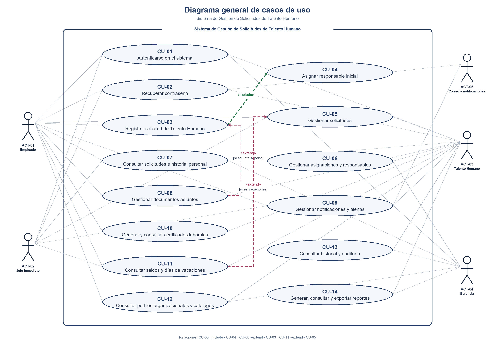

El límite representa el sistema y las asociaciones conectan cada actor con los casos en los que participa. La relación «include» parte de CU-03 hacia CU-04 porque registrar una solicitud ejecuta la asignación inicial. La relación «extend» parte de CU-08 hacia CU-03 y se activa cuando se adjunta un soporte. Ambas relaciones se conectan a sus casos base según la notación UML y aparecen en la Figura 9.

#### Catálogo de casos de uso. La tabla resume su operación, las historias que los originan y los requisitos funcionales que implementan.

#### Tabla 5. Catálogo de casos de uso

| Caso de uso | Nombre | Operaciones | Nace de | Implementa |
| --- | --- | --- | --- | --- |
| CU-01 | Autenticarse en el sistema | 1. Crear (HU-01, registro de acceso) → 2. Consultar (HU-01, credenciales y rol) | HU-01 | RF-01 |
| CU-02 | Recuperar contraseña | 1. Crear (HU-02) → 3. Actualizar (HU-02) | HU-02 | RF-02, RF-43 |
| CU-03 | Registrar solicitud de Talento Humano | 1. Crear | HU-03 | RF-03, RF-04, RF-05, RF-06, RF-13 |
| CU-04 | Asignar responsable inicial | 1. Crear | HU-05 | RF-09 |
| CU-05 | Gestionar solicitudes | 1. Crear (HU-04, historial) → 2. Consultar → 3. Actualizar → 4. Eliminar (cancelación lógica) | HU-04, HU-07, HU-12, HU-15, HU-18 | RF-11, RF-17, RF-20, RF-07, RF-08, RF-23 |
| CU-06 | Gestionar asignaciones y responsables | 1. Crear → 2. Consultar → 3. Actualizar → 4. Eliminar (inactivación lógica) | HU-05, HU-19, HU-23, HU-24, HU-25, HU-26 | RF-29, RF-30, RF-32, RF-24, RF-31 |
| CU-07 | Consultar solicitudes e historial personal | 2. Consultar | HU-09, HU-16, HU-17, HU-22, HU-29 | RF-13, RF-14, RF-21, RF-22, RF-28, RF-36, RF-37, RF-38 |
| CU-08 | Gestionar documentos adjuntos | 1. Crear → 2. Consultar | HU-10, HU-27, HU-28 | RF-15, RF-33, RF-35, RF-34 |
| CU-09 | Gestionar notificaciones y alertas | 1. Crear → 2. Consultar → 3. Actualizar | HU-06, HU-13, HU-31 | RF-10, RF-18, RF-41, RF-42 |
| CU-10 | Generar y consultar certificados laborales | 1. Crear → 2. Consultar → 3. Actualizar | HU-03, HU-08, HU-30 | RF-05, RF-12, RF-39, RF-40 |
| CU-11 | Consultar saldos y días de vacaciones | 2. Consultar | HU-35, HU-36 | RF-50, RF-51 |
| CU-12 | Consultar perfiles organizacionales y catálogos | 2. Consultar | HU-21, HU-32 | RF-27, RF-44, RF-45 |
| CU-13 | Consultar historial y auditoría | 2. Consultar | HU-11, HU-33, HU-34 | RF-26, RF-16, RF-46, RF-47, RF-48, RF-49, RF-60, RF-61 |
| CU-14 | Generar, consultar y exportar reportes | 1. Crear → 2. Consultar / exportar | HU-14, HU-16, HU-20, HU-37, HU-38, HU-39, HU-40 | RF-19, RF-25, RF-53, RF-54, RF-56, RF-52, RF-57, RF-58, RF-59, RF-62, RF-55 |

### 13.1.1 Selección justificada de casos críticos

Los 14 casos se mantienen en el diagrama general y el catálogo. Se documentan como críticos seis que validan acceso, recuperación, radicación, decisión, asignación y soportes, y concentran reglas de negocio y escenarios de rechazo:

CU-01, Autenticarse: autorización y protección de acceso (RN-27; RNF-03).

CU-02, Recuperar contraseña: token temporal y uso restringido (RN-20; RNF-03 y RNF-05).

CU-03, Registrar solicitud: registro previo, soporte y radicado único (RN-01, RN-02 y RN-23).

CU-05, Gestionar solicitudes: estados, aprobación, rechazo con motivo y conservación del historial (RN-03 a RN-07 y RN-16).

CU-06, Gestionar asignaciones: responsable inicial, reasignación y motivo obligatorio (RN-08 a RN-10 y RN-26).

CU-08, Gestionar documentos: asociación, validación e identificación de soportes (RN-17 a RN-19).

### 13.2 CU-01 — Autenticarse en el sistema

| CU-01 | Autenticarse en el sistema | Procedencia |
| --- | --- | --- |
| Actor | Actor principal: ACT-01 Empleado, ACT-02 Jefe inmediato, ACT-03 Usuario de Talento Humano o ACT-04 Gerencia. | Actores ACT definidos en el contexto del proyecto. |
| Precondición | El usuario tiene una cuenta registrada y activa y se encuentra en la pantalla de acceso. | Antecedentes de las HU relacionadas y RN aplicables. |
| Flujo básico (Evento / Respuesta) | 1. El usuario abre la opción de acceso e ingresa su correo y contraseña. / El sistema recibe las credenciales para validarlas.   2. El usuario solicita iniciar sesión. / El sistema valida las credenciales y determina el rol asociado a la cuenta.   3. El usuario presenta credenciales válidas. / El sistema crea la sesión y muestra únicamente el menú y las funciones permitidas para el rol. / El sistema registra el resultado del intento de la cuenta en RegistroAcceso. | Paso 1: HU-01Paso 2: HU-01; RF-01Paso 3: HU-01; RNF-03 / Registro del intento: HU-01 o CA-2; RF-01. |
| Flujo alternativo FA-01 | FA-01 Credenciales incorrectas. El sistema rechaza el acceso, informa que las credenciales no son válidas y mantiene al usuario fuera de las funciones internas. | HU-01 (si la cuenta está registrada) |
| Flujo alternativo FA-02 | FA-02 Correo no registrado. El sistema rechaza el acceso y muestra un mensaje de credenciales no válidas sin revelar información interna. | HU-01 |
| Poscondición | El usuario queda autenticado con una sesión asociada a su rol, o permanece sin acceso si la validación falla. | Criterios de aceptación: HU-01 → FB-02–FB-03; CA-2 → FA-01; CA-3 → FA-02. |

### 13.3 CU-02 — Recuperar contraseña

| CU-02 | Recuperar contraseña | Procedencia |
| --- | --- | --- |
| Actor | Actor principal: ACT-01 Empleado, ACT-02 Jefe inmediato, ACT-03 Usuario de Talento Humano o ACT-04 Gerencia. Actor secundario: ACT-05 Sistema de Correo y Notificaciones. | Actores ACT definidos en el contexto del proyecto. |
| Precondición | El usuario tiene una cuenta activa y un correo registrado. Para solicitar un nuevo enlace, el mecanismo anterior expiró o dejó de ser utilizable. | Antecedentes de las HU relacionadas y RN aplicables. |
| Flujo básico (Evento / Respuesta) | 1. El usuario solicita recuperación e ingresa el correo registrado. / El sistema valida la cuenta y genera un mecanismo temporal. 2. El usuario abre el mecanismo vigente y registra una nueva contraseña. / El sistema valida vigencia, actualiza la contraseña e invalida el mecanismo utilizado. 3. Si el enlace anterior no sirve, el usuario solicita otro mecanismo. / El sistema genera uno nuevo con vigencia definida. | Paso 1: HU-02; RF-02 / Paso 2: HU-02; RF-02; RN-20 / Paso 3: HU-02; RF-43; RN-20 |
| Flujo alternativo FA-01 | FA-01 Correo no registrado. El sistema no inicia la recuperación y muestra una respuesta controlada. | HU-02 |
| Flujo alternativo FA-02 | FA-02 Enlace expirado o inválido. El sistema rechaza el mecanismo y permite solicitar uno nuevo. | HU-02 |
| Poscondición | La contraseña queda actualizada solo después de validar un mecanismo temporal vigente; el mecanismo utilizado deja de ser utilizable. | Criterios de aceptación: HU-02 → FB-01/FA-01; HU-02 → FB-02/FA-02; HU-02 → FB-03/FA-02. |

### 13.4 CU-03 — Registrar solicitud de Talento Humano

| CU-03 | Registrar solicitud de Talento Humano | Procedencia |
| --- | --- | --- |
| Actor | Actor principal: ACT-01 Empleado. | Actores ACT definidos en el contexto del proyecto. |
| Precondición | El empleado tiene una cuenta activa y está autenticado. Los tipos de solicitud habilitados están disponibles para consulta. | Antecedentes de las HU relacionadas y RN aplicables. |
| Flujo básico (Evento / Respuesta) | 1. El empleado consulta los tipos disponibles y selecciona permiso, vacaciones, certificado o incapacidad. / El sistema presenta los campos correspondientes al tipo seleccionado.   2. El empleado diligencia la información requerida y envía la solicitud. / El sistema valida campos obligatorios y, para vacaciones, fechas y duración; para incapacidad, exige el soporte clínico.   3. El empleado adjunta soporte cuando el tipo de solicitud lo exige o cuando complementa la información. / El sistema valida y asocia el archivo a la solicitud mediante CU-08.   4. El empleado confirma el envío. / El sistema registra la solicitud con estado inicial, genera su radicado único y determina el responsable inicial. | Paso 1: HU-03; consulta de HU-32 en CU-12Paso 2: HU-03; RN-01, RN-02, RN-13Paso 3: HU-03, HU-10; RN-17–RN-19Paso 4: HU-03, HU-05 CA-1–CA-3; RF-03–RF-06, RF-13; RN-01, RN-08, RN-23 |
| Flujo alternativo FA-01 | FA-01 Información obligatoria incompleta. El sistema no registra la solicitud e identifica la información que debe completarse. | HU-03; RN-01 |
| Flujo alternativo FA-02 | FA-02 Fechas de vacaciones inválidas. El sistema rechaza el período y solicita corregir las fechas. | HU-03; RN-13 |
| Flujo alternativo FA-03 | FA-03 Falta o invalidez del soporte médico. El sistema no registra la incapacidad hasta que se adjunte un soporte válido. | HU-03; RN-02, RN-18 |
| Flujo alternativo FA-04 | FA-04 No hay responsable inicial disponible. El sistema conserva la solicitud registrada sin asignarla a un responsable no autorizado y deja el evento identificable para su atención. | HU-05 CA-4; RN-08 |
| Poscondición | La solicitud queda asociada al empleado, con radicado único, estado inicial y responsable cuando existe uno autorizado; los datos inválidos no se guardan como una solicitud completa. | Criterios de aceptación: HU-03 → FB-02; CA-3 → FA-01; CA-4 → FB-04.; HU-03 → FB-02; CA-4 → FA-02.; HU-03 → FB-02 y FB-04; CA-3–CA-4 → CU-10.; HU-03 → FB-02–FB-04; CA-3–CA-4 → FA-03. |

### 13.5 CU-04 — Asignar responsable inicial

| CU-04 | Asignar responsable inicial | Procedencia |
| --- | --- | --- |
| Actor | Caso automático ejecutado por el sistema durante el registro de una solicitud. No requiere interacción directa de un actor externo. | Actores ACT definidos en el contexto del proyecto. |
| Precondición | Se ha completado el registro de una solicitud y existe una regla de asignación asociada al tipo de trámite. | Antecedentes de las HU relacionadas y RN aplicables. |
| Flujo básico (Evento / Respuesta) | 1. CU-03 solicita determinar el responsable inicial. / El sistema consulta el tipo de solicitud y la asignación configurada para ese tipo.   2. El sistema identifica un responsable autorizado. / El sistema crea la asignación y registra responsable, solicitud y fecha de asignación.   3. La asignación queda creada. / El sistema deja disponible la identidad del responsable vigente para la gestión del trámite. | Paso 1: HU-05 CA-1; RF-09; RN-08Paso 2: HU-05 CA-2–CA-3; RN-08Paso 3: HU-05 CA-1–CA-3; RF-09; RN-26 |
| Flujo alternativo FA-01 | FA-01 No se encuentra responsable disponible. El sistema no asigna la solicitud a una persona no autorizada y mantiene identificable que falta completar la asignación. | HU-05 CA-4; RN-08 |
| Poscondición | La solicitud tiene una asignación inicial vigente o queda identificada para que Talento Humano complete la asignación conforme a la autorización definida. | Criterios de aceptación: HU-05 CA-1–CA-3 → FB-01–FB-03; CA-4 → FA-01. |

### 13.6 CU-05 — Gestionar solicitudes

| CU-05 | Gestionar solicitudes | Procedencia |
| --- | --- | --- |
| Actor | Actor principal: ACT-02 Jefe inmediato o ACT-03 Usuario de Talento Humano. Para editar o cancelar una solicitud pendiente, actor principal: ACT-01 Empleado. | Actores ACT definidos en el contexto del proyecto. |
| Precondición | La solicitud existe. El usuario está autenticado, autorizado para la operación y la solicitud se encuentra en un estado que permite realizarla. | Antecedentes de las HU relacionadas y RN aplicables. |
| Flujo básico (Evento / Respuesta) | 1. El usuario consulta la solicitud y selecciona una acción permitida. / El sistema muestra el detalle y verifica el rol, el estado y las reglas aplicables.   2. Para aprobar una solicitud de vacaciones, el responsable solicita la aprobación. / El sistema consulta el saldo del período y permite continuar solo si es suficiente.   3. El responsable aprueba, rechaza con motivo o cambia el estado a En revisión con nota; el empleado puede editar o cancelar mientras siga permitido. / El sistema aplica la acción, actualiza el estado y registra usuario, fecha, motivo o nota cuando corresponda. | Paso 1: HU-04, HU-12 CA-1, HU-15 CA-1, HU-18 CA-1; RN-03–RN-05, RN-15Paso 2: HU-07 CA-1–CA-4; RF-11; RN-12, RN-13Paso 3: HU-04, HU-12 CA-1, CA-4; HU-15 CA-1, CA-3–CA-4; HU-18 CA-1, CA-4; RN-03–RN-07, RN-15–RN-16 |
| Flujo alternativo FA-01 | FA-01 Solicitud en estado no permitido o ya procesada. El sistema no realiza la acción y conserva el estado y el historial existentes. | HU-04, HU-12 CA-2–CA-3; HU-18 CA-2–CA-3; RN-03–RN-04, RN-15 |
| Flujo alternativo FA-02 | FA-02 Rechazo sin motivo o cambio a En revisión sin nota. El sistema solicita el dato obligatorio y no confirma la operación hasta recibirlo. | HU-04, HU-15 CA-2; RN-06, RN-16 |
| Flujo alternativo FA-03 | FA-03 Saldo de vacaciones insuficiente. El sistema impide aprobar la solicitud de vacaciones y presenta el saldo correspondiente al período. | HU-07 CA-3–CA-4; RN-12–RN-13 |
| Flujo alternativo FA-04 | FA-04 Usuario no autorizado. El sistema rechaza la operación y no modifica la solicitud. | HU-04; RN-05 |
| Poscondición | La solicitud conserva el estado resultante de la operación autorizada y el historial incluye la evidencia requerida; si una validación falla, no se aplica el cambio. | Criterios de aceptación: HU-04 → FB-01 y FB-03; CA-3 → FA-01.; HU-04 → FB-03; CA-2 → FA-02.; HU-07 CA-1–CA-2, CA-4 → FB-02; CA-3 → FA-03.; HU-12 CA-1, CA-4 → FB-01 y FB-03; CA-2–CA-3 → FA-01.; HU-15 CA-1, CA-3–CA-4 → FB-03; CA-2 → FA-02.; HU-18 CA-1, CA-4 → FB-03; CA-2–CA-3 → FA-01. |

### 13.7 CU-06 — Gestionar asignaciones y responsables

| CU-06 | Gestionar asignaciones y responsables | Procedencia |
| --- | --- | --- |
| Actor | Actor principal: ACT-03 Usuario de Talento Humano. | Actores ACT definidos en el contexto del proyecto. |
| Precondición | La solicitud existe y el usuario está autenticado y autorizado para consultar o modificar asignaciones. | Antecedentes de las HU relacionadas y RN aplicables. |
| Flujo básico (Evento / Respuesta) | 1. El usuario busca la solicitud y abre su sección de responsables. / El sistema muestra el responsable vigente y distingue las asignaciones finalizadas.   2. El usuario solicita consultar el historial o el motivo de una asignación. / El sistema presenta la secuencia, fechas y motivos registrados, sin modificar la solicitud.   3. El usuario reasigna a un responsable autorizado o finaliza una asignación vigente. / El sistema registra motivo y fechas, conserva la asignación anterior y actualiza quién queda vigente. | Paso 1: HU-23 CA-1–CA-3; RF-29; RN-26Paso 2: HU-24 CA-1–CA-3; HU-26 CA-1–CA-2, CA-4; RF-30, RF-32; RN-10, RN-26Paso 3: HU-19 CA-1, CA-3–CA-4; HU-25 CA-1–CA-3; RF-24, RF-31; RN-07, RN-09–RN-10, RN-26 |
| Flujo alternativo FA-01 | FA-01 Responsable no autorizado o motivo obligatorio ausente. El sistema rechaza la reasignación y conserva la asignación vigente. | HU-19 CA-2–CA-3; RN-09–RN-10 |
| Flujo alternativo FA-02 | FA-02 No existe responsable vigente o no hay asignaciones. El sistema informa que no hay asignación vigente o historial para mostrar. | HU-23 CA-4; HU-24 CA-4 |
| Flujo alternativo FA-03 | FA-03 La asignación ya fue finalizada. El sistema no la finaliza por segunda vez y mantiene su fecha de cierre. | HU-25 CA-4 |
| Flujo alternativo FA-04 | FA-04 Asignación sin motivo registrado. El sistema indica que no hay motivo disponible, sin inventar información. | HU-26 CA-3 |
| Poscondición | Las asignaciones mantienen su secuencia e historial; solo una reasignación válida cambia el responsable vigente. | Criterios de aceptación: HU-19 CA-1 y CA-4 → FB-03; CA-2–CA-3 → FA-01.; HU-23 CA-1–CA-3 → FB-01; CA-4 → FA-02.; HU-24 CA-1–CA-3 → FB-02; CA-4 → FA-02.; HU-25 CA-1–CA-3 → FB-03; CA-4 → FA-03.; HU-26 CA-1–CA-2, CA-4 → FB-02; CA-3 → FA-04. |

### 13.8 CU-07 — Consultar solicitudes e historial personal

| CU-07 | Consultar solicitudes e historial personal | Procedencia |
| --- | --- | --- |
| Actor | Actor principal: ACT-01 Empleado. Actores secundarios: ACT-02 Jefe inmediato y ACT-03 Usuario de Talento Humano, según permisos. | Actores ACT definidos en el contexto del proyecto. |
| Precondición | El usuario está autenticado. La solicitud existe para consultar el detalle; las consultas personales se limitan al empleado autenticado. | Antecedentes de las HU relacionadas y RN aplicables. |
| Flujo básico (Evento / Respuesta) | 1. El usuario ingresa un radicado o combina filtros permitidos por tipo, estado, fecha y empleado. / El sistema busca las solicitudes que cumplen los criterios y respeta los permisos del usuario.   2. El usuario selecciona una solicitud o consulta su historial personal. / El sistema muestra radicado, tipo, fecha, estado, responsable vigente cuando exista y las respuestas disponibles.   3. El usuario revisa los resultados. / El sistema conserva los datos y no modifica la solicitud por el hecho de consultarla. | Paso 1: HU-09 CA-1, CA-3; HU-16, HU-17 CA-1–CA-2; HU-22 CA-1–CA-3; RF-14, RF-21, RF-22, RF-28; RN-23–RN-24, RN-27Paso 2: HU-17 CA-2–CA-3; HU-22 CA-1–CA-3; HU-29; RF-28, RF-36–RF-38Paso 3: HU-09 CA-4; HU-17 CA-1–CA-3; HU-29 |
| Flujo alternativo FA-01 | FA-01 Radicado inexistente, filtros sin coincidencias o historial vacío. El sistema informa que no encontró resultados y mantiene disponible la consulta. | HU-09 CA-2; HU-16, HU-17 CA-4; HU-22 CA-4 |
| Flujo alternativo FA-02 | FA-02 El usuario intenta consultar información personal de otro empleado. El sistema aplica las restricciones de autorización y no muestra solicitudes ajenas. | HU-17 CA-1; RN-24, RN-27 |
| Flujo alternativo FA-03 | FA-03 No hay responsable asociado o el detalle solicitado no está disponible. El sistema presenta únicamente la información registrada y señala el dato ausente. | HU-22 CA-3–CA-4; RN-26 |
| Poscondición | La información se presenta conforme a los filtros y permisos; la consulta no modifica solicitudes ni historiales. | Criterios de aceptación: HU-09 CA-1, CA-3–CA-4 → FB-01 y FB-03; CA-2 → FA-01.; HU-16 → FB-01; CA-4 → FA-01.; HU-17 CA-1–CA-3 → FB-01–FB-03; CA-4 → FA-01.; HU-22 CA-1–CA-3 → FB-01–FB-02; CA-4 → FA-01.; HU-29 → FB-02.; HU-29 → FB-02.; HU-29 → FB-02. |

### 13.9 CU-08 — Gestionar documentos adjuntos

| CU-08 | Gestionar documentos adjuntos | Procedencia |
| --- | --- | --- |
| Actor | Actor principal: ACT-01 Empleado. Actor secundario: ACT-03 Usuario de Talento Humano. | Actores ACT definidos en el contexto del proyecto. |
| Precondición | La solicitud existe y el usuario tiene autorización para adjuntar o consultar documentos asociados a ella. | Antecedentes de las HU relacionadas y RN aplicables. |
| Flujo básico (Evento / Respuesta) | 1. El empleado selecciona el archivo y la solicitud a la que pertenece. / El sistema comprueba formato y tamaño antes de aceptar el archivo.   2. El archivo cumple las condiciones. / El sistema almacena el documento asociado a la solicitud y registra quién lo cargó y cuándo.   3. El usuario consulta los documentos asociados. / El sistema presenta los datos disponibles de cada documento, únicamente para la solicitud autorizada. | Paso 1: HU-10, HU-28 CA-1–CA-4; RF-15, RF-33, RF-35; RN-18Paso 2: HU-10; RF-15, RF-33; RN-17, RN-19Paso 3: HU-27 CA-1–CA-2, CA-4; RF-34; RN-17, RN-19, RN-27 |
| Flujo alternativo FA-01 | FA-01 Formato o tamaño no permitido. El sistema rechaza el archivo e indica la condición que debe corregirse antes de cargarlo. | HU-10, HU-28 CA-2–CA-3; RF-35; RN-18 |
| Flujo alternativo FA-02 | FA-02 El documento pertenece a otra solicitud o el usuario no tiene permiso. El sistema no asocia ni muestra el documento en la solicitud consultada. | HU-27 CA-3; RN-17, RN-27 |
| Flujo alternativo FA-03 | FA-03 La solicitud no tiene documentos asociados. El sistema informa que no hay documentos para mostrar. | HU-27 CA-1, CA-4 |
| Poscondición | Los documentos válidos quedan asociados a su solicitud con evidencia de carga; los archivos rechazados no quedan disponibles como soportes. | Criterios de aceptación: HU-10 → FB-01–FB-02; CA-2 → FA-01.; HU-10 → FB-01–FB-02; CA-2–CA-3 → FA-01.; HU-27 CA-1–CA-2, CA-4 → FB-03; CA-3 → FA-02.; HU-28 CA-1, CA-4 → FB-01; CA-2–CA-3 → FA-01. |

### 13.10 CU-09 — Gestionar notificaciones y alertas

| CU-09 | Gestionar notificaciones y alertas | Procedencia |
| --- | --- | --- |
| Actor | Actor principal: ACT-01 Empleado o ACT-03 Usuario de Talento Humano, según el aviso. Actor secundario: ACT-05 Sistema de Correo y Notificaciones. | Actores ACT definidos en el contexto del proyecto. |
| Precondición | El usuario tiene una cuenta y existen eventos o notificaciones dirigidos a él. Para una alerta de demora, la solicitud superó el plazo definido sin movimiento. | Antecedentes de las HU relacionadas y RN aplicables. |
| Flujo básico (Evento / Respuesta) | 1. Se produce un cambio de estado o se supera el plazo de tres días sin movimiento. / El sistema identifica la solicitud y el destinatario correspondiente; para la demora, dirige la alerta a Talento Humano.   2. El sistema genera el aviso. / El sistema crea la notificación interna y envía correo cuando el canal está configurado.   3. El empleado consulta sus notificaciones internas y marca una como leída. / El sistema muestra solo avisos del empleado y cambia únicamente su estado de lectura. | Paso 1: HU-06 CA-1, CA-3–CA-4; HU-13 CA-1–CA-2; RN-11, RN-21Paso 2: HU-13 CA-1, CA-3–CA-4; RF-10, RF-18, RF-41; RN-21Paso 3: HU-31; RF-41–RF-42; RN-21–RN-22 |
| Flujo alternativo FA-01 | FA-01 La solicitud aún no supera tres días sin movimiento. El sistema no genera la alerta de demora. | HU-06 CA-2; RN-11 |
| Flujo alternativo FA-02 | FA-02 Correo no configurado. El sistema conserva la notificación interna sin reportar un envío de correo no realizado. | HU-13 CA-4 |
| Flujo alternativo FA-03 | FA-03 No hay notificaciones o el aviso pertenece a otro usuario. El sistema informa que no hay avisos propios disponibles y rechaza modificar notificaciones ajenas. | HU-31; RN-21–RN-22 |
| Poscondición | El aviso queda asociado al destinatario correcto; el estado leído se actualiza solo para la notificación seleccionada. | Criterios de aceptación: HU-06 CA-1, CA-3–CA-4 → FB-01; CA-2 → FA-01.; HU-13 CA-1–CA-3 → FB-01–FB-02; CA-4 → FA-02.; HU-31 → FB-03; CA-4 → FA-03.; HU-31 → FB-03; CA-4 → FA-03. |

### 13.11 CU-10 — Generar y consultar certificados laborales

| CU-10 | Generar y consultar certificados laborales | Procedencia |
| --- | --- | --- |
| Actor | Actor principal: ACT-03 Usuario de Talento Humano para generar el certificado; ACT-01 Empleado para consultar y descargarlo. | Actores ACT definidos en el contexto del proyecto. |
| Precondición | Existe una solicitud de certificado asociada al empleado. Para generar el documento, la solicitud debe estar aprobada y la información laboral necesaria debe estar disponible. | Antecedentes de las HU relacionadas y RN aplicables. |
| Flujo básico (Evento / Respuesta) | 1. Talento Humano selecciona una solicitud de certificado aprobada. / El sistema verifica el estado de la solicitud antes de habilitar la generación.   2. Talento Humano confirma la generación. / El sistema genera y almacena el certificado asociado a la solicitud y actualiza el estado del trámite.   3. El empleado consulta el estado o solicita el certificado generado. / El sistema presenta el estado asociado a la solicitud y, si existe, permite consultar o descargar el archivo correcto. | Paso 1: HU-03, HU-08 CA-1–CA-2; RF-12; RN-14–RN-14Paso 2: HU-08 CA-1, CA-3–CA-4; RF-12, RF-39–RF-40; RN-14–RN-14Paso 3: HU-03, HU-30; RF-39–RF-40; RN-14 |
| Flujo alternativo FA-01 | FA-01 La solicitud no está aprobada. El sistema no genera el certificado y mantiene el trámite en el estado correspondiente. | HU-03, HU-08 CA-2; RN-14 |
| Flujo alternativo FA-02 | FA-02 El certificado aún no se ha generado o no está disponible. El sistema informa que no hay archivo para consultar o descargar. | HU-30 |
| Poscondición | El certificado, cuando se genera, queda asociado a su solicitud y su estado puede consultarse sin mezclar trámites de otros empleados. | Criterios de aceptación: HU-03 → FB-01 y FA-01; CA-1–CA-2 → CU-03.; HU-08 CA-1, CA-3–CA-4 → FB-01–FB-02; CA-2 → FA-01.; HU-30 → FB-03; CA-4 → FA-02.; HU-30 → FB-03 y FA-02. |

### 13.12 CU-11 — Consultar saldos y días de vacaciones

| CU-11 | Consultar saldos y días de vacaciones | Procedencia |
| --- | --- | --- |
| Actor | Actor principal: ACT-01 Empleado para consultar sus días disponibles; ACT-03 Usuario de Talento Humano para consultar el saldo de un empleado por período. | Actores ACT definidos en el contexto del proyecto. |
| Precondición | El usuario está autenticado y puede consultar el saldo propio o el de un empleado conforme a sus permisos. | Antecedentes de las HU relacionadas y RN aplicables. |
| Flujo básico (Evento / Respuesta) | 1. El usuario selecciona el empleado y el período, o solicita su propio saldo disponible. / El sistema consulta el saldo correspondiente sin modificarlo.   2. El sistema encuentra el saldo del período. / El sistema presenta días generados, utilizados y disponibles y mantiene la asociación al empleado y período correctos. | Paso 1: HU-35 CA-1; HU-36 CA-1–CA-3; RF-50–RF-51; RN-12, RN-30Paso 2: HU-35 CA-2–CA-3; HU-36 CA-1–CA-2; RF-50–RF-51; RN-12 |
| Flujo alternativo FA-01 | FA-01 No hay información de saldo para el período o empleado. El sistema informa que no existe saldo registrado y no calcula valores sin respaldo. | HU-35 CA-4; HU-36 CA-4 |
| Flujo alternativo FA-02 | FA-02 El empleado intenta consultar el saldo de otra persona. El sistema limita la consulta al saldo propio. | HU-36 CA-3; RN-27 |
| Poscondición | El saldo se presenta para el empleado y período solicitados; la consulta no modifica los valores almacenados. | Criterios de aceptación: HU-35 CA-1–CA-3 → FB-01–FB-02; CA-4 → FA-01.; HU-36 CA-1–CA-3 → FB-01–FB-02; CA-4 → FA-01. |

### 13.13 CU-12 — Consultar perfiles organizacionales y catálogos

| CU-12 | Consultar perfiles organizacionales y catálogos | Procedencia |
| --- | --- | --- |
| Actor | Actor principal: ACT-03 Usuario de Talento Humano para consultar perfil; ACT-01 Empleado para consultar tipos; ACT-03 Usuario de Talento Humano para consultar estados. | Actores ACT definidos en el contexto del proyecto. |
| Precondición | El usuario está autenticado y tiene permiso para consultar la información seleccionada. | Antecedentes de las HU relacionadas y RN aplicables. |
| Flujo básico (Evento / Respuesta) | 1. El usuario selecciona el empleado, tipo de solicitud o estados que desea consultar. / El sistema verifica el criterio y la autorización correspondiente.   2. El sistema encuentra la información solicitada. / El sistema muestra área, cargo y rol del empleado, o el catálogo de tipos y estados sin mezclar registros. | Paso 1: HU-21 CA-1; HU-32; RF-27, RF-44–RF-45; RN-25, RN-27Paso 2: HU-21 CA-2–CA-3; HU-32; RN-03, RN-25 |
| Flujo alternativo FA-01 | FA-01 El empleado no tiene datos organizacionales registrados. El sistema identifica los datos que no están disponibles sin sustituirlos por los de otra persona. | HU-21 CA-4 |
| Flujo alternativo FA-02 | FA-02 Tipo no habilitado o estado no definido. El sistema no presenta el valor como una opción válida y conserva la consulta en modo de solo lectura. | HU-32; RN-03 |
| Flujo alternativo FA-03 | FA-03 El usuario no tiene autorización para consultar el perfil. El sistema rechaza la consulta. | HU-21 CA-1; RN-27 |
| Poscondición | La información de referencia se muestra en modo de consulta y corresponde al empleado o catálogo solicitado. | Criterios de aceptación: HU-21 CA-1–CA-3 → FB-01–FB-02; CA-4 → FA-01.; HU-32 → FB-01–FB-02; CA-4 → FA-02.; HU-32 → FB-01–FB-02; CA-3–CA-4 → FA-02. |

### 13.14 CU-13 — Consultar historial y auditoría

| CU-13 | Consultar historial y auditoría | Procedencia |
| --- | --- | --- |
| Actor | Actor principal: ACT-03 Usuario de Talento Humano o ACT-04 Gerencia, según los permisos de consulta. | Actores ACT definidos en el contexto del proyecto. |
| Precondición | El usuario está autenticado y autorizado para consultar el historial, registros de acceso u operaciones auditadas. | Antecedentes de las HU relacionadas y RN aplicables. |
| Flujo básico (Evento / Respuesta) | 1. El usuario selecciona el tipo de consulta y define solicitud, usuario o período. / El sistema valida permisos y presenta los registros que coinciden con los criterios.   2. El usuario selecciona una operación auditada para ver su detalle. / El sistema muestra entidad, operación, usuario, fecha y los valores anterior y nuevo cuando estén registrados.   3. El usuario termina la consulta. / El sistema mantiene el historial y la auditoría sin modificaciones. | Paso 1: HU-11, HU-33, HU-34; RF-16, RF-26, RF-46–RF-48, RF-60–RF-61; RN-07, RN-27–RN-28Paso 2: HU-11, HU-34; RF-49; RN-28Paso 3: HU-11, HU-33, HU-34; RF-16, RF-46–RF-49 |
| Flujo alternativo FA-01 | FA-01 No hay registros que coincidan o la operación no quedó registrada. El sistema informa que no hay resultados para mostrar. | HU-34 |
| Flujo alternativo FA-02 | FA-02 El usuario no está autorizado para consultar los registros. El sistema rechaza la consulta y no revela datos auditados. | HU-34; RN-27 |
| Flujo alternativo FA-03 | FA-03 El valor anterior o nuevo no está disponible. El sistema presenta únicamente los valores registrados e indica cuál no está disponible. | HU-34; RN-28 |
| Poscondición | La consulta es de solo lectura y no altera las evidencias históricas o de acceso. | Criterios de aceptación: HU-11 → FB-01–FB-03.; HU-11 → FB-01; CA-4 → FB-03.; HU-33 → FB-01; CA-4 → FA-02.; HU-34 → FB-01–FB-03; CA-4 → FA-01.; HU-34 → FB-02; CA-4 → FA-03.; HU-33 → FB-01; CA-4 → FA-02.; HU-34 → FB-01; restricciones → FA-02. |

### 13.15 CU-14 — Generar, consultar y exportar reportes

| CU-14 | Generar, consultar y exportar reportes | Procedencia |
| --- | --- | --- |
| Actor | Actor principal: ACT-03 Usuario de Talento Humano para reportes operativos; ACT-04 Gerencia para resúmenes globales y reportes organizacionales. | Actores ACT definidos en el contexto del proyecto. |
| Precondición | Existe información registrada. El usuario está autenticado y autorizado para consultar el alcance de reporte solicitado. | Antecedentes de las HU relacionadas y RN aplicables. |
| Flujo básico (Evento / Respuesta) | 1. El usuario selecciona el reporte y combina tipo, responsable, área, cargo, rol, estado o período según corresponda. / El sistema valida los criterios y los permisos asociados al usuario.   2. El usuario solicita generar el reporte. / El sistema procesa los datos, diferencia los resultados por los criterios y presenta el reporte con su período.   3. El usuario abre reportes ya generados o elige exportar el resultado. / El sistema presenta el reporte autorizado o exporta el mismo resultado consultado en un formato habilitado. | Paso 1: HU-14 CA-1–CA-3; HU-20 CA-1–CA-3; HU-16 CA-1–CA-2; HU-38 CA-1–CA-2; HU-40 CA-1–CA-2; RF-19, RF-25, RF-53–RF-54, RF-56–RF-59, RF-62; RN-27, RN-29–RN-30. Paso 2: HU-14 CA-2–CA-3; HU-20 CA-2–CA-3; HU-16 CA-1–CA-2; HU-38 CA-1–CA-2. Paso 3: HU-37 CA-1–CA-3; HU-39 CA-1–CA-3; RF-52, RF-55; RN-27. |
| Flujo alternativo FA-01 | FA-01 No existen datos para los criterios seleccionados. El sistema informa que no hay resultados y conserva los filtros para que puedan ajustarse. | HU-14 CA-4; HU-16 CA-3; HU-20 CA-4; HU-38 CA-3; RN-29–RN-30. |
| Flujo alternativo FA-02 | FA-02 El usuario no tiene permiso para consultar o exportar la información. El sistema rechaza la consulta o exportación y no entrega datos fuera del alcance autorizado. | HU-37 CA-4; HU-40 CA-3; RN-27. |
| Flujo alternativo FA-03 | FA-03 Formato de exportación no habilitado. El sistema informa los formatos disponibles y conserva el reporte generado. | HU-39 CA-4. |
| Poscondición | El reporte queda presentado o exportado conforme al alcance y filtros seleccionados; los resultados no incluyen solicitudes ajenas a los criterios o permisos. | Criterios de aceptación: HU-14 CA-1–CA-3 → FB-01–FB-02; CA-4 → FA-01. HU-16 CA-1–CA-2 → FB-01–FB-02; CA-3 → FA-01. HU-20 CA-1–CA-3 → FB-01–FB-02; CA-4 → FA-01. HU-37 CA-1–CA-3 → FB-03; CA-4 → FA-02. HU-38 CA-1–CA-2 → FB-01–FB-02; CA-3 → FA-01. HU-39 CA-1–CA-3 → FB-03; CA-4 → FA-03. HU-40 CA-1–CA-2 → FB-01; CA-3 → FA-02. |

## 2.7 Mockups e Interfaces de Usuario (MK-01 a MK-12)

Los 12 mockups se vinculan con los casos de uso y las HU que representan. La matriz 14.13 consolida sus códigos junto con los actores y las referencias MySQL. Los métodos indicados corresponden a los que aparecen en el modelo de clases o en la entrega de programación del equipo.

Este capítulo representa las vistas de interacción del sistema a partir de las HU, CU, RF, RN y el diccionario de datos del proyecto. Cada figura incorpora llamadas de trazabilidad; su ficha declara cobertura, campos/tipos existentes, acciones y reglas visibles. Las brechas del modelo se señalan para revisión en vez de completar el esquema por suposición.

### 14.1 MK-01 — Acceso y recuperación

#### Figura 10. MK-01: Acceso y recuperación; vista de referencia con trazabilidad anotada.

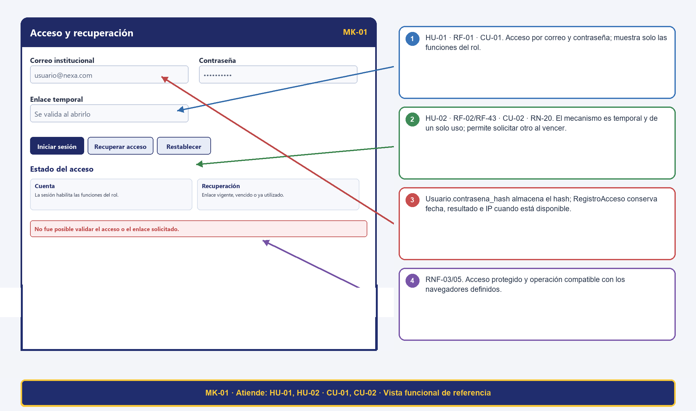

#### Tabla 6. Trazabilidad del mockup MK-01: Acceso y recuperación

| Código | MK-01 |
| --- | --- |
| Pantalla | Acceso y recuperación |
| Atiende (HU / CU) | HU-01, HU-02 / CU-01, CU-02 |
| Campos ↔ Diccionario | Usuario.correo VARCHAR(150) UQ NN; Usuario.contrasena_hash VARCHAR(255) NN; Usuario.activo BOOLEAN NN; Usuario.intentos_fallidos INT NN; Usuario.bloqueado_hasta DATETIME NULL; RecuperacionClave.token VARCHAR(255) UQ NN, fecha_expiracion DATETIME NN y utilizada BOOLEAN NN. |
| Botones ↔ Eventos | Iniciar sesión; Recuperar acceso; Restablecer — eventos relacionados con CU-01, CU-02. RF específicos y transiciones se detallan en la matriz final. |
| RN visibles | RN-20: mecanismo temporal; rechazar vencido o inválido. RNF-03/05: protección de acceso y compatibilidad. |
| Métodos de clase ↔ pantalla (HU respaldadas) | RegistroAcceso.registrarIntento; Usuario.iniciarSesion; RecuperacionClave.generarToken; Usuario.actualizarContrasena |

### 14.2 MK-02 — Bandeja y búsqueda de solicitudes

#### Figura 11. MK-02: Bandeja y búsqueda de solicitudes; vista de referencia con trazabilidad anotada.

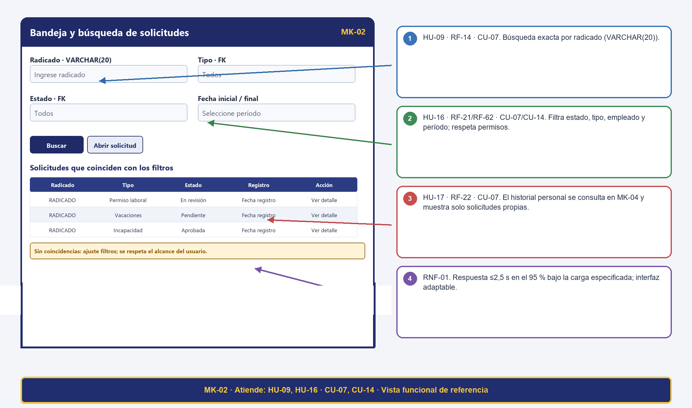

#### Tabla 7. Trazabilidad del mockup MK-02: Bandeja y búsqueda de solicitudes

| Código | MK-02 |
| --- | --- |
| Pantalla | Bandeja y búsqueda de solicitudes |
| Atiende (HU / CU) | HU-09, HU-16 / CU-07, CU-14 |
| Campos ↔ Diccionario | Solicitud.radicado VARCHAR(20), id_tipo_solicitud/id_estado INT FK, fecha_registro DATETIME y fechas DATE. TipoSolicitud.nombre VARCHAR(50); EstadoSolicitud.nombre VARCHAR(30). |
| Botones ↔ Eventos | Buscar; Abrir solicitud; filtrar reportes — eventos relacionados con CU-07 y CU-14. RF específicos y transiciones se detallan en la matriz final. |
| RN visibles | RN-03: toda consulta exige sesión activa.RN-27: el acceso a consultas operativas se restringe por rol autorizado (HU-17 / RF-22 se gestiona en la vista personal MK-04). |
| Métodos de clase ↔ pantalla (HU respaldadas) | Solicitud.consultarPorRadicado |

### 14.3 MK-03 — Registro y edición de solicitud

#### Figura 12. MK-03: Registro y edición de solicitud; vista de referencia con trazabilidad anotada.

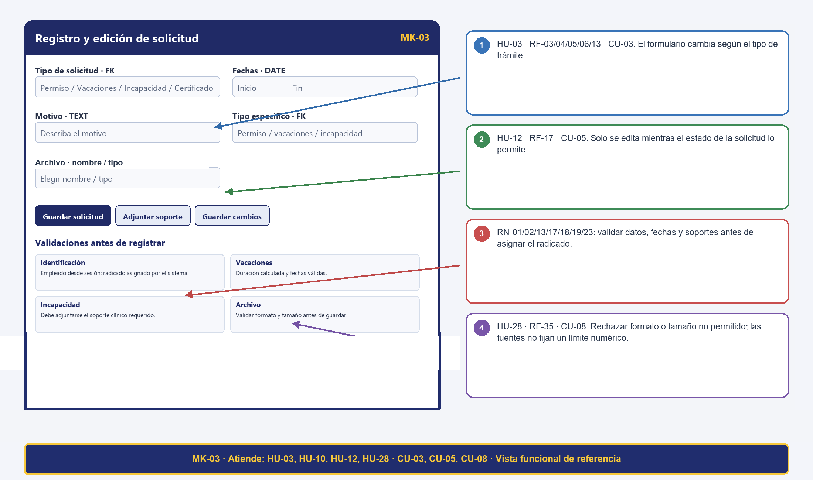

#### Tabla 8. Trazabilidad del mockup MK-03: Registro y edición de solicitud

| Código | MK-03 |
| --- | --- |
| Pantalla | Registro y edición de solicitud |
| Atiende (HU / CU) | HU-03, HU-10, HU-12, HU-28 / CU-03, CU-05, CU-08 |
| Campos ↔ Diccionario | Solicitud.id_usuario INT FK NN, id_tipo_solicitud INT FK NN, id_estado INT FK NN, radicado VARCHAR(20) UQ NN; PermisoLaboral/Vacacion (fecha_inicio DATE NN, fecha_fin DATE NN, motivo TEXT); Incapacidad (fecha_inicio DATE NN, fecha_fin DATE NN, observacion TEXT); Documento (nombre_archivo VARCHAR(150), tipo_archivo VARCHAR(50), tamano_archivo INT, ruta_archivo VARCHAR(300)). Días solicitados se calcula como valor derivado sin persistirse. |
| Botones ↔ Eventos | Guardar solicitud; Adjuntar soporte; Guardar cambios — eventos relacionados con CU-03, CU-05, CU-08. RF específicos y transiciones se detallan en la matriz final. |
| RN visibles | RN-01/02/13/15/17/18/19/23: obligatoriedad, soporte clínico, fechas, edición por estado, asociación/validación de archivo, carga y radicado. RNF-03/04/05/06. |
| Métodos de clase ↔ pantalla (HU respaldadas) | Solicitud.radicarSolicitud; Incapacidad.validarDocumentoMedico; Documento.validarFormato; Documento.validarTamanoMaximo |

### 14.4 MK-04 — Detalle, historial y documentos

#### Figura 13. MK-04: Detalle, historial y documentos; vista de referencia con trazabilidad anotada.

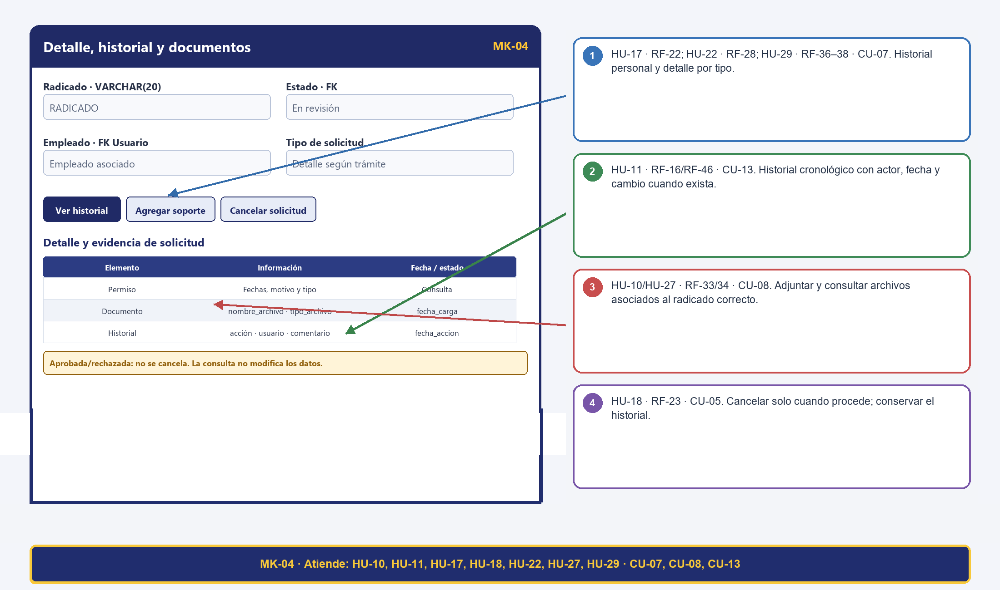

#### Tabla 9. Trazabilidad del mockup MK-04: Detalle, historial y documentos

| Código | MK-04 |
| --- | --- |
| Pantalla | Detalle, historial y documentos |
| Atiende (HU / CU) | HU-11, HU-17, HU-18, HU-22, HU-10, HU-27, HU-29 / CU-07, CU-08, CU-13 |
| Campos ↔ Diccionario | Solicitud.radicado VARCHAR(20), id_estado INT FK, fechas DATE, motivo TEXT; HistorialSolicitud.fecha_accion DATETIME, comentario TEXT y estados anterior/nuevo; Documento.nombre_archivo VARCHAR(150), tipo_archivo VARCHAR(50), fecha_carga DATETIME. |
| Botones ↔ Eventos | Ver historial; Agregar soporte; Cancelar solicitud — eventos relacionados con CU-07, CU-08, CU-13. RF específicos y transiciones se detallan en la matriz final. |
| RN visibles | RN-04/07/15/17/19/23/24/26/28: cancelación permitida, historial, documentos asociados, consulta personal y responsable vigente. RNF-01/03/04/05/06. |
| Métodos de clase ↔ pantalla (HU respaldadas) | HistorialSolicitud.consultarHistorial; Solicitud.actualizarEstado; PermisoLaboral.aprobarPermiso; HistorialSolicitud.registrarCambioEstado; Documento.validarFormato; PermisoLaboral.calcularDias; Vacacion.calcularDias; Incapacidad.calcularDias |

### 14.5 MK-05 — Bandeja de revisión y decisión

#### Figura 14. MK-05: Bandeja de revisión y decisión; vista de referencia con trazabilidad anotada.

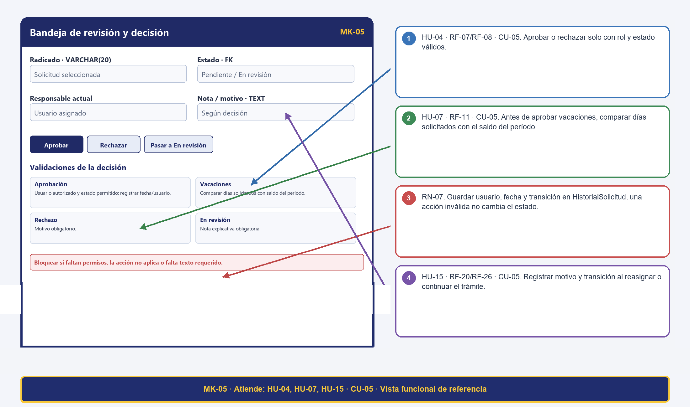

#### Tabla 10. Trazabilidad del mockup MK-05: Bandeja de revisión y decisión

| Código | MK-05 |
| --- | --- |
| Pantalla | Bandeja de revisión y decisión |
| Atiende (HU / CU) | HU-04, HU-07, HU-15 / CU-05 |
| Campos ↔ Diccionario | Solicitud.id_estado INT FK; decisión y nota en HistorialSolicitud.fecha_accion DATETIME/comentario TEXT; SaldoVacaciones.dias_generados y dias_utilizados. Días disponibles = dias_generados - dias_utilizados (valor derivado, no almacenado). |
| Botones ↔ Eventos | Aprobar; Rechazar; Pasar a En revisión — eventos relacionados con CU-05. RF específicos y transiciones se detallan en la matriz final. |
| RN visibles | RN-03/05/06/07/12/16: estado válido, autorización, motivo de rechazo, saldo y nota para En revisión. RNF-01/03/04/05. |
| Métodos de clase ↔ pantalla (HU respaldadas) | PermisoLaboral.aprobarPermiso; SaldoVacaciones.diasDisponibles; Solicitud.actualizarEstado; HistorialSolicitud.registrarCambioEstado |

### 14.6 MK-06 — Asignaciones y responsables

#### Figura 15. MK-06: Asignaciones y responsables; vista de referencia con trazabilidad anotada.

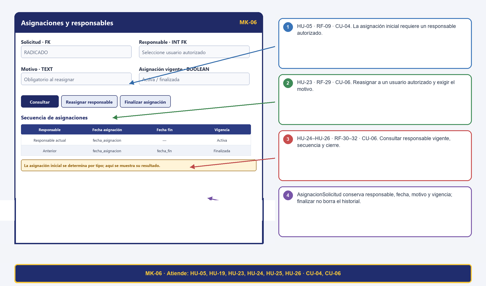

#### Tabla 11. Trazabilidad del mockup MK-06: Asignaciones y responsables

| Código | MK-06 |
| --- | --- |
| Pantalla | Asignaciones y responsables |
| Atiende (HU / CU) | HU-05, HU-19, HU-23, HU-24, HU-25, HU-26 / CU-04, CU-06 |
| Campos ↔ Diccionario | AsignacionSolicitud.id_solicitud/id_usuario_responsable INT FK; fecha_asignacion/fecha_fin DATETIME; motivo TEXT; activa BOOLEAN. |
| Botones ↔ Eventos | Consultar; Reasignar responsable; Finalizar asignación — eventos relacionados con CU-04, CU-06. RF específicos y transiciones se detallan en la matriz final. |
| RN visibles | RN-08/09/10/26: responsable autorizado, motivo de reasignación y asignación vigente diferenciada de finalizada. RNF-03/04/05/06. |
| Métodos de clase ↔ pantalla (HU respaldadas) | Solicitud.asignarResponsable; AsignacionSolicitud.asignar; AsignacionSolicitud.finalizarAsignacion |

### 14.7 MK-07 — Notificaciones y alertas

#### Figura 16. MK-07: Notificaciones y alertas; vista de referencia con trazabilidad anotada.

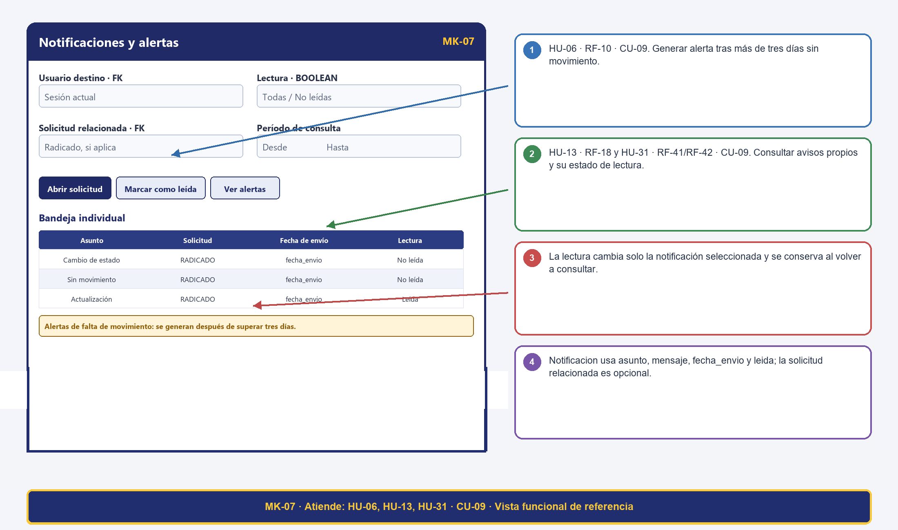

#### Tabla 12. Trazabilidad del mockup MK-07: Notificaciones y alertas

| Código | MK-07 |
| --- | --- |
| Pantalla | Notificaciones y alertas |
| Atiende (HU / CU) | HU-06, HU-13, HU-31 / CU-09 |
| Campos ↔ Diccionario | Notificacion.id_usuario INT FK, id_solicitud INT FK opcional, asunto VARCHAR(150), mensaje TEXT, fecha_envio DATETIME y leida BOOLEAN. |
| Botones ↔ Eventos | Abrir solicitud; Marcar como leída; Ver alertas — eventos relacionados con CU-09. RF específicos y transiciones se detallan en la matriz final. |
| RN visibles | RN-11/21/22: alerta después de tres días sin movimiento, destinatario correcto y lectura individual. RNF-03/04/05. |
| Métodos de clase ↔ pantalla (HU respaldadas) | Notificacion.enviarNotificacion; Notificacion.marcarComoLeida |

### 14.8 MK-08 — Certificado laboral

#### Figura 17. MK-08: Certificado laboral; vista de referencia con trazabilidad anotada.

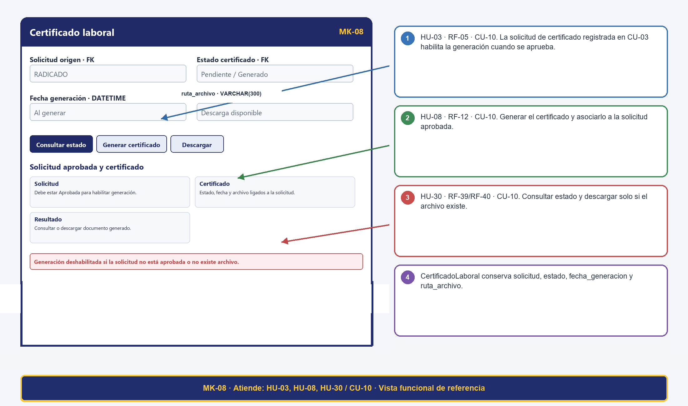

#### Tabla 13. Trazabilidad del mockup MK-08: Certificado laboral

| Código | MK-08 |
| --- | --- |
| Pantalla | Certificado laboral |
| Atiende (HU / CU) | HU-03, HU-08, HU-30 / CU-10 |
| Campos ↔ Diccionario | CertificadoLaboral.id_solicitud/id_estado_certificado INT FK; fecha_generacion DATETIME; ruta_archivo VARCHAR(300). EstadoCertificado.nombre VARCHAR(30). |
| Botones ↔ Eventos | Consultar estado; Generar certificado; Descargar — eventos relacionados con CU-10. RF específicos y transiciones se detallan en la matriz final. |
| RN visibles | RN-14: solo pueden generarse certificados laborales cuando la solicitud esté en estado Aprobada.   RN-03: la consulta y descarga del certificado exige sesión activa y autorización sobre la solicitud. |
| Métodos de clase ↔ pantalla (HU respaldadas) | Solicitud.radicarSolicitud; CertificadoLaboral.generarCertificado; CertificadoLaboral.consultarCertificado |

### 14.9 MK-09 — Saldo y días de vacaciones

#### Figura 18. MK-09: Saldo y días de vacaciones; vista de referencia con trazabilidad anotada.

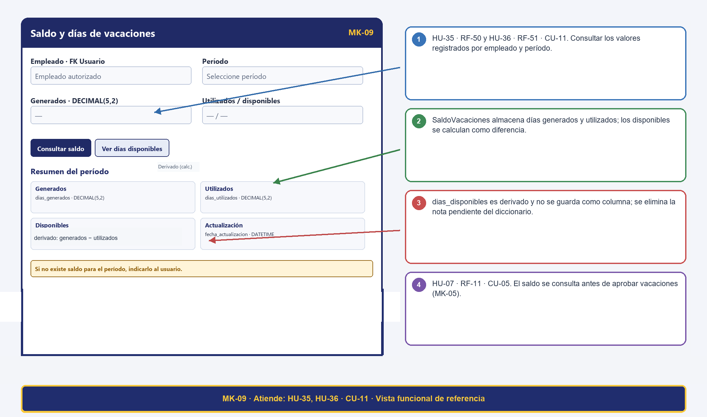

#### Tabla 14. Trazabilidad del mockup MK-09: Saldo y días de vacaciones

| Código | MK-09 |
| --- | --- |
| Pantalla | Saldo y días de vacaciones |
| Atiende (HU / CU) | HU-35, HU-36 / CU-11 |
| Campos ↔ Diccionario | SaldoVacaciones.id_usuario INT FK NN; SaldoVacaciones.periodo VARCHAR(10) NN; SaldoVacaciones.dias_generados DECIMAL(5,2) NN; SaldoVacaciones.dias_utilizados DECIMAL(5,2) NN; SaldoVacaciones.fecha_actualizacion DATETIME NN. El saldo disponible (dias_generados - dias_utilizados) se calcula como valor derivado en consulta. |
| Botones ↔ Eventos | Consultar saldo; Ver días disponibles — eventos relacionados con CU-11. RF específicos y transiciones se detallan en la matriz final. |
| RN visibles | RN-12/30: saldo del período y rango temporal coherente. Días disponibles se calculan con los valores de SaldoVacaciones. RNF-01/03/04/05. |
| Métodos de clase ↔ pantalla (HU respaldadas) | SaldoVacaciones.diasDisponibles |

### 14.10 MK-10 — Perfil organizacional y catálogos

#### Figura 19. MK-10: Perfil organizacional y catálogos; vista de referencia con trazabilidad anotada.

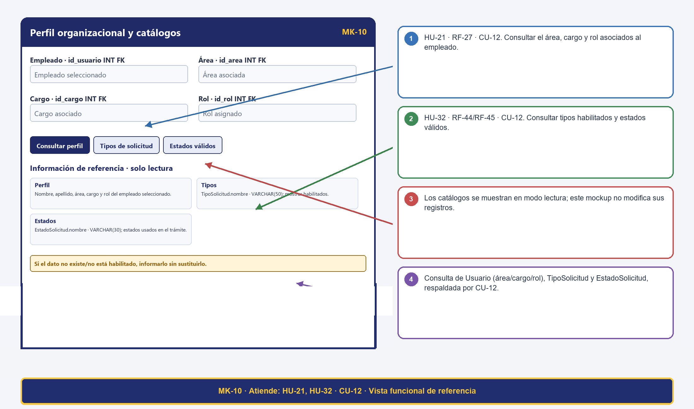

#### Tabla 15. Trazabilidad del mockup MK-10: Perfil organizacional y catálogos

| Código | MK-10 |
| --- | --- |
| Pantalla | Perfil organizacional y catálogos |
| Atiende (HU / CU) | HU-21, HU-32 / CU-12 |
| Campos ↔ Diccionario | Usuario.nombre/apellido VARCHAR(100), id_area/id_cargo/id_rol INT FK; Área/Cargo.nombre VARCHAR(100); Rol.nombre VARCHAR(50); TipoSolicitud.nombre VARCHAR(50); EstadoSolicitud.nombre VARCHAR(30). |
| Botones ↔ Eventos | Consultar perfil; Tipos de solicitud; Estados válidos — eventos relacionados con CU-12. RF específicos y transiciones se detallan en la matriz final. |
| RN visibles | RN-03/25/27: estado válido, perfil del empleado consultado y acceso autorizado. RNF-03/04/05. |
| Métodos de clase ↔ pantalla (HU respaldadas) | Consulta de solo lectura de Usuario (área, cargo y rol), TipoSolicitud y EstadoSolicitud, respaldada por CU-12. |

### 14.11 MK-11 — Historial y auditoría

#### Figura 20. MK-11: Historial y auditoría; vista de referencia con trazabilidad anotada.

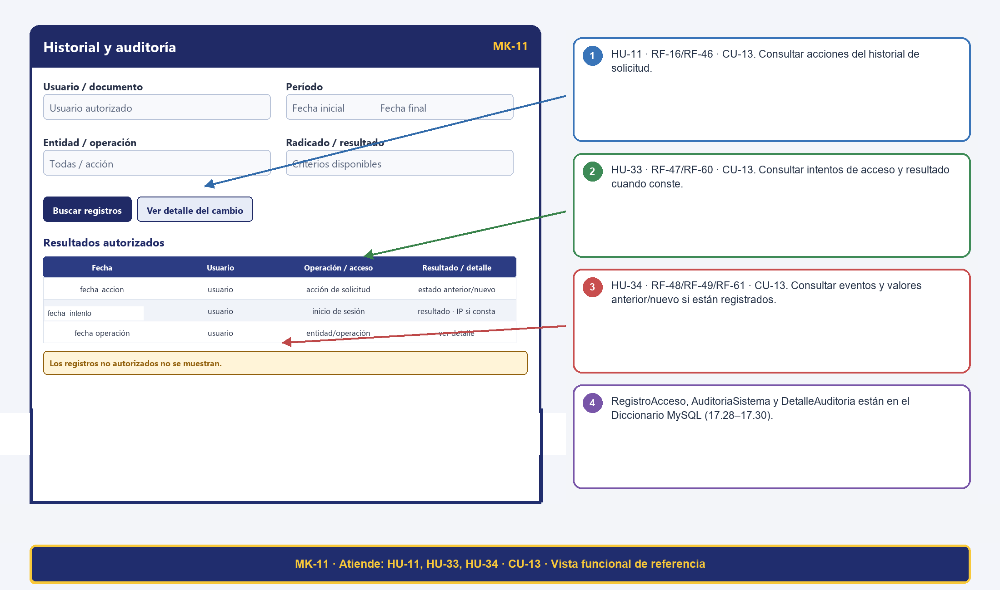

#### Tabla 16. Trazabilidad del mockup MK-11: Historial y auditoría

| Código | MK-11 |
| --- | --- |
| Pantalla | Historial y auditoría |
| Atiende (HU / CU) | HU-11, HU-33, HU-34 / CU-13 |
| Campos ↔ Diccionario | HistorialSolicitud (id_solicitud, id_usuario, id_tipo_accion, id_estado_anterior, id_estado_nuevo, comentario, fecha_accion); RegistroAcceso (id_usuario, fecha_intento, exitoso, direccion_ip); AuditoriaSistema (id_usuario, tabla_afectada, accion_realizada, fecha_accion); DetalleAuditoria (id_auditoria, campo_modificado, valor_anterior, valor_nuevo). |
| Botones ↔ Eventos | Buscar registros; Ver detalle del cambio — eventos relacionados con CU-13. RF específicos y transiciones se detallan en la matriz final. |
| RN visibles | RN-07/27/28: solo lectura, autorización y valores anterior/nuevo cuando existan. RNF-03/05. El Diccionario MySQL incluye RegistroAcceso, AuditoriaSistema y DetalleAuditoria. |
| Métodos de clase ↔ pantalla (HU respaldadas) | PermisoLaboral.aprobarPermiso; Solicitud.actualizarEstado; HistorialSolicitud.registrarCambioEstado; HistorialSolicitud.consultarHistorial; RegistroAcceso.consultarAccesosPorUsuario; AuditoriaSistema.consultarPorUsuario; DetalleAuditoria.consultarDetalle |

### 14.12 MK-12 — Reportes y exportación

#### Figura 21. MK-12: Reportes y exportación; vista de referencia con trazabilidad anotada.

#### Tabla 17. Trazabilidad del mockup MK-12: Reportes y exportación

| Código | MK-12 |
| --- | --- |
| Pantalla | Reportes y exportación |
| Atiende (HU / CU) | HU-14, HU-20, HU-37, HU-38, HU-39, HU-40, HU-16 / CU-14 |
| Campos ↔ Diccionario | Reporte.id_tipo_reporte/id_usuario INT FK, fecha_generacion DATETIME, nombre_archivo VARCHAR(150), ruta_archivo VARCHAR(300). Los filtros de consulta no están definidos como campos persistidos. |
| Botones ↔ Eventos | Generar reporte; Consultar generados; Exportar resultado — eventos relacionados con CU-14. RF específicos y transiciones se detallan en la matriz final. |
| RN visibles | RN-25: los reportes deben generarse únicamente con información registrada en el sistema.   RN-27 y RN-30: solo usuarios con rol autorizado pueden generar o exportar reportes según los parámetros seleccionados. |
| Métodos de clase ↔ pantalla (HU respaldadas) | Reporte.generar; Reporte.exportar |

### 14.13 Matriz integral de trazabilidad

La matriz integra las 40 HU consolidadas con sus criterios de aceptación, RF, RN/RNF, pasos básicos y alternos de CU, campos SQL contrastados, actores, mockups y referencias al documento MySQL. La numeración de HU de la entrega MySQL se usa como referencia funcional; no se presume una equivalencia uno a uno con las historias consolidadas de Nexa. P identifica pasos básicos y FA, flujos alternos. La tabla de correspondencia MySQL relaciona los métodos operativos con los procedimientos y HU; las operaciones de consulta y validación se justifican por sus criterios de aceptación.

#### Tabla 18. Matriz integral de trazabilidad del proyecto

| HU | Criterios de aceptación | RF asociados | RN / RNF | CU (pasos / flujos) | SQL DDL: tablas y campos | ACT / MK / referencia MySQL |
| --- | --- | --- | --- | --- | --- | --- |
| HU-01 | CA-1: Con credenciales válidas, el sistema permite el acceso y muestra únicamente las funciones del rol asignado.   CA-2: Con credenciales inválidas, deniega el acceso y presenta un mensaje claro.   CA-3: Registra los intentos asociados a una cuenta identificable con fecha, resultado y dirección IP cuando esté disponible. | RF-01 | RN: — / RNF: RNF-03 | CU-01 P1–3; FA-01/02; CU-01 P3 | Usuario (id_usuario, nombre, apellido, correo, contrasena_hash, id_cargo, id_area, id_rol, activo); Rol (id_rol, nombre); RegistroAcceso (id_acceso, id_usuario, fecha_intento, exitoso, direccion_ip) | ACT-01 / MK-01 / PRG-01 / ACT-01, ACT-02, ACT-03, ACT-04 / Sin PRG directo identificado en la matriz MySQL |
| HU-02 | CA-1: El sistema envía un mecanismo temporal al correo registrado y permite solicitar otro cuando el anterior haya expirado.   CA-2: Solo un mecanismo vigente y no utilizado permite establecer la nueva contraseña.   CA-3: Después del restablecimiento, el mecanismo queda marcado como utilizado y no puede reutilizarse. | RF-02, RF-43 | RN: RN-20 / RNF: RNF-03, RNF-05 | CU-02 P1; FA-01/02; CU-02 P3; FA-02; CU-02 P2 | RecuperacionClave (id_recuperacion, id_usuario, token, fecha_solicitud, fecha_expiracion, utilizada); Usuario (id_usuario, nombre, apellido, correo, contrasena_hash, id_cargo, id_area, id_rol, activo) | ACT-01, ACT-05 / MK-01 / PRG-02 / ACT-01, ACT-02, ACT-03, ACT-05 / Sin PRG directo identificado en la matriz MySQL |
| HU-03 | CA-1: El empleado selecciona uno de los tipos de solicitud disponibles y diligencia los datos obligatorios de ese trámite.   CA-2: Se aplican las validaciones correspondientes, incluidas las fechas y el saldo para vacaciones y el soporte requerido para incapacidad.   CA-3: Una solicitud válida recibe un radicado único, queda en el estado inicial definido y muestra confirmación.   CA-4: Si faltan datos o no se cumplen las reglas del tipo seleccionado, el sistema no radica la solicitud e indica qué debe corregirse. | RF-03, RF-13, RF-04, RF-05, RF-06 | RN: RN-01, RN-23, RN-13, RN-14, RN-02 / RNF: RNF-01, RNF-02, RNF-03, RNF-04, RNF-05, RNF-06 | CU-03 P1–4; FA-01–04; CU-10 P1–3; FA-01/02. | PermisoLaboral (id_permiso, id_solicitud, id_tipo_permiso, id_estado_permiso, fecha_inicio, fecha_fin, motivo); EstadoPermiso (id_estado_permiso, nombre); TipoPermiso (id_tipo_permiso, nombre); Solicitud (id_solicitud, radicado, id_usuario, id_tipo_solicitud, id_estado, fecha_registro); EstadoVacacion (id_estado_vacacion, nombre); TipoVacacion (id_tipo_vacacion, nombre); Vacacion (id_vacacion, id_solicitud, id_tipo_vacacion, id_estado_vacacion, fecha_inicio, fecha_fin, motivo); CertificadoLaboral (id_certificado, id_solicitud, id_estado_certificado, fecha_generacion, ruta_archivo); EstadoCertificado (id_estado_certificado, nombre); EstadoIncapacidad (id_estado_incapacidad, nombre); TipoIncapacidad (id_tipo_incapacidad, nombre); Incapacidad (id_incapacidad, id_solicitud, id_tipo_incapacidad, id_estado_incapacidad, fecha_inicio, fecha_fin, observacion); Documento (id_documento, id_solicitud, id_usuario_carga, nombre_archivo, tipo_archivo, tamano_archivo, ruta_archivo, fecha_carga) | ACT-01 / MK-03, MK-08 / PRG-04 / PRG-03, PRG-04 / PRG-04, PRG-08 / PRG-04, PRG-07 |
| HU-04 | CA-1: Solo un actor autorizado puede aprobar o rechazar una solicitud en un estado que admita la decisión.   CA-2: Al rechazar, se exige el motivo; al aprobar, se registra la decisión y su nuevo estado.   CA-3: Cada cambio guarda solicitud, actor, fecha, estado anterior, estado nuevo y acción asociada al historial. | RF-07, RF-26, RF-08 | RN: RN-03, RN-05, RN-07, RN-06 / RNF: RNF-01, RNF-02, RNF-03, RNF-04, RNF-05, RNF-06 | CU-05 P1–3; FA-01/02/04. | HistorialSolicitud (id_historial, id_solicitud, id_usuario, id_tipo_accion, id_estado_anterior, id_estado_nuevo, fecha_accion, comentario); EstadoSolicitud (id_estado, nombre); PermisoLaboral (id_permiso, id_solicitud, id_tipo_permiso, id_estado_permiso, fecha_inicio, fecha_fin, motivo); Solicitud (id_solicitud, radicado, id_usuario, id_tipo_solicitud, id_estado, fecha_registro) | ACT-02 / MK-05 / PRG-05 / ACT-01, ACT-02, ACT-03, ACT-04 / Sin PRG directo identificado en la matriz MySQL |
| HU-05 | Antecedentes:   Dado que existe una solicitud registrada   Y que el tipo de solicitud tiene un responsable definido para iniciar su flujo      Escenario: CA-1 Determinación del responsable   Dado que RAD-2026-005 corresponde a un tipo de solicitud con responsable configurado   Cuando se inicia el flujo de atención   Entonces el sistema determina el responsable correspondiente al tipo de solicitud      Escenario: CA-2 Asociación de la asignación   Dado que se determinó el responsable "Carlos Pérez"   Cuando se confirma la asignación inicial   Entonces la asignación queda asociada a RAD-2026-005   Y Carlos Pérez queda identificado como responsable      Escenario: CA-3 Registro de fecha   Dado que la solicitud fue asignada   Cuando se consulta la asignación   Entonces se muestra el responsable asignado   Y se conserva la fecha de asignación      Escenario: CA-4 Solicitud sin responsable disponible   Dado que no existe un responsable configurado para el tipo correspondiente   Cuando se intenta realizar la asignación inicial   Entonces el sistema no asigna un responsable inexistente   Y deja la situación identificada para gestión | RF-09 | RN: RN-08 / RNF: RNF-01, RNF-02, RNF-03, RNF-06 | CU-04 P1–3; FA-01; CU-06 P1–4 (consulta, reasignación y cierre de asignaciones). | AsignacionSolicitud (id_asignacion, id_solicitud, id_usuario_responsable, fecha_asignacion, fecha_fin, motivo, activa); Solicitud (id_solicitud, radicado, id_usuario, id_tipo_solicitud, id_estado, fecha_registro) | ACT-03 / MK-06 / PRG-04 |
| HU-06 | Antecedentes:   Dado que existe una solicitud pendiente de atención   Y que el límite definido para generar la alerta es superior a tres días sin movimiento      Escenario: CA-1 Alerta después del límite   Dado que RAD-2026-006 permanece sin movimiento durante más de tres días   Cuando se supera el límite definido   Entonces el sistema genera la alerta correspondiente   Y la alerta identifica la solicitud y el destinatario      Escenario: CA-2 Sin alerta antes del límite   Dado que RAD-2026-007 lleva menos de tres días sin movimiento   Cuando se verifica el proceso de alertas   Entonces el sistema no genera la alerta por vencimiento del límite      Escenario: CA-3 Identificación de la solicitud   Dado que RAD-2026-006 genera una alerta   Cuando el destinatario consulta la alerta   Entonces puede identificar el número de radicado   Y puede identificar que corresponde a una solicitud sin movimiento      Escenario: CA-4 Destinatario correcto   Dado que una solicitud tiene un responsable vigente   Cuando se genera la alerta   Entonces la alerta se dirige al destinatario definido para la atención de la solicitud | RF-10 | RN: RN-11 / RNF: RNF-02, RNF-03, RNF-04 | CU-09 P1–2; FA-01 | Notificacion (id_notificacion, id_usuario, id_solicitud, asunto, mensaje, fecha_envio, leida); Solicitud (id_solicitud, radicado, id_usuario, id_tipo_solicitud, id_estado, fecha_registro) | ACT-03, ACT-05 / MK-07 / PRG-10 |
| HU-07 | Antecedentes:   Dado que existe una solicitud de vacaciones pendiente de aprobación   Y que el sistema dispone del saldo correspondiente al empleado y período      Escenario: CA-1 Consulta previa a la aprobación   Dado que Ana Torres solicita 5 días de vacaciones   Cuando el usuario autorizado inicia la validación para aprobar   Entonces el sistema consulta el saldo disponible antes de aprobar      Escenario: CA-2 Saldo suficiente   Dado que Ana tiene 10 días disponibles y solicita 5   Cuando se valida el saldo   Entonces el sistema determina que el saldo es suficiente   Y permite continuar con el proceso de aprobación      Escenario: CA-3 Saldo insuficiente   Dado que Ana tiene 3 días disponibles y solicita 5   Cuando se valida el saldo   Entonces el sistema determina que el saldo es insuficiente   Y no permite aprobar la solicitud por falta de saldo      Escenario: CA-4 Período correspondiente   Dado que Ana tiene saldos registrados para diferentes períodos   Cuando se valida una solicitud de vacaciones   Entonces el sistema utiliza el saldo correspondiente al período de la solicitud | RF-11 | RN: RN-05, RN-12 / RNF: RNF-01, RNF-02, RNF-03, RNF-04, RNF-05, RNF-06 | CU-05 P2; FA-03 | SaldoVacaciones (id_saldo, id_usuario, periodo, dias_generados, dias_utilizados, fecha_actualizacion); Vacacion (id_vacacion, id_solicitud, id_tipo_vacacion, id_estado_vacacion, fecha_inicio, fecha_fin, motivo) | ACT-03 / MK-05 / PRG-03, PRG-05 |
| HU-08 | Antecedentes:   Dado que existe una solicitud de certificado laboral asociada a un empleado      Escenario: CA-1 Generación desde solicitud aprobada   Dado que la solicitud RAD-2026-008 está aprobada   Cuando el usuario de Talento Humano solicita generar el certificado   Entonces el sistema genera el certificado asociado a RAD-2026-008      Escenario: CA-2 Rechazo de generación sin aprobación   Dado que RAD-2026-009 se encuentra pendiente   Cuando el usuario intenta generar el certificado   Entonces el sistema no genera el documento como certificado aprobado   Y conserva el estado de la solicitud      Escenario: CA-3 Asociación del archivo   Dado que el certificado fue generado correctamente   Cuando se consulta la solicitud RAD-2026-008   Entonces el archivo generado aparece asociado a esa solicitud      Escenario: CA-4 Disponibilidad   Dado que existe un certificado generado   Cuando el empleado o usuario autorizado consulta la solicitud   Entonces el sistema permite acceder al archivo según los permisos definidos | RF-12 | RN: RN-14 / RNF: RNF-01, RNF-02, RNF-03, RNF-04, RNF-05, RNF-06 | CU-10 P1–2; FA-01 | CertificadoLaboral (id_certificado, id_solicitud, id_estado_certificado, fecha_generacion, ruta_archivo); EstadoCertificado (id_estado_certificado, nombre); Solicitud (id_solicitud, radicado, id_usuario, id_tipo_solicitud, id_estado, fecha_registro) | ACT-03 / MK-08 / PRG-08 |
| HU-09 | Antecedentes:   Dado que el usuario de Talento Humano ha iniciado sesión   Y que existen solicitudes registradas      Escenario: CA-1 Búsqueda por radicado existente   Dado que existe la solicitud RAD-2026-010   Cuando el usuario busca exactamente RAD-2026-010   Entonces el sistema localiza la solicitud   Y muestra información que permite identificarla inequívocamente      Escenario: CA-2 Radicado inexistente   Dado que no existe una solicitud con radicado RAD-9999   Cuando el usuario realiza la búsqueda   Entonces el sistema no devuelve solicitudes   Y muestra que no se encontró coincidencia      Escenario: CA-3 Radicado exacto   Dado que existen varios radicados diferentes   Cuando el usuario consulta RAD-2026-010   Entonces el resultado corresponde al radicado consultado   Y no mezcla información de otros radicados      Escenario: CA-4 Consulta sin modificación   Dado que el usuario localiza una solicitud   Cuando visualiza el resultado de la búsqueda   Entonces la consulta no modifica los datos de la solicitud | RF-14 | RN: RN-23 / RNF: RNF-01, RNF-02, RNF-03, RNF-04, RNF-05, RNF-06 | CU-07 P1; FA-01 | Solicitud (id_solicitud, radicado, id_usuario, id_tipo_solicitud, id_estado, fecha_registro) | ACT-03 / MK-02 / PRG-11 |
| HU-10 | CA-1: El archivo queda asociado a la solicitud correspondiente y se identifica quién lo cargó y cuándo.   CA-2: Se permiten soportes adicionales mientras la solicitud no haya sido procesada.   CA-3: El sistema valida el formato y tamaño permitidos antes de aceptar el archivo. | RF-15, RF-33 | RN: RN-17, RN-18, RN-19 / RNF: RNF-01, RNF-02, RNF-03, RNF-04, RNF-05, RNF-06 | CU-08 P1–2; FA-01/02. | Solicitud (id_solicitud, radicado, id_usuario, id_tipo_solicitud, id_estado, fecha_registro); Documento (id_documento, id_solicitud, id_usuario_carga, nombre_archivo, tipo_archivo, tamano_archivo, ruta_archivo, fecha_carga) | ACT-01 / MK-03 / PRG-04, PRG-07 / MK-04 / PRG-07 |
| HU-11 | CA-1: El historial se presenta en orden cronológico y corresponde a la solicitud consultada.   CA-2: Cuando existan, se muestran la radicación, cambios de estado, asignaciones y cargas documentales, con actor, fecha y detalle registrado.   CA-3: El acceso a la información respeta los permisos del usuario. | RF-16, RF-46 | RN: RN-07, RN-28 / RNF: RNF-01, RNF-02, RNF-03, RNF-06 | CU-13 P1–2; FA-01; CU-13 P1 | HistorialSolicitud (id_historial, id_solicitud, id_usuario, id_tipo_accion, id_estado_anterior, id_estado_nuevo, fecha_accion, comentario); TipoAccion (id_tipo_accion, nombre) | ACT-03 / MK-04 / PRG-09 / MK-11 / Consulta SQL; matriz MySQL |
| HU-12 | Antecedentes:   Dado que el empleado tiene una solicitud registrada   Y que la solicitud se encuentra en un estado que permite modificación      Escenario: CA-1 Edición de solicitud pendiente   Dado que RAD-2026-013 está pendiente   Cuando Ana modifica el motivo de la solicitud y guarda los cambios   Entonces el sistema actualiza la información   Y conserva la solicitud con sus datos modificados      Escenario: CA-2 Solicitud procesada no editable   Dado que RAD-2026-014 ya fue aprobada   Cuando Ana intenta modificarla   Entonces el sistema no permite la edición   Y conserva los datos procesados      Escenario: CA-3 Estado no modificable   Dado que una solicitud se encuentra en un estado que no permite cambios   Cuando el empleado intenta editarla   Entonces el sistema bloquea la operación      Escenario: CA-4 Trazabilidad de modificación   Dado que una solicitud pendiente fue modificada   Cuando se consulta su historial   Entonces la modificación queda identificable para conservar la trazabilidad | RF-17 | RN: RN-07, RN-15 / RNF: RNF-01, RNF-02, RNF-03, RNF-04, RNF-05, RNF-06 | CU-05 P1,3; FA-01/04 | Solicitud (id_solicitud, radicado, id_usuario, id_tipo_solicitud, id_estado, fecha_registro) | ACT-01 / MK-03 / PRG-05 |
| HU-13 | Antecedentes:   Dado que el empleado tiene solicitudes registradas   Y que está habilitada la notificación correspondiente      Escenario: CA-1 Notificación por cambio de estado   Dado que RAD-2026-015 cambia de Pendiente a Aprobada   Cuando se confirma el cambio de estado   Entonces el sistema genera la notificación configurada   Y la dirige al empleado correspondiente      Escenario: CA-2 Destinatario correcto   Dado que RAD-2026-016 pertenece a Ana Torres   Cuando se genera una notificación por su cambio de estado   Entonces la notificación identifica a Ana como destinataria   Y no se presenta como notificación dirigida a otro empleado      Escenario: CA-3 Notificación interna   Dado que se genera una notificación interna   Cuando Ana consulta sus notificaciones   Entonces puede identificar el aviso relacionado con la solicitud   Y el sistema conserva su estado de lectura      Escenario: CA-4 Correo configurado   Dado que el proceso tiene habilitada la notificación por correo   Cuando ocurre el evento que la genera   Entonces el sistema utiliza el correo asociado al destinatario | RF-18 | RN: RN-21 / RNF: RNF-02, RNF-03, RNF-04 | CU-09 P2–3; FA-02/03 | Notificacion (id_notificacion, id_usuario, id_solicitud, asunto, mensaje, fecha_envio, leida); Solicitud (id_solicitud, radicado, id_usuario, id_tipo_solicitud, id_estado, fecha_registro) | ACT-01, ACT-05 / MK-07 / PRG-09 |
| HU-14 | Antecedentes:   Dado que existen solicitudes con fechas y responsables registrados   Y que el usuario de Talento Humano puede consultar reportes      Escenario: CA-1 Consulta por tipo y responsable   Dado que existen solicitudes de permiso atendidas por Carlos Pérez   Cuando el usuario consulta tiempos por tipo "Permiso laboral" y responsable "Carlos Pérez"   Entonces el reporte utiliza esos criterios   Y muestra los tiempos registrados para las solicitudes coincidentes      Escenario: CA-2 Uso de tiempos registrados   Dado que una solicitud tiene registrado su tiempo de atención   Cuando se genera la consulta   Entonces el reporte utiliza el tiempo registrado del proceso   Y no inventa un valor para la solicitud      Escenario: CA-3 Identificación del período   Dado que el usuario consulta el período del 01/10/2026 al 31/10/2026   Cuando genera el reporte   Entonces el resultado identifica el período consultado      Escenario: CA-4 Sin coincidencias   Dado que no existen solicitudes que cumplan los filtros   Cuando se consulta el reporte   Entonces el sistema informa que no hay información coincidente | RF-19 | RN: RN-29, RN-30 / RNF: RNF-01, RNF-02, RNF-03, RNF-04, RNF-05, RNF-06 | CU-14 P1–2; FA-01 | TipoReporte (id_tipo_reporte, nombre); Solicitud (id_solicitud, radicado, id_usuario, id_tipo_solicitud, id_estado, fecha_registro); Reporte (id_reporte, id_tipo_reporte, id_usuario, fecha_generacion, nombre_archivo, ruta_archivo) | ACT-03 / MK-12 / PRG-11 |
| HU-15 | Antecedentes:   Dado que existe una solicitud que puede pasar al estado En revisión   Y que el usuario de Talento Humano está autorizado      Escenario: CA-1 Cambio a En revisión   Dado que RAD-2026-017 está en un estado que permite revisión adicional   Cuando el usuario selecciona cambiar a En revisión   Entonces la solicitud queda en estado En revisión      Escenario: CA-2 Nota obligatoria   Dado que RAD-2026-018 requiere una validación adicional   Cuando el usuario intenta cambiarla a En revisión sin registrar una nota   Entonces el sistema no ejecuta el cambio   Y solicita la nota explicativa      Escenario: CA-3 Nota registrada   Dado que el usuario ingresa la nota "Validar soporte adjunto"   Cuando confirma el cambio   Entonces la nota queda asociada al cambio de estado   Y la solicitud queda En revisión      Escenario: CA-4 Historial   Dado que la solicitud fue cambiada a En revisión   Cuando se consulta su historial   Entonces se identifica el cambio de estado   Y se conserva la nota explicativa registrada | RF-20, RF-26 | RN: RN-03, RN-07, RN-16 / RNF: RNF-01, RNF-02, RNF-03, RNF-04, RNF-05, RNF-06 | CU-05 P1,3; FA-01/02/04 | HistorialSolicitud (id_historial, id_solicitud, id_usuario, id_tipo_accion, id_estado_anterior, id_estado_nuevo, fecha_accion, comentario); EstadoSolicitud (id_estado, nombre); Solicitud (id_solicitud, radicado, id_usuario, id_tipo_solicitud, id_estado, fecha_registro) | ACT-03 / MK-05 / PRG-05 |
| HU-16 | CA-1: La consulta acepta estado, tipo, empleado y rango de fechas, incluidos los filtros de período y estado.   CA-2: Los resultados corresponden a los criterios seleccionados y muestran el radicado, tipo, empleado, fecha y estado.   CA-3: Si no hay coincidencias, el sistema informa que no se encontraron solicitudes. | RF-21, RF-62 | RN: RN-03, RN-27, RN-30 / RNF: RNF-01, RNF-02, RNF-03, RNF-04, RNF-05, RNF-06 | CU-07 P1; FA-01/02; CU-14 P1–2 | EstadoSolicitud (id_estado, nombre); TipoSolicitud (id_tipo_solicitud, nombre); Solicitud (id_solicitud, radicado, id_usuario, id_tipo_solicitud, id_estado, fecha_registro); TipoReporte (id_tipo_reporte, nombre); Reporte (id_reporte, id_tipo_reporte, id_usuario, fecha_generacion, nombre_archivo, ruta_archivo); Cargo (id_cargo, nombre); Area (id_area, nombre); Rol (id_rol, nombre) | ACT-03 / MK-02 / PRG-11 / MK-02, MK-12 |
| HU-17 | Antecedentes:   Dado que el empleado "Ana Torres" ha iniciado sesión      Escenario: CA-1 Consulta exclusiva del empleado   Dado que Ana tiene solicitudes propias y existen solicitudes de otros empleados   Cuando consulta su historial personal   Entonces el sistema muestra únicamente las solicitudes de Ana Torres      Escenario: CA-2 Fechas y estados   Dado que Ana tiene solicitudes con diferentes fechas y estados   Cuando consulta su historial   Entonces cada solicitud muestra su fecha y estado correspondiente      Escenario: CA-3 Respuestas y comentarios   Dado que una solicitud de Ana tiene una respuesta o comentario registrado   Cuando consulta su historial   Entonces el sistema muestra esa respuesta o comentario junto a la solicitud      Escenario: CA-4 Sin solicitudes   Dado que un empleado no tiene solicitudes anteriores   Cuando consulta su historial personal   Entonces el sistema informa que no existen solicitudes para mostrar | RF-22 | RN: RN-03, RN-24 / RNF: RNF-01, RNF-02, RNF-03, RNF-04, RNF-05, RNF-06 | CU-07 P2; FA-01/02 | EstadoSolicitud (id_estado, nombre); TipoSolicitud (id_tipo_solicitud, nombre); Solicitud (id_solicitud, radicado, id_usuario, id_tipo_solicitud, id_estado, fecha_registro) | ACT-01 / MK-04 / PRG-11 |
| HU-18 | Antecedentes:   Dado que el empleado tiene una solicitud registrada   Y que todavía no ha sido aprobada ni rechazada      Escenario: CA-1 Cancelación permitida   Dado que RAD-2026-019 se encuentra pendiente   Cuando Ana selecciona cancelar la solicitud   Entonces el sistema ejecuta la cancelación   Y registra la acción realizada      Escenario: CA-2 Solicitud aprobada no cancelable   Dado que RAD-2026-020 está aprobada   Cuando Ana intenta cancelarla   Entonces el sistema no permite la cancelación      Escenario: CA-3 Solicitud rechazada no cancelable   Dado que RAD-2026-021 está rechazada   Cuando Ana intenta cancelarla   Entonces el sistema no permite la cancelación      Escenario: CA-4 Trazabilidad   Dado que RAD-2026-019 fue cancelada correctamente   Cuando se consulta su historial   Entonces la cancelación aparece registrada   Y se conserva la información de la acción | RF-23, RF-26 | RN: RN-03, RN-04, RN-07 / RNF: RNF-01, RNF-02, RNF-03, RNF-04, RNF-05, RNF-06 | CU-05 P1,3; FA-01/04 | HistorialSolicitud (id_historial, id_solicitud, id_usuario, id_tipo_accion, id_estado_anterior, id_estado_nuevo, fecha_accion, comentario); EstadoSolicitud (id_estado, nombre); Solicitud (id_solicitud, radicado, id_usuario, id_tipo_solicitud, id_estado, fecha_registro) | ACT-01 / MK-04 / PRG-05 |
| HU-19 | Antecedentes:   Dado que existe una solicitud con un responsable asignado   Y que el usuario de Talento Humano está autorizado para reasignar      Escenario: CA-1 Reasignación a responsable autorizado   Dado que RAD-2026-022 está asignada a Carlos Pérez   Cuando el usuario la reasigna a Laura Gómez, quien es responsable autorizado   Entonces la nueva asignación queda asociada a la solicitud      Escenario: CA-2 Responsable no autorizado   Dado que "Usuario no autorizado" no puede recibir solicitudes   Cuando se intenta reasignar RAD-2026-022 a ese usuario   Entonces el sistema no realiza la reasignación      Escenario: CA-3 Motivo obligatorio   Dado que se seleccionó un responsable autorizado   Cuando el usuario intenta reasignar sin ingresar motivo   Entonces el sistema no completa la reasignación   Y solicita el motivo obligatorio      Escenario: CA-4 Registro histórico   Dado que la reasignación se realizó con motivo "Distribución de carga"   Cuando se consulta el historial de la solicitud   Entonces se identifica la reasignación   Y se conserva el motivo registrado | RF-24 | RN: RN-07, RN-09, RN-10 / RNF: RNF-01, RNF-02, RNF-03, RNF-06 | CU-06 P1,3; FA-01 | AsignacionSolicitud (id_asignacion, id_solicitud, id_usuario_responsable, fecha_asignacion, fecha_fin, motivo, activa); HistorialSolicitud (id_historial, id_solicitud, id_usuario, id_tipo_accion, id_estado_anterior, id_estado_nuevo, fecha_accion, comentario) | ACT-03 / MK-06 / PRG-06 |
| HU-20 | Antecedentes:   Dado que el gerente tiene permiso para consultar información de gestión      Escenario: CA-1 Selección de período   Dado que el gerente desea consultar octubre de 2026   Cuando selecciona el período del 01/10/2026 al 31/10/2026   Entonces el sistema genera el resumen correspondiente a ese período      Escenario: CA-2 Diferenciación por tipo   Dado que existen solicitudes de permisos, vacaciones, incapacidades y certificados   Cuando el gerente consulta el resumen   Entonces la información diferencia los tipos de solicitud      Escenario: CA-3 Correspondencia con el período   Dado que existen solicitudes fuera del período seleccionado   Cuando se genera el resumen   Entonces esas solicitudes no hacen parte del resultado del período consultado      Escenario: CA-4 Período sin información   Dado que no existen solicitudes en el período seleccionado   Cuando el gerente consulta el resumen   Entonces el sistema informa que no existen datos para ese período | RF-25 | RN: RN-29, RN-30 / RNF: RNF-01, RNF-02, RNF-03, RNF-04, RNF-05, RNF-06 | CU-14 P1–2; FA-01 | TipoReporte (id_tipo_reporte, nombre); Solicitud (id_solicitud, radicado, id_usuario, id_tipo_solicitud, id_estado, fecha_registro); Reporte (id_reporte, id_tipo_reporte, id_usuario, fecha_generacion, nombre_archivo, ruta_archivo) | ACT-04 / MK-12 / PRG-11 |
| HU-21 | Antecedentes:   Dado que existe un empleado registrado   Y que el usuario de Talento Humano tiene permiso para consultar su información organizacional      Escenario: CA-1 Identificación del empleado   Dado que el usuario selecciona a Ana Torres   Cuando consulta su perfil organizacional   Entonces el sistema identifica que la información corresponde a Ana Torres      Escenario: CA-2 Datos organizacionales disponibles   Dado que Ana Torres tiene área "Talento Humano", cargo "Analista" y rol registrado   Cuando se consulta su perfil   Entonces el sistema muestra el área, cargo y rol registrados      Escenario: CA-3 Información correspondiente   Dado que existen otros empleados registrados   Cuando el usuario consulta el perfil de Ana Torres   Entonces el sistema no mezcla datos organizacionales de otros empleados      Escenario: CA-4 Datos no registrados   Dado que un empleado no tiene uno de los datos organizacionales registrados   Cuando se consulta el perfil   Entonces el sistema muestra los datos disponibles   Y no inventa información para el dato faltante | RF-27 | RN: RN-03 / RNF: RNF-01, RNF-02, RNF-03, RNF-04, RNF-05 | CU-12 P1–2; FA-01/03 | Usuario (id_usuario, nombre, apellido, correo, contrasena_hash, id_cargo, id_area, id_rol, activo); Cargo (id_cargo, nombre); Area (id_area, nombre); Rol (id_rol, nombre) | ACT-03 / MK-10 / PRG-11 |
| HU-22 | Antecedentes:   Dado que existe una solicitud registrada   Y que el usuario tiene permiso para consultarla      Escenario: CA-1 Radicado   Dado que existe RAD-2026-023   Cuando el usuario consulta su detalle   Entonces el sistema muestra el radicado RAD-2026-023      Escenario: CA-2 Información básica   Dado que RAD-2026-023 es una solicitud de permiso registrada el 10/10/2026   Cuando se consulta el detalle   Entonces se muestran el tipo, la fecha y el estado actual      Escenario: CA-3 Responsable   Dado que RAD-2026-023 tiene un responsable vigente   Cuando se consulta el detalle   Entonces el sistema muestra el responsable actual      Escenario: CA-4 Solicitud inexistente   Dado que no existe RAD-9999   Cuando el usuario intenta consultar su detalle   Entonces el sistema informa que la solicitud no fue encontrada | RF-28 | RN: RN-23, RN-27 / RNF: RNF-01, RNF-02, RNF-03, RNF-04, RNF-05, RNF-06 | CU-07 P2; FA-03 | EstadoSolicitud (id_estado, nombre); TipoSolicitud (id_tipo_solicitud, nombre); Solicitud (id_solicitud, radicado, id_usuario, id_tipo_solicitud, id_estado, fecha_registro) | ACT-01 / MK-04 / PRG-11 |
| HU-23 | Antecedentes:   Dado que existe una solicitud con asignaciones registradas      Escenario: CA-1 Responsable vigente   Dado que RAD-2026-024 tiene como responsable vigente a Carlos Pérez   Cuando el usuario consulta el responsable actual   Entonces el sistema identifica a Carlos Pérez como responsable vigente      Escenario: CA-2 Correspondencia con la solicitud   Dado que existen asignaciones de varias solicitudes   Cuando se consulta RAD-2026-024   Entonces se muestra únicamente la asignación correspondiente a esa solicitud      Escenario: CA-3 Asignación finalizada   Dado que una asignación anterior de RAD-2026-024 fue finalizada   Cuando se consulta el responsable actual   Entonces la asignación finalizada no aparece como vigente      Escenario: CA-4 Sin responsable vigente   Dado que una solicitud no tiene una asignación vigente   Cuando se consulta su responsable actual   Entonces el sistema informa que no existe responsable vigente | RF-29 | RN: RN-26 / RNF: RNF-01, RNF-02, RNF-03, RNF-06 | CU-06 P1; FA-02 | AsignacionSolicitud (id_asignacion, id_solicitud, id_usuario_responsable, fecha_asignacion, fecha_fin, motivo, activa); HistorialSolicitud (id_historial, id_solicitud, id_usuario, id_tipo_accion, id_estado_anterior, id_estado_nuevo, fecha_accion, comentario); Usuario (id_usuario, nombre, apellido, correo, contrasena_hash, id_cargo, id_area, id_rol, activo) | ACT-01 / MK-06 / PRG-06 |
| HU-24 | Antecedentes:   Dado que una solicitud tiene una o más asignaciones o reasignaciones registradas      Escenario: CA-1 Consulta de asignaciones   Dado que RAD-2026-025 fue asignada inicialmente a Carlos Pérez y posteriormente a Laura Gómez   Cuando se consulta el historial de asignaciones   Entonces se muestran las asignaciones asociadas a RAD-2026-025      Escenario: CA-2 Diferenciación de estados   Dado que la asignación de Carlos Pérez fue finalizada y la de Laura Gómez está vigente   Cuando se consulta el historial   Entonces se distinguen la asignación finalizada y la vigente      Escenario: CA-3 Fechas de asignación   Dado que cada asignación tiene una fecha registrada   Cuando se consulta el historial   Entonces el sistema muestra la fecha correspondiente a cada asignación      Escenario: CA-4 Solicitud sin asignaciones   Dado que una solicitud no tiene asignaciones registradas   Cuando se consulta su historial de asignaciones   Entonces el sistema informa que no existen asignaciones históricas | RF-30 | RN: RN-26 / RNF: RNF-01, RNF-02, RNF-03, RNF-06 | CU-06 P1–2; FA-02/04 | AsignacionSolicitud (id_asignacion, id_solicitud, id_usuario_responsable, fecha_asignacion, fecha_fin, motivo, activa); HistorialSolicitud (id_historial, id_solicitud, id_usuario, id_tipo_accion, id_estado_anterior, id_estado_nuevo, fecha_accion, comentario); Usuario (id_usuario, nombre, apellido, correo, contrasena_hash, id_cargo, id_area, id_rol, activo) | ACT-03 / MK-06 / PRG-06 |
| HU-25 | Antecedentes:   Dado que existe una asignación vigente asociada a una solicitud   Y que el usuario de Talento Humano está autorizado      Escenario: CA-1 Finalización de asignación   Dado que Carlos Pérez tiene la asignación vigente de RAD-2026-026   Cuando el usuario finaliza la asignación   Entonces la asignación queda marcada como finalizada      Escenario: CA-2 Registro de fecha de finalización   Dado que la asignación está vigente   Cuando se confirma su finalización   Entonces el sistema registra la fecha de finalización      Escenario: CA-3 Deja de estar activa   Dado que la asignación de Carlos Pérez fue finalizada   Cuando se consulta el responsable vigente de RAD-2026-026   Entonces Carlos Pérez ya no aparece como responsable activo      Escenario: CA-4 Asignación ya finalizada   Dado que una asignación ya está finalizada   Cuando se intenta finalizar nuevamente   Entonces el sistema no la trata como una asignación vigente | RF-31 | RN: RN-26 / RNF: RNF-01, RNF-02, RNF-03, RNF-06 | CU-06 P3; FA-03 | AsignacionSolicitud (id_asignacion, id_solicitud, id_usuario_responsable, fecha_asignacion, fecha_fin, motivo, activa) | ACT-03 / MK-06 / PRG-06 |
| HU-26 | Antecedentes:   Dado que existe una asignación o reasignación con motivo registrado      Escenario: CA-1 Consulta del motivo   Dado que la asignación de RAD-2026-027 tiene el motivo "Distribución de carga"   Cuando el usuario consulta el motivo   Entonces el sistema muestra "Distribución de carga"      Escenario: CA-2 Motivo asociado a la asignación   Dado que RAD-2026-027 tiene varias asignaciones con motivos diferentes   Cuando se consulta una asignación específica   Entonces el motivo mostrado corresponde a esa asignación      Escenario: CA-3 Asignación sin motivo   Dado que una asignación no tiene un motivo registrado   Cuando se consulta su motivo   Entonces el sistema informa que no existe motivo registrado      Escenario: CA-4 Consulta sin modificación   Dado que existe una asignación con motivo registrado   Cuando el usuario consulta el motivo   Entonces la asignación permanece sin cambios | RF-32 | RN: RN-10 / RNF: RNF-01, RNF-02, RNF-03, RNF-06 | CU-06 P2; FA-04 | AsignacionSolicitud (id_asignacion, id_solicitud, id_usuario_responsable, fecha_asignacion, fecha_fin, motivo, activa); HistorialSolicitud (id_historial, id_solicitud, id_usuario, id_tipo_accion, id_estado_anterior, id_estado_nuevo, fecha_accion, comentario); Usuario (id_usuario, nombre, apellido, correo, contrasena_hash, id_cargo, id_area, id_rol, activo) | ACT-03 / MK-06 / PRG-06 |
| HU-27 | Antecedentes:   Dado que existe una solicitud con documentos adjuntos   Y que el usuario tiene permiso para consultarlos      Escenario: CA-1 Consulta de documentos   Dado que RAD-2026-029 tiene dos documentos asociados   Cuando el usuario consulta sus documentos adjuntos   Entonces el sistema muestra los documentos asociados a RAD-2026-029      Escenario: CA-2 Información del documento   Dado que existe un documento llamado "Soporte.pdf"   Cuando se consulta la lista de documentos   Entonces se identifica su nombre, tipo y fecha de carga      Escenario: CA-3 Documento de otra solicitud   Dado que existen documentos asociados a diferentes solicitudes   Cuando se consulta RAD-2026-029   Entonces el sistema no muestra documentos pertenecientes a otra solicitud      Escenario: CA-4 Consulta sin modificación   Dado que existen documentos asociados   Cuando el usuario los consulta   Entonces el contenido y los registros de los archivos no se modifican | RF-34 | RN: RN-17, RN-19 / RNF: RNF-01, RNF-02, RNF-03, RNF-04, RNF-05, RNF-06 | CU-08 P3; FA-02/03 | Solicitud (id_solicitud, radicado, id_usuario, id_tipo_solicitud, id_estado, fecha_registro); Documento (id_documento, id_solicitud, id_usuario_carga, nombre_archivo, tipo_archivo, tamano_archivo, ruta_archivo, fecha_carga) | ACT-03 / MK-04 / PRG-07 |
| HU-28 | Antecedentes:   Dado que el empleado está adjuntando un documento a una solicitud      Escenario: CA-1 Formato válido   Dado que el archivo "Soporte.pdf" tiene un formato permitido   Cuando el empleado intenta adjuntarlo   Entonces el sistema acepta la validación de formato      Escenario: CA-2 Formato inválido   Dado que el archivo "Soporte.exe" no corresponde a un formato permitido   Cuando el empleado intenta adjuntarlo   Entonces el sistema informa que el formato no es válido   Y no almacena el archivo como soporte válido      Escenario: CA-3 Tamaño máximo   Dado que el archivo supera el tamaño máximo permitido   Cuando el empleado intenta cargarlo   Entonces el sistema informa que el tamaño no es válido   Y no almacena el archivo como soporte válido      Escenario: CA-4 Validación exitosa   Dado que el archivo cumple formato y tamaño   Cuando se ejecutan las validaciones   Entonces el archivo puede continuar al proceso de almacenamiento como soporte válido | RF-35 | RN: RN-18 / RNF: RNF-01, RNF-02, RNF-03, RNF-04, RNF-05, RNF-06 | CU-08 P1; FA-01 | Documento (id_documento, id_solicitud, id_usuario_carga, nombre_archivo, tipo_archivo, tamano_archivo, ruta_archivo, fecha_carga) | ACT-01 / MK-03 / PRG-07 |
| HU-29 | CA-1: El permiso muestra fechas, tipo, estado y motivo.   CA-2: Las vacaciones muestran fechas, días calculados, modalidad, estado y motivo.   CA-3: La incapacidad muestra fechas, tipo u origen, estado, observación y soporte médico cuando esté asociado.   CA-4: El sistema solo muestra los datos que corresponden al tipo de trámite y a los permisos del usuario. | RF-36, RF-37, RF-38 | RN: RN-12, RN-13, RN-17 / RNF: RNF-01, RNF-02, RNF-03, RNF-04, RNF-05, RNF-06 | CU-07 P2; FA-03 | PermisoLaboral (id_permiso, id_solicitud, id_tipo_permiso, id_estado_permiso, fecha_inicio, fecha_fin, motivo); EstadoPermiso (id_estado_permiso, nombre); TipoPermiso (id_tipo_permiso, nombre); EstadoVacacion (id_estado_vacacion, nombre); TipoVacacion (id_tipo_vacacion, nombre); Vacacion (id_vacacion, id_solicitud, id_tipo_vacacion, id_estado_vacacion, fecha_inicio, fecha_fin, motivo); EstadoIncapacidad (id_estado_incapacidad, nombre); TipoIncapacidad (id_tipo_incapacidad, nombre); Incapacidad (id_incapacidad, id_solicitud, id_tipo_incapacidad, id_estado_incapacidad, fecha_inicio, fecha_fin, observacion) | ACT-01 / MK-04 / Consulta SQL; matriz MySQL / PRG-03 / ACT-03 |
| HU-30 | CA-1: El sistema informa el estado vigente del certificado.   CA-2: Cuando el certificado esté generado, permite consultar y descargar el archivo asociado.   CA-3: Si aún no está disponible, indica el estado sin presentar un archivo inexistente. | RF-39, RF-40 | RN: RN-14 / RNF: RNF-01, RNF-02, RNF-03, RNF-04, RNF-05, RNF-06 | CU-10 P3; FA-02 | CertificadoLaboral (id_certificado, id_solicitud, id_estado_certificado, fecha_generacion, ruta_archivo); EstadoCertificado (id_estado_certificado, nombre) | ACT-01 / MK-08 / PRG-08 |
| HU-31 | CA-1: El empleado consulta únicamente sus notificaciones, con asunto, fecha y contenido.   CA-2: Puede marcar individualmente una notificación como leída.   CA-3: El estado de lectura se conserva y se refleja al volver a consultar. | RF-41, RF-42 | RN: RN-21, RN-22 / RNF: RNF-02, RNF-03, RNF-04 | CU-09 P3; FA-03 | Notificacion (id_notificacion, id_usuario, id_solicitud, asunto, mensaje, fecha_envio, leida) | ACT-01 / MK-07 / PRG-09 |
| HU-32 | CA-1: Antes de radicar, el empleado puede consultar los tipos de solicitud disponibles.   CA-2: El personal autorizado puede consultar los estados válidos y su significado operativo.   CA-3: La consulta presenta los valores definidos por los catálogos vigentes. | RF-44, RF-45 | RN: RN-03 / RNF: RNF-01, RNF-02, RNF-03, RNF-04, RNF-05 | CU-12 P1–2; FA-02 | TipoSolicitud (id_tipo_solicitud, nombre); EstadoSolicitud (id_estado, nombre) | ACT-01 / MK-10 / Consulta SQL; matriz MySQL / ACT-03 |
| HU-33 | CA-1: La consulta permite filtrar por usuario y rango de fechas; cuando se requiera, también por dirección IP y resultado.   CA-2: Cada resultado muestra fecha del intento, resultado y dirección IP registrada.   CA-3: La consulta no permite alterar los registros de acceso. | RF-47, RF-60 | RN: RN-27 / RNF: RNF-01, RNF-02, RNF-03, RNF-06 | CU-13 P1; FA-01/02; CU-13 P1–2 | RegistroAcceso (id_acceso, id_usuario, fecha_intento, exitoso, direccion_ip); Usuario (id_usuario, nombre, apellido, correo, contrasena_hash, id_cargo, id_area, id_rol, activo) | ACT-03 / MK-11 / PRG-01 / PRG-01, PRG-11 |
| HU-34 | CA-1: La consulta permite filtrar eventos por usuario operador, tabla afectada y período.   CA-2: Cada evento muestra acción, usuario y fecha registrados.   CA-3: Cuando existe un detalle asociado, se muestran el campo modificado y sus valores anterior y nuevo. | RF-48, RF-49, RF-61 | RN: RN-27, RN-28 / RNF: RNF-01, RNF-02, RNF-03, RNF-06 | CU-13 P1; FA-01/02; CU-13 P2–3; FA-01/02/03; CU-13 P1–2 | AuditoriaSistema (id_auditoria, id_usuario, tabla_afectada, accion_realizada, fecha_accion); Usuario (id_usuario, nombre, apellido, correo, contrasena_hash, id_cargo, id_area, id_rol, activo); DetalleAuditoria (id_detalle, id_auditoria, campo_modificado, valor_anterior, valor_nuevo) | ACT-04 / MK-11 / PRG-09 / ACT-03 / PRG-09, PRG-11 |
| HU-35 | Antecedentes:   Dado que existe información de saldo de vacaciones para empleados y períodos      Escenario: CA-1 Selección de empleado y período   Dado que el usuario selecciona a Ana Torres y el período 2026   Cuando consulta el saldo   Entonces el sistema identifica a Ana Torres y el período 2026      Escenario: CA-2 Días generados y utilizados   Dado que Ana tiene 15 días generados y 5 utilizados   Cuando consulta el saldo del período   Entonces el sistema muestra 15 días generados   Y muestra 5 días utilizados      Escenario: CA-3 Único saldo por empleado y período   Dado que existe un saldo para Ana Torres y el período 2026   Cuando se consulta ese período   Entonces el sistema presenta el saldo correspondiente a esa combinación      Escenario: CA-4 Período sin saldo   Dado que no existe saldo registrado para el período consultado   Cuando se realiza la consulta   Entonces el sistema informa que no existe información de saldo para ese período | RF-50 | RN: RN-12, RN-30 / RNF: RNF-01, RNF-02, RNF-03, RNF-04, RNF-05, RNF-06 | CU-11 P1–2; FA-01/02 | SaldoVacaciones (id_saldo, id_usuario, periodo, dias_generados, dias_utilizados, fecha_actualizacion) | ACT-03 / MK-09 / PRG-03 |
| HU-36 | Antecedentes:   Dado que el empleado "Ana Torres" tiene información de saldo de vacaciones      Escenario: CA-1 Cálculo de disponibilidad   Dado que Ana tiene 15 días generados y 5 utilizados   Cuando consulta sus días disponibles   Entonces el sistema calcula la disponibilidad a partir de esos valores      Escenario: CA-2 Período correspondiente   Dado que Ana tiene saldos correspondientes a diferentes períodos   Cuando consulta un período específico   Entonces la disponibilidad corresponde al período consultado      Escenario: CA-3 Consulta sin modificación   Dado que existe un saldo de vacaciones registrado   Cuando Ana consulta sus días disponibles   Entonces la consulta no modifica el saldo      Escenario: CA-4 Sin información de saldo   Dado que no existe saldo para el período consultado   Cuando Ana consulta sus días disponibles   Entonces el sistema informa que no hay información disponible para calcular la disponibilidad | RF-51 | RN: RN-12 / RNF: RNF-01, RNF-02, RNF-03, RNF-04, RNF-05, RNF-06 | CU-11 P1–2; FA-01/02 | SaldoVacaciones (id_saldo, id_usuario, periodo, dias_generados, dias_utilizados, fecha_actualizacion) | ACT-01 / MK-09 / PRG-03 |
| HU-37 | Antecedentes:   Dado que existen reportes de gestión previamente generados   Y que el usuario está autorizado para consultarlos      Escenario: CA-1 Identificación del tipo   Dado que existe un reporte de tiempos de respuesta   Cuando el usuario consulta los reportes generados   Entonces el sistema identifica el tipo del reporte      Escenario: CA-2 Fecha de generación   Dado que el reporte fue generado el 20/10/2026   Cuando el usuario consulta sus datos   Entonces se muestra la fecha de generación      Escenario: CA-3 Usuario autorizado   Dado que el reporte está disponible para un usuario autorizado   Cuando ese usuario lo consulta   Entonces el sistema permite acceder al reporte      Escenario: CA-4 Reporte no disponible para el usuario   Dado que un reporte no corresponde al usuario autorizado   Cuando intenta consultarlo   Entonces el sistema no lo presenta como disponible para ese usuario | RF-52 | RN: RN-27, RN-30 / RNF: RNF-01, RNF-02, RNF-03, RNF-04, RNF-05, RNF-06 | CU-14 P1,3; FA-01 | TipoReporte (id_tipo_reporte, nombre); Solicitud (id_solicitud, radicado, id_usuario, id_tipo_solicitud, id_estado, fecha_registro); Reporte (id_reporte, id_tipo_reporte, id_usuario, fecha_generacion, nombre_archivo, ruta_archivo); Cargo (id_cargo, nombre); Area (id_area, nombre); Rol (id_rol, nombre) | ACT-04 / MK-12 / PRG-11 |
| HU-38 | CA-1: El usuario selecciona el criterio disponible: tipo de solicitud, responsable o período.   CA-2: El reporte presenta los datos que corresponden al criterio seleccionado y al intervalo indicado.   CA-3: Si no hay datos para los filtros, el sistema informa que el resultado está vacío. | RF-53, RF-54, RF-56 | RN: RN-27, RN-29, RN-30 / RNF: RNF-01, RNF-02, RNF-03, RNF-04, RNF-05, RNF-06 | CU-14 P1–2; FA-01/02 | TipoReporte (id_tipo_reporte, nombre); Solicitud (id_solicitud, radicado, id_usuario, id_tipo_solicitud, id_estado, fecha_registro); Reporte (id_reporte, id_tipo_reporte, id_usuario, fecha_generacion, nombre_archivo, ruta_archivo) | ACT-03 / MK-12 / PRG-11 / ACT-04 |
| HU-39 | Antecedentes:   Dado que existe un reporte de gestión consultado   Y que el formato de exportación está habilitado      Escenario: CA-1 Exportación habilitada   Dado que el reporte RAD-REP-001 está disponible   Cuando el usuario selecciona un formato habilitado   Entonces el sistema genera el archivo de exportación      Escenario: CA-2 Reporte correspondiente   Dado que el usuario está consultando el reporte de solicitudes de octubre   Cuando selecciona exportar   Entonces el archivo corresponde al reporte consultado      Escenario: CA-3 Conservación de información   Dado que el reporte contiene resultados y filtros   Cuando se exporta   Entonces el archivo conserva la información del resultado      Escenario: CA-4 Formato no habilitado   Dado que un formato no está habilitado   Cuando el usuario intenta exportar en ese formato   Entonces el sistema no realiza una exportación en ese formato | RF-55 | RN: RN-27 / RNF: RNF-01, RNF-02, RNF-03, RNF-04, RNF-05, RNF-06 | CU-14 P3; FA-02/03 | Reporte (id_reporte, id_tipo_reporte, id_usuario, fecha_generacion, nombre_archivo, ruta_archivo) | ACT-03 / MK-12 / PRG-11 |
| HU-40 | CA-1: La consulta admite cada criterio organizacional definido: área, cargo o rol.   CA-2: Los resultados muestran únicamente las solicitudes vinculadas al criterio seleccionado.   CA-3: El sistema respeta los permisos de consulta del usuario. | RF-57, RF-58, RF-59 | RN: RN-27, RN-29 / RNF: RNF-01, RNF-02, RNF-03, RNF-04, RNF-05, RNF-06 | CU-14 P1–2; FA-01/02 | TipoReporte (id_tipo_reporte, nombre); Solicitud (id_solicitud, radicado, id_usuario, id_tipo_solicitud, id_estado, fecha_registro); Reporte (id_reporte, id_tipo_reporte, id_usuario, fecha_generacion, nombre_archivo, ruta_archivo); Cargo (id_cargo, nombre); Area (id_area, nombre); Rol (id_rol, nombre) | ACT-04 / MK-12 / PRG-11 / ACT-03 |
