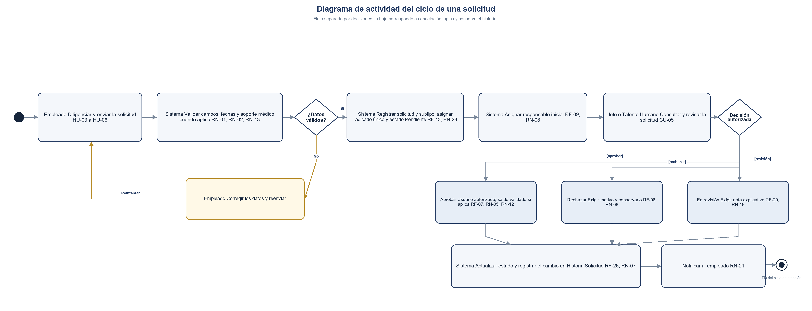
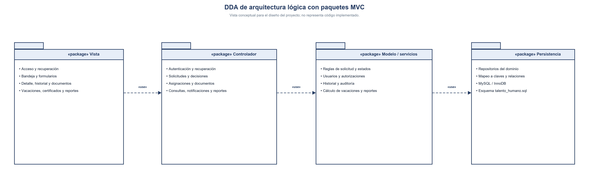
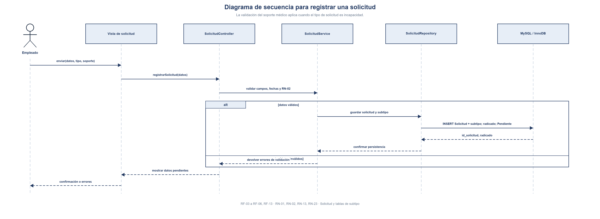
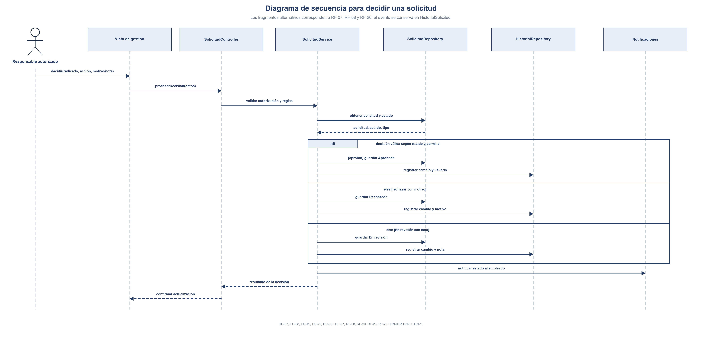
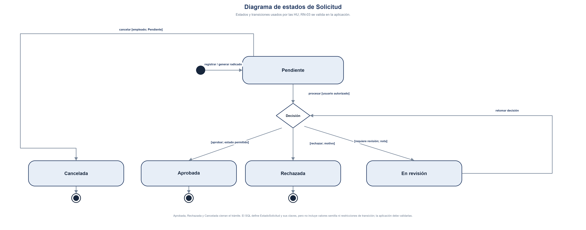

# 2.4 Diseño Conductual y Arquitectura en Paquetes MVC

**Proyecto:** Sistema de Gestión de Solicitudes de Talento Humano — Nexa Servicios  
**Fase:** Fase 3 — Diseño  
**Fuente:** Documento Definitivo Aprobado (*Nexa servicios talento humano definitivo actual.docx*)  

---

### 16.6 Diseño conductual y paquetes MVC

Los siguientes diagramas presentan el flujo, la arquitectura lógica en paquetes MVC, las interacciones de registro y decisión y los estados de una solicitud. Se vinculan con requisitos y reglas ya documentados; son diseños conceptuales y no afirman que exista código implementado.

#### Figura 27. Diagrama de actividad del ciclo de una solicitud.

Trazabilidad: HU-03 a HU-04, HU-15, HU-18; RF-03 a RF-09, RF-13, RF-20, RF-23 y RF-26; RN-01 a RN-08, RN-13, RN-16, RN-21 y RN-23.

#### Figura 28. DDA de arquitectura lógica con paquetes MVC.

Trazabilidad funcional: CU-01 a CU-14. Vista conceptual del diseño MVC; los paquetes no implican que sus componentes estén implementados.

#### Figura 29. Diagrama de secuencia para registrar una solicitud.

Trazabilidad: HU-03; RF-03 a RF-06 y RF-13; RN-01, RN-02, RN-13 y RN-23; persistencia de Solicitud y del subtipo aplicable.

#### Figura 30. Diagrama de secuencia para decidir una solicitud.

Trazabilidad: HU-04, HU-15, HU-18; RF-07, RF-08, RF-20, RF-23 y RF-26; RN-03 a RN-07, RN-16 y RN-21; evento en HistorialSolicitud.

#### Figura 31. Diagrama de estados de Solicitud.

Trazabilidad: HU-04, HU-15, HU-18; RF-07, RF-08, RF-20 y RF-23; RN-03 a RN-07 y RN-16. La transición válida requiere control de permisos y estado.
