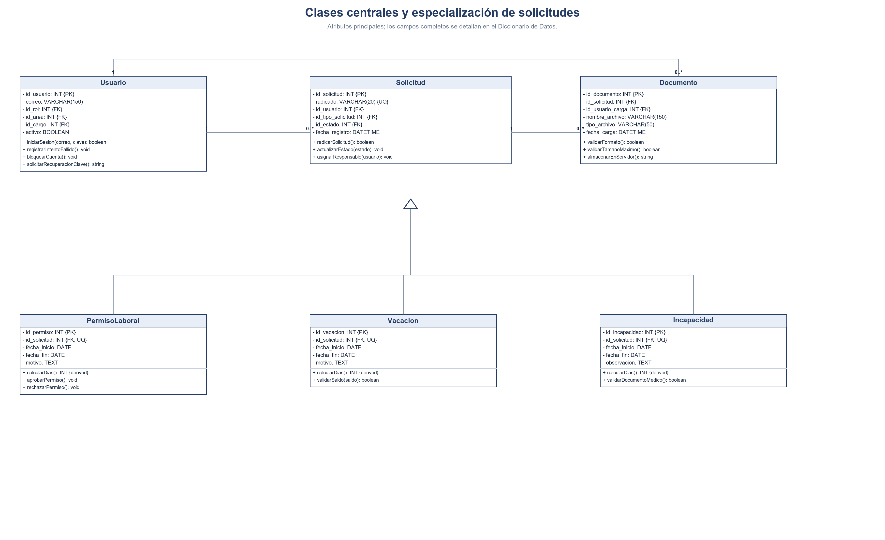
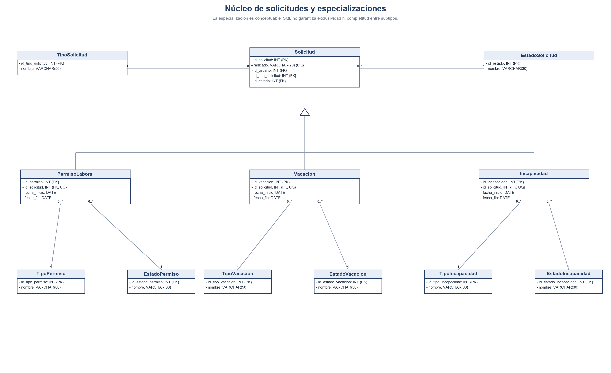
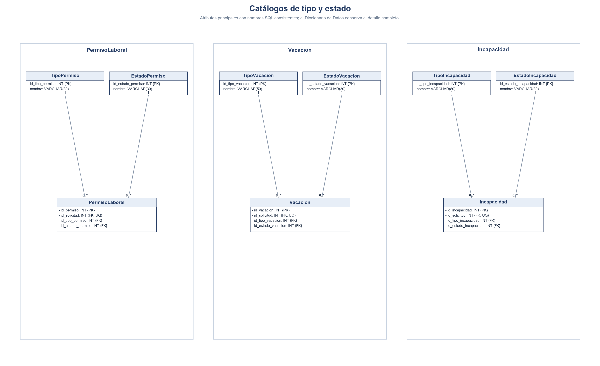
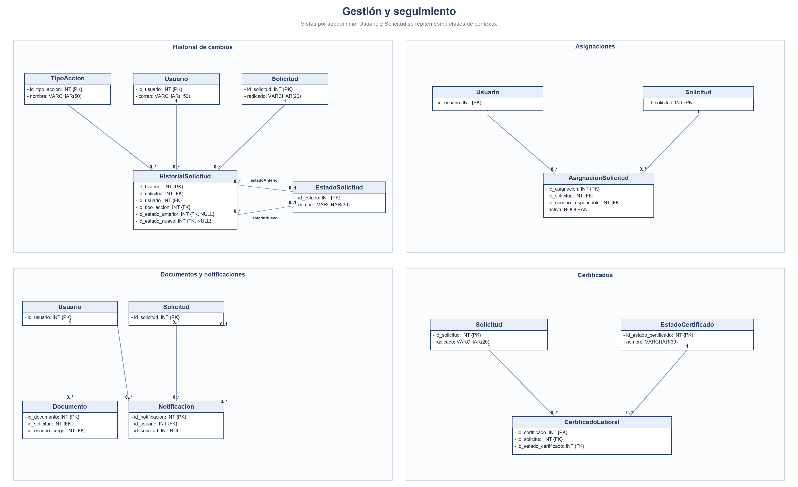
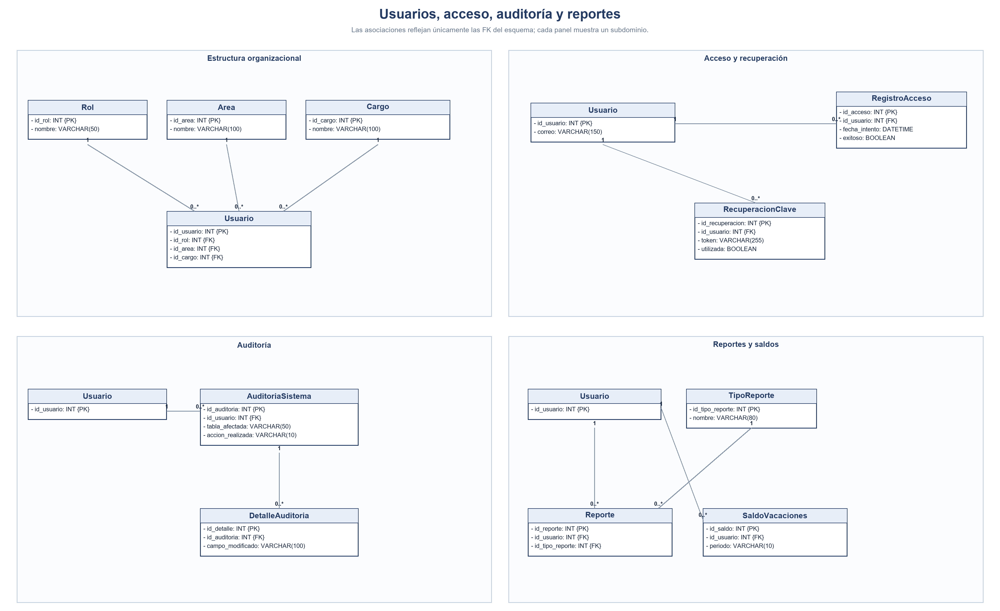

# 3.3 Modelo Orientado a Objetos y Diagrama de Clases UML

**Proyecto:** Sistema de Gestión de Solicitudes de Talento Humano — Nexa Servicios  
**Fase:** Fase 3 — Diseño  
**Fuente:** Documento Definitivo Aprobado (*Nexa servicios talento humano definitivo actual.docx*)  

---

16. Modelo Orientado a Objetos (Diagrama de Clases)

Esta sección integra el paso del modelo de datos relacional al modelo orientado a objetos contenido en el PDF actual, conservando las clases, visibilidad, atributos, métodos y herencia allí definidos.

#### <<Clase>> Usuario

- idUsuario: int

- nombre: string

- apellido: string

- documento: string

- correo: string

- contrasenaHash: string

- activo: boolean

- intentosFallidos: int

- bloqueadoHasta: datetime

- cargo: Cargo

- area: Area

- rol: Rol

+ iniciarSesion(correo: string, contrasena: string): boolean
+ registrarIntentoFallido(): void
+ bloquearCuenta(): void
+ solicitarRecuperacionClave(): string

#### <<Clase>> Solicitud

- idSolicitud: int

- radicado: string

- fechaRegistro: datetime

- estado: EstadoSolicitud

- usuario: Usuario

- documentosSoporte: List<Documento>

+ radicarSolicitud(): boolean
+ actualizarEstado(nuevoEstado: EstadoSolicitud): void
+ asignarResponsable(usuario: Usuario): void

#### <<Clase>> PermisoLaboral

- fechaInicio: date

- fechaFin: date

- motivo: string

- tipoPermiso: TipoPermiso

- estadoPermiso: EstadoPermiso

+ calcularDias(): int <<derived>>
+ aprobarPermiso(): void
+ rechazarPermiso(): void

#### <<Clase>> Vacacion

- fechaInicio: date

- fechaFin: date
- motivo: string

- tipoVacacion: TipoVacacion

- estadoVacacion: EstadoVacacion

+ calcularDias(): int <<derived>>
+ validarSaldo(saldoActual: SaldoVacaciones): boolean

#### <<Clase>> Incapacidad

- fechaInicio: date

- fechaFin: date

- observacion: string

- tipoIncapacidad: TipoIncapacidad

- estadoIncapacidad: EstadoIncapacidad

+ calcularDias(): int <<derived>>
+ validarDocumentoMedico(): boolean

#### <<Clase>> Documento

- idDocumento: int

- nombreArchivo: string

- tipoArchivo: string

- tamanoArchivo: int

- rutaArchivo: string

- fechaCarga: datetime

- usuarioCarga: Usuario

+ validarFormato(): boolean
+ validarTamanoMaximo(): boolean
+ almacenarEnServidor(): string

Diagrama de Clases UML del sistema (núcleo y especialización de solicitudes)

#### Figura 22. Diagrama de Clases UML - Gestión de Solicitudes.

Este diagrama presenta el núcleo de solicitudes y sus especializaciones. Sus atributos y relaciones se contrastan con el Diccionario de Datos y talento_humano-1.sql; la exclusividad entre subtipos permanece como validación de aplicación, porque el script no la impone.

Vistas ampliadas por subdominio del diagrama de clases (30 entidades)

El modelo se presenta en cuatro vistas UML complementarias para facilitar la lectura. Las clases repetidas son referencias a una misma clase lógica; aquí se muestran atributos principales y el Diccionario de Datos conserva el detalle completo.

### 16.1 Núcleo y especialización

Solicitud es una clase concreta que sirve como base conceptual. PermisoLaboral, Vacacion e Incapacidad son especializaciones conceptuales. El SQL no garantiza exclusividad ni completitud entre subtipos.

#### Figura 23. Vista UML del núcleo y la especialización de solicitudes.

### 16.2 Catálogos de tipo y estado

Cada permiso, vacación o incapacidad se vincula con un tipo y un estado propios. Un registro de catálogo puede clasificar varias instancias del subtipo correspondiente.

#### Figura 24. Vista UML de los catálogos de los subtipos.

### 16.3 Gestión y seguimiento

Una solicitud puede tener cero o varios registros de historial, asignaciones, documentos o certificados. Cada notificación se dirige a un usuario y puede vincularse con cero o una solicitud; una solicitud puede asociarse con varias notificaciones. Las referencias al usuario identifican el actor, responsable, destinatario o cargador según el caso.

#### Figura 25. Vista UML del flujo y seguimiento de solicitudes.

### 16.4 Usuarios, acceso y auditoría

Se muestran las relaciones organizacionales del usuario y las entidades de recuperación, acceso, reportes y auditoría.

#### Figura 26. Vista UML de usuarios y servicios de soporte.

### 16.5 Criterios de corrección UML

La operación calcularDias() se define solo en las clases con fechas de inicio y fin: PermisoLaboral, Vacacion e Incapacidad. Solicitud no la declara porque también se relaciona con certificados, que no representan un periodo de ausencia.

• El modelo conceptual representa PermisoLaboral, Vacacion e Incapacidad como especializaciones mutuamente excluyentes. El SQL define UNIQUE(id_solicitud) en cada tabla de subtipo, lo que limita a una fila por subtipo y solicitud, pero no impide que una misma Solicitud aparezca en varias tablas ni exige que aparezca en alguna. La exclusividad y completitud deben validarse en la aplicación o respaldarse con restricciones de esquema adicionales. CertificadoLaboral se vincula con Solicitud para emitir el documento aprobado.

• Las multiplicidades distinguen catálogos compartidos (un tipo o estado para muchas instancias) de registros dependientes (por ejemplo, una auditoría con cero o más detalles).

• Las vistas parciales no duplican entidades del modelo; repiten Usuario, Solicitud y otros elementos solo como anclas de lectura.
